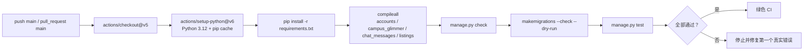

<div align="center">


# .github · 持续集成

**每次推送到 `main` 或提交 Pull Request，都用同一组检查回答：能不能导入、能不能启动、迁移是否一致、测试是否通过。**

[项目首页](../README.md) · [完整项目手册](../docs/README.md) · [模块地图](../docs/module-map.md)

[](https://github.com/strawberry-little-bear/campus_glimmer/actions/workflows/django.yml)

</div>

## 🧭 CI 流水线



工作流定义在 [`workflows/django.yml`](workflows/django.yml)。它只做验证，不自动修改代码、迁移或数据。

## ✅ 本地等价检查

提交前建议运行：

```powershell
python -m compileall -q accounts campus_glimmer chat_messages listings
python manage.py check
python manage.py makemigrations --check --dry-run
python manage.py test
```

如果只改了某一组能力，可以先跑对应测试文件，但推送前仍应至少完成系统检查、迁移检查和全量测试。

## 🔐 修改约定

- 不把令牌、生产密钥或真实用户数据写进 workflow；
- 新增运行依赖时同步更新 `requirements.txt`，CI 不需要第二套依赖清单；
- 调整 Python 版本、Action 版本或测试命令时，先用同一组本地命令验证；
- 失败时优先修复第一个真实错误，不要通过跳过测试、放宽迁移检查或忽略异常来“变绿”；
- 依赖缓存使用 `requirements.txt` 指纹，修改依赖后首次运行会重新安装；
- workflow 当前使用 `actions/checkout@v5` 与 `actions/setup-python@v6`，避免旧 Node 运行时告警。

## 🧯 常见排查

| 失败步骤 | 优先检查 |
| --- | --- |
| 安装依赖 | 版本约束、包名拼写、Python 3.12 兼容性 |
| 语法检查 | 是否有未闭合字符串、导入路径或生成文件缺失 |
| Django 检查 | 环境变量、URL、应用注册和模板配置 |
| 迁移检查 | 模型改动后是否忘记提交迁移 |
| 测试 | 先看第一个失败用例，再判断是否是共享状态或数据库问题 |

## 📚 继续阅读

- [Docker 运行说明](../docker/README.md)
- [Django 项目配置](../campus_glimmer/README.md)
- [完整项目手册](../docs/README.md)
