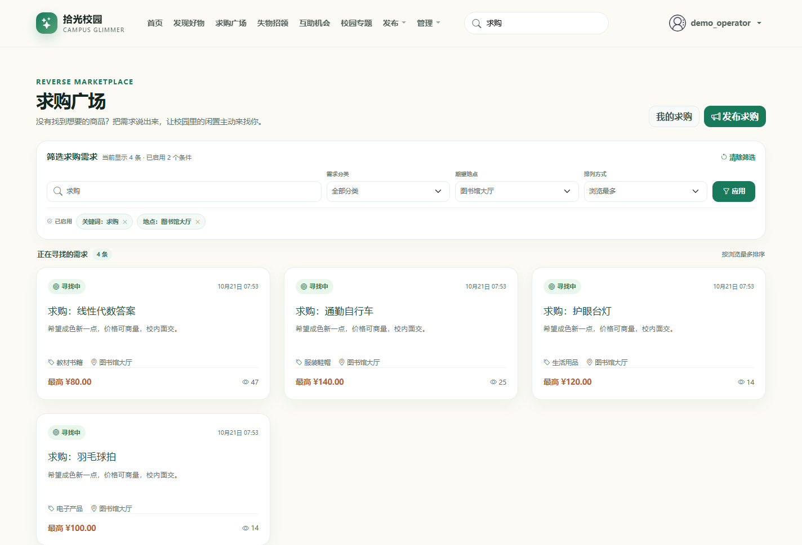
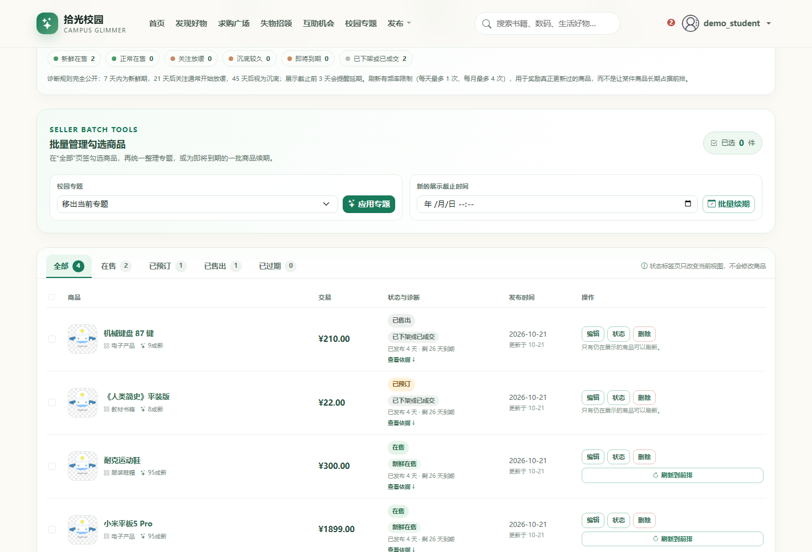
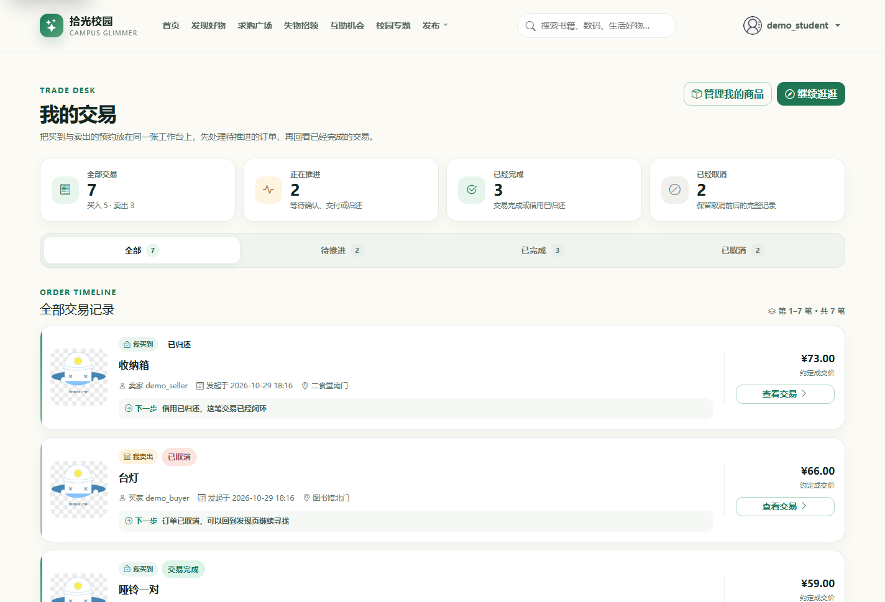
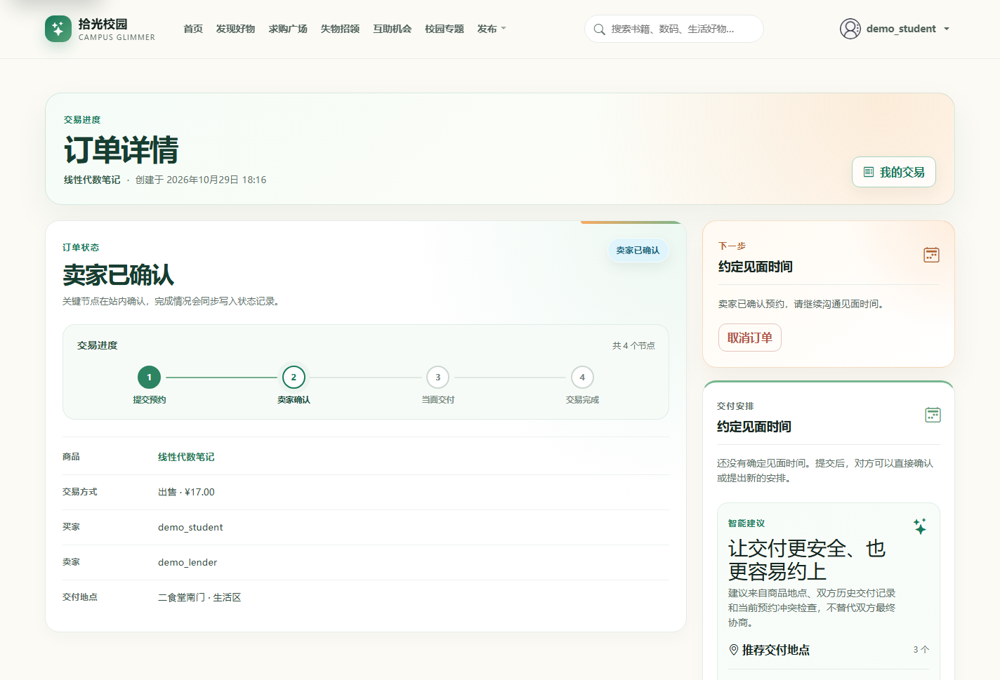
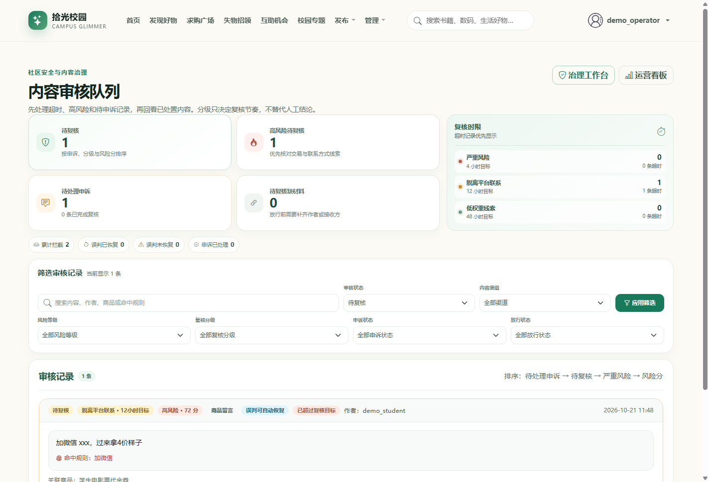
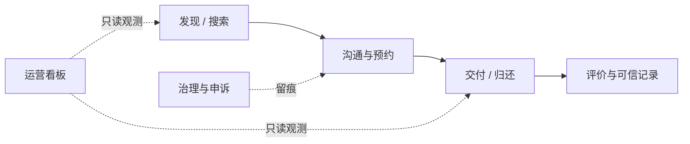

<a id="top"></a>
<div align="center">


# 拾光校园 · Campus Glimmer

**让闲置在校园里继续流转，也让每一次相遇都更有回应。**

面向校园的二手交易与互助协作平台。围绕发布、发现、沟通、预约、交付、
评价和治理，把一次校园交易中容易被忽略的细节连接成可回看的完整链路。

[](https://www.djangoproject.com/)
[](https://www.python.org/)
[](https://github.com/strawberry-little-bear/campus_glimmer/actions/workflows/django.yml)
[](docker-compose.yml)
[](LICENSE)

[产品预览](#preview) · [能力地图](#features) · [快速开始](#quick-start) · [工程与测试](#engineering) · [文档地图](#docs) · [完整手册](docs/README.md)

</div>

---

<a id="preview"></a>
## 📸 产品预览

<p align="center">
  <a href="docs/screenshots/home.png"></a>
</p>

<p align="center"><strong>首页 · 从校园场景进入交易与互助</strong><br /><sub>品牌主视觉、全局入口、未读提醒和正在流转的好物 · 本地演示数据</sub></p>

<table>
<tr>
<td width="50%" valign="top">
<a href="docs/screenshots/discover.png"></a>
<p align="center"><strong>发现好物</strong><br /><sub>分类、价格、成色与校园地点组合筛选</sub></p>
</td>
<td width="50%" valign="top">
<a href="docs/screenshots/item-detail.png"></a>
<p align="center"><strong>商品详情</strong><br /><sub>交易信息、地点、价格参考与操作入口</sub></p>
</td>
</tr>
<tr>
<td width="50%" valign="top">
<a href="docs/screenshots/inbox.png"></a>
<p align="center"><strong>消息工作台</strong><br /><sub>会话整理、未读聚焦、收到与发出视图</sub></p>
</td>
<td width="50%" valign="top">
<a href="docs/screenshots/profile.png"></a>
<p align="center"><strong>账户中心</strong><br /><sub>校园身份、可信资料、贡献进度与活动入口</sub></p>
</td>
</tr>
</table>

<p align="center">
  <a href="docs/screenshots/demands.png"></a>
</p>

<p align="center"><strong>求购广场 · 需求筛选工作台</strong><br /><sub>结果数与已启用条件可读，关键词、分类和地点支持逐项移除 · 本地演示数据</sub></p>

<p align="center">
  <a href="docs/screenshots/my-items.png"></a>
</p>

<p align="center"><strong>我的商品 · 卖家工作台</strong><br /><sub>生命周期诊断、五类状态页签独立分页、专题与续期批量工具和逐件操作集中管理 · 本地演示数据</sub></p>

<p align="center">
  <a href="docs/screenshots/my-orders.png"></a>
</p>

<p align="center"><strong>我的交易 · 买入与卖出总览</strong><br /><sub>待推进、已完成与已取消分栏；统计按全量订单计算，结果每页 10 笔并保留当前筛选 · 本地演示数据</sub></p>

<p align="center">
  <a href="docs/screenshots/order-detail.png"></a>
</p>

<p align="center"><strong>订单详情 · 交易工作台</strong><br /><sub>订单状态、语义化四步进度、下一步动作、交付安排与安全记录保持同一阅读层级 · 本地演示数据</sub></p>

<table>
<tr>
<td width="50%" valign="top">
<a href="docs/screenshots/moderation-queue.png"></a>
<p align="center"><strong>内容审核值班台</strong><br /><sub>四项待办、三级时限与组合筛选同屏，审核动作留在记录原位</sub></p>
</td>
<td width="50%" valign="top">
<a href="docs/screenshots/operations.png"></a>
<p align="center"><strong>运营看板</strong><br /><sub>供给、需求、搜索、交付与告警共用同一套指标口径</sub></p>
</td>
</tr>
</table>

<p align="center"><sub>全部截图来自当前本地页面与演示数据；登录、通知、订单详情、贡献中心、公开档案等更多界面见 <a href="docs/screenshots/README.md">系统界面预览</a></sub></p>

---

## 🧭 这是一个怎样的项目

校园二手交易不是普通电商的缩小版。活动范围集中，交易更依赖当面沟通和时间协调；
商品生命周期会随开学、考试周和毕业季快速变化；平台除了撮合交易，还要处理通知、
举报、内容治理和运营复盘。

拾光校园从“发布一件闲置、找到一个买家”出发，持续补齐交易地点、预约是否有效、
订单进行到哪一步、消息是否被看到、问题由谁处理，以及运营者如何理解站内真实需求。
项目按真实业务链路长期迭代：一个功能通常会经过场景设计、数据模型、页面交互、权限边界、
数据库迁移、后台运营和自动化测试，再进入主分支。

> **当前状态：** 持续维护中。核心交易、消息通知、社区治理、专题运营和运营看板已形成闭环；
> 近期迭代重点放在账户与消息工作台、移动端体验、界面一致性和生产环境可靠性。

<table>
<tr>
<td width="50%" valign="top">
<h3>🛍️ 校园交易闭环</h3>
<p>出售、赠送、借用、求购与失物招领共用一条清晰的发布和发现入口；商品与求购发布/编辑页提供分段填写、进度提示和响应式单列布局，预约、交付、归还、评价与争议都有对应状态。</p>
</td>
<td width="50%" valign="top">
<h3>🔎 搜索与供需判断</h3>
<p>组合筛选、关注的搜索、价格轨迹、推荐反馈和供需信号，让“有没有人需要”不再只靠感觉判断。</p>
</td>
</tr>
<tr>
<td width="50%" valign="top">
<h3>💬 消息与社区治理</h3>
<p>留言、私信、通知、未读提醒、通知偏好、举报回访与内容申诉连接起每一次互动，并保留处理边界；登录注册、资料编辑、发布、消息、交易以及举报审核、争议和预约异常处置等关键表单的错误与帮助信息都支持键盘与读屏访问。</p>
</td>
<td width="50%" valign="top">
<h3>📊 运营与基础设施</h3>
<p>专题目标、用户漏斗、运营告警、定时任务、PostgreSQL、Redis、对象存储与备份恢复共同支撑长期运行。</p>
</td>
</tr>
</table>

### 一条交易如何走完

<p align="center">
  <strong>发布</strong> → <strong>发现</strong> → <strong>沟通</strong> → <strong>预约</strong> → <strong>交付</strong> → <strong>评价</strong> → <strong>治理</strong>
</p>

出售、免费赠送和限期借用会在预约之后进入不同状态分支；求购匹配和失物招领是两条并行支线。
完整流程图见[校园交易闭环](docs/business-flow.svg)，规则与边缘情况见[功能手册](docs/feature-handbook.md)。

> **运营纪律：** 看板与治理工作台只读消费业务事实，不自动修改交易状态。
> 指标会明确样本、分母、周期和缺失值，避免用不可解释的数字替代判断。

---

<a id="features"></a>
## 🗺️ 功能地图

功能按九条业务链路组织。下面只保留能力概览，完整规则、指标口径和边缘情况从
[功能手册](docs/feature-handbook.md)进入。

| 业务链路 | 现在能做什么 |
| :--- | :--- |
| 🛍️ **商品发布与校园地点** | 分区发布 / 编辑工作台、出售 / 赠送 / 借用、多图预览、地点、刷新额度、批量发布与学期续期 |
| 🔎 **搜索、保存与推荐** | 组合筛选、关注的搜索、价格轨迹、推荐反馈、机会流与供需信号 |
| 🧭 **失物招领与智能匹配** | 可解释筛选工作台、失物 / 招领线索、匹配确认、领取反馈与结果回访 |
| 📦 **交易预约与订单状态** | 预约、改期、交付确认、借用归还、评价、争议与逾期催收 |
| 💬 **私信、留言与通知中心** | 会话、未读提醒、偏好、汇总降噪、单条与批量延后和恢复 |
| 🛡️ **社区治理与后台处理** | 举报与争议分页处理、可解释优先级、风险分级、内容申诉与误判放行 |
| 📈 **运营看板与运营告警** | 供给、需求、搜索、交付、治理、通知、推荐、任务台账和专题目标节奏 |
| 🎓 **校园身份与可信交易** | 校园邮箱认证、公开档案、安全提示与确认记录 |
| 🎪 **校园专题与个人足迹** | 专题浏览、加入与退出、参与区间、目标进度、严格用户漏斗、已结束专题对比和运营导出 |

**专题详情商品区**按创建时间和主键稳定倒序分页，每页 12 件；顶部“当前在售”始终展示全量计数，非法页码回到第一页、越界页码收敛到末页。加入、退出和摘要设置保留当前页码，操作后回到 `#campaign-items`。

**个人历史、专题足迹与领取申请**统一使用服务端分页：最近浏览每页 24 件；我的领取申请、发布者管理队列和专题历史参与每页 12 条。专题当前参与始终显示，历史按退出时间倒序分页；申请按待处理、已选中、未选中、已撤回的业务优先级排序。发布者顶部的待处理数始终按全量计算，专题订阅与退出、申请撤回都会安全回到原页码。

### 业务主线与旁路



出售、免费赠送和限期借用会在预约后进入不同状态分支；求购匹配与失物招领是两条并行支线。
完整流程图见[校园交易闭环](docs/business-flow.svg)，业务规则见[功能手册](docs/feature-handbook.md)。

---

## 🧱 技术栈

| 层次 | 当前方案 |
| :--- | :--- |
| Web | Django 5.1+ · Django Templates · 轻量 JavaScript |
| 数据 | SQLite（本地默认）· PostgreSQL 16（生产） |
| 缓存 | LocMem（本地默认）· Redis 7（生产，含 `cached_db` 会话） |
| 文件存储 | 本地 `media/`（开发）· S3 / MinIO（生产） |
| 图片 | Pillow · EXIF 方向 · WebP 重编码 · 缩略图与响应式候选 |
| 部署 | Docker Compose · Gunicorn · WhiteNoise · `/healthz/` 与 `/readyz/` |
| 备份 | PostgreSQL custom dump · S3 对象镜像 · SHA-256 校验 · 增量恢复 |
| 质量 | GitHub Actions · PostgreSQL/Redis 集成任务 · Django check · 迁移检查 · 自动化测试 |

项目保持 Django 应用的自然边界：

```text
accounts/         注册、登录、个人资料与校园认证
chat_messages/    留言、私信、内容审核与申诉
listings/         商品、订单、搜索、通知、运营与治理
templates/        页面模板
static/           CSS、JavaScript 与静态资源
docs/             功能、设计、架构和运营文档
```

<p align="center">
  <a href="docs/architecture.svg"></a>
</p>

<p align="center"><sub>应用边界、共享数据事实与运营读取路径 · 点击查看架构图原图</sub></p>

模块、测试和设计文档索引见[模块与测试地图](docs/module-map.md)。

---

<a id="quick-start"></a>
## 🚀 快速开始

### 1. 准备环境

```bash
git clone https://github.com/strawberry-little-bear/campus_glimmer.git
cd campus_glimmer
python -m venv .venv
```

Windows PowerShell：

```powershell
.\.venv\Scripts\Activate.ps1
```

macOS / Linux：

```bash
source .venv/bin/activate
```

### 2. 安装并启动

```bash
python -m pip install -r requirements.txt
python manage.py migrate
python manage.py createsuperuser
python manage.py runserver
```

需要快速准备演示数据时，可在迁移后运行：

```bash
python init_data.py
```

打开 <http://127.0.0.1:8000/> 即可访问。

### 3. 常用页面

| 页面 | 地址 |
| :--- | :--- |
| 首页 | <http://127.0.0.1:8000/> |
| 发现好物 | <http://127.0.0.1:8000/listings/> |
| 搜索 | <http://127.0.0.1:8000/listings/search/> |
| 我的交易 | <http://127.0.0.1:8000/listings/orders/> |
| 我的心愿单 | <http://127.0.0.1:8000/listings/favorites/> |
| 关注的搜索 | <http://127.0.0.1:8000/listings/saved-searches/> |
| 消息工作台 | <http://127.0.0.1:8000/messages/inbox/> |
| 通知中心 | <http://127.0.0.1:8000/listings/notifications/> |
| 校园专题 | <http://127.0.0.1:8000/listings/campaigns/> |
| 我的专题足迹 | <http://127.0.0.1:8000/listings/campaigns/mine/> |
| 运营看板 | <http://127.0.0.1:8000/listings/operations/> |
| 管理后台 | <http://127.0.0.1:8000/admin/> |

<details>
<summary><strong>环境变量与本地配置</strong></summary>

复制配置模板：

```bash
cp .env.example .env
```

Windows PowerShell：

```powershell
Copy-Item .env.example .env
```

| 变量 | 作用 | 默认值 |
| :--- | :--- | :--- |
| `DJANGO_SECRET_KEY` | Django 密钥，生产环境必须替换 | 本地开发占位值 |
| `DJANGO_DEBUG` | 是否开启调试模式 | `1` |
| `DJANGO_ALLOWED_HOSTS` | 允许访问的域名，逗号分隔 | `127.0.0.1,localhost,testserver` |
| `DJANGO_CSRF_TRUSTED_ORIGINS` | 反向代理场景下的可信来源 | 空 |
| `DJANGO_DB_PATH` | 本地 SQLite 数据库文件路径 | `db.sqlite3` |
| `DJANGO_DATABASE_URL` | 生产 PostgreSQL 连接串 | 空（使用 SQLite） |
| `DJANGO_CACHE_URL` | 生产 Redis 连接串 | 空（使用 LocMem） |
| `DJANGO_STORAGE_BACKEND` | `filesystem`、`s3` 或 `minio` | `filesystem` |
| `DJANGO_S3_*` | bucket、endpoint、凭据与浏览器侧签名端点 | 空 |
| `DJANGO_SECURE_SSL_REDIRECT` | 是否强制跳转 HTTPS | `0` |
| `DJANGO_SESSION_COOKIE_SECURE` | 是否只通过 HTTPS 发送会话 Cookie | `0` |
| `DJANGO_CSRF_COOKIE_SECURE` | 是否只通过 HTTPS 发送 CSRF Cookie | `0` |
| `DJANGO_SECURE_HSTS_SECONDS` | HSTS 的 max-age 秒数 | `0` |
| `DJANGO_EMAIL_BACKEND` | 邮件后端 | DEBUG 时使用 console |

</details>

---

## 🐳 Docker 与部署

```bash
docker compose up --build
```

访问 <http://127.0.0.1:8000/>。容器默认使用 SQLite，数据库和上传文件分别通过
`campus_data`、`campus_media` 数据卷持久化。

```bash
docker compose down
```

仅在确认不需要保留数据后执行：

```bash
docker compose down -v
```

镜像内置健康检查：

- `/healthz/`：存活检查，确认 Django 进程可以处理请求；
- `/readyz/`：就绪检查，验证 PostgreSQL、Redis 和 S3/MinIO，失败时返回 `503`。

本地 Compose 继续使用 SQLite 与本地媒体文件。需要 PostgreSQL、Redis、MinIO 和定时备份时，使用 [生产编排](docker-compose.prod.yml)：

```bash
cp .env.production.example .env.production
# 替换所有 CHANGE_ME，并保证数据库/Redis 密码与连接串一致
docker compose --env-file .env.production -f docker-compose.prod.yml up -d --build
```

<details>
<summary><strong>生产部署检查清单</strong></summary>

- 替换 `DJANGO_SECRET_KEY`，关闭调试模式并配置允许域名；
- 配置 PostgreSQL、Redis、MinIO 或等价托管服务，生产启动会拒绝占位配置；
- `DJANGO_S3_PUBLIC_ENDPOINT_URL` 必须是浏览器可访问的域名或端口；
- 启用 HTTPS 后配置安全重定向、Session/CSRF Cookie 和可信来源；
- 域名与回滚窗口确认后再设置 `DJANGO_SECURE_HSTS_SECONDS`；
- 将备份复制到独立主机或对象存储，并定期做恢复演练；
- 不提交生产数据库、上传文件、密钥或包含用户隐私的日志；
- 当前生产编排是单机、小规模基线，不提供自动故障转移或异地容灾。

详细步骤见[生产部署基线](docs/production-deployment.md)与[备份恢复](docs/backup-restore.md)。

</details>

---

<a id="engineering"></a>
## 🧪 工程与测试

提交前建议运行：

```bash
python -m compileall -q accounts campus_glimmer chat_messages listings
python manage.py check
python manage.py makemigrations --check --dry-run
python manage.py test
git diff --check
```

GitHub Actions 在推送到 `main` 或提交 Pull Request 时执行语法检查、Django check、
迁移一致性检查和完整测试集。四个任务分工不同：`quality` 在 SQLite 下跑完整业务测试，
`production-deps` 用 PostgreSQL 16 与 Redis 7 再跑一遍，`object-storage` 在 runner 上启动
MinIO，对对象存储做真实上传、签名 URL 与备份恢复验证；`backup-restore` 把数据库 dump 灌进
一个全新的隔离库逐表比对，并用不匹配的客户端版本验证护栏会拦。目标不是只看“能启动”，
而是让每次迭代都能独立验证和回溯。

### 定时任务

周期任务统一封装成 Django management command，可接入 cron、系统计划任务或容器调度。

| 命令 | 用途 | 建议 |
| :--- | :--- | :--- |
| `process_order_timeouts` | 预约超时、归还提醒与逾期催收 | 周期性运行 |
| `expire_items` | 下架到期商品并通知发布者 | 每日运行 |
| `send_operations_digest` | 生成管理员运营告警日报 | 按统计周期运行 |
| `send_opportunity_digest` | 发送互助机会摘要 | 每日运行 |
| `send_saved_search_digest` | 发送关注搜索汇总 | 按日 / 周运行 |
| `send_campaign_update_digest` | 发送校园专题上新摘要 | 按日 / 周运行 |
| `send_lifecycle_reminders` | 发送商品生命周期提醒 | 每日运行 |
| `sync_academic_calendar` | 补齐学期阶段并刷新快照 | 开学前与每周运行 |
| `backfill_item_thumbnails` | 回填历史图片变体和宽高 | 上线辅助、分批运行 |

参数、幂等边界和运行台账见[后台与定时任务](docs/scheduled-tasks.md)。

### 权限与安全

- 普通用户只能编辑自己的商品，查看和操作自己参与的订单、私信、通知与收藏；
- 管理员可以处理治理事项，但不能绕过服务端权限检查代替用户完成交易操作；
- 项目默认启用 `nosniff`、`Referrer-Policy`、`Cross-Origin-Opener-Policy`、
  `X-Frame-Options` 和 HttpOnly Cookie；
- 生产环境的 400、权限不足、CSRF 校验失败、404 与 500 页面使用同一套品牌化错误体验：
  说明发生了什么、给出安全返回路径，不展示异常文本、堆栈或用户数据；500 页面使用独立静态外壳，
  避免数据库或会话异常时再次级联失败；
- 订单创建使用事务和锁，争议证据、通知读取、运营数据和订单操作均在服务端校验身份。

详细边界见[当前取舍与边界](docs/product-boundaries.md)。

---

## 🗓️ 后续路线图

- **供给侧与提醒**：完善刷新台账覆盖和生命周期提醒效果；
- **搜索、供需与机会流**：补齐空结果诊断、需求承接和推荐解释；
- **交易、交付与借用**：强化交付异常、归还质量、催收效果和安全确认；
- **治理与通知**：继续做治理分组、申诉质量和通知降噪；
- **校园场景与信任**：完善认证体验、可信档案和地点维护；
- **运营与数据质量**：加强导出一致性、样本审计、指标血缘和告警；
- **基础设施与体验**：补齐多实例迁移、集中日志、监控告警、异机备份与恢复演练；继续优化移动端、无障碍和图片加载。

每个方向都拆成可独立验证、独立回滚的小迭代。详细待办、已落地范围和不做某项功能的理由见
[后续路线图](docs/roadmap.md)。

---

<a id="docs"></a>
## 📚 文档地图

| 想了解什么 | 从这里开始 |
| :--- | :--- |
| 完整项目说明、系统概览与本地运行 | [完整项目手册](docs/README.md) |
| 九条业务链路的完整规则、指标与边缘情况 | [功能手册](docs/feature-handbook.md) |
| 核心 ORM 模型、关键字段与约束 | [核心数据模型](docs/data-model.md) |
| 代码模块、测试与设计文档索引 | [模块与测试地图](docs/module-map.md) |
| 周期任务、幂等边界与运行台账 | [后台与定时任务](docs/scheduled-tasks.md) |
| PostgreSQL、Redis、对象存储与生产启动 | [生产部署基线](docs/production-deployment.md) |
| 备份内容、校验、保留与恢复演练 | [备份与恢复](docs/backup-restore.md) |
| 专题目标、严格漏斗与跨专题样本口径 | [专题目标与转化漏斗](docs/campaign-goals-funnel-design.md) |
| 举报与争议队列的分页、排序与全量统计 | [治理队列分页设计](docs/governance-queue-pagination-design.md) |
| 400 / 403 / 404 / 500 与 CSRF 错误页的恢复路径和隐私边界 | [品牌化错误体验设计](docs/error-experience-design.md) |
| 浏览足迹、专题历史与免费领取申请队列的分页边界 | [个人队列分页设计](docs/personal-queue-pagination-design.md) |
| 学期阶段、统计快照与交易高峰 | [学期日历与交易高峰](docs/academic-calendar.md) |
| 当前取舍、隐私边界与实现纪律 | [当前取舍与边界](docs/product-boundaries.md) |
| 后续方向与拆分原则 | [后续路线图](docs/roadmap.md) |
| 系统界面与截图维护 | [系统界面预览](docs/screenshots/README.md) |
| 按源码目录了解模块 | [目录级 README 索引](docs/README.md#directory-readmes) |
| 具体功能的设计过程与历史取舍 | [`docs/` 设计说明](docs/) |

README 只保留项目级入口，详细口径继续在深文档中维护。这样新增能力时不必反复拉长首页，
也不会把长期积累的设计理由混进快速说明。

---

## 🤝 参与开发

欢迎提出具体的校园交易场景，也欢迎提交代码、测试、设计和文档改进。适合的贡献方向包括
搜索与推荐、交易安全、治理、通知、移动端、无障碍、部署、监控和运营分析。

建议的提交方式：

1. 先说明要解决的使用场景和受影响的业务链路；
2. 将一个独立功能的模型、页面、权限、测试和文档放在同一组改动中；
3. 提交前运行本地检查和测试；
4. 使用清晰的中文提交信息，保持每个提交可独立理解和回溯；
5. 不提交本地数据库、上传文件、密钥或临时调试产物。

<div align="center">

---

**拾光校园 · 让闲置流转，让好物遇见对的人。**

[返回顶部](#top) · [MIT License](LICENSE)

</div>
