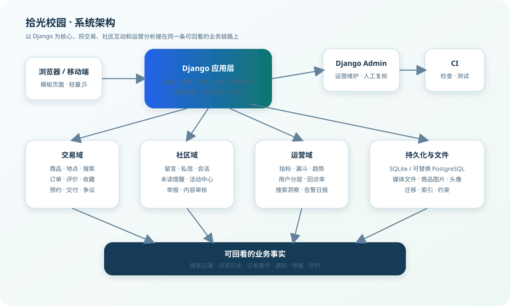
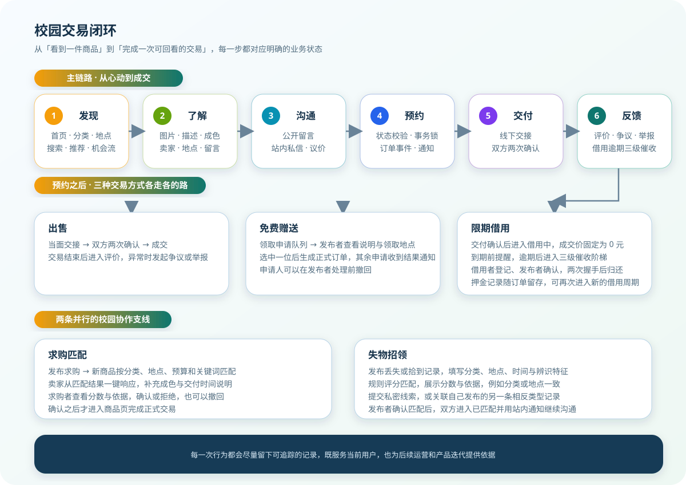

   # 拾光校园 · Campus Glimmer

> 让闲置在校园里继续流转，也让每一次相遇都更有回应。

[](https://www.djangoproject.com/)
[](https://www.python.org/)
[](https://github.com/strawberry-little-bear/campus_glimmer/actions/workflows/django.yml)
[](LICENSE)

拾光校园（Campus Glimmer）是一个面向校园生活的二手交易与社区协作项目。它从“发布一件闲置、找到一个买家”的小闭环出发，逐步补齐校园交易中经常被忽略的细节：在哪里交付、如何沟通、预约是否有效、交易进行到哪一步、消息是否被看到、问题由谁处理，以及运营者如何了解站内真实需求。

项目不是一次性推倒重做的演示页面，而是按真实业务链路持续演进的 Django 项目。每次迭代尽量同时考虑数据模型、页面交互、权限边界、数据库迁移、后台运营和自动化测试，让新增能力能够自然地接入原有系统。

## 目录

- [项目定位](#项目定位)
- [系统概览](#系统概览)
- [功能模块](#功能模块)
- [典型业务流程](#典型业务流程)
- [运营数据闭环](#运营数据闭环)
  - [闭环的最后一环：动作有没有用](#闭环的最后一环动作有没有用)
- [学期日历与交易高峰](#学期日历与交易高峰)
- [项目结构](#项目结构)
- [核心数据模型](#核心数据模型)
- [治理工作台](#治理工作台)
- [权限与安全边界](#权限与安全边界)
- [本地运行](#本地运行)
- [配置说明](#配置说明)
- [Docker 运行](#docker-运行)
- [后台与定时任务](#后台与定时任务)
- [定时任务运行台账](#定时任务运行台账)
- [测试与持续集成](#测试与持续集成)
- [当前取舍与边界](#当前取舍与边界)
- [后续路线图](#后续路线图)
- [参与开发](#参与开发)
- [License](#license)

## 项目定位

校园二手交易和普通电商并不完全相同。校园用户通常在相对有限的地理范围内活动，交易更依赖当面沟通和时间协调；商品生命周期短，供需变化快；用户既是买家，也是卖家、内容参与者和社区成员。因此，项目将“商品列表”作为入口，但不把系统目标局限在商品 CRUD：

- 对用户，重点是降低从发现商品到完成交易的沟通成本；
- 对交易双方，重点是提供可追踪的预约、状态和交付确认；
- 对社区，重点是保留通知、举报、内容审核和争议处理的入口；
- 对运营者，重点是把搜索、浏览、收藏、预约和完成交易等行为整理成可解释的指标；
- 对项目本身，重点是用小步、可回溯的独立提交持续迭代，而不是一次性堆叠大量改动。

## 系统概览

下面的架构图描述当前项目的主要边界。图中“运营看板”和“站内通知”使用同一套业务数据，但通过权限和通知偏好隔离普通用户与管理员能力。



### 技术栈

| 层次 | 当前方案 | 说明 |
| --- | --- | --- |
| Web 框架 | Django 5.1+ | URL 路由、视图、模板、表单、认证和管理后台 |
| 编程语言 | Python 3.11+ | 业务逻辑、数据统计、管理命令和测试 |
| 数据库 | SQLite（默认） | 适合本地开发、演示和轻量部署；生产环境可替换 |
| 页面层 | Django Templates + 静态资源 | 服务端渲染为主，未读提醒和部分筛选交互使用轻量 JavaScript |
| 文件存储 | 本地 media 目录 | 商品图片和头像；容器运行时使用独立数据卷 |
| Web 服务 | Django 开发服务器 / Gunicorn | Docker 镜像默认使用 Gunicorn |
| 自动化 | GitHub Actions | 语法检查、Django 系统检查、迁移检查和测试 |

## 功能模块

### 1. 商品发布与校园地点

- 发布、编辑、删除商品，支持标题、描述、价格、分类、成色和多图上传；
- 商品状态覆盖“在售、已预订、已售出、已过期”等主要阶段；
- 支持“出售”“免费赠送”和“限期借用”三种交易方式，免费商品不会以 0 元伪装成普通商品，而是在列表、详情、领取申请和订单中使用明确的免费语义；
- 限期借用商品可以设置借用天数和押金记录，成交价固定为 0 元，交付确认后进入“借用中”，到期前和逾期后分别发送提醒；
- 借用归还需要借用者登记、发布者确认，双方完成确认后订单进入“已归还”，商品重新开放借用；同一件物品可以保留历史借用订单并再次进入新的借用周期；
- 免费赠送采用独立的领取申请队列：申请不会立即锁定商品，发布者可以查看申请说明和领取地点，选中一位同学后再生成正式订单，其余申请会收到结果通知；申请人也可以在发布者处理前撤回申请；
- 支持为商品设置可选的展示截止时间，到期后自动从公开商品流和推荐结果中隐藏，并由维护命令将商品状态更新为“已过期”；
- 卖家可以编辑已过期商品并设置新的未来截止时间，系统会自动重新上架，避免毕业季、短租和临时清仓商品长期占据列表；
- 商品可以绑定已配置的校园地点，包括校区、楼栋和更具体的交易说明；
- 支持按关键词、分类、地点、成色和价格区间组合筛选；
- 支持按最新发布、价格和相关度排序，并提供分页；
- 商品详情展示卖家资料、地点、留言、收藏状态、相近商品和可用的交易操作；
- 出售类商品会显示价格参考卡：基于近 180 天同类商品的价格分位数给出常见区间、中位数和参考可信度，并结合浏览、收藏和进行中预约展示需求热度；
- 价格参考使用可解释的站内统计，不自动改价、不承诺成交，也会在样本不足时降低提示强度；
- 用户可以收藏商品，也可以对暂时不可用的商品开启有货提醒；
- 首页提供分类入口、热门地点、最新商品和基于可解释信号的推荐；
- 校园地点可以标记为公共交付区域，并补充开放时间、照明、门禁等安全提示，供交付推荐使用。
- 管理员可以在运营看板查看按校园地点聚合的供需热力：当前在售、周期新增、有效求购、预约和完成交易会形成可解释的地点活跃度与供需压力，不采集用户实时位置。
- 管理员可以配置有开始和结束时间的校园专题，例如毕业季清仓、教材交换周；发布者可以在发布商品时加入已启用专题，用户从专题页集中浏览当前在售商品。
- 发布者可以在“我的商品”中批量将多件商品加入或移出专题，服务端只更新当前用户拥有的商品，并通过事务保证批量操作的一致性。
- 运营看板会按专题时间窗口聚合新增商品、当前在售、曝光、收藏、预约和完成交易，并给出浏览转预约、收藏转预约和预约完成率等转化指标；
- 对浏览较多但没有预约、或专题尚未形成供给的活动，系统会生成可解释的运营提示，帮助运营者决定是补充商品、优化描述，还是调整活动组织方式。

> 当前“就近”是基于校园地点数据的筛选，不依赖 GPS，也不会把用户实时位置上传到服务端。这样更适合校园内的固定交易点，也为后续增加距离、时间段或校区偏好留下扩展空间。

- 卖家可以在“我的商品”里看到每件商品的生命周期诊断，把“发布了多久”拆成新鲜在售、正常在售、关注放缓、沉底较久、即将到期、已下架或已成交几种状态；
- 诊断同时给出该商品的浏览、收藏、预约记录和距上次刷新的天数，卖家能判断问题是出在定价、图片还是商品已经沉到底部；
- 商品支持“刷新”操作，用于把仍在售的商品重新带回列表前排，刷新间隔和每月次数都有限制，避免靠频繁刷新长期霸占首页；
- 刷新节奏由后台按 24 小时最小间隔和每月 4 次上限控制，超出额度时页面会说明原因，而不是静默失败。
- 系统会定期把需要处理的商品合并成一条站内提醒发给卖家，未读时会在导航栏显示，不需要卖家记得主动去查；
- 提醒分两类：一类是商品进入“关注放缓 / 沉底较久 / 即将到期”需要决策，另一类是久未成交且价格高于同类常见区间时给出可参考的同类区间；
- 两类提醒按卖家合并，同一个卖家一次只会收到一条，列出条数有上限，其余折叠为“另有 N 件”；
- 提醒带冷却期，同类提醒在冷却期内不会重复发送；免打扰时段内只推迟发送，不会消耗冷却额度，也不会漏发；
- 价格提醒只引用真实存在的同类商品区间，没有足够样本时不给建议，也不会把“久未成交”直接等同于“应该降价”。

### 2. 搜索、保存与推荐

- 全局搜索支持关键词、分类、校园地点、成色和价格条件；
- 搜索框支持基于历史搜索、分类和地点的联想建议；
- 搜索词、筛选条件和结果数量会以结构化记录保存，用于分析供需缺口；
- 用户可以保存搜索条件，并在后续查看或启用、停用保存的搜索；
- 保存的搜索支持三种提醒节奏：即时提醒、每日汇总和每周汇总，无需重建关注即能切换；
- 汇总节奏会把缓冲区里的命中合并成一条通知，并可以限制单条最多列出几件商品，剩余命中以“另有 N 条未展示”提示；
- 汇总通知会写入命中原因（关键词、分类、地点、成色、价格），让用户知道为什么这条条件触发了提醒；
- 关注搜索支持设置临时静默时间，适合考试周或假期暂时不需要提醒；静默期间命中仍然会进入缓冲区，不会丢失；
- 关注搜索页会展示每条关注的待提醒数和当前命中数，方便判断是否需要放宽条件；
- 「当前命中」这一项是可点的：它把这组条件原样带回发现页重跑一遍，让人看到底是哪些商品在售——这个数是实时口径，逐件比对当前在售商品得出的，点了就必须对得上；
- 「待提醒」保持纯数字，不做成链接：缓冲里的命中可能已经下架、过期或卖掉，做成链接只会给出点不到的商品；
- 保存筛选条件成功后，提示里直接带一条通往「关注的搜索」的链接，不必靠用户自己猜路径；用户菜单里也能随时进入这一页调整提醒节奏、暂停或临时静默；
- 从汇总节奏切回即时提醒时，等待中的命中会立即补送一条，不会抄到下一次计划任务；
- 缓冲区使用“关注 + 商品”唯一约束，同一件商品重复发布不会产生重复命中记录；
- 运营看板上会统计「一条命中等了多久才送到」：命中时刻和送达时刻两个字段一直在写，但差值从来没有被算过，现在日度和周度各出一套等待分布；
- 等待一律按天分档，不按小时——一次汇总等待的时间尺度是天，报「平均等了 31 小时」对一个按周运转的节奏没有意义，而「平均等了 1.3 天」立刻能看出日度正常、周度偏慢；
- 日度和周度各用自己的一套阈值，不合成一个平均数：日度拖过一天是异常，周度拖过一周才值得看，合成一个平均数会把两者的差异抹平，而那正是要动作的地方；
- 时延和商品是否还可交易按档交叉，这是这个模块真正的价值所在：如果每一档的不可交易率都差不多，说明等待不是原因，该去查条件是不是太宽；如果后几档明显更高，说明等待本身就是原因，该去调汇总节奏；
- 「送达时商品已不可交易」这一栏是高估：商品状态只能按当前状态回看，送达之后商品仍可能被下架或卖出，历史状态没有记录，所以一条发得很及时、但商品在送达之后才卖掉的命中也会被算进来——宁可高估，因为运营看到高估的数字会去核实，看到低估的数字会直接相信；
- 还躺在缓冲区里的命中单独数出来，不计入任何等待分布：它们没有送达时刻，是右删失样本，算进分母会让平均等待凭空变短；
- 清单只列「等得久、且商品当前已不可交易」的命中，等得越久的排在越前面，并带上送达时间——要区分的是「这条通知送到的时候东西已经没了」和「东西是在这条通知送到之后才没的」，前者是节奏问题，后者只是正常的交易流转；
- 推荐结果优先使用分类、地点、热度和新鲜度等可解释信号；
- 推荐反馈会被记录，便于后续判断推荐是否真正帮助用户发现商品；
- 搜索运营页可以查看热门搜索、去重用户数、无结果比例和可回到商品列表的跟进入口；
- 搜索洞察页会从同一用户的相邻搜索里挖出「同义词候选」：先搜 A 无结果、紧接着改搜 B 有结果，这种改口行为就是用户自己发现的等价说法，运营确认后即可变成同义词；
- 登录用户可以进入“校园互助机会”，查看平台根据自己仍可交易的商品和有效失物招领记录整理出的帮助机会；
- 用户可以在“互助贡献”页面查看累计积分、当前等级、下一等级进度、已解锁徽章和最近贡献事件；贡献记录只展示自己的可审计摘要，不公开交易对象和私密沟通内容。
- 互助贡献页提供“校园循环影响力”报告入口（`/contributions/impact/`），按最近 6 个月汇总已经完成或完成归还的流转记录；报告展示完成次数、不同物品数、协作同学数、分类 / 地点分布和月度趋势。
- 循环影响分采用公开且可解释的规则计算：完成出售计 8 分、免费赠送计 12 分、借用归还计 10 分；取消、待确认和仍在进行中的订单不会计入，页面也不展示交易金额或交易对象。
- 机会流会复用求购和失物招领的可解释匹配规则，展示匹配分数、分类 / 地点 / 关键词等依据，并提供查看求购、响应需求或查看匹配记录的入口；
- 同一条求购或失物记录只保留最有价值的一条推荐，过期记录、用户自己的求购和失物记录不会进入可响应机会。
- 用户可以对暂时不需要的机会执行“暂不展示”，系统只在推荐层记录 30 天的个性化忽略状态，不修改原始求购或失物招领数据；忽略到期后机会可以重新进入推荐。
- 求购响应和失物招领线索被确认后，发布者可以补充一次“互助完成反馈”，区分“已完成”和“暂未解决”，并选择“按约完成”“沟通顺畅”“信息有帮助”等轻量标签；它与交易星级评价分开，避免把非交易协作强行套进交易评分。
- 完成反馈会通知参与者，并在“已完成”时为帮助者生成幂等的校园互助贡献记录；未解决的反馈也会保留，方便后续运营统计和再次跟进，而不会被错误计入完成次数。

### 3. 失物招领与智能匹配

失物招领不是商品交易的附属页面，而是一条独立的校园协作链路。用户可以发布“我丢失了”或“我捡到了”的记录，平台在不公开敏感联系方式的前提下，帮助双方发现可能的对应关系。

- 记录支持丢失 / 拾到两种方向，并可填写标题、描述、分类、校园地点、发生时间、截止时间和辨识特征；
- 公开列表支持关键词、类型、分类、地点和时间排序筛选，过期记录会自动从公开入口隐藏；
- 系统会对丢失与拾到记录进行轻量规则匹配，综合比较分类、地点、发生时间和描述关键词；
- 匹配结果会展示分数和具体依据，例如“物品分类一致”“发生地点一致”“发生时间相差 3 天内”，避免只给出不可解释的推荐结论；
- 新记录发布后，会向已有高匹配度记录的发布者发送可去重的站内提醒；
- 用户可以向记录发布者提交私密线索，也可以关联自己发布的另一条相反类型记录；
- 记录发布者可以确认或暂不匹配线索，确认后双方记录进入“已匹配”，并通过站内通知继续沟通；
- 线索在确认前只对记录发布者可见，页面明确提示不要公开电话、宿舍号等敏感信息；
- 线索确认后，发布者可以记录互助结果和过程标签；反馈只展示必要的结果摘要，不公开私密联系方式，也不会替代失物归属的人工核验；
- 管理后台可以查看记录、线索、状态和处理时间，方便后续增加审核、举报和校园治理能力。

当前匹配采用可解释的规则评分，不宣称自动确认物品归属。这样既能快速形成实用闭环，也为后续接入更细的图像特征、时间窗口和人工审核留下边界。

### 4. 交易预约与订单状态

- 买家从商品详情发起交易预约；
- 预约创建时校验商品状态，并使用事务和行级锁尽量避免并发预约同一件商品；
- 买卖双方可以在订单详情中推进交易状态；
- 交易确认后可以提出交付时间、结束时间和校园地点，另一方可接受或暂不接受；
- 订单详情会根据商品发布地点、双方历史交付记录和地点使用情况推荐交付地点，并说明推荐依据和安全提示；
- 系统会从未来一周的校园日间时段中筛选双方均无预约冲突的候选时间，优先展示工作日课后和周末等更容易完成当面交付的时段；
- 推荐结果可以一键回填预约表单，但最终地点和时间仍由交易双方协商确认；
- 系统会检查买卖双方当前有效的交付安排，拦截重叠时间段，减少同一用户同时答应多笔交易的爽约风险；
- 每次交付安排都会留下提议人、回应人、时间和状态，重新协商时保留同一订单的可追溯链路；
- 接受交付安排后订单自动进入“待当面交付”，再由双方分别完成交付确认；
- 记录订单事件，保留状态变化和时间线，方便回看交易过程；
- 支持交付确认、评价和交易争议入口；
- 限期借用订单单独记录借用押金、预计归还时间、实际归还时间和双方归还确认状态；借用押金只作为双方线下约定的记录，不由平台代收或自动结算；
- 借用订单在双方完成交付确认后进入“借用中”，系统会发送归还前提醒和逾期提醒；借用者登记归还、发布者确认收到后，商品才会重新回到可借用状态；
- 借用逾期不会只发一条提醒就彻底沉默：逾期 1 天起进入三级催收阶梯，一级只提醒借用方，二级同时告知双方平台已开始记录，逾期满 7 天上报治理工作台；
- 催收阶梯按“逾期了多久”推导当前该在第几级，漏跑一次计划任务下一次会自动追上，不会因为一次故障永久落后一级；
- 同一笔订单两次催收之间至少隔一天，跳级追上来时会补发二级那一声（借出方在这一级才第一次被告知），但不会补播被跳过的一级；
- 平台在催收里只做记录和通知：不自动取消订单、不代扣押金、不给任何人打上失信标记，押金仍由两个同学线下结算；
- 双方确认归还后催收记录立即闭环，等级和升级次数保留下来供回看，但不再计入待办——同学之间的借用不该留下永久污点；
- 交易争议可以由买卖双方补充 JPG、PNG、WebP 或 PDF 证据，平台和交易参与人可以在受保护的下载入口中查看；
- 证据上传会写入订单事件时间线，并向另一方发送站内提醒，方便核实争议发生前后的过程。
- 通过管理命令处理临近超时提醒，并自动释放已经过期的预约；
- 订单详情提供交易安全卡，综合检查商品图片、同类价格、发布者历史履约、校园认证、公共交付地点、预约时段、交付确认码和已确认异常记录；
- 安全卡使用可解释的“提醒 / 注意 / 保障”信号，不阻断正常交易、不展示私密联系方式，只帮助双方在交付前完成必要核对；
- 免费领取申请队列第一次被运营读到：`GiftApplication` 是站内唯一一条“多人竞争、平台只记录不排序”的队列，`applicant_note` 此前唯一的读路径是后台的 `search_fields`，`decided_at` 的读路径只有 `list_display` 和 `list_filter`——两个字段的差值从来没有任何一行代码算过。运营侧此前能回答“有多少份申请”，回答不了“这件免费商品是没人要，还是有 8 个人在等卖家决定”；
- 面板按队列长度分布报“一件免费商品收到了多少份申请”，分母是商品数而不是申请数：一件八人竞争的商品若按申请数走，会在分布里出现八次，“竞争激烈”那一档被同一件商品撑起来，而它其实只是一件商品。只收到一份申请的商品单独一档——一份申请的“选中率”必然是 100%，把它和八份申请的选中率混在一起平均，会得到一件压根不存在的商品；
- 处理时长按 `decided_at - created_at` 报，分“当天内 / 一到三天 / 三到七天 / 超过七天”四档。分母只收 `selected` / `rejected` / `withdrawn` 三种已经处理完的状态；`pending` 没有处理时刻，是右删失样本，单独数出来，不丢也不混——把它算进任何等待分布都会让平均处理时长偏短；
- 申请说明只报填写率和“填了 vs 没填”两组的选中率对照，一个字符的正文都不读：它是自由文本，可能写着电话、微信、楼栋号。两组各自至少 12 份才给方向，差值不满 8 个百分点视为噪声；对照只做对照、不给因果——愿意写一段说明的申请人可能本来就是更认真、更想要的那批人，平台没有能力把“说明起了作用”和“这个人本来就更容易被选中”分开；
- 撤回（`withdrawn`）单独一档，不和“未选中”混在一起：它是申请人自己点的，可能是改主意了，也可能是等太久等不住了，平台没有能力区分这两者，所以只报规模、不给方向；
- 本模块只报告，不给卖家排序、不替卖家推荐申请人、不改任何一条申请的状态：队列现在是按先来后到排的，任何“更该被选中”的排序都是平台在替一个具体的人做决定，而这个决定会直接决定另一个人能不能拿到东西。不催卖家、不给申请人发提醒、不把统计写回任何记录。
- 内容审核规则的误判与漏判第一次被运营读到：`chat_messages/moderation.py` 的四条关键词规则各带一个权重——微信导流 40、外部链接 20、手机号 35、高风险交易 50——命中后相加、封顶 100，再按 60 / 30 切成 high / medium / low。`risk_score` 此前唯一的读路径是模型的 `ordering` 和 `Index`，没有任何一行代码拿它和另一个数比过大小；`matched_terms` 的读路径是后台的 `search_fields` 和审核队列页的一个搜索框，没有人按规则拆开统计过；`reviewed_at` 的读路径只有后台的 `list_filter`，“复核时刻减拦截时刻”这个差从来没有任何一行代码算过。而治理时效视图早已为商品举报、交易争议、交付预约异常、借用逾期催收四条队列建好，唯独漏了内容审核这一条；
- 于是运营此前能回答“有多少高风险审核在等”，回答不了“规则说高风险的，复核之后真的是高风险吗”。而这套规则全是关键词匹配：“外部链接”只匹配 `https?://` 或 `www.`，一条正常分享课程资料链接的留言会被拦下来，`risk_score` 记 20，躺在队列里和真的导流内容排在一处；
- 分母只收已经复核完的记录：`confirmed` 和 `dismissed` 都带 `reviewed_at`，有起止两点；`pending` 没有复核时刻，是右删失样本，单独数出来，不丢也不混——把它算进任何时长分布都会让平均复核时长偏短，一条刚拦下两分钟的内容和一条拦了三周的内容在分母里是同一条，而前者压根还没有开始被复核；
- 按规则拆开，不按风险等级拆开：`matched_terms` 是“、”连接的标签串，一条记录可同时命中多条规则，所以它会同时出现在多个规则组里——这是故意的，要回答的是“微信导流这条规则准不准”，所有命中它的记录都是它的样本。按风险等级拆反而看不出问题，一条 100 分的记录分不出是哪条规则起的作用；
- 误判率与漏判率分开报，不合成一个“准确率”：两个数的分母不一样，合成一个数会把两个问题压成一个说不清的数，而它们指向的动作完全相反——误判率高该去收紧规则，漏判率高该去补规则。误判率高过 15 个百分点才标黄；漏判的代价比误判高，门槛取 10 个百分点；
- 权重只报分布，不重新拟合：记录里只有相加之后的分数，一条 55 分的记录可能是 40 + 20 减 5，也可能是 50 + 20 减 15，从分数反推不出权重组合。所以分数只当参照，它唯一能回答的问题是“高分的档是不是真的更容易确认违规”；
- 渠道分开报，不合并：用户在这两条渠道上写东西的心态完全不同——留言是公开的、写给所有来看商品的人，私信是一对一的、写给另一个同学的。混在一起报会让两边都被稀释；
- 疑似漏判清单只收“确认违规、且命中的规则里没有高风险交易”的记录：高风险交易那一条权重 50，单它一条就能跨过 60 的高风险线；确认违规却只命中外部链接或手机号的记录，说明真正该拦的东西没有对应的规则，那是要补规则的对象。每行只带分数和规则名，一个字符的正文都不读——`content` 是自由文本，可能写着电话、微信、楼栋号；
- 本模块只报告：不改任何一条审核记录、不自动确认或放行、不按 `risk_score` 做任何自动放行、不改 `_RULES` 和权重、不改 60 / 30 的分档阈值。规则是发版本的代码，不是运营可以随手调的参数；而放行一条真的导流内容，代价是另一个同学被骗。复核人的决定是这个队列里唯一的质量标注，本模块只是把它读出来。
- 订单相关通知会根据状态变化、提醒策略和用户通知偏好生成。
- 交易评价的质量第一次被运营读到：`Rating` 是站内唯一一条"一笔交易走完之后，双方各自给对方打一个分"的记录，模型只有 `order`、`rater`、`ratee`、`score`（1-5 星）、`comment`、`created_at` 六个字段，写入路径只有 `views.py` 的 `rate_order`。此前全项目唯一碰 `score` 的地方是 `reputation.py` 算"评价表现良好"徽章，只求一个 `Avg`——没有一处拿 `score` 和另一个数比过大小，也没有一处算过这笔交易有几个人被评价了；
- 缺的是四个从来没人算过的数：一笔交易有几个人被评价了；分打出来之后多久才提交；交易结果和分数有没有关系；写没写文字和打多少分有没有关系。本模块只补这四件事，其余一律不碰；
- 覆盖率的分母只收 `completed` / `returned` 两种状态的订单。`pending` / `confirmed` / `meeting` / `borrowed` 是右删失样本——交易还在走，评价入口本来就还开着，把它们算进分母只会把覆盖率系统性拉低，所以单独数出规模、不混入百分比；
- 订单完成时刻取 `OrderEvent` 里 `to_status` 为 `completed` 或 `returned` 的最早一条 `created_at`，不用 `Order.updated_at`——任何一次保存都会动 `updated_at`，那不是完成时刻。没有完成事件的评价不计入时延分布，单独数出来，也不拿 `order.created_at` 近似：那是下单时刻，用它会把等待系统性拉长；
- 等待时长按天分档（一天内 / 一到三天 / 三到七天 / 七到三十天 / 超过三十天），不按小时——评价是交易结束后的自愿行为，小时级的抖动没有运营含义。未评订单只报规模不报等待时长：它右删失，而且可能跨多个统计周期；
- 评价人数分布的分母是订单数，一笔双方都评的交易只出现一次，不按评价条数展开——否则一个爱评价的用户会把"双方互评率"这个数抬起来；
- 双向评价必须按方向拆开：买家评卖家、卖家评买家、双方都评、只有一方评、双方都没评五类分开报。只报总数会骗人——一个人评了就算"有评价"，运营看到百分之百以为健康，而另一半沉默者恰恰是最该被看见的那批；
- 交付异常只做"有没有"的对照，不给因果：只有 `MeetingIncident.status` 为 `resolved` 的才算，两组各至少十二笔、差值不满八个百分点视为噪声。异常记录只说明这两组人的交易体验不同，不说明分数是异常导致的，更不说明该去改异常处理流程；
- 分数只报六个桶（1 星到 5 星加未评分），不合成任何"好评率"或"满意度"。合成分数会诱导人去优化那个数——把一星投诉改成三星就能把好评率做上去，而一星才是要读的信号。`Avg` 已在 `reputation.py` 报过，这里不重复；
- 自由文本只报填写率、长度分档和"写了 vs 没写"的分数对照，一个字符内容都不读——`comment` 可能写着电话、微信、楼栋号。不切词、不聚类、不抽关键词；
- 交易方式（sale / free / borrow）拆开报不合并：免费领取和借用不涉及付款，打分的参照系和 sale 不同，合并会把两种完全不同的体验平均成一个没有解释力的数；
- 失物招领的线索，有多少条走到了「已确认」，第一次被运营读到。`LostFoundPost` / `LostFoundLead` 是站内唯一一条不经过交易就完成的互助：发布记录、收到线索、确认其中一条、补写互助反馈，四步每一步都在写库，却没有任何一处把它们连起来看过。运营能大概说出「有多少条记录」，四个更接近这个功能好不好用的问题一直答不上来：一条记录平均收到几条线索；确认率按 `post_type` 拆开是多少；确认之后东西找回来了没有；没被确认的线索是被拒了还是被撤回了。本模块只补这四件事；
- “被驳回的线索”必须拆成两类，否则会得出反的结论。`review_lost_found_lead` 的 `accept` 会把同一条记录下其余 `pending` 的线索全部批量改成 `rejected`——所以统计表里那一列“已驳回”里很大一部分不是发布者拒绝的，而是另一条线索被确认时顺带清理掉的。把两类混在一个“发布者拒绝率”里报，会得出“发布者很不认可线索”这个完全错误的结论，直接导致错误动作；
- 拆分规则是看这条线索所属的记录有没有 `accepted` 的另外一条：有，归“另一条被确认时顺带清掉”；没有，归“发布者看过之后拒绝”。这条边界偏保守，会把“发布者真的拒绝过、又后来确认了另一条”的几条也算成顺带清掉；但反过来做会系统性高估发布者的拒绝行为，而高估更危险——它会让运营去改一个其实正常的确认逻辑；
- 确认率按 `post_type` 拆开报，不按总数报。lost 和 found 的候选池与认领意愿完全不同：摘东西的人通常不在意自己摘到的东西还能不能要，而丢东西的人什么线索都想试一试，合并会把两个方向平均成一个什么都不能说的数；
- “一条记录收到几条线索”的分母是记录数而不是线索数：一条收到十条线索的记录若按线索数走，会在分布里出现十次，而它只是一条记录；
- 线索数分档用闭区间上界，不走共享的 `_bucket_index`：线索数是小数量计数，运营要看的是 0 / 1 / 2-3 / 4+ 这四个形状，拆得更细只会把已经很少的样本打散；
- 提交间隔按小时起步分档（一小时内 / 一到六小时 / 六到二十四小时 / 超过一天），只报第一条线索。后续线索的时间间隔取决于第一条能不能对上，不取决于运营，报了会诱导人去优化一件不能操控的事；
- 完成率只报失物招领自己的，不和求购响应合并：两者难度天差地别，合并会相互稀释，最终得到一个什么都不能说的数；
- 已确认但没有提交反馈的独立报数字。`accept` 分支没有引导填反馈，不知道属于哪一种，就不猜；
- `message` 和 `identifying_features` 只报长度，一个字符都不读——线索里可能写着电话、微信、宿舍号。
- 确认了求购响应之后，交易真的发生了吗，第一次被运营读到。`DemandResponse` 是站内唯一一条「卖家拿在售商品去接一个学生写的需求」的记录，写入路径三条，终点是 `review_demand_response` 的 `accept` 分支：响应改成 `accepted`、给响应人记一次贡献、**求购改成 `fulfilled`**、同一条求购下其余 `pending` 的响应全部批量改成 `rejected` 并逐一通知，通知原文写着「请继续进入商品详情完成预约或领取申请」。**确认之后，没有任何东西把这次确认和一笔订单连起来**——`Order` 模型里没有一个字段指向 `DemandResponse`，也没有一个字段指向 `DemandPost`；`create_order` 从商品详情页发起，校验的是 `is_available_now` 和进行中订单，这条路径上没有任何一处问过「这个买家是不是刚刚确认了某个求购响应」。于是站内同时住着两个关于「这条求购成了没有」的说法，而且它们互相不知道：一边是 `DemandPost.status` 在 `accept` 那一刻就变成 `fulfilled`，从此这条求购从所有「寻找中」的列表里消失；另一边是 `Order` 那边什么都没有发生。**`fulfilled` 这个词现在描述的是「有人点了确认」，不是「有人买到了」**；
- 全站唯一一个按 `DemandPost.status` 做的漏斗到「确认」这一级就是终点了。运营看到的是一个确认率，看不到确认之后有多少真的变成了订单。确认率高而成交低，说明流程断在中段；这两个数现在分居两处，谁也说不清。`demand_match_quality.py` 回答「平台自己打的匹配分准不准」，不关心接受之后发生了什么；`analytics.py` 的互助反馈统计回答「确认之后发布者说这次算不算完成」，但它把求购响应和失物招领线索并成一个总数报，而且只有提交了反馈的那些才进得来——**没有提交反馈的那一批，恰恰是最可能断在中段的那一批**。本模块补四件事：确认之后有多少真的变成了订单；从确认到下单隔了多久；变成了订单的那些最后成交吗；确认之后没有订单的，卡在哪；
- 转化的归属只能靠字段比对回推，而这个口径有一处说不清。三条同时满足才算转化：商品相同、买家是响应人、下单不早于确认时刻。`UniqueConstraint` 只挡 `(demand, item)`，所以同一件商品可能挂着两条已确认响应（同一个人拿同一件商品响应两条求购，两条都被确认）。**所以按响应逐条判定，不按订单归属**：一条响应只要能找到满足条件的订单就算转化，一条订单可以同时算作两条响应的转化。这个口径会让「转化响应数」和「有订单的响应数」在极少数重叠场景下不一致，但宁可重复计数也不伪装能分清——把两笔说不清的成交硬派给其中一条，会让另一条的转化率凭空变成零，而它是真的转化了；
- 分母只收已确认的响应，`withdrawn` 不进去。撤回是响应人自己撤的，它没有进入过发布者的决策，既不是转化也不是流失，把它算进任何一边都会让分母说一件没发生的事；
- 统计窗口按 `DemandResponse.updated_at` 切，不按 `created_at` 切。一条窗口前提交、窗口内才被确认的响应，它的转化发生在窗口内，按 `created_at` 切会把它整条丢出去。`accept` 分支带的 `auto_now`，所以 `updated_at` 就是确认时刻，不需要另建字段；
- 订单结局里 `completed` 和 `returned` 都算成交——借用订单走到 `returned` 是一次完整的闭环。`cancelled` 独立一类，不算成交也不算未成交：它是一次真的失败，而且失败在确认之后，比「没有订单」更值得被看见。只报规模不猜原因：取消可能是卖家反悔、也可能是买家反悔、也可能是两个人谈崩了，订单事件时间线里的 `actor` 只说明谁按了那个按钮，不等于「谁造成的」，这个判断平台做不了；
- 卡点分三类，顺序即优先级：响应商品已经不可交易、求购那边已经不重要了、还在路上。第三类才是真正要运营看一眼的：商品在、求购在、两边都没动，那次确认就这样悬着。**`fulfilled` 故意不算进第二类**：它是 `accept` 当场写的，人人如此，算进来会让每一条未成交的响应都落进「求购那边已经不重要了」，而真正要看的第三类就一条都数不到。只收 `closed` / `expired`——发布者或系统主动结束的。第二类只报规模不给方向：一条关闭了的求购对应的未成交响应，可能是发布者自己找到了，也可能是他忘了回来关，平台分不清；
- 时延分档按小时起步，不按分钟也不按天起步：确认之后那段路是用户自己摸回去的，分钟级的抖动没有运营含义；而按天起步会把「当天」这档撑得很大，这档恰恰是最该被单独看见的。中位数之外报 P90 和平均：平均数在长尾上会被一条隔了三周的订单带偏，运营要看的是「绝大多数人多久走完那段路」。没有订单的响应不进时延分布，它们属于另一张表；
- 转化率按交易方式拆开，不按总数报。出售要看钱，免费和借用都不涉及付款，走完那段路的动力完全不同；合并会把两种体验平均成一个没有解释力的数；
- 响应说明只报「写了没写」和长度，一个字符的内容都不读——`message` 是自由文本，可能写着电话、微信、宿舍号。不切词、不聚类、不推断语义。「写了 vs 没写」和转化只做对照，不给因果：一个愿意写清楚「我这个还有发票和盒子」的卖家可能本来就更认真，平台没有能力把「说明起了作用」和「这个人本来就靠谱」分开。两组各至少 12 条才给方向，差值不满 8 个百分点视为噪声；
- 卡点清单只带商品标题、求购标题、确认时刻和卡点类别，不带任何用户名。这份清单是给「现在去看看」用的，不是给「追责」用的；
- 本模块只报告：不自动建订单、不改 `accept` 之后的任何通知文案、不把 `fulfilled` 的写入时机推到订单完成之后、不按用户做任何聚合或排名、不做「置疑似放鸽子」检测。把 `fulfilled` 的写入时机改到订单完成之后会让求购列表永远显示「寻找中」，而那些其实已经触达的需求会一次次被推给新的卖家。这个口径只让两个分居两处的数字第一次落到同一张表上。
- 交易争议处理得公不公平，第一次被运营读到：`OrderDispute` 是站内唯一一条「一笔交易走不下去，双方自己谈不拢，请平台介入」的记录。`governance_sla.py` 已经把它并进了治理队列，和商品举报、交付预约异常、借用逾期催收放在一张表里比时效，回答的是「这条争议多久被处理」。它从来没有回答过另外三个问题，而这三个问题比时效更接近「治理公不公平」：哪一类争议更容易被驳回；证据提交得晚不晚；处理意见写了没有。更麻烦的是从来没有人从「谁发起」这个方向看过争议，而它是这套治理里唯一的方向信号；
- 驳回率按 `reason` 拆开，不按总数报。五种争议的举证难度完全不是一回事：「没收到商品」要看交付确认，「商品与描述不符」要看聊天记录和实物照片。把它们平均成一个总驳回率，这个数一旦波动，运营第一反应是去查处理人，而不是去查是哪一类争议在涨；
- 分母只收 `resolved` / `rejected`。还挂在 `open` / `reviewing` 的是右删失样本：争议还没判，谈不上被驳回还是被支持，把它算进分母会让驳回率凭空变小，单独数出规模，不丢也不混；
- 证据只报「进来得多晚」，不读内容、不判充分性。按 `OrderDisputeEvidence.created_at` 减所属争议的 `created_at` 算，报的是最早一条附件的到达时刻——它决定处理人是带着材料判，还是先催材料再判，这直接影响 `governance_sla.py` 报的那个处理时长。两个模块报的是同一条争议的两端，却从来没有被放在一起看过。不读 `note`（自由文本，可能写着电话、微信、楼栋号），不数附件个数，不判断「证据够不够」——平台没有能力判断一段聊天记录能不能证明「商品与描述不符」，这个判断只有处理人能做；
- 结案之后才补进来的附件单独数出来，不混进任何比率：它没有参与这次裁定。附件本来就是可选的，没带不是缺失数据；
- 「有没有附件」和「驳回不驳回」只做对照，不给因果。两组各至少 8 条已结案争议才给方向，差值不满 8 个百分点视为噪声。一个发起时就附了截图的争议可能本身事实更清楚、更容易被支持；一个什么附件都没有的争议也可能只是用户不知道怎么上传。平台没有能力把「证据起了作用」和「这事本来就好判」分开，把它做成因果会直接变成一个对具体用户的负面标签——「你上次没传截图所以被驳回了」——那是这套治理最不该变成的东西；
- 发起方向只报买家/卖家，不按用户聚合、不排名、不报任何人的用户名。把「谁最爱发起争议」做成一张排行榜，平台就从仲裁者变成了一个记录谁难相处的小本子。方向分布报的是流程本身是否对双方可用：只有一方发得起、发了总被驳，那流程就是偏的；双方发起率相当、驳回率也相当，那流程是中的。这是流程的性质，不是人的性质；
- 处理意见只报「写了没写」和长度，一个字符内容都不读。`resolution_note` 是处理人写给双方的一段自由文本，可能写着电话、微信、楼栋号，也可能写着处理人的判断和情绪，只关心它有没有被写下来。驳回却一个字都没写的那一格单独数出来：双方收到了「已驳回」的通知，却不知道为什么，和驳回本身没有区别。至于理由写得好不好，那是复核人该看的；
- 只报两段时长，不报「等材料花了多久」这个差值。结案慢可能是材料来得晚，也可能是处理人忙，还可能是双方在谈，平台没有能力把这三件事分开，报一个差值等于把处理人的效率问题算成了用户的问题。两段各自单独报，运营自己判断；
- 本模块只报告：不改 `resolve_dispute` 的表单、不强制 `resolution_note` 必填、不改 `add_dispute_evidence` 的开放状态、不催证据、不催处理意见、不按用户做任何聚合或排名、不做「疑似滥诉」检测。让处理意见变成必填会让驳回率数字变好看，但会让处理人在没话说的时候写废话，而一段「经核实，情况属实」比空着更糟——它让双方以为理由已经给了。填写率是一个要被看见的数字，不是一个要被填满的格子。
- 本模块只报告：不改 `rate_order` 的开放期限、不催评、不写回信誉分、不做疑似刷分检测、不隐藏低分、不补 `OrderEvent`。催评和写回信誉分都会让"评价"这件事变质——一旦评价和利益挂钩，它就不再是对交易的描述，而是对利益的描述。
- 有货提醒的等待与触达质量第一次被运营读到：`ItemAvailabilityWatch` 是站内唯一一条"用户主动表达想要、商品真的回来了、然后证据被删掉"的队列。模型只有 `user`、`item`、`created_at` 三个字段，唯一消费路径 `listings/availability.py` 的 `notify_item_available()` 发完通知就 `watch.delete()`——证据被抹掉，事后无法回补。于是运营侧此前能回答"有多少人在等有货"，回答不了"这些关注最终等到了没有"；
- 缺的是三个从来没人算过的数：从点下关注到商品回来隔了多久；有多少关注最终等到了；点进来的用户有多少。本模块只补这三件事，其余一律不碰；
- 消费即删除，所以"等了多久"只报存量不报流量：已经消费掉的样本 `created_at` 被抹掉了，数不出来就不报，不用近似值冒充，也不改 `delete()`——为一次统计去动正在跑的业务路径不划算。等待时长只按当前还挂着的关注报，分成"当天内 / 一到三天 / 三到七天 / 超过七天"四档；
- 死信和白等分开判：死信指商品已经 `is_available_now`、关注却还挂着，这些人永远不会被通知，取三个来源——用户关掉了 `item_available` 通知偏好时 `create_notification` 返回 None 而关注不删、`edit_item` 把过期商品重新上架时不调 `notify_item_available`、`confirm_return` 双方确认归还时也不调；白等指商品已经 sold 或 expired，关注同样还在，但这些人只是白等，不是被漏掉。白等只报规模、不给方向，因为商品卖出或过期是卖家的正常决定，不是平台的疏漏；
- 商品状态一律按当前状态回看，会系统性偏高，宁可高估不低估：一件两周前 sold 的商品这周可能又被上架了，而关注还在，回看时它算死信、其实不算。高估的代价是运营多看一眼，低估的代价是一个真的被漏掉的用户永远等不到；
- 一件商品多少人在等，分母是商品数而不是关注数：和免费领取队列同一个口径，一件八人竞争的商品若按关注数走会在分布里出现八次，"竞争激烈"那一档被同一件商品反复撑起来，而它其实只是一件商品；
- 触达质量只补一列"送达时商品还可不可交易"，不重复统计时延：通知送达的那一刻商品可能已经卖掉了，这一列回答"用户点进来看到的是什么"，至于"通知多久送达"是 `notification_response` 的地盘，两个模块不重叠；
- 本模块只报告：不改 `delete()`、不自动清理挂死的关注、不补发漏掉的通知、不给卖家看等待人数（那会直接改变买卖双方的力量对比）、不读任何自由文本、不把统计写回任何记录。用户点下的每一次关注都是他自己的意愿表达，本模块只是把表达之后发生了什么读出来。

### 5. 私信、留言与通知中心

- 商品详情页支持公开留言；
- 用户之间可以围绕商品发送站内私信；
- 会话列表按最近消息聚合，展示最近一条消息、消息总数和未读数量；
- 支持按用户、商品或消息内容搜索会话，并可批量标记已读；
- 站内通知中心按通知类型、时间和已读状态组织消息；
- 顶部导航会定时刷新私信和站内通知未读数，页面切到后台时暂停刷新，重新回到前台后恢复；
- 活动中心会聚合交易、收藏、保存搜索、评价、审核和运营提醒等动态；
- 用户可以按类别关闭不需要的提醒，管理员还可以单独控制运营告警日报；
- 商品展示到期后会向发布者发送可关闭、可去重的站内通知，并保留商品详情作为重新编辑和上架入口；
- 免费领取申请的提交、选中、未选中和撤回状态会进入通知中心，并可在通知偏好中单独关闭；
- 新商品发布后会与有效求购按分类、地点、预算和关键词进行轻量匹配，并通过可关闭、可去重的站内通知提醒求购发布者；
- 商品发布者可以从匹配结果中一键响应求购，并补充成色、交付时间等说明；求购发布者可以查看匹配分数和依据，确认或拒绝响应，确认后再进入商品页完成正式交易；
- 求购响应会保留提交、确认、拒绝和撤回状态，避免把一次性的匹配提醒误认为已经完成交易；
- 失物招领的可能匹配、私密线索提交、确认和暂不匹配也会进入通知中心，并遵循独立的通知偏好；
- 互助机会页支持按日生成摘要通知：系统会汇总当前用户可响应的求购和失物招领机会，尊重个人通知偏好，并使用“日期 + 用户”幂等键避免重复提醒；
- 通知中心支持“稍后处理”：用户可以将未读事项延后 2 小时、24 小时或 3 天；延后期间不会计入顶部未读提醒，截止后自动重新出现，且保留原始通知和处理入口；
- 通知偏好支持免打扰时段：用户可以配置跨午夜的时间窗口，例如 22:00—08:00；时段内顶部未读提醒和动态未读汇总会暂时静默，但通知不会丢失，仍可从通知中心主动查看；
- 借用订单的即将到期、逾期、归还登记和双方完成归还确认也会进入通知中心，并遵循通知偏好和幂等发送规则；
- 借用逾期催收的第二级会同时通知借用方与出借方，第三级上报治理队列后不再继续向双方私域发消息，避免催收变成骚扰；
- 关注搜索的汇总提醒拥有独立的通知类型和偏好开关，关闭后不会再生成汇总，但缓冲区仍然会继续记录；
- 汇总提醒按“用户 + 周期”生成幂等键，每日汇总按日期去重，每周汇总按 ISO 周去重，重复运行计划任务不会重复推送；
- 每一条被标记为已读的通知都会记录阅读时间，用户侧可以对放置超过一周的未读事项看到温和提示，运营侧则能统计每类提醒真实的处理时效；
- 每条被标记为已读的私信都会记录第一次被打开的时刻，运营侧据此统计私信的响应时效，用户侧看不到「对方已读」；

### 6. 社区治理与后台处理

- 用户可以举报商品，举报包含原因、补充说明和处理状态；
- 管理员可以在举报队列中查看、审核和记录处理备注；
- 私信和留言经过内容审核规则后，保留审核事件、命中规则、风险等级和复核状态；
- 交易争议有独立处理入口，避免把异常订单埋在普通订单列表中；
- 交付预约异常（未到场、严重迟到、现场安全问题）由任意一方提交，另一方不会看到提交动作本身；
- **治理工作台**把商品举报、交易争议、交付预约异常三类队列合并到同一页面，按队列、状态和统计周期筛选，最早超期的事项排在最前；
- **借用逾期催收的第三级不再只是一句“已上报”**：它作为第四类队列进入治理工作台，和三类传统队列放在同一张表里计算等待时长；
- **该队列的时限从三级催收发出那一刻起算**，而不是从第一级建行起算——那之前平台在走自己的阶梯，不该记在治理账上；
- 按队列、状态和统计周期筛选，最早超期的事项排在最前；
- 三类队列共用一套处理卡片，但处理时限不同：预约异常会阻塞一次线下交付，时限最短；交易争议涉及双方举证，时限最长；
- 预约异常此前只能在 Django 后台处理，现在工作台可以直接给出结论，处理人、处理时间、双方通知和订单时间线会一并写入；
- 每个队列都会统计周期内的处理时长（中位数、P90、最快/最慢）和时限内完成率，让"有多少"之外多一个"等了多久"的答案；
- 待处理清单不按统计周期过滤：周期开始前就超期的事项，恰恰是最不该被藏起来的那一件；
- 管理后台提供用户、商品、分类、校园地点、订单、通知和审核相关数据的维护入口；
- 治理操作尽量留下结构化记录，便于追责、复盘和后续运营分析。

### 7. 运营看板与运营告警

管理员可以按 7 天、30 天、90 天或 1 年查看运营数据，主要包括：

- 商品发布、浏览、收藏、预约、完成交易、搜索、新用户和举报数量；
- 有效求购数量、匹配通知量、被触达求购数和匹配通知阅读率，用来观察供需撮合是否真正产生回应；
- 求购匹配的“收到提醒 → 卖家响应 → 求购者确认”转化漏斗，并区分响应提交时间与确认处理时间；
- 求购响应总数、收到响应的求购数、确认/未采纳数量，以及按分类和期望地点拆分的响应确认率；
- “详情浏览 → 收藏 → 预约 → 完成交易”的去重转化漏斗；
- 每日趋势、订单状态、分类供给和校园地点供给；
- 校园供需热力：按配置地点展示供给、需求、预约和完成交易，并用“需求紧张 / 需求偏高 / 供需相对平衡 / 供给较充足”帮助运营人员定位补给机会；
- 校园需求雷达：将周期内的无结果搜索与有效求购按关键词、分类和校园地点聚合，输出“优先处理 / 值得补给 / 持续观察”分级；
- 需求雷达不会只显示一个无法解释的推荐分，而是同时展示无结果搜索次数、独立搜索用户、有效求购数、当前匹配供给和证据信号，并给出补充供给、关注地点、完善同义词或创建专题等建议；
- 需求机会分采用可解释规则：无结果搜索代表显性缺口，有效求购代表更强的主动意愿，当前供给不足会提高缺口优先级；结果只保留聚合统计，不暴露具体用户身份；
- 当需求雷达识别到高优先级缺口时，结果会进入运营提醒和运营告警日报，管理员可以从提醒直接回到对应统计周期，形成“发现缺口 → 触达运营 → 补充供给”的闭环；
- 治理队列处理时效：按队列展示周期内处理量、待处理、超期数量和中位/P90 耗时，并给出时限内完成率；
- 当任一治理队列出现超期事项时，运营告警会直接点名该队列和超期件数，交付预约异常按最高优先级提示，可以从告警一键进入治理工作台；
- 借用逾期催收超期只升到“需要关注”，而不是“优先处理”：它不阻塞一次线下交付，三件慢还的充电宝不该盖过一次约好的当面交付；
- 管理员可以直接从需求机会卡片建立跟进任务；任务会保存创建时的机会分、证据信号和建议动作，并通过“待跟进 → 跟进中 → 已完成 / 已忽略”记录运营处理过程，避免看板刷新后失去上下文；
- 需求跟进闭环效果：把「任务派出去之后缺口到底有没有被补上」单独做成一个面板，以任务创建时间为分界，对比同一主题在前后两个窗口的无结果搜索率，输出缺口收敛、基本持平、缺口扩大、样本不足和观察期未结束五种判定；
- 闭环判定不把变化和原因混为一谈：无结果率下降的同时可用供给增加，才判定为「供给动作生效」；率降但供给没涨，会提示排除季节性因素；率升且供给也没动，则明确记为任务未见效果；
- 基线期或观察期搜索量不足、以及观察期还没走完的任务单独标注，不计入命中率——用一次偶然的下降宣称成功，会让整个雷达失去可信度；
- 闭环命中率过低时会触发运营告警，提示该修的是机会分口径或补给动作是否对准真实需求，而不是继续加供给；
- 需求雷达命中率的学期纵向对比：跳学期趋势比的是相邻两个等长周期，而校园需求本身就顺常期节漂移：开学前两周搜教材和宿舍用品，考试周找复习资料，毕业季则是供给集中释放。现在把每个跟进任务按创建日归入学期阶段，只拿同一个阶段在相邻两个学期里相比，因为“这届考试周和上届考试周”才是唯一可比的那一对；
- 只在一个学期出现过的阶段不给方向：没有同类的早期阶段可减，而前三十天属于另一个季节，把它当成上个学期比会把季节性读成雷达在漂移；
- 每个阶段格子独立套用与整体相同的任务数门槛，不为了让表格好看而放宽：两周里只建了三个任务的阶段，命中率一步就是三分之一个台阶，在它上往方向说话只是算术；
- 早于第一个学期开始配置、或落在学期内未划分阶段的任务单独计数，不被丢掉——丢了就会缩小分母，让每个阶段的命中率安静地变大；
- 本模块只报告，不排序、不把阶段命中率回流到机会分、等级或状态：雷达学会按自己超长发挥的季节调整权重，比误报本身更糟；
- 校园专题表现：按专题自身开始、结束时间与统计周期的重叠部分计算，避免把活动之外的行为错误归因给专题；
- 专题分析同时保留汇总指标和逐专题漏斗，使用去重浏览记录和结构化订单记录，不暴露单个用户的行为明细。
- 学期节律与交易高峰：按学期日历把统计口径从“平均值”换成“当前处于学期的哪个阶段”，展示当前阶段与上一阶段的商品、求购、完成交易变化和搜索无结果率；
- 学期阶段统计快照的质量：`AcademicTermSnapshot` 自上线起只被写、从未被读，现在这张表的规模、阶段覆盖、孤儿行、过期快照和命令是否还在跑，第一次出现在运营看板上；
- 孤儿行的判据是匹配键失效，不是学期停用残留：`is_active` 的帮助文字明写“历史数据保留”，停用学期下面留着的快照行是设计如此；孤儿只指学期还启用着、而这一行的 `(phase_key, start_date)` 在当前阶段集合里找不到对应；
- `refreshed_at` 只能回答“命令上次写到这一行是什么时候”，回答不了“这一行的内容上次变化是什么时候”：`update_or_create` 会把 `auto_now` 字段无条件补进 `update_fields`，十个计数一个都没变也照推，所以本模块只报刷新陈旧度、不报内容陈旧度；
- 过期看阶段自己的结束日期，不看 `refreshed_at`：一条阶段上学期就结束了，`refreshed_at` 照样是昨天，而它准在三个月前；反过来“刷新中断”才看 `refreshed_at`，且只在周期内确实有成功运行时才判；
- 覆盖率的分母是启用中学期的应有阶段，不是快照表的行数：拿行数当分母会把孤儿行算成已覆盖；
- 只报告，不刷任何快照、不删任何孤儿行、不改任何 `starts_on`、不动 `refresh_academic_term_snapshots` 的任何逻辑，也不让 `build_academic_calendar` 改读快照。
- 学期阶段通过偏移天数划分，管理员可以在后台调整开学两周、常规教学、考试周和毕业季的边界，不需要改代码就能适配不同学校的校历；
- 阶段对比同时给出“供给上升 / 供给回落 / 与上一阶段持平 / 基准阶段”的判断，帮助运营人员理解供给节律，而不是把阶段计数当成因果结论。
- 搜索同义词候选挖掘：同义词此前完全靠运营手工猜测「学生搜不到充电宝会不会改搜移动电源」，既低效又必然遗漏；现在把同一用户 30 分钟内的相邻搜索两两配对，只保留「前一次无结果、后一次有结果」的改口证据，按出现次数和涉及用户数排序；
- 候选只提议、不自动生效：同义词会改变此后每一次搜索的结果范围，配错一对（例如把 iPhone 和手机壳配到一起）会让所有人的搜索悄悄变差，所以每条候选都要运营在后台确认后写入；
- 已经启用为同义词的词对不再重复推荐，但停用后的同义词不会屏蔽候选——停用即不再影响搜索，改口证据重新出现时应当重新提醒运营；
- 搜索洞察页为每条候选提供「一键确认」入口，两个词直接预填进后台表单，运营只需要补一个是否启用的开关；候选也随 CSV 一起导出，便于转交同事批量处理。
- 同义词效果回流：同义词确认之后到底有没有用一直没人知道。现在把每条确认时间当成分界线，统计学生原本输入的搜索词在分界线两侧各四两周的无结果率；无结果率下降算生效，基本持平往往说明这两个词本来就不指同一类东西，上升则需要回头核对词对是否配错；
- 搜索趋势与筛选偏好：总量只能回答“搜索变多还是变少”，回答不了“是谁在变、筛选项有没有换口味”。现在按搜索词和按筛选项分别与上一个等长周期对比，看量的升降，以及无结果率、点击率的变化；
- 占比一律按同一类筛选项内部计算：全站搜索量上涨会推高每个取值的绝对次数，按次数比会让每个选项都“上升”而毫无信息量，所以分类占比上升只代表在用了分类筛选的搜索里它份额变大；
- 四类筛选项分别是成色、分类、地点和价格带；价格没有独立字段，由学生自己填的最低价 / 最高价落进哪个区间决定，两个价格都没填的搜索不计入任何价格带；
- 样本不足的搜索词和筛选项单独标注、不判方向：一个只被搜过两次的词足以让无结果率从 0% 跳到 50%，把噪声当趋势比承认“看不出来”更糟；
- 把“搜不到”和“搜到了不点”分成两类线索：前者是供给问题该补货，后者是排序、价格或标题问题，改搜索配置没有用，混在一张榜里会看错方向；
- 筛选组合的交叉对比：单维表只能回答“图书占比升了”和“50-200 元占比升了”，两者同时上升并不等于“50-200 元的图书”在升——这两个信号可能来自两群不相干的学生，把两个占比相加对一个没人测过的数字做算术；
- 组合占比一律在同一个分类内部计算：用全站搜索当分母会让占比随总量潮池般涨落，并且把不同分类的组合拿来互相比，那回答的就不再是“这个品类里学生更爱看哪个价位”；
- 只做分类×价格带二维交叉，不做三维：分类和价格带是学生能同时想着的两个因素，再去交上地点在校园搜索量下几乎每个格子都是空的，表格会变成一片破折号；
- 组合的样本门槛与单维筛选完全一致，一分不降：组合是交叉表的一个格子，证据比任一个单维都薄，单维那边算太薄的数据不能到组合表里突然变成“够薄所以够了”；本周期和上一周期都少于四次的组合只标为样本不足，只列出来、不判方向；
- 只在一个周期出现过的组合报为“本期新出现”，只在上个周期出现过的报为“本期已消失”，两者都不给占比差：没有上期的占比可减；
- 组合对比同样只报告、不改任何东西：不动门槛、不动价格带边界、不动分类，也不新建表和迁移，只读 `SearchQuery`。
- 候选门槛建议：出现次数门槛此前一直是个从没被回流数据校正过的常量，松了会让运营在噪声里挑词对，紧了会把低频但真实的等价挡在视野外。现在用已确认同义词的命中率反推这个门槛是松了还是紧了，在固定档位表（1–5 次）上只给出相邻的一档；
- 门槛只建议、不自动改：它决定运营能看到哪些候选，属于平台行为的开关，悄悄改掉它等于在没人看着的时候改掉平台照着行动的依据，因此模块从不写这个常量，改不改、什么时候改由运营决定；
- 词对大面积配错时不建议调门槛：若可判定的同义词里有超过四成让无结果率上升，问题出在词对本身，收紧门槛只会把这些配错的词对藏起来不给人看。这种情况单独标为「不是阈值问题」，并建议先回头核对；
- 每档的代价都算出来摆在一起：同一份搜索日志按 1–5 次各跑一遍，把候选总数和累计出现次数并列展示，运营在决定之前就能看到放宽一档会多出多少条待确认；
- 样本不足不给方向：可判定的同义词少于四条时命中率还是「一两条的观感」，此时只报告、不指方向，宁可维持现状。
- 候选否决与负向样本：候选列表此前只能「确认」不能「否决」，被运营看过并否掉的词对不留任何痕迹，下周原样回到列表里，运营只能把同一批噪声再读一遍；而门槛建议只读已确认的词，于是一个确认了两百条、也默默否掉两百条的候选池，和一个只确认了两百条的池子，在它眼里没有区别。现在每条候选行内都能直接否决，连同原因和备注一起落库，被否决的词对不再进入挖掘结果；
- 否决按出现次数加权，不按否决条数：一个出现四十次仍被否掉的词对和一个只出现两次的词对说的不是同一件事——前者是运营在说「平台的词汇表里这两个词确实不是一回事」，后者只是某位运营的个人口味。按条数计数会让否得多的运营看起来像面对着一个嘈杂的候选池，所以每条否决都带上它背后的改口频率一起呈现；
- 低于门槛的否决不进门槛判断：运营在候选列表之外否掉一个从未达到门槛的词对，说明不了门槛该松还是该紧——门槛从来不是他看见这个词对的原因。这类否决单独计数、单独展示，不混进门槛方向的样本里；
- 否决可撤销，且与确认互斥：运营三月否掉一个词对、十月改主意是常态，一个只能新增不能撤销的否决表会把一次误判永久变成一次误判；而同一个词对同时存在「已确认生效」和「仍在屏蔽候选」两条记录是自相矛盾的，矛盾必须由人来解开——词对后来被确认时否决标记为失效而不删除（保留「有人说过不」的痕迹），同义词被删掉时否决重新生效；
- 否决只是留痕，不是平台行为：它不扩大也不缩小任何搜索的结果范围，更不修改候选次数门槛本身。门槛方向由四个信号给出——样本不足、更像挖掘规则读错了（高频仍被判为不是同一个东西，收紧只会把它们藏起来）、支持收紧（否决集中在证据不足）、以及两类理由都不占多数时维持现状；
- 趋势对比只做对比，不改动同义词候选的出现次数阈值，也不重排需求雷达——阈值一动，平台照着行动的依据就变了，这个决定必须由运营来做；门槛建议一节虽然会给出方向，但同样只到建议为止，不碰常量本身。
- 统计只覆盖已确认的同义词，候选本身不落库，无法统计其确认率；已停用的同义词不参与判定，停用后的搜索变化属于市场而不属于这条配置。
- 通知处理时效与触达质量：区分“送达”与“被处理”，按通知类型统计已读率、平均 / 中位 / P90 处理时长，并把交易关键类通知单独汇总；
- 处理时长分布按“1 小时内 / 1 天内 / 3 天内 / 1 周内 / 1 周以上”分桶，避免只用一个平均值掩盖真实分布；
- 发送时段与处理时段对照，用来发现正好落在用户免打扰时段、始终没人处理的发送时间；
- 超出一周仍未处理的通知单独计数，并进入运营建议，防止未读数长期虚高；
- 当某类通知已读率低于 50% 或平均处理时长超过一周时，会标记为“需关注”并给出降低频率、改为摘要合并或调整发送时间等可执行建议；
- 私信响应时效：把“发出去”和“被打开”分成两个分母，统计一条私信从发出到第一次被打开隔了多久（中位数、P90 与分档分布）、有多少信发出去就再没被打开过，以及会话是双向聊起来了还是只说了一句；
- 响应时长只收带 `read_at` 的样本，未读私信不计入分布，否则会把没回复当成零秒回复；按发送人与接收人分别报，因为“卖家不回买家”和“买家不回卖家”是两件事；
- 私信响应时效的跨周期对比：同一批私信按发出时刻切成本周期与上一个等长周期，中位打开时长、P90、打开率、超期未打开占比和双向会话占比逐项摆在一起，回答“这个月比上个月好还是坏”；
- 首页推荐卡挑得准不准：把用户对推荐结果的表态按理由拆开，报反馈率、正负比例、改口数和「想看看」之后有没有真的去看，回答「这套打分挑出来的东西用户认不认、不认的话是哪一句理由在骗人」；
- 机会流上被按「不再显示」的机会：机会流是站内唯一一条个性化推荐流，用户在卡片上点「暂不展示」会落一行 `OpportunityDismissal`，而这条负反馈此前只被机会流自己读回来做排除、从没被运营读到。这一轮把忽略的规模与结构、按分数档拆的分布、按理由拆的分布和重复忽略搬上看板，回答「这套匹配打出来的机会，卖家是用脚投了票的——他关了哪些、为什么关、关了还有用吗」；
- 用户建的心愿单分组：分组功能从很早起就是建全的——能建、能改名之外的一切操作、能按分组筛选，而「分组」这个维度此前一条统计都没有。这一轮把分组的大小分布、空分组（分「刚建」和「早就建了还空着」）、收藏的分组渗透和分组名的收敛形状搬上看板，回答「平台给了一个工具，这个工具好不好用」——这是功能采用的度量，不是打分器的自我检验；
- 打开得快慢和成交只做相关性描述，不给因果也不给任何人打分；面板只给运营看，不对对话双方暴露“对方已读”。
- 时长按倍数判方向、比例按百分点判方向：打开时长没有百分点这个尺度，中位从 3600 秒到 7200 秒与从 60 秒到 120 秒是同一种变化，用绝对差会让慢的周期永远不敏感；
- 订单全链路阶段时长：把“下单 → 卖家确认 → 当面交付 → 成交 / 借出 → 物品归还”的等待拆到每个阶段，用中位、P90、平均和最快 / 最慢分别描述，定位真正拖慢成交的那一段；
- 阶段耗时只统计相邻两个状态流转时间都齐全的订单；周期结束时仍在流程中的订单单独计入“进行中”，不把在途订单误判为超时；
- 瓶颈阶段会按中位耗时占比标出，并与分类、交付地点两个维度交叉拆分，回答“慢在哪一段、慢在哪些商品或地点”；
- 当某条流转记录的时间早于上一阶段时，该样本按异常剔除并计数，同时进入运营建议提示数据质量问题；
- 借用链与买卖链终点不同：买卖单走到“成交”，借用单还会继续统计“借出 → 物品归还”，因此两类订单的端到端口径分开呈现。
- 供给侧生命周期健康：把“发布过多少商品”换成“有多少商品还在被维护”，按生命周期等级统计当前在售商品、需要卖家决策的商品和发布超 45 天且无互动的商品；
- 卖家维护覆盖率只统计有在售商品的卖家，未发布过的用户不计入分母，避免用不相关的人群稀释真实维护情况；
- 按在管规模（1 件、2-3 件、4-8 件、9 件以上）分组展示卖家数、在售商品、待处理商品、无互动商品和刷新额度已用尽的卖家，用于区分“新手卖家”和“批量铺货后无人维护”；
- 统计周期内刷新次数、刷新卖家数、刷新额度已用尽的卖家和名下商品全部待处理的卖家，用来判断刷新机制是被正常使用还是已经被额度限制；
- 供给侧建议只在越过阈值时给出，没有对应问题时保持为空，不会为了填满看板而制造运营动作。
- 生命周期提醒触达与行动：把「提醒发出去之后卖家到底动没动手」单独做成一个面板，统计周期内被提醒的商品、通知被打开的比例、提醒后发生动作的比例，以及「看了但没动」的商品数量；
- 行动只认可可观测的写入点：刷新看主动刷新时间，成交看订单走到终态；编辑商品不算动作，因为任何保存都会改写更新时间，无法区分「卖家看过」和「别的东西改过这一行」；
- 按提醒类型分开展示行动率，且三个桶互斥：同时收到待处理提醒和价格参考提醒的商品单独成桶，否则同一个动作无法归因给任何一类，带证据的提醒是否更有效就答不了；
- 「看了但没动」和「完全没动作」的商品按发布天数排序逐条列出，而不是合并成一个数字，因为这类商品才是需要人工介入的那一批；
- 借用逾期催收阶梯：把“逾期之后平台还在做什么”做成可回看的台账，面板给出待催收数量、已上报治理队列数量、周期内升级与闭环数量，以及仍在跟进中的最长逾期天数；
- 催收看板只列出真正升级过的订单，迟还但从未催收的借用不填充列表，否则运营要读一堆不需要处理的行；
- 每一行都带当前等级、累计升级次数、最近升级时间和闭环时间，运营可以直接回答“这笔到底催到哪一步了、谁被告知过”；
- 台账不重复解释规则本身：三级阶梯的受众差异、跳级补发与归还即闭环的取舍写在看板脚注里，改规则只需要改模块常量。
- 借用逾期风险分层：催收阶梯和治理队列都回答不了「是一类物品本来就难还，还是一串不走运的同学」，把同一批借用单按分类和押金档位各聚合一遍，给出每组的借用量、升级率、第三级率和闭环时长，第三级率高的组排在前面，用来回答「哪些品类天生更容易拖到第三级」；
- 分层的分母包含从未升级过的借用：只看升级过的订单会让每一组的升级率都变成 100%，分层就白做了；
- 样本少于 5 笔的组照常列出但标记为样本不足，并在看板里整行压暗——2 笔里 1 笔拖到第三级是 50%，这个数字不能拿去当结论，但直接藏起来会让人以为这个分类没有风险；
- 闭环时长从真正发生的那一级催收起算，而不是从到期日：在等级一等了一周的订单，不该被记成运营花了一周处理；
- 分层只做统计聚合，不会因为某个分类看起来更容易拖就提前催收它的借用方，也不据此调整押金或给任何人打标记——催收时机是「同学的东西最多能丢多久」的策略，不该被一个统计数字推着走。
- 定时任务健康度的跨周期趋势：健康面板回答的每一个问题都是关于单个周期的，而接下来的问题——这个月比上个月好还是坏——不能靠更轻的阅读单个窗口回答出来；
- 成功率按两个等长周期比较，趋势阈值与搜索趋势面板完全一致（超过 10 个百分点才算上升或下降），因为多个面板并排在同一张看板上，读者在一处学会“上升”的含义后不该在另一处重新学一个数；
- 耗时看中位数、最长一次和异常慢的次数，不看平均值：一个命令十一次四秒、一次四分钟，均值是三十五秒，而这个数字描述了没有任何一次真正发生过的运行；
- 一次运行按它开始的时刻归期，而不按结束时刻：按结束时刻归期会让卡在边界上的那次算进下一个周期，于是坏周期会报成“好周期之后跟着一个慢周期”；
- 任一周期运行次数少于 4 次时只报数值、不给方向：四次运行算出来的成功率一步一个五分之一，这样的差值是算术而不是证据；
- 运行次数永远不给方向：跑得更多只说明这个周期更忙，不代表更健康，把它叫“上升”会教会读者把量的变化读成质的变化；
- 命令耗时的分位分布：中位数回答“典型的一次有多久”，回答不了“最慢的那一档有多慢”——一个命令五十次四秒、一次四十秒，中位数在每个窗口里都是四秒，而调度窗口正是在被那一档悄悄吃掉；
- 三个分位各回答一个问题：P50 是典型的一次，P90 是偶尔等一回的那一次，P99 是吃掉调度窗口的那一次，只看中位数会把这三件读成同一件；
- 分位取最近秩，也就是某次真实发生过的运行，不取插值：插值 P90 会落在第九次和第十次之间，那是一次从未发生过的运行；
- 样本撑不起某个分位时就把它留空并标明样本不足：十次运行的最近秩 P99 就是最大值，贴上 P99 的标签是让读者以为尾巴被量过，其实只看见了一次运行；
- 失败运行不进分位：失败可能毫秒级退出，也可能挂到被调度器杀掉，算进去会让同一个数字同时描述“多常坏”和“好的时候多慢”，失败次数仍然列在旁边；
- 尾部倍数取已声称的最高分位与 P50 的差，样本不足 P99 时退到 P90：否则样本少一档的命令会被报成“没有尾巴”，而它恰好看得见的那一档正在变慢；
- 此处只报告，不拆分命令、不改调度配置、不把统计写回台账。
- 只报告，不改 `STALE_AFTER`、不重跑失败的命令、不改调度配置，也不把统计写回台账：一个能挥动调度的统计会把台账变成一个记录被它自己抠出来的形状的地方。
- 运行时长的按小时分布：上面几项都按命令切，看不见小时级的互相排队——七个命令共用同一块磁盘、同一个连接池和校园接口那点配额，两条各自四秒的命令配在同一分钟启动会跑成十一秒，而每一条都只显得“自己变慢了”；
- 小时按本地时钟切，不按 UTC：CI 跑 UTC 而项目时区是东八区，本地凌晨两点的那次运行在 UTC 里是前一天傍晚六点，按 UTC 分桶会把拥塞报在一个没人配过命令的小时刻上；
- 拥塞要同时满足两个条件：这一小时至少有门槛那么多次运行，且其中有命令比它自己的全周期中位数慢到变慢倍数。只满足一个都不算，否则“忙”会被读成“堵”；
- “这一小时比平时慢”用命令自己的全周期中位数当基线，不是小时之间互比：一条每次都慢的命令不该让它跑过的每个小时都显得拥塞，那是按速度给命令排名而不是发现队列；
- 一次运行按它开始的时刻归期，卡在小时边界上的那次归它开始的那个小时，不归它结束的那个小时；
- 只报最忙的若干个小时，并把上一周期同一小时并排报出来：二十四行里二十行基本是空的，那不是发现而是日历；
- 此处同样只报告，不改 crontab、不自动挪任务、不把统计写回台账。
- 失败原因的跨周期变化：把上一条的结果按原因 × 两个等长周期拆开比，回答「这一类的失败是在变多，还是本来就这样」——只按一个窗口聚合，15 是平稳的 15 还是从 2 涨上来的尖峰，两种读起来完全一样；
- 一次运行按它开始的时刻归期，和调度趋势面板同一个边界：两个面板对「这次失败算哪一期」必须给出同一个答案，否则读者会在两个面板之间看到两套账；
- 方向按「占本周期失败总数的比例」判，不按次数差判：失败次数是原始计数，没有百分点这个尺度，只有本来就是百分比的数字才有；份额同时反映这一类的起落和整体的厚薄，所以整体失败变多时单个类别的份额也可能下降，这不矛盾；
- 上一周期没有的类别标成「本期新出现」，不记成从 0 涨上来的 15：「没有记录」和「确实一次都没失败」在这张表上要能分开，前者是新的故障，后者是常态；
- 类别自身要过两次失败的门槛（一次失败不是一种形态，两个周期各一次也读不出走向），周期内失败总数也要过五次的门槛（分母太薄时某一类占 100%，份额一步能跳很远，那不是方向，是抖动）；
- 失败的次数上升算坏消息，所以方向徽标的颜色语义与成功率面板相反；分类只说明失败长什么样，不代表严重程度，这里只报告，不改分类映射表、不自动重试、不改调度配置。
- 借用节奏与学期阶段交叉：把风险分层的结果与学期日历叠在一起看，围绕「考试周集中借出」还是「这个品类本身难还」分开：同样是第三级率，落在十四天的考试周和十四周的常规教学周里不是一回事；
- 阶段按学期进程排列而不是数据库返回顺序，跨学期的同一个阶段合并成一行：读者要比较的是「考试周是什么样」，不是「去年秋天那次考试周」；
- 日均口径的分母是阶段真正产生借用的那些天，而不是阶段的名义长度：报告窗口只覆盖阶段后半段时，用名义长度除会把日均压小好几倍，那看起来像个发现，其实是窗口切出来的假象；
- 阶段内占比的分母是所在阶段的借用总数，不是全站借用数：前者回答「这个阶段发生的事里有多少出了错」，后者会随总量涨落，回答的另外一个问题；
- 两个合成桶描述的是日历覆盖率而不是节奏：没配学期日历时发生的借用、落在阶段空隙里的借用，都单独计数并说出来，不参与「最忙阶段」的结论——静默丢掉会缩小分母，把每个阶段的占比悄悄放大；
- 交叉表的一个格子比任何一张父表都薄，因此门槛与风险分层完全一致（同一个 5），不因为表格变大就放容；样本不足的阶段和分类照常列出、整行压暗并标注，但不参与统计结论；
- 交叉只做统计聚合，不会把「考试周看起来集中借出」变成提前催收的许可；催收时机是「同学的东西最多能丢多久」的策略，不该被一个统计数字推着走。
- **借用催收的跨周期时效对比**：把「这个月是不是比上个月更糟了」做成看板上的一个确定答案，而不是靠人拿两张快照去目测。
- 当前周期与上一个等长周期用同一把时钟切分，周期边界取本地午夜，与搜索趋势面板共用同一个取界函数——同一笔借用在这张表里计入，在那张表里也必须计入。
- 分子分母都按同一笔借用归期：升级行属于哪一周是调度器决定的，借用属于哪一周是用户决定的，按升级行归期会让升级率随着调度节奏自己晃动。
- 升级率的分母包含从未升级过的借用。只看升级过的订单会让两个周期都落在 100%，差值恒为零，于是面板会在一个翻了三倍的队列上报完美稳定。
- 催收命令只走 120 天回看窗口，超出窗口的订单会永远留在分母里、表现成升级率偏低——这是面板唯一会低估一个周期的方向，也是运营承受得起的方向。
- 闭环时长从真正发生的那一级催收起算，不从到期日起算：在等级一坐了一周的订单不该被记成运营花了一周处理，否则队列越空、闭环时长越难看。
- 未闭环订单的逾期天数不参与跨周期对比。那是对着「今天」算出来的数，上一周期因此永远是更老的那个，这个指标只会自己往下掉——日历造出来的趋势，不是队列造出来的。
- 对比项同时覆盖比率与时长（升级率、第三级率、平均闭环时长、最慢闭环），只比率会漏掉「处理变慢」，只时长会漏掉「变频繁」。
- 任一周期少于 5 笔借用即标记样本不足，与借用风险分层同一个门槛：3 笔借用算出来的差值是噪声，面板不能成为隔壁表里算太薄、这里刚好够的那种地方。
- 方向词与阈值直接沿用搜索趋势（上升/下降/持平/本期新出现/本期已消失/样本不足，十分位），两块面板并排摆在同一张看板上，读者不该在两处各学一个数。
- 本模块只报告，不提前催收、不改动催收阶梯、不打标记借用人。
- 定时任务运行台账与健康统计：七个定时命令过去跑完就走，运行结果只存在于进程返回值里，看板既回答不了「上周的提醒到底发出去没有」，命令失败在项目内部也完全没有记录；现在每次运行都会落库一行记录，面板给出各命令的运行次数、失败次数、最近状态、静默天数和连续失败次数；
- 静默天数按最近一次<i>成功</i>运行计算，而不是最近一次任意运行：一直失败的命令同样每天都在跑，按任意运行计算会把它伪装成健康的；
- 台账只保存可横向比较的标量指标，不原样保存命令返回的任意结构，因此各命令才能摆进同一张表；`--dry-run` 单独标记且默认不计入成功率；
- 调度建议只在越过阈值时给出，并直接点名连续失败或长期静默的命令，不为了填满看板而制造运营动作；
- 成功率对外只呈现 0-100 的百分数：0-1 的小数直接拼 `%` 会渲染成 0.7%，看板上就读成「几乎全都失败」，而聚合层保留小数供按比率比较的调用方使用，两种刻度由测试分别钉住。
- 当前周期与上一段同长度周期的变化对比；
- 基于发布、搜索、浏览、收藏、交易和私信行为的活跃用户分层；
- 基于新用户 cohort 的回访率，并明确统计样本口径；
- 无结果搜索比例、待处理举报队列和完成交易环比变化形成的运营提醒；
- 脱敏 CSV 导出，方便留档、复盘或交给外部分析工具继续处理；
- 导出口径与面板逐节对齐：早先是「面板有、导出无」，下载回去的表被读成另一个项目的数据；现在校园供需热力、校园专题表现、学期节律、通知处理时效、生命周期提醒触达、定时任务台账、借用逾期风险分层和治理队列处理时效这八个面板都补上了对应小节，每节都带上它得出结论时用的门槛、样本量和「此处只报告」的边界；
- 后来又发现「面板有、导出无」不止八个：热门搜索和借用逾期催收阶梯两块也一直只有屏幕上有，下载回去的表里找不到；热门搜索补出无结果占比一列，借用催收阶梯补出待催收、已上报治理队列、周期内升级与闭环、最长逾期和累计升级次数，以及每一笔催收订单的当前等级与闭环时间；
- 靠人工数面板终究会漏，所以加了一条覆盖断言把这件事交给测试：它渲染看板、抓出所有面板标题，再和 CSV 的节标题逐一对照，每个面板要么同名、要么在别名表里登记、要么在豁免集里说明为什么本就不该导出；别名表每条都注明理由，它的长度本身就是一处技术债的度量，写不出理由的差异应该去改代码而不是往表里加一行。
- 断言跑起来之后，它还顺带查出了另一类问题：面板和导出各自安好，只是叫不同的名字，像「订单状态」和「交易状态分布」、「订单阶段耗时」和「订单全链路阶段时长」，下载回去的运营得先在脑子里过一遍映射才知道读的是哪块；这类历史差异一共九处，现在都改成了节标题直接等于面板标题，覆盖断言也从「登记过就算过」收紧成「同名才算过」，别名表清空后本身也成了一条契约；
- 顺手补了两处本来就该有的归属：校园需求机会原来连节标题都没有，表格裸跟在待处理交易争议后面，下载回去得靠数行才知道这块表是谁的；分类与地点在面板里是一节带两个小标题，在导出里却是两张没有归属的裸表，现在也收成一节两个子标题。
- 导出只报不改：和面板一样，它不会因为某个分类看起来更容易拖就提前催收，也不会自动派单、重跑命令或改动任何阈值，这句话随表一起导出，而不是只留在看板上。
- 节标题对上之后又往前看了一层：节下面是什么还是没人管。实测三十九张面板表格里有三十八张在导出里找不到列数一致的表头，根因不是列名写错——面板的列名要塞进窄卡片，导出的列名要能单独读，本来就该不一样——而是导出把面板里的小标题提到了和节标题同级，运营对着屏幕找「互助反馈闭环」这一节，下载回去只看到「互助反馈来源」「反馈标签」几个陌生的顶层节，得自己猜它们原本归谁。现在层级对齐了，每个小标题都留在自己那一节里。
- 还有十九个节的键值摘要原来紧跟在节标题后面，形状和表头一模一样，运营把它当表头导入 Excel，得到的列名是「周期内运行 / 0 / 失败 / 0」，整张表直接废掉；现在这些摘要都落到显式的口径子标题底下，不再冒充表头。
- 日常反馈趋势一度只有屏幕上有、下载回去找不到，现在补进了导出；定时任务运行台账的面板比导出少两列（成功率、最近成功），也按一个字段一列补齐，窄卡片不再靠省略列来换宽度。
- 覆盖断言换了一把更准的尺子：原来要求面板和导出列数完全相等，可面板是窄卡片、常常把第二个数字塞进 <small> 里省一列，导出则一个字段一列，列数相等这条线画错了地方，真正常出事的是反过来的那种——导出比面板还窄，等于下载回去的表丢了屏幕上看得见的信息。现在守住的是这条：导出的表不能比面板窄。顺带修掉了尺子自己的一个漏洞，数据行有十一格、前两格还是「命令名, 数字」，一直被误判成表头，表头被砍掉一列也查不出来；现在表头行里出现纯数字就不再算表头，这条线也拿两次故意破坏验证过。
- 搜索趋势的线索对比有两条测试一直在本地绿着、CI 上红着没人管：造点击的时候忘了把时间回填到搜索那一刻，而 CI 跑 UTC、项目跑东八区，点击就落在窗口上界之外八个钟头，三次搜索全被读成「搜到了不点」。现在点击跟着搜索一起回填，另外补了一条把这件事钉住的测试——测试造的数据必须真的落在它声称的那个窗口里，否则它守住的其实是一句空话。
- `SearchImpression.position` 和 `SearchClick.position` 从曝光追踪上线起就一直在写，但除了后台列表页没有任何东西读过它们。排序是平台自己写的，却从来没有人量过它有没有用——总量点击率回答不了「是用户懒得点，还是我们把好商品埋在了第二页」，而这两件事的处置正相反。现在按位置分档报点击率、比较被点商品与曝光商品的平均位置，并在总体点击率偏低时区分前排没吸引力和有人翻到后面才点；样本不足的档只报数字不给结论，也只报告，不改 relevance 权重。
- `DemandResponse.match_score` 和 `match_reason` 也是同一类被写下来却没人读的字段。这个分数不是旁证，它是平台自己写的匹配依据，也是这件商品能不能响应这条求购的准入条件——响应时和采纳时各有一道 `if not match:` 把它当门槛用。而求购人会逐条采纳或拒绝，也就是说系统里一直存着一份对自身匹配算法的、免费的、带标签的验证集，从来没有人打开过。
- 现有的求购匹配统计只按分类和地点数响应与采纳率，打分在其中是隐形的。于是两种方向相反的失败被混成同一个采纳率：打分虚高，卖家白费一次响应机会、好商品被挡在门外；打分偏低，匹配提醒变成人人学会忽略的噪声。前者该调权重，后者该重新设计打分语义，而在按分类的响应数里两者都看不出来。
- 现在按匹配分段报采纳率，并回答三件事：打分是不是单调的（采纳率是否随分段上升）、打分在哪里失效（高分被拒率，以及哪些维度的权重没挣到位置）、四个维度是否真的拉开了差距（带此依据与不带此依据的采纳率差）。分段固定为 2-4 / 5-6 / 7-8 / 9-11 分，不做逐分——逐分的样本只会更薄。
- 只统计已决断的响应（采纳或未采纳）：待决断的说不出打分的事，撤回的说不出求购人的判断；按 `updated_at` 归窗口，因为求购人是在点下「采纳」那一刻做出判断的，创建时间只说得出卖家什么时候响应。维度取自响应上记录的匹配依据原文而不是重新算分，否则求购条件在响应之后变过，会把不是当时判断的东西算成当时的判断。
- 每段至少 12 条已决断响应才给结论，差值小于 8 个百分点视为噪声；样本不足的分段只报数字、不给方向。- 互助反馈表单上，四个固定标签旁边一直有一个五百字的自由文本框。标签表达的是「勾了哪个框」，自由文本表达的是固定选项没覆盖到的那部分——「对方迟到了半小时」、「约定的地点进不去」、「价格和说的不一样」，这些话一个标签都装不下，而它们恰恰是一次互助为什么没走成的真实原因。这些文字从表单上线起就一直在写，写进数据库之后，除了后台列表页没有任何东西打开过它。
- 现在开始读它，但只做最朴素的三件事。第一件是填写率与长度分布：一个没人写的字段不该被分析，该被撤掉，所以先问它还活着没有，而不是先报词频——那样会把一个死字段讲成一份热闹的词典。第二件是未完成与已完成的填写率对比，这是整套统计里最有信息量的一问：没走成的互助反而更少有人留下解释，说明失败的原因系统根本采集不到，四个标签也就无从改进；没走成的更愿意写，说明这里是失败诊断的真实信号源。第三件是高频词，只做切词与去停用词后的计数，明确标注仅供参考。
- 高频词这条边界划得很刻意：不引入分词库，数几个词不值得一个依赖，代价和这个项目的其余部分不匹配；不聚类、不推断主题、不判断语义，因为它没有能力做这些，而假装有比不做更糟。它抓得到「迟到」，抓不到「迟到了半小时」，报告的是前者，对后者不作任何声明。出现不满两次的词不进榜单，无论它多具体——某一次互助的细节不是一类问题。
- 计的是 document frequency：一个词出现在多少条不同的补充说明里，而不是出现多少次。滑窗取词一定会切出跨词的碎片——「约定的地点」能产出「定的地」「方迟到」这种东西，按出现次数计数它们能爬到很高的位置，但它们只会在同一段文本里自我重复，极少在不同的反馈里不约而同地出现。按反馈条数计数，碎片自己就沉下去了，这是滑窗方案唯一需要的补丁，也是它不必引入分词库的原因。切词还额外丢掉首字、尾字或中间夹着虚词的候选词：「定的地」跨越了「约定的地点」的虚词边界，「进不去」里的「不去」也是，真正在说事的词很少把虚词含在中间。代价也写在这里：它抓不到「迟到了半小时」里的「迟到」，那个词的后半截正好被虚词「了」切掉了。
- 未完成与已完成的填写率相差不满 8 个百分点视为噪声：几十条样本上几个百分点的距离和抛硬币差不多。名次相同的词按字面排序、反馈按时间排序，一份榜单在不同时刻给出不同的前十二名，比一份错的榜单更难用。本模块只报告，不公开反馈原文、不新增标签、不把任何词回写成结构化字段。

- `DemandOpportunityTask` 从需求雷达上线那天起就带着两个字段：`due_at` 记这次跟进该在什么时候之前有结论，`note` 是一段留给跟进人自己的自由文本。而雷达旁边那三个按钮——建立跟进任务、开始跟进、标记完成——只改状态和负责人，从来不碰它们；创建任务的视图不传，看板模板里也找不到它们的名字，全库唯一的引用是后台的 `search_fields`。一个建了台账却没有时间表的跟进流程，和没有台账是两件事：前者会让「正在跟进」这句话无限期地有效。
- 现在这两个字段第一次有了写入路径：建立任务和更新任务时都能填截止时间与备注，截止时间由 `datetime-local` 输入框交上来，按项目时区显式转成 aware 时间，解析不了就明说，而不是静默丢掉的——一个被悄悄丢掉的期限比一个报错更糟，运营以为设了，看板以为没有。备注截断到 500 字而不是报错，一段超长的备注该被收下，而不是让人删字重打。
- 统计上先问填写率，再问逾期。一个没人填的字段不该被分析，该被撤掉；先报逾期再报填写率，会把一个死字段讲成一份热闹的清单。而「任务建了但没人给期限」本身比逾期更能说明跟进流程有没有真的在跑，所以它被单独报出来，不混进逾期里——没有期限的任务无从逾期，把它算进逾期率的分母会让逾期率凭空变小。
- 逾期按本地日期差分档（当天 / 1-3 天 / 3 天以上），不按 24 小时的倍数算：昨晚 23:00 到期的任务，今早 08:00 已经是逾期一天，而两者的间隔只有九个小时。同一天里到了期限还没到的点，也算「当天逾期」而不是「还没到期」——期限确实过了，没凑满一整天不等于没超。已闭环的任务从逾期清单里排除，但照常参与完成率统计。
- 最有信息量的一问是：设了截止时间的任务，是不是真的更容易被做完。完成率的分母是已闭环的任务，不是全部任务——一个还没做完的任务说不出它会不会被做完。两组各自至少 12 条已闭环才给方向，差值不满 8 个百分点视为噪声，样本不足时只报数字、不给方向。
- 待处理清单刻意不按统计周期过滤：周期开始之前就超期的那个任务，恰恰是最不该被藏起来的一件。期限距建任务超过 180 天单独报出来——那种期限读起来像「填个日子好让字段不为空」，它和没填一样不约束任何东西。
- `note` 是跟进人写给自己的内部备忘，不是用户声音。这里只数字数、只报有多少人写，不切词、不聚类、不推断语义，也不公开任何一条原文——给内部记录做词典，会把备忘讲成用户反馈。本模块只报告，不自动派单、不改任务状态、不改截止时间、不新增任何提醒。

管理员还可以通过管理命令发送运营告警日报。日报只投递给活跃管理员，尊重个人通知偏好，并使用“日期 + 统计周期”的幂等键避免同一日报重复刷屏。

- 约好的那一次见面：交付预约从上线那天起就在记两段时间——对方多久回应一个提议（`responded_at`），以及双方各自什么时候登记到场（`buyer_arrived_at` / `seller_arrived_at`）。四个字段全都有写入路径，而读取路径只有一处：订单详情页把它们显示给用户本人看。运营侧一条统计都没有，于是“约好了”和“见着了”在数据里被当成同一件事，而它们显然不是；一个把全部预约都算成履约的平台，会一直以为自己的交付环节很健康，直到有人开始提交异常；
- 面板回答四个问题：对方多久回应、有没有人到、迟到多久，以及一条“对方未到场”的异常到底有没有到场记录作支撑；
- 回应时长按天分档（1 小时内 / 1 天内 / 3 天内 / 3 天以上），并给出中位、P90、最快和最慢：一次交付安排的时间尺度是天，报“回应用了 37 小时”对一个按周排期的用户没有意义；
- 回应只认 `responded_at`，不用 `updated_at`——后者也会在重新提议时被写，拿它算会让“多久回应”和“多久改主意”混在一起；
- 到场统计的分母只收“约定结束时间已经过去”的确认预约：还没到结束时间的约会谈不到“有没有人到”，把它算进分母会让到场率凭空变小，这是右删失样本，和订单阶段流面板同一个道理；未到核对时间的预约单独计数，不丢也不混；
- 迟到按签到时间减去约定开始时间算，提前到单独一档，不算迟到也不算准点：一个提前二十分钟到的人不该被记成“准点”，那会让“大家都守时”这句话变成一句被统计口径制造出来的好话；
- “对方未到场”的异常与到场记录做交叉：提交人说的是一句主观陈述，签到记录是系统里另一方亲手留下的动作。两者对不上的那一条不做判定——平台没有能力也不该去判定——而是列出来给运营去核实；
- 交叉只对照“未到场”这一类异常，安全与其他类型与到没到无关，硬拉进来只会得到一堆没有意义的“无依据”；
- 未接受原因的取值单独一节报出来：这个字段唯一的写入路径是视图里的一句硬编码，用户从来没有机会填它，所以它的取值分布只可能有一个值。如实报告它是个常量，比给它编一张分布图要诚实；
- 本模块只报告，不改签到窗口、不自动判定爽约、不新增提醒，也不把统计写回任何记录。
- 归还登记的那两次握手：借用的归还是这套系统里唯一一个「两个人各自点一下、顺序完全由双方自己决定」的闭环——买家点「登记我已归还」写 `buyer_returned_at`，卖家点「确认已收到归还物品」写 `seller_returned_at`，两个字段都写上，订单才从「借用中」变成「已归还」，商品才重新开放借用，催收阶梯才被关闭。已经有四个模块在读借用的逾期，它们全都从「东西还没回来」这一侧切进去；而「还没回来」只是问题的一半，另一半是东西已经回来了、或者借用方说已经回来了，而另一方没有点确认——这个状态在数据里完全可见，却没有任何一个模块在看它；
- 握手完成率的分母只收「周期内创建、且已经离开借用中」的借用订单。已经离开的意思是走到了「已归还」，或者带着一次真实的借用记录被取消；从来没进入过借用就被取消的订单，握手压根没开始，不算进来。还挂在借用中的订单是右删失样本——握手还没有结束，根本谈不上有没有完成——把它算进分母会让完成率凭空变小，这部分单独数出来，不丢也不混；
- 「两次握手都点了」和「走到了已归还」是两个数而不是一个：前者数时间戳，后者数订单状态，两者应当相等。不相等说明有订单两次握手都点了却没有走到已归还，那是数据里的一处矛盾，看板把它单独列出来，因为静默忽略它会让分母悄悄变小，而没人知道为什么；
- 等待时长一律按天分档，不按小时：一次归还等待的时间尺度是天，报「平均等了 26 小时」对一个按周借用、按周归还的场景没有意义。分档取当天 / 1-3 天 / 3-7 天 / 7-14 天 / 超过两周，最后一档是尾巴——等了两周以上的订单，商品和押金都还卡在这一笔上，长尾才是要动作的那一批；
- 「已登记未确认」的等待从先登记那一刻算到现在，而「现在」不属于任何统计周期，所以它按订单的一生累计，不按周期切：按周期切会把一个跨越周期边界的等待算成两段短的，而那正是最不该被切开的样本。这一列也没有上界，所以它报分布而不是平均值——一个等了四十天的订单会被一个平均值藏起来，而它恰恰是最该被看见的那一条；
- 「逾期未归还」和「已登记未确认」必须分开报。这两类都表现为「订单还没结束」，但运营动作完全相反：前者是催收阶梯该管的事，看板只报数、不改阶梯、不提前催收；后者是「去提醒另一方点一下」的事，和催收无关——东西很可能已经回来了。把它们合成一个「进行中的借用」数字，会让人以为问题只有一种；
- 「谁先登记」单独一档，因为它和「等多久」不是一回事：借用方先登记是正常路径；发布者先登记意味着他先收到了东西、而借用方还没点，这个顺序在借用的语境里是反常的，通常说明双方对「归还」的定义不一致（东西放下了但没交接，或者放下了一个不一样的东西）。先登记的一方也决定了两件事——现在在等哪一方，以及先登记那一刻到第二个时间戳之间的间隔归谁；
- 清单报的是「登记之后订单再也没有动过」，不报「卡住」：前者是 `OrderEvent` 里可以直接数出来的事实，后者是一个判断。一条登记之后双方又提交了争议、又补了证据的订单，和一条登记之后订单再也没动过的订单，要做的动作完全不同——前者去治理工作台看争议，后者去提醒另一方点一下按钮；
- 本模块只报告握手完成度，不自动推进任何一笔订单：不写 `seller_returned_at`、不改订单状态、不重新开放商品、不关闭催收。卖家没有点确认，可能因为他还没收到东西，可能因为买家登记错了，可能因为他就是想拖——平台没有能力区分这三者，也就不该替其中任何一种做决定。一个自动关掉催收的看板，会在卖家真的没收到东西时替他撤掉上报，那是比这个缺口严重得多的错；不改 `confirm_return` 的任何逻辑、不加超时、不改催收阶梯的触发条件、不改 `close_escalation` 的调用点、不新增提醒类型，也不把统计写回任何记录；
- 在现场念出来的那六位数字：交付确认码是这套系统里少见的「平台自己推荐、自己记录、自己从不统计」的机制——`handoff_code_hash`、`handoff_code_hint`、`handoff_code_issued_at`、`handoff_code_used_at`、`handoff_code_attempts` 五个字段都有完整的写入路径，有行锁、有五次错误锁定、有「重新生成即作废旧码」的语义，而读取路径只有后台和订单详情页。交易安全卡在订单进入「待当面交付」时会明确建议「建议启用交付确认码」并给出按钮——一个平台在向用户推荐一个自己从不统计使用情况的机制；
- 面板回答四件事：生成率、现场核对率、一次就对的比例，以及撞到锁定的订单都是谁；
- 生成率的分母只收已经离开「待当面交付」阶段的订单：一个现在还挂在本阶段的订单，见面还没发生，根本谈不上有没有生成码，把它算进分母会让生成率凭空变小，这是右删失样本，和订单阶段流、到场统计同一个道理；
- 错误次数记的是最后一枚码的错误次数，不是这笔订单累计的错误次数——重新生成会把它归零。所以「一次就对」必须和「重新生成过」合起来读：单看它，一个现场出过问题、后来换过码的订单一手滑就对的订单一模一样，而这是两回事；
- 重新生成的次数从站内通知反推，而不是从字段读——没有字段记它。卖家关掉订单状态通知之后，生成不再留痕，所以这一列报的是下界，不是准数；
- 完成率对照只做对照、不给因果。两组各自至少 12 笔才给方向，差值不满 8 个百分点视为噪声；愿意生成码的双方可能本来就是更认真的那批人，平台没有能力把「码起了作用」和「这对双方本来就靠谱」分开；
- 取消的订单两组都留着——取消不是失败，把它剔掉会让两边的完成率一起变好看，而那正好是最该被看见的那批订单；
- 撞到锁定的每一行都带上后来有没有重新生成、有没有最终做成：一笔锁定之后换码顺利交付的订单，和一笔锁定后就僵在那里的订单，要做的动作完全不一样；
- 本模块只报告，不改确认码、不改锁定阈值、不新增提醒，也不把统计写回任何记录。
- 从第一次心动到下一步：商品详情页一直在写三列——`view_count`、`first_viewed_at`、`last_viewed_at`。前两列被反复读取，唯独 `first_viewed_at` 只出现在后台那一列：它由 `auto_now_add` 写一次，此后永远不变，而没有任何一行代码读过它。于是数据库里一直躺着一个没人看过的差：`last_viewed_at - first_viewed_at`，一个用户对一件商品的考虑窗口。`view_count` 回答「看了几次」，这个差回答「从第一次心动到最近一次回访拖了多久」——一件被看了 12 次、横跨 9 天、最后既没收藏也没下单的商品，和一件被看了 1 次的商品，在 `view_count` 的榜上前者显眼得多，但真正该被问的恰恰是前者。已经有模块在读供给侧的新鲜度、价格参考和生命周期诊断，它们都回答「这件商品现在是什么状态」；没有一个模块回答「看它的人想了多久，想完之后做了什么」；
- 考虑窗口的分母只收「至少回访过一次」的浏览记录。只看过一次的记录没有窗口可言——`first_viewed_at` 和 `last_viewed_at` 是同一次写入的产物，差是零，而零和「当天」不是一回事：当天就走了的样本窗口是真的短，只看一次的样本压根没有窗口。把它算成「当天」，会让「当天就回访」的比例虚高。只看一次的那批单独数出来，它是「看了就走」的规模，也是前者的对照组——两者放在一起，才能回答「这个平台上的心动，通常是想多久的」；
- 一条浏览记录就是一个（用户，商品）对，本身就是一次心动的完整轨迹，所以统计不按人聚合、也不按商品聚合：按人聚会把同一个人对十件商品的考虑混成一个数，按商品聚会把十个人对一件商品的考虑混成一个数，而模块要问的恰恰是「一次心动想了多久」；
- 统计窗口按 `first_viewed_at` 取，不按 `last_viewed_at`：窗口要回答「这段时间里新产生的心动考虑了多久」，起点必须是第一次心动。按 `last_viewed_at` 取会把一条横跨多个周期的长考虑塞进最后一个周期，而那个周期的其他记录都是当天心动的，混在一起两个数都不能用；
- 收藏和预约必须分开报：收藏是留待观察，预约是准备成交。合并成一个「有动作」会让「只是想留着」和「已经在推进」变成一回事，而这两批样本要做的运营动作完全不同。只认 `first_viewed_at` 之后的收藏和下单——一件先被收藏、后来才第一次被浏览的商品，收藏不是浏览的结果，不能算成心动的下一步；
- 「先下单、后浏览」的记录单独一列，不进任何等待分布：它的考虑窗口是负的，而一个负的考虑窗口说明这条记录的顺序和「心动—考虑—下单」的叙事不一致，可能是线下说好了再来平台走一遍，也可能是收藏之后隔了很久才点进详情页。把它算成「没有任何下一步」，会让这批本已成交的样本看起来像失败的样本；
- 考虑窗口按天分档，不按小时：一次考虑的时间尺度是天，报「平均考虑了 41 小时」会让人以为是小时级的问题，而去查一个按天运转的流程。下单决策窗口的分档更粗、以周为单位——从心动到掏钱中间还隔着一整套预约、见面、议价，它天然比「回访」长，用同一套天分档会把绝大多数样本堆在最后一档，那张表就等于没分；
- 「想了很久却没有下一步」的清单口径是窗口拖过一周且至今没有任何下一步：一周是「正常节奏」的上界——三天之内想清楚是常见的，等满一周之内还在比价也说得过去，超过一周仍然既没有收藏也没有预约，才是运营该看一眼的。每行带上商品当前状态，因为「这件商品还在不在架上」决定了这条记录还能不能被补救；
- 本模块只报告，不判定「为什么没行动」：反复看却不行动，可能是价格，可能是描述没说清，可能是照片看不出成色，也可能只是买家自己拖——平台没有能力区分这四者，也就不该替其中任何一种下结论。不改 `views.py` 详情页的写入逻辑、不清浏览记录、不降价、不下架、不给卖家发提醒、不用 `first_viewed_at` 做任何推荐排序，也不把统计写回任何记录。


- 商品图片覆盖度也是同样的情形：`ItemImage` 是全站唯一一个「产品侧已经用上、运营侧却从未量化」的字段。交易安全卡早就在判 `if not item.images.exists()` 挂警告，但那只是告警不算统计；各个建议模块也在不做依据地喂「引导卖家补充图片」，但从来没人数过商品到底配了几张图。这个面板把它数出来：分母只算当前在架商品，已售出、已预订、已过期都不进分母，因为图片覆盖度改变不了已完成的交易；面板给出一张图都没配的商品占比、图片数分档、按交易方式与分类的无图情况，以及一份无图商品清单。有图与无图商品的成交率只做对照不给因果：传几张图本身就是卖家信心的表达，把差距当回应效应会误导运营。上传后又删图不留历史，`ItemImage` 也没有 `is_primary`、`order`、`created_at`，所以「哪张是封面」和「先传了哪张」这两件事都答不了，面板也就不装作能答。

- 站内私信的响应时效第一次被运营读到：`PrivateMessage` 有六列，最后一列 `is_read` 是个没有时间戳伴随的布尔值，四条写路径全都只翻布尔值，翻的那一刻被永久丢掉。于是数据库能回答"这条信读没读"，回答不了"什么时候读的""从发来到被打开隔了多久""有多少信发出去就再没被打开过"。站内通知 `Notification` 早就带着 `read_at` 在算处理时效，私信是站内唯一一条"用户对用户"的渠道，也是唯一一条记录已读却不记录何时已读的渠道——同一个平台上，一边在量通知的时效，一边把私信的时效扔掉；
- 面板把这三个问题分成三个分母报，不合成一个总分：从发来到被打开隔了多久，分母只收 `read_at IS NOT NULL` 的信，报中位数与分布、不报均值（一封信躺了 40 天才被打开，会把"一般 6 小时"这个真相平均掉）；有多少信发出去就再没被打开，分母是 `is_read=False` 且年龄超过静默期的信，这不是"没读"而是"到现在还没读"，随时间是移动的；以及按发送人与接收人分别报，因为"卖家不回买家"和"买家不回卖家"是两件事；
- 未读样本绝不混进时延分布，否则会把没回复当成零秒回复；在 `read_at` 上线前就已读的老信计入打开数但不进时长样本，面板明说这批数不出来，不用零冒充；
- 四条写路径（打开会话页、逐条标已读、全部标已读、选中标已读）共用一个 Python 侧时间戳：批量 `.update()` 发生在一次 HTTP 请求里，取数据库 `now()` 会让同一次"用户动手"被拆成几个毫秒级的时刻，统计口径就不一致了；
- 私信是交易闭环里唯一一段平台看得见的对话：买家点"联系卖家"、卖家回一句"还在吗"、双方约在图书馆东门——这些话平台都存着，但对这段时间的唯一了解此前只是"这条信已读"。更隐蔽的一层是，私信未读数驱动着站内未读角标，一个卖家把 40 条未读一次性标成已读，和一个卖家真的逐条读完 40 条，在后台看来都是"未读清零"，而这两个卖家该得到的运营关注完全相反；
- 打开得快慢和成交只做相关性描述，不做因果声明：平台现在没有能力证明"因为回得快所以成交了"，只能把两列放在一起让人看；
- 首页那八张推荐卡第一次被运营读到：`RecommendationService` 给每个登录用户算八件商品，分数由新鲜度、收藏数、用户标过的「想看看」、分类匹配、地点匹配五部分组成，每件带一句人话理由。用户在卡上点「想看看」或「不感兴趣」落在 `RecommendationFeedback` 里，**打分、证据、和证据所对应的那个分数，三样东西都在库里，只是从没被放在同一张表里**——后台能列出这些反馈，看板上没有任何一个数字；
- 推荐打分的性质比搜索排序更严重：它直接决定每个用户打开首页看到什么，而首页是全站流量最大的页面。一个新鲜度权重写错的推荐服务，会让每个用户的第一屏都是刚上架四小时内的商品，运营从任何现有面板上都看不出这件事——搜索面板量的是搜索，供给面板量的是商品，两个都不碰「用户看到的那八张卡是什么」；
- 面板回答四个问题、四个分母：推荐卡收到了多少反馈（分母是窗口内全部被点开过的商品）；正负反馈的比例（分母只收有过反馈的推荐，拿展示数当分母会把「没人看」混成「看了不喜欢」）；按理由拆（五句理由各自的正负比例，这是唯一能指向具体改动的切分）；反馈之后用户做了什么（「想看看」之后有没有真的去看、有没有真的下单）；
- 理由在反馈时刻重算，走 `recommendations.py` 导出的 `recommendation_reason_key`——同一个函数，不能在运营模块里另写一套。复算里的 `feedback_match` 取「改过口」而不是「现在还想看」：改过口的行，第一次表态已经把商品写进了「想看看」集合，用户第二次点按钮时「你标记过想看」那句话是生效的；只表过一次态的行，点击本身就是入集合的那个动作，那句话还没生效。按「现在还想看」读会让所有 interested 反馈都落进同一个桶，正负比例退化成恒等式（interested 100%、dismiss 0%），按理由拆的这一问就永远问不出来；
- 复算还原的是点击那一刻的理由，不是推荐当时的理由：用户在那之后又收藏或浏览过的东西会改变它。这是唯一不用改表、不用加曝光日志就能拿到的近似，面板上每一行都带这句说明，不装作能还原当时的理由；
- 反馈率的分母不和反馈取交集：取交集会让分母只剩「被推荐、被点开、还表过态」的那几件，反馈率恒为 100%，这个数字就不存在了。它只低不高——一件从搜索点进去的商品也占了分母，却没有推荐卡可点；真正的分母要一张曝光表才数得出来，而首页不该为一个运营面板多一次 insert，所以这个数报出来的是**反馈率的下界**；
- 改口是一次改口，不是两条记录：`update_or_create` 保证 `(user, item)` 唯一，先「想看」后「不感兴趣」是一行 `action='dismiss'`，`created_at` 是首次表态、`updated_at` 是改口时刻。改口数单独统计，它是「推荐可能推得太频繁」最硬的证据。两列相差的判据带 60 秒容差——一次 `create()` 里 `auto_now_add` 与 `auto_now` 各取一次时钟，两列会差出毫秒级，直接比相等会把每一条首次反馈都误判成改口；
- 按理由聚合，不按用户、不按商品：按用户是排名（隐私，也不是运营射程），按商品让被推一万次和一次不可比。理由是打分的可解释输出，也是运营唯一能动手改的东西（改权重、改文案）；
- 一条理由要凑够 12 条反馈才给方向，两条理由的正负比例相差不满 15 个百分点视为噪声——同一个量级的理由之间的这点差别，运营看不出来、也动不了手；
- 本模块只报告，不调 +10、不调 0.8、不调 +8、不改任何一句理由文案、不把负反馈的商品加进黑名单、不重算推荐。自己改自己权重会让看板量的不是推荐质量，而是它上周的输出。
- 机会流的忽略<b>不报忽略率</b>，因为分母不可得：`OpportunityDismissal` 只记「忽略」不记「看过」，一条机会被渲染出来而用户什么也没点，库里一行都没有；机会流页面本身也不产生任何可反推的记录（「打开过机会流页」不在任何表里，机会卡上的「去响应」指向求购详情页，那条浏览会被算成一次普通商品浏览）。所以「窗口内被展示过的机会」拿不到，而它是忽略率的分母。首页推荐那边能用 `BrowsingHistory` 反推一个下界，机会流连这个近似都没有——报一个「用页面构造当分母」的率是估算不是测量，而一个估算出来的率会让运营以为自己量过，那比没有数字更糟。所以四个切分的分子分母都是忽略，报的是占比（形状）不是率；
- 重复忽略是唯一能穿透「分母不可得」的证据，也是本模块唯一敢报出来的比例：`OpportunityDismissal` 上有 `(user, demand)` 和 `(user, lost_found_post)` 两个无条件唯一约束，写入走 `update_or_create` 且 `defaults` 里只更 `expires_at`，所以同一个人对同一条机会的第二次「不再显示」不产生新行，只把旧行的 `expires_at` 往后推 30 天，`created_at` 停在第一次按下的时刻。于是判据只能取一个间接信号——`expires_at` 和 `created_at` 的距离落在 (30, 35] 天即算重复忽略。它数不到「第二次忽略恰好也落在第一次附近」的情形，也分不清「用户主动又按」和「别的东西更新了这一行」（目前后者的写入路径不存在，但这是一个需要守住的前提）；
- 分数在忽略时刻重算，走两个匹配器自己的函数（`_match_demand` 与 `score_lost_found_posts`），不在运营模块里另写一套：两套打分逻辑算出两个分数，比没有分数更糟。复算取这个用户名下<b>当前在售</b>的商品或<b>活跃</b>的失物记录里分数最高的那一次匹配，所以还原的是「如果今天再进池，这条机会是多少分」，不是忽略那一刻的分数——用户之后可能把商品下架、降价、改了分类。今天匹配不上的行仍然计入规模，它是「忽略之后把自己的商品下架了」的那一批，本身就是一个信号；
- 按理由聚合，不按用户、不按商品：按用户是排名（隐私，也不是运营射程），按商品让被忽略一万次和一次不可比。
- 心愿单分组<b>不报「先收藏后归类」，因为库里没有那个时刻</b>：`Favorite` 没有 `updated_at`，`views.update_favorite_collection` 走 `save(update_fields=['collection'])`，模型里也没有任何 `auto_now` 字段，所以这次保存不刷新任何时间列。一条 60 天前收藏的商品，昨天被移进分组，它在这个库里的全部痕迹就是 `created_at = 60 天前`、`collection = 那个分组`——它是什么时候被归类的，不存在。所以「窗口内新建的收藏里有多少条直接就归了类」读不出来：`collection` 是今天读到的值，不是它创建时的值，报出来会被读成「收藏时就归组率」，而它其实混着大量后来才移进去的收藏。报一个会被误读成另一个意思的数，比没有数字更糟。同理不报分组改名频率（应用内没有改名路由，`updated_at` 只反映 admin 动过）和删分组之后收藏去哪了（删分组只走 admin，删完的收藏和从来没归过类的收藏长得一模一样）；
- 心愿单分组的四类分母各自独立，不能混：当前全部收藏、当前全部分组、当前有收藏的用户、窗口内新建。「建过分组的人占多少」的分子必须取<b>有收藏且建过分组的人</b>，不能是「建过分组的人」——`create_favorite_collection` 只要求登录、不要求有收藏，所以一个人完全可以先建一个空分组、一条收藏都没有。拿全部建分组的人当分子、有收藏的人当分母，占比会超过 100%，报出一个数学上不可能的数；「已归组收藏占多少」的分母则是全部收藏；
- 「当前」是快照不是窗口：分组可以被删（删完收藏变未分组），收藏可以被取消（`toggle_favorite` 的 `delete` 分支），所以窗口内的新建规模和当前快照是两件事，分开报、不放进同一张表。空分组要按 `FavoriteCollection.created_at` 拆「刚建」和「早就建了还空着」——后者占空分组的比例分母是空分组自己，不是全部分组；分组名的计数天然是用户数（同一用户内名字唯一），只有被 3 个以上用户用过的名字才进榜，这是隐私线不是样本线。理由是打分的可解释输出，也是运营唯一能动手改的东西。本模块只报告，不改任何一行的 `expires_at`、不改 30 天静默期、不动两个匹配器的任何常数、不删任何忽略记录、不给任何人排名。
- 本模块只报告：不给用户加公开的"回复速度分"（那是排名，而且建立在"打开会话页即算读完"这个非常弱的信号上）、不自动提醒卖家回私信（未读角标已经在催了，再加推送会变成骚扰）、不把 `read_at` 暴露给对话双方（"对方已读"会让二手交易里的沟通变形）、不回填历史数据（给老信填一个别的时间戳是伪造证据）。

- 私信响应的好坏第一次有了比较对象：上一轮把「一条私信隔了多久被打开」搬上了看板，但那份快照回答不了紧随其后的问题——这个月比上个月好还是坏。中位打开 6 小时在两个周期都出现，和中位从 2 小时爬到 6 小时，在只有一份快照的屏幕上是同一个数字，而运营对「一直如此」「正在变坏」「只是开学季偶然高」这三种情况的反应完全相反；
- 单周期快照无法区分这三种情况，运营只能把两个月的截图放在一起目测——而这正是看板该替他做的事。更实际的一层是，私信响应是运营少数推得动的指标：开学前推一轮「及时回复提醒」、在沉默率高的分类下做一轮卖家引导，做完之后他要回答「有没有用」，此前没有工具能回答；
- 两侧窗口等长、都按本地午夜切，与搜索趋势面板共用同一个取界函数：同一批私信在私信面板和搜索面板里必须落进同一个周期，两个面板各切各的会让同一条信在两个周期里各自成立，读者无从判断哪一个在说谎；
- 时长按倍数判方向，不按百分点也不按绝对差：百分点阈值只对「两边本来就是百分比」的指标有意义，而时长是秒——中位 3600 秒到 7200 秒和 60 秒到 120 秒是同一种变化，用绝对差会让慢的周期永远不敏感。阈值取 1.5 倍而不是定时任务面板的 0.25，因为那里比的是机器上跑的命令、信号干净，这里比的是人，而一封信躺三天和其余一小时以内混在一起本来就是重尾分布；
- 打开率和超期未打开占比按百分点判，沿用搜索面板的十个百分点：两边本来就是百分比，同一个看板上的读者已经学过「10 个百分点」意味着什么，不该在这里学第二个数。未打开按「占本周期发出总量的比例」判而不按次数差判——这个周期发了 200 条、上个月发了 80 条，未打开从 10 条变 24 条，次数差是 +14 而份额几乎没动，把次数差当趋势会让量涨本身被读成质量掉；
- 两侧各自过样本门槛，任一侧不足就只报数字不猜方向：`read_at` 是最近才上线的字段，上一周期里绝大多数信是在这个字段存在之前就被标记为已读的，它们计入打开数但根本没有打开时刻。这是右删失，不是「上一周期打开得慢」；拿上线前的老信当上一周期的时长样本、或者把上一周期当成 0 秒回复，都是伪造证据——一个刚上线的字段本来就需要等一个周期才有第一次有意义的对比；
- 超期未打开的静默期按每个窗口自己的边界算，不按现在算：拿现在去量上一周期，会把上一周期末尾那些还没过静默期的信算成没人回，于是每个短于静默期的周期都会被报成一次从未发生过的改善；
- P90 和双向会话占比只报数不判方向：一封信躺半个月就能把一个 30 封信的窗口的 P90 抬高三分之一，把那叫「上升」会教读者不再信任这一列；而会话变得双向不等于更健康，也可能只是两个人为一件谁都不买的商品聊了很久；
- 三个问题各自报各自的方向，不加权成一个「响应健康分」：合成分数会让「打开率掉了但时长没变」和「时长涨了但打开率没变」显示成同一个数字，而运营对这两种情况的反应完全不同；
- 不按用户聚合：对比的是周期对周期，不是人对人。某个用户这个月比上个月回得快不在本模块射程内——那是排名。也不自动给卖家发提醒（未读角标已经在催了）、不调 `SILENT_AFTER`、不改写任何一条私信、不预测下个月。

### 8. 校园身份与可信交易

- 管理员可以在后台配置允许使用的校园邮箱域名，并单独启用或停用某个域名；
- 用户可以从个人资料发起校园邮箱认证，系统发送一次性验证链接；
- 验证链接默认 24 小时有效，重新发送会使之前的令牌失效；
- 认证成功后，商品详情的卖家信息会展示校园认证标识；
- 同一个校园邮箱不能绑定多个账号，认证状态与学校名称会保留在账户档案中；
- 用户拥有一个可公开访问的交易档案页，展示在售商品、评价和交易表现，但不会暴露邮箱、电话、微信等联系方式；
- 交易档案同时统计用户作为发布者和购买者的完成记录，并把完成交易数、履约率、评价均值和已确认交付异常拆开呈现；
- 信誉标签采用可解释的规则生成，例如“有完成交易记录”“交易履约稳定”和“评价表现良好”，不使用无法解释的单一信用分；
- 公开交易档案新增“校园互助贡献”模块：完成交易、完成借用归还等可验证行为会形成积分记录，并按“热心参与者”“可靠交易伙伴”“校园互助达人”等等级展示；
- 贡献积分采用独立的可审计记录和来源幂等键，同一笔交易重复提交或重复执行不会重复计分；
- 普通用户只看到积分、等级和脱敏后的贡献说明，不会看到订单编号、交易金额或其他参与人的联系方式；管理员可以在后台检索贡献类型、来源键和发生时间，用于复核和运营分析；
- 验证令牌只以哈希形式保存，认证完成后清空令牌哈希，不把明文令牌写入数据库。
- 运营看板新增「一封验证邮件，用户隔了多久才点开」面板：`CampusVerification` 表里一直有两个只被单独读、差值从未被算过的时间戳——`token_issued_at` 每次发送或重发验证邮件都会刷新，`verified_at` 在用户点开链接、令牌通过校验的那一刻写上。前者唯一的读者是 24 小时过期判断，后者唯一的读者是 `is_verified` 属性和两处 `verified_at__isnull=False` 的筛选。运营侧此前能回答「有多少人认证成功」，回答不了「认证这步卡不卡」「卡在哪一类邮箱」；
- 面板按「十分钟内 / 十分钟到一小时 / 一小时到一天 / 超过一天」四档报耗时分布，分母只收已经认证成功的记录。还挂在 `pending` 上的认证没有完成时刻，谈不上等了多久——那是右删失样本，单独数出来，不丢也不混；`unverified` 状态压根没有发过邮件，算进去只会让耗时凭空变长；
- 同一份数据按域名再分一组：同一个学校的校园邮箱，收件速度、垃圾邮件策略、学生查邮件的习惯都是同一个量级，按域名报才能区分「某一类邮箱特别慢」和「所有邮箱都慢」——前者是邮件服务商的问题，后者是平台自己的文案或链接位置问题。慢域名超过 8 个百分点才标黄，几个百分点的差距在这个样本量上是噪声；
- 隔了超过一天才点开链接的记录逐条列出，每行带上邮件发出与认证成功两个时刻，用来区分「用户真的隔了一天多才看到这封邮件」和「时间戳被手工改过」——后者是数据里的矛盾，本模块把它归到最短的一档，不让它把任何分布拖歪；
- 本模块只报告，不重发任何验证邮件、不改任何一条认证记录的状态：一个期末周的学生三天后才看到邮件，不是平台的错；一个把验证邮件当垃圾邮件拦掉的邮箱，也不是用户的错——平台没有能力区分这两者，也就不该替任何一方下结论。

> 校园认证只证明用户可以控制某个已配置的校园邮箱，不等同于平台对个人身份、商品质量或线下交易结果的担保。

## 典型业务流程

下面的流程图展示一条从发现商品到完成交易的完整链路。每个阶段都对应页面动作、业务约束和可回看的数据记录。



### 用户视角

1. **发现**：用户从首页、分类、地点或搜索结果进入商品列表；
2. **筛选**：根据价格、成色、地点和状态缩小范围；
3. **了解**：查看图片、描述、卖家信息、地点和其他用户留言；
4. **沟通**：通过留言或私信确认商品细节、交付时间和交易地点；
5. **预约**：发起预约，系统校验商品是否仍可交易；
6. **推进**：双方更新订单状态，系统生成订单事件和必要通知；
7. **交付**：在线下完成交接后，由双方确认交付；
8. **反馈**：交易结束后评价，遇到异常时可以发起争议或举报。

### 系统视角

- 商品是交易入口，订单是状态主线；
- 私信和通知负责把状态变化传递给相关用户；
- 订单事件、浏览历史、搜索记录、评价和举报构成可回看的业务事实；
- 运营看板对这些事实做周期聚合，而不是直接修改交易数据；
- 管理员通知偏好和日报幂等键，保证运营提醒可控、可重复执行而不重复投递。

## 运营数据闭环

运营模块遵循“记录行为 → 聚合指标 → 识别问题 → 发送提醒 → 进入处理页面”的链路：

1. **记录行为**：保存搜索词、筛选条件、结果数量、浏览、收藏、预约、订单事件、私信和举报等结构化数据；
2. **聚合指标**：按统计周期计算供给、需求、活跃度、转化漏斗、回访率和治理队列；求购撮合还会关联匹配通知、卖家响应和求购确认，形成从触达到成交意向的独立漏斗；
   - 地点热力会进一步把供给、有效求购、周期预约和完成交易放到同一口径下，输出地点级供需压力，支持从“看见问题”进入“补充供给”的运营动作；
   - 专题分析会把“活动内容 → 商品曝光 → 收藏 → 预约 → 完成交易”串成专题级漏斗，并输出低转化提示，让运营数据能够反向影响下一轮活动策划；
3. **识别问题**：识别无结果搜索、待处理举报堆积、完成交易下降等运营告警；
4. **发送提醒**：管理员可以运行 `send_operations_digest`，将告警摘要写入站内通知中心；
5. **进入处理**：通知携带运营看板地址，管理员可以直接回到对应统计周期继续分析。

### 闭环的最后一环：动作有没有用

前五步只解决"发现问题并派人处理"，回答不了"处理完之后有没有好转"。一个只会报警、无法证明自己有用的雷达，很快会失去运营的信任。因此链路在"进入处理"之后补上第六步：

6. **验证效果**：以跟进任务的创建时间为分界，对比同一主题在前后两个窗口的无结果搜索率。

判定分五档，而不是简单二分：

| 判定 | 含义 | 运营该做什么 |
| --- | --- | --- |
| 缺口收敛 | 无结果率下降 | 若可用供给同时增加，说明补给动作对准了需求，可以复制到同类主题 |
| 基本持平 | 变化落在噪声区间 | 人工判断是否值得继续投入 |
| 缺口扩大 | 无结果率上升 | 核对是否补错了主题，或需求本身在增长 |
| 样本不足 | 两侧搜索量都太少 | 等待数据积累，不下结论 |
| 观察期未结束 | 任务刚建立不久 | 暂不判定，避免冤枉人 |

几条口径上的取舍：

- **分界线用任务创建时间，不用雷达行**。雷达行是滚动聚合，看板每刷新一次内容就变，不能当稳定边界；任务是一次有日期的决策。
- **变化和原因分开判**。无结果率下降但可用供给没涨，只记为"疑似收敛"并提示排除季节性因素；把两件事混在一起，会让运营误以为随便做点什么都能让数字变好。
- **样本不足不计入命中率**。用一次偶然的下降宣称成功，比不统计更糟。命中率只统计有完整证据的任务。
- **两侧窗口等长**。各取 14 天，避免单一季节波动伪装成收敛。
- **命中率过低会告警**。这通常意味着机会分口径或补给动作有问题，而不是该继续加供给。

日报是幂等的：同一个管理员、同一个日期、同一个统计周期只会生成一条对应通知。这样可以将命令接入系统计划任务，而不必担心重复执行造成通知刷屏。

## 学期日历与交易高峰

校园交易有明显的学期节律：开学两周集中在教材和宿舍用品，考试周转向复习资料，毕业季则是清仓供给集中释放。只看“最近 30 天平均值”会把这些变化抹平，因此项目引入学期日历，把统计口径切成阶段。

**阶段模型**

- `AcademicTerm`：一个学期，包含名称、标识、类型（春 / 秋 / 夏 / 冬）、起止日期和启用状态；停用后不再参与阶段计算，但历史数据保留；
- `AcademicPhase`：学期内的一个阶段，用「开始偏移天数 + 结束偏移天数」定位，偏移以学期开始日为第 0 天计算，超出学期长度时自动截断；
- `AcademicTermSnapshot`：阶段级统计快照，由管理命令刷新，看板可以直接读取缓存而不用每次重算全表。

**默认阶段计划**

| 阶段 | 偏移天数 | 典型特征 |
| --- | --- | --- |
| 开学周 | 0 – 13 | 教材和宿舍用品需求集中 |
| 常规教学周 | 14 – 97 | 以日常兴趣和小件为主 |
| 考试周 | 98 – 111 | 复习资料和陈旧资料需求上升 |
| 毕业季 | 112 – 125 | 清仓供给集中释放 |

偏移天数是可配置的，不是写死在代码里的常量：不同学校的校历长度不同，管理员在后台调整边界即可，代码和迁移都不需要改动。`AcademicPhase` 上还有唯一约束保证同一学期内偏移量不重叠。

**阶段感知的提醒内容**

关注搜索汇总和互助机会摘要会在通知尾部追加一句当前阶段说明，例如“当前处于秋季学期考试周：复习资料和陈旧资料需求上升。”，让用户理解为什么此刻收到这类提醒。没有配置学时会自动退化成原来的文案，不影响任何已有功能。

**维护命令**

```bash
python manage.py sync_academic_calendar
python manage.py sync_academic_calendar --ensure-phases
python manage.py sync_academic_calendar --refresh-snapshots
python manage.py sync_academic_calendar --term-slug autumn-2026
```

默认同时补齐阶段并刷新快照；`--term-slug` 可以只处理某个学期。命令会回报处理了多少学期、新增了多少阶段、刷新了多少条快照，适合接入系统计划任务。

**边界说明**

- 阶段对比说明的是供给节律，不代表单个用户的因果结论；
- 阶段统计复用现有的商品、求购、订单和搜索记录，不新增用户行为采集；
- 未配置学时时，看板会保留面板并提示如何录入，其余统计口径完全不变。

## 项目结构

```text
campus_glimmer/
├── accounts/                  # 注册、登录、个人资料和账户测试
├── chat_messages/             # 商品留言、私信、内容审核、私信响应时效、响应时效跨周期对比和会话测试
├── campus_glimmer/            # Django 项目配置、根路由和健康检查
├── listings/                  # 商品、订单、搜索、通知、运营和治理业务
│   ├── analytics.py           # 运营指标、漏斗、分层、回访和运营提醒
│   ├── availability.py        # 商品可用性与有货提醒
│   ├── forms.py               # 商品、搜索、通知偏好等表单
│   ├── models.py              # 商品、地点、领取申请、订单、通知和机会忽略记录等核心模型
│   ├── notifications.py       # 通知生成和通知相关业务
│   ├── operations_digest.py   # 运营告警日报构建与幂等投递
│   ├── opportunity_digest.py   # 互助机会摘要通知构建与幂等投递
│   ├── order_workflow.py      # 订单状态流转和交付相关逻辑
│   ├── meeting_scheduling.py  # 交付时间安排与冲突检测
│   ├── price_insights.py      # 同类价格参考与需求热度分析
│   ├── campus_pulse.py         # 按校园地点聚合供需热力与运营压力
│   ├── campaign_analytics.py  # 校园专题周期、转化漏斗与运营提示
│   ├── demand_radar.py        # 无结果搜索、求购与供给缺口的需求雷达
│   ├── demand_radar_outcome.py # 需求跟进任务创建前后的无结果率对比与闭环判定
│   ├── demand_radar_hit_layers.py # 把闭环命中率按分类与地点切开，只报告不改加权
│   ├── demand_radar_phase_trend.py # 同一阶段跳学期对比命中率，只报告不改加权
│   ├── demand_opportunity_followups.py # 跟进任务截止时间与备注的填写率、逾期与完成率对比（只报告不改写）
│   ├── demand_match_quality.py  # 匹配打分与求购人真实决定的对照（只报告不改权重）
│   ├── mutual_aid_feedback_notes.py # 互助反馈补充说明的填写情况与词频（只报告不改字段）
│   ├── search_rewrites.py    # 同一用户相邻搜索里的同义词候选挖掘（只提议不自动生效）
│   ├── search_synonym_effect.py # 已确认同义词的无结果率回流与生效判定
│   ├── search_threshold_feedback.py # 由命中率反推候选门槛建议（只建议不自动改）
│   ├── search_rejection_stats.py # 否决记录的频率加权与门槛负向样本（只报告不改写）
│   ├── search_position_quality.py # 搜索结果位置分档点击率与排序效果（只报告不改权重）
│   ├── search_combo_shift.py    # 筛选组合的跳周期交叉对比（分类×价格带，只报告）
│   ├── notification_response.py # 通知处理时效与触达质量统计
│   ├── order_stage_flow.py    # 订单全链路阶段时长与瓶颈分析
│   ├── lifecycle_diagnostics.py # 商品生命周期等级、刷新节奏与卖家侧诊断
│   ├── lifecycle_reminders.py   # 商品生命周期提醒的合并发送与冷却回写
│   ├── lifecycle_reminder_effect.py # 提醒后的触达、阅读与行动统计
│   ├── supply_lifecycle.py      # 供给侧生命周期健康、卖家在管规模与运营建议
│   ├── task_runs.py            # 定时任务运行台账：每次运行的落库、失败记录与预演标记
│   ├── task_run_health.py      # 台账聚合：成功率、静默天数、连续失败与调度建议
│   ├── task_run_failure_causes.py # 定时任务失败原因的分类聚合（配置/数据/外部依赖）
│   ├── task_run_trend.py        # 台账的跨周期对比：成功率方向与耗时趋势
│   ├── task_run_duration_percentiles.py # 按命令分组的耗时分位 P50/P90/P99
│   ├── task_run_hour_load.py  # 运行时长的按小时分布：本地小时分桶、拥塞判定与上一周期同一小时对比
│   ├── task_run_failure_cause_trend.py # 失败原因的跨周期变化：按原因 × 两个等长周期按份额判方向
│   ├── task_run_overlap.py  # 命令的自我重叠：耗时对照运行间隔，重叠按台账真实对数
│   ├── governance_sla.py       # 四类治理队列的处理时长、超期清单与时限内完成率
│   ├── borrow_escalation.py   # 借用逾期催收三级阶梯、归还闭环与看板汇总
│   ├── borrow_risk.py          # 借用逾期风险分层：按分类与押金档位聚合升级率
│   ├── borrow_rhythm.py        # 借用节奏与学期阶段交叉：阶段日均口径与阶段内分类明细
│   ├── borrow_escalation_trend.py # 借用催收的跨周期时效对比：与上一等长周期逐项比较
│   ├── lost_found_matching.py # 失物招领规则匹配与可解释分数
│   ├── opportunity_feed.py    # 面向当前用户的互助机会聚合与去重
│   ├── circular_impact.py     # 隐私安全的校园循环影响力报告聚合
│   ├── test_campaigns.py        # 校园专题、时间窗口和专题商品测试
│   ├── test_bulk_campaign.py     # 商品批量加入和移出专题测试
│   ├── test_lost_found.py         # 失物招领、匹配和线索流转测试
│   ├── test_lifecycle_diagnostics.py # 商品生命周期等级、刷新限流和卖家面板测试
│   ├── test_lifecycle_reminders.py    # 生命周期提醒的合并、冷却、偏好与免打扰测试
│   ├── test_lifecycle_reminder_effect.py # 提醒后动作归因、互斥分桶与阻塞原因测试
│   ├── test_supply_lifecycle.py      # 供给侧覆盖率、在管规模分组和建议阈值测试
│   ├── test_task_runs.py            # 台账落库、失败仍记录、预演排除与健康聚合测试
│   ├── test_task_run_trend.py       # 跨周期对比的归期口径、耗时中位数与样本门槛测试
│   ├── test_task_run_failure_cause_trend.py # 失败原因跨周期变化：归期、份额方向与两道门槛
│   ├── test_task_run_overlap.py  # 自我重叠：节奏从台账反推、重叠须有代价、只报告不改写
│   ├── test_borrow_escalation.py   # 三级阶梯、跳级补发、归还闭环、命令台账与看板测试
│   ├── test_dashboard_export_coverage.py # 面板与导出同名即契约：九处历史差异已清、豁免集与新增导出行
│   ├── test_dashboard_export_columns.py # 面板与导出的层级与表头：子标题归节、表头可判别、摘要不冒充表头
│   ├── test_search_position_quality.py # 位置分档点击率、排序效果与深度诊断，含页面与导出呈现
│   ├── test_borrow_rhythm.py      # 阶段归属、日均口径、窗口截断、合成桶与门槛测试
│   ├── test_borrow_escalation_trend.py # 归期口径、逾期天数不参与对比、门槛与方向词
│   ├── test_borrow_risk_panel.py  # 风险分层上板、小样本提示与两种导出行
│   ├── test_governance_sla.py    # 去重计数、周期前积压、四类时限与治理工作台测试
│   ├── test_demand_radar.py       # 需求雷达聚合、供给判断和看板导出测试
│   ├── test_demand_radar_outcome.py # 闭环窗口口径、样本不足处理、命中率与告警测试
│   ├── test_demand_radar_hit_layers.py # 分层命中率：门槛、未分织任务与导出行
│   ├── test_demand_radar_phase_trend.py # 学期纵向对比：归期、跳学期、薄格子与导出行
│   ├── test_demand_match_quality.py # 分档采纳率、单调性、高分被拒、维度效果与看板导出
│   ├── test_demand_opportunity_followups.py # 填写率优先、无期限不作分母、噪声线、写入路径与看板导出
│   ├── test_mutual_aid_feedback_notes.py # 填写率、结果对比、噪声线、词频边界与看板导出
│   ├── test_search_rewrites.py   # 改口配对、时间窗口、已配同义词排除与一键确认入口测试
│   ├── test_search_threshold_feedback.py # 门槛方向、档位代价、不自动改常量与面板导出测试
│   ├── test_search_rejection_stats.py # 否决生效、双向、可撤销、否决失效与面板导出测试
│   ├── test_search_combo_shift.py  # 组合占比口径、稀疏门槛、单周期组合与面板导出测试
│   ├── test_opportunity_feed.py   # 互助机会匹配、过期过滤和去重测试
│   ├── test_opportunity_digest.py # 互助机会摘要通知、偏好和命令测试
│   ├── test_mutual_aid_feedback.py # 求购响应与失物线索的完成反馈闭环测试
│   ├── test_circular_impact.py   # 循环影响力统计、趋势和隐私边界测试
│   ├── test_saved_search_latency.py # 命中时延口径、交叉与看板导出测试
│   ├── test_campus_verification_friction.py # 认证等待时延口径、域名分组、右删失样本与看板导出测试
│   ├── test_gift_application_queue.py # 队列长度分商品聚合、处理时长、说明填写率对照与看板导出测试
│   ├── test_moderation_rule_quality.py # 按规则拆的误判率与漏判率、右删失样本、权重只报分布与看板导出测试
│   ├── test_availability_watch_quality.py # 等待时长只报存量、死信三个来源、分母按商品聚合与看板导出测试
│   ├── test_rating_quality.py # 覆盖率分母只收已走完、完成时刻取 OrderEvent、双向按方向拆与看板导出测试
│   ├── test_dispute_resolution_quality.py # 驳回率按 reason 拆、右删失样本、证据只报到达时刻与看板导出测试
│   ├── test_lost_found_lead_quality.py # 线索量分档、确认率指向分离、确认率按 post_type 拆与看板导出测试
│   ├── test_demand_response_conversion.py # 转化只按字段比对回推、卡点三类不含 fulfilled、自动时间戳无法回填与看板导出测试
│   ├── test_recommendation_quality.py # 反馈率分母只收点开过的、正负比例分母只收有反馈的、复算理由与服务同函数、改口带 60 秒容差、样本不足不给方向与看板导出测试
│   ├── test_opportunity_dismissal_quality.py # 不报忽略率、归期按 created_at、重复忽略按两列距离判、分数重算走匹配器自身、样本不足不给方向与看板导出测试
│   ├── test_favorite_collection_quality.py # 不报先收藏后归类（无 updated_at）、分母交集防渗透率破百、快照与窗口分开、空分组分刚建与早就空着、名字进榜是隐私线、空平台不报 0% 与看板导出测试
│   ├── test_item_image_coverage.py # 商品图片覆盖度，只报告不改写
│   ├── test_academic_term_snapshot_quality.py # 快照规模、覆盖分母、孤儿与停用残留分开、过期看 end_date、刷新中断只在有成功运行时判、命令状态与看板导出测试
│   ├── test_notification_snooze.py # 通知延后、未读统计和权限测试
│   ├── test_notification_quiet_hours.py # 免打扰窗口、跨午夜和未读静默测试
│   ├── recommendations.py     # 推荐结果和推荐反馈
│   ├── recommendation_quality.py # 首页推荐卡的反馈率、正负比例、改口数与理由拆分（只报告不改权重）
│   ├── opportunity_dismissal_quality.py # 机会流负反馈的规模、分数档与理由拆分、重复忽略（只报告不改静默期）
│   ├── favorite_collection_quality.py # 心愿单分组的大小分布、空分组、渗透与命名收敛（只报告不改任何分组）
│   ├── reputation.py          # 卖家交易信誉摘要与公开指标
│   ├── academic_term_snapshot_quality.py # 学期阶段快照的规模、覆盖、孤儿行与过期（只报告不改写）
│   ├── transaction_safety.py  # 订单交易安全卡与可解释风险提示
│   ├── saved_searches.py      # 保存搜索条件
│   ├── saved_search_digest.py # 关注搜索汇总提醒的缓冲与补送
│   ├── saved_search_latency.py # 关注搜索命中的等待时延统计
│   ├── campus_verification_friction.py # 校园认证从发邮件到点开链接的等待时延统计
│   ├── gift_application_queue.py # 免费领取申请队列的长度、处理时长与说明填写率统计
│   ├── moderation_rule_quality.py # 内容审核四条规则的误判率、漏判率与复核时效统计
│   ├── availability_watch_quality.py # 有货提醒的等待时长、死信来源、白等规模与触达质量统计
│   ├── rating_quality.py      # 交易评价的覆盖率、提交时延、双向分布与文字填写率统计
│   ├── dispute_resolution_quality.py # 交易争议按类型的驳回率、证据到达时刻、发起方向与处理意见填写率统计
│   ├── lost_found_lead_quality.py # 失物招领线索的提交量、确认率、确认率指向分离与反馈填写率统计
│   ├── demand_response_conversion.py # 确认求购响应之后的订单转化、下单时延、订单结局与卡点统计
item_image_coverage.py # 在架商品的图片覆盖度与无图商品清单
│   ├── views.py               # 商品、订单、搜索、通知和运营页面
│   ├── migrations/            # 数据库迁移
│   └── management/commands/   # 预约超时、商品到期、运营日报、机会摘要、生命周期提醒、学期日历等管理命令
├── templates/                 # Django 模板和页面布局
├── static/                    # CSS、JavaScript、图标等静态资源
├── media/                     # 本地开发时的上传文件目录
├── docker/                    # 容器相关辅助文件
├── docs/                      # 架构图、业务流程图和项目文档
├── Dockerfile
├── docker-compose.yml
├── init_data.py               # 本地演示数据初始化脚本
├── manage.py
├── requirements.txt
└── README.md
```

## 核心数据模型

项目使用 Django ORM 管理业务数据，当前模型可以按以下几组理解：

| 领域 | 主要模型 | 作用 |
| --- | --- | --- |
| 商品 | `Category`、`CampusLocation`、`Item`、`ItemImage` | 商品分类、校园地点、商品主体、交易方式、图片和可选展示截止时间 |
| 商品生命周期 | `Item.last_refreshed_at`、`Item.refresh_count`、`Item.attention_reminder_sent_at`、`Item.price_drop_reminder_sent_at` | 商品刷新时间与次数、待处理提醒和降价提醒的发送记录，用于生命周期诊断、刷新限流和供给侧统计 |
| 生命周期提醒效果 | `Item.attention_reminder_sent_at`、`Item.price_drop_reminder_sent_at`、`Notification.read_at`、`OrderEvent.created_at` | 提醒时间戳、通知是否被打开，以及订单何时走到终态；三者共同决定「提醒之后有没有动作」 |
| 校园活动 | `CampusCampaign` | 有起止时间的专题活动，以及专题与在售商品的可选关联 |
| 学期日历 | `AcademicTerm`、`AcademicPhase`、`AcademicTermSnapshot` | 学期起止日期、按偏移天数划分的阶段规则、阶段级统计快照 |
| 互动 | `Favorite`、`ItemAvailabilityWatch`、`Comment`、`PrivateMessage` | 收藏、有货提醒、公开留言和私信 |
| 交易 | `Order`、`OrderEvent`、`MeetingAppointment`、`DeliveryConfirmation`、`Rating` | 交易预约、交付时间协商、状态事件、双方确认和完成后的评价 |
| 订单阶段链路 | `OrderEvent`（状态流转事件） | 每次状态变化都会留下带时间戳的事件记录，运营看板据此还原“下单 → 确认 → 交付 → 成交 / 借出 → 归还”的阶段耗时 |
| 搜索 | `SearchQuery`、`SearchClick`、`SearchImpression`、`SavedSearch`、`SearchSynonym` | 搜索需求、点击、曝光、保存搜索和联想词；无结果搜索会进入需求雷达 |
| 需求撮合 | `DemandPost`、`DemandResponse` | 求购发布、商品响应、确认匹配和需求转化 |
| 通知 | `Notification`、`NotificationPreference` | 站内提醒、未读状态、阅读时间、通知偏好、求购关联、到期提醒和幂等键；通知类型包含商品生命周期提醒，可单独关闭 |
| 身份与信任 | `CampusDomain`、`CampusVerification`、`Rating` | 校园邮箱域名配置、身份认证和交易信誉摘要 |
| 治理 | `Report`、`ModerationEvent`、`OrderDispute`、`OrderDisputeEvidence` | 商品举报、内容审核、交易争议、证据和复核记录 |
| 运营 | 订单、浏览、搜索、收藏、求购等行为记录的聚合 | 看板、漏斗、用户分层、回访率、需求雷达、跟进任务和运营告警 |
| 需求跟进闭环 | `DemandOpportunityTask.created_at`、`DemandOpportunityTask.radar_key`、`DemandOpportunityTask.available_supply`、`SearchQuery.result_count` | 任务创建时间是唯一稳定的分界线（雷达行是滚动聚合，内容每次刷新都变），创建时的供给数用于判断「动作是否真的发生」，搜索结果数用于判断「需求是否被满足」 |
| 同义词候选 | `SearchQuery.user_id`、`SearchQuery.query`、`SearchQuery.result_count`、`SearchQuery.created_at`、`SearchSynonym.keyword` / `synonym` / `is_active` | 同一次会话内相邻两次搜索的改口证据；已启用同义词的两个方向都参与去重，停用同义词不屏蔽候选 |
| 同义词效果回流 | 不新增表，读 `SearchSynonym.created_at` + `SearchQuery` | 确认时间是唯一稳定的分界线；搜索词记录的是学生原本输入的那一串（扩展只发生在查询内部），按扩展词统计会成为自己和自己比、永远报成功 |
| 筛选组合对比 | 不新增表，读 `SearchQuery.category_id` + `min_price` / `max_price` | 组合占比的分母是同一个分类内部的搜索次数，因此分类总量上涨不会把每个组合都推成上升；价格带判据与单维表同一套，闭带需要两个界都设、开区间顶带只需下限 |
| 候选门槛建议 | 不新增表，读 `SearchSynonym` + `SearchQuery` | 命中率衡量的是「候选池 + 人工确认」整条链而非候选池本身，因此只作为调整门槛的参考；词对大面积配错时判定为配对问题而非阈值问题，收紧门槛只会把错误藏起来 |
| 候选否决分析 | 新增表 `SearchSynonymRejection` + 读 `SearchQuery` | 否决记录本身落库（否决候选不落库），归一化词对与排查器同一套，因此「充电宝」和「充电宝 」落到同一行；出现次数由同一份改口日志反汇，否决按次数加权而不按否决条数 |
| 定时任务台账 | `TaskRun` | 每个管理命令每次运行的起止时间、耗时、状态、固定指标和失败摘要，用于回答「调度是否健康」 |
| 定时任务失败原因分类 | 不新增表，读 `TaskRun.note` | 把周期内失败的运行按“失败长什么样”归成配置、数据状态、外部依赖、未归类四类，并统计每类的次数、涉及命令与最近一次备注；只描述不下结论 |
| 定时任务健康度的跨周期趋势 | 不新增表，读 `TaskRun.started_at` + `duration_ms` + `status` | 把同一批运行切成本周期与上一个等长周期，比较成功率方向与耗时趋势。一次运行按它开始的时刻归期，否则卡在边界上的那次会算进下一个周期；耗时给中位数、最长一次和异常慢的次数，不给平均值（一次跑了两小时的运行会把平均值抬成一个从未发生过的数字）；只报告，不改 stale 阈值、不自动重试。 |
| 借用逾期催收 | `BorrowReturnEscalation` | 一笔借用订单当前的催收等级、累计升级次数、最近升级时间、说明和归还闭环时间，用于回答「这笔到底催到哪一步了」 |
| 借用逾期风险分层 | 不新增表，读 `Order` + `BorrowReturnEscalation` | 按分类与押金档位聚合的借用量、升级率、第三级率与闭环时长，用来回答「哪些品类天生更容易拖到第三级」；只读聚合，不新增写入路径 |
| 借用节奏与学期阶段交叉 | 不新增表，读 `Order` + `BorrowReturnEscalation` + `AcademicTerm` / `AcademicPhase` | 把风险分层的同一批借用按学期阶段再聚合一遍，给出阶段日均借用、日均第三级与阶段内分类明细，用来区分「考试周集中借出」和「这个品类本身难还」；只读聚合，不新增写入路径 |
| 借用催收跨周期时效对比 | 不新增表，读 `Order` + `BorrowReturnEscalation` | 当前周期与上一等长周期逐项比较；分子分母按同一笔借用归期，逾期天数不参与对比 |
| 机会流上被按「不再显示」的机会 | 不新增表，读 `OpportunityDismissal` + `Item` + `LostFoundPost` | 按机会类型、分数档和理由拆开忽略的规模与结构，并单独报重复忽略；不报忽略率（分母是被展示过的机会，拿不到），按分数档与按理由两处的分子分母都是忽略、报的是占比不是率；重复忽略按 `expires_at` 与 `created_at` 的距离落在 (30, 35] 天判，是间接证据；分数在忽略时刻重算，走 `_match_demand` 与 `score_lost_found_posts` 自己，还原的是「今天再进池」的分数；今天匹配不上的行仍计入规模；只报告不改任何一行的 `expires_at`、不改 30 天静默期 |
| 用户建的心愿单分组 | 不新增表，读 `FavoriteCollection` + `Favorite` + `Item` | 分组大小分布（分子分母都是分组）、空分组按 `created_at` 分「刚建」与「早就空着」（占空分组的分母是空分组自己）、收藏的分组渗透（已归组占全部收藏、有收藏且建过分组的人占有收藏用户——建分组不要求有收藏，取交集防占比破百）、分组名收敛（计数天然是用户数，只有 3 个以上用户用过的名字才进榜）；不报「先收藏后归类」（`Favorite` 无 `updated_at`，归类时刻在库里不存在）、不报分组改名频率（应用内没有改名路由）、不报删分组后收藏去向（只走 admin 且 `SET_NULL` 让删完的收藏和没归过类的一样）；「当前」是快照不是窗口，与窗口内新建规模分开报；只报告不改任何一条 `Favorite.collection` |
| 首页推荐卡挑得准不准 | 不新增表，读 `RecommendationFeedback` + `BrowsingHistory` + `Favorite` + `Order` | 按理由拆开统计反馈率、正负比例、改口数与反馈后动作；正负比例的分母只收有过反馈的推荐，反馈率的分母是窗口内全部被点开过的商品（只低不高的下界）；理由按反馈时刻重算，走推荐服务同一个函数，复算里的「你标记过想看」只对改过口的行生效；改口按两列时刻差判，带 60 秒容差；只报告不改权重 |
| 私信响应时效的跨周期对比 | 不新增表，读 `PrivateMessage.created_at` + `is_read` + `read_at` | 本周期与上一个等长周期逐项比较；时长按倍数判方向（中位达到上期 1.5 倍记为变慢），比例按百分点判；任一侧样本不足只报数字不猜方向，`read_at` 上线前就已读的老信计入打开数但不进时长样本 |
| 需求雷达命中率的跳周期趋势 | 整个 `DemandOpportunityTask` + `SearchQuery` | 同一个周期内的任务改变了多少，与上一周期比对命中率走向。取任务创建时刻作为归期，让刚刚建行的任务不会落入上一周期；只统计有证据的任务，只报告、不把命中率回流到任何字段。 |
| 需求雷达命中率的学期纵向对比 | 整个 `DemandOpportunityTask` 的 `created_at` + `AcademicTerm` / `AcademicPhase` + `SearchQuery` | 把同一个阶段在相邻两个学期里相比，而不是跟前三十天比。学期需求本身顺季节漂移，把上个月当成上个学期比会把季节性读成雷达在漂移；只在一个学期出现过的阶段不给方向，早于第一个学期配置的任务单独计数；只报告、不改加权。 |
| 学期阶段快照质量 | 不新增表，读 `AcademicTermSnapshot` + `AcademicTerm` / `AcademicPhase` + `TaskRun` | 这张表自上线起只被写、从未被读，现在报它的规模、应有阶段覆盖率、孤儿行（匹配键失效，与学期停用残留分开）、过期快照（看阶段 `end_date` 不看 `refreshed_at`）和命令是否还在跑；不报快照数与实时数的偏差、不报内容陈旧度；只报告，不刷新、不删行、不改 `starts_on` |
| 需求雷达闭环的分层命中率 | 整个 `DemandOpportunityTask` 的 `category` / `location` + `SearchQuery` | 把同一周期的跟进任务按任务自己带的分类和地点切开，每个分层报自己的命中率。整体一个数字既可能是“每类都在 60% 左右”，也可能是“一类 95%、另一类 25%”，而这两者需要的回应相反。命中率只在层内读，不跟“该层占全部任务的比例”比；每层各自要过与整体相同的任务数门槛，门槛不为了表格好看而放开；任务数少的分层上的差值不算结论，这里不排序、不把命中率回流到机会分。 命中率只在层内读，不跟“该层占全部任务的比例”比；每层各自要过与整体相同的任务数门槛，门槛不为了表格好看而放开；任务数少的分层上的差值不算结论，这里不排序、不把命中率回流到机会分。 |

关键约束包括：

- 收藏、商品有货提醒等重复关系通过数据库约束或幂等逻辑避免重复；
- 订单创建在事务中校验并锁定商品，降低并发预约冲突；
- 通知读取、订单操作、评价、举报和运营数据访问均在服务端校验身份；
- 争议证据下载只允许订单买卖双方或管理员访问，不直接暴露原始 media 链接；
- 商品是否仍可预约由服务端的 `ItemQuerySet.available()` 和订单创建时的行级锁共同校验，不能只依赖前端按钮或定时任务是否及时运行；
- 搜索和运营数据尽量保存为结构化字段，便于重新计算和解释指标；
- 上传文件保存在 media 目录，数据库不直接保存二进制内容；
- 校园认证令牌只保存 Django 密码哈希，验证成功或重新发送后旧令牌不能继续使用；
- 校园邮箱域名由管理员显式配置，未配置或已停用的域名不能发起认证。
- 商品刷新按 24 小时最小间隔和每月 4 次上限控制，限流状态保存在商品上，刷新只改曝光排序，不改动商品内容和发布状态；
- 生命周期诊断在应用层计算，不回写商品状态，保证“待处理”只是一个可解释的运营口径而不是隐式过滤条件。
- 定时任务台账只保存可横向比较的标量指标，不原样保存命令返回的任意结构；失败记录写在独立短事务里，业务事务回滚也不会带走失败证据。

## 治理工作台

三类治理事项原本分散在三个页面，各自使用不同的词汇描述同一件事，而交付预约异常甚至没有前台处理入口，只能在 Django 后台里翻。治理工作台把它们收敛到一处，并补上三者都缺失的一个维度：**处理时长**。现在它同时照顾四类队列：商品举报、交易争议、交付预约异常，以及已经走过三级催收的逾期借用。

### 为什么是"等了多久"而不是"有多少"

积压数量只说明规模。10 件待处理举报可能件件都是当天提交，也可能第一件已经躺了半个月——这两种情况需要的动作完全不同。工作台对每个队列分别统计：

- 周期内处理量、已处理、待处理和超期件数；
- 处理时长中位数、P90 以及最快/最慢，按"处理人写进记录的那一刻"计算，打开队列页不算响应；
- 时限内完成率，衡量的是承诺有没有被守住，而不是事情有没有做完。

### 四类队列为什么时限不同

| 队列 | 处理时限 | 理由 |
| --- | --- | --- |
| 商品举报 | 2 天 | 离线复核，不阻塞交易本身 |
| 交易争议 | 3 天 | 需要双方举证，留给沟通的时间更长 |
| 交付预约异常 | 24 小时 | 阻塞一次已经约好的线下交付，拖延代价最高
| 借用逾期催收 | 7 天 | 已经走过三级催收，再给一周把最坏情况限制在逾期两周内 |

用一个共享时限要么让预约异常被埋进误报，要么让举报烂在队列里。超期判定同时设了一条 75% 的预警线，用来在真正超期前先露出"即将超期"的事项。

### 实现取舍

- **不建镜像表**：三类模型本身都有创建时间和关闭时间戳，聚合在应用层完成。镜像表只会多出一条写入路径和一次数据漂移的机会；代价是无法把聚合推给 SQL，而校园规模的治理队列本就只是几百件的量级。
- **待处理清单不受统计周期限制**：周期开始前就已超期的事项，恰恰是最不该被窗口藏起来的那一件。吞吐量按周期统计，待处理清单按实时状态统计，两者在页面上分开呈现。
- **同一事项只计一次**：一件举报可能同时落在"周期内"和"当前待处理"两个集合里，去重键用 `(队列, 主键)`，不能用 Python 对象的 `id()`——那是临时字典的地址，两次加载会得到两个不同的键，同一件举报就会被算成两件。
- **借用队列没有处理按钮**：平台只记录和通知，不取消订单、不代扣押金，因此这一类卡片只提供“查看订单时间线”，而不是一个假装能处置的实心按钮；
- **前台只下结论**：预约异常处理页只提供"已确认异常 / 已驳回"两种终态，不提供"转处理中"，与另外两个队列的流转规则保持一致。

## 权限与安全边界

### 普通用户

- 只能编辑、删除自己发布的商品；
- 只能查看和操作自己参与的订单、私信、通知和收藏；
- 只能修改自己的资料和通知偏好；
- 可以举报商品或内容，但不能直接改变审核结论；
- 可以发起校园邮箱认证，但不能自行把认证状态改为已认证。

### 管理员

- 可以访问运营看板、搜索洞察、举报队列、争议队列和内容审核队列；
- 可以处理举报、争议和审核事件，并留下处理记录；
- 可以接收运营告警日报，但是否接收由个人通知偏好控制；
- 不能绕过服务端权限检查直接代替普通用户完成交易操作。

### 部署注意事项

- 生产环境必须替换 `DJANGO_SECRET_KEY`；
- 不要提交生产数据库、上传文件、密钥或包含用户隐私的日志；
- 启用 HTTPS 后，应同步配置安全重定向、Session Cookie、CSRF Cookie 和可信来源；
- 面向真实用户时，应进一步配置反向代理、限流、备份、日志和媒体文件访问策略。

## 本地运行

### 1. 获取代码并创建虚拟环境

```bash
git clone https://github.com/strawberry-little-bear/campus_glimmer.git
cd campus_glimmer
python -m venv .venv
```

Windows PowerShell：

```powershell
.\.venv\Scripts\Activate.ps1
```

macOS / Linux：

```bash
source .venv/bin/activate
```

### 2. 安装依赖并准备数据库

```bash
python -m pip install -r requirements.txt
python manage.py migrate
```

如果需要创建管理员账号：

```bash
python manage.py createsuperuser
```

如果需要快速准备演示数据，可以执行：

```bash
python init_data.py
```

### 3. 启动开发服务器

```bash
python manage.py runserver
```

常用地址：

| 页面 | 地址 |
| --- | --- |
| 首页 | <http://127.0.0.1:8000/> |
| 商品列表 | <http://127.0.0.1:8000/listings/> |
| 校园专题 | <http://127.0.0.1:8000/listings/campaigns/> |
| 搜索 | <http://127.0.0.1:8000/listings/search/> |
| 我的订单 | <http://127.0.0.1:8000/listings/orders/> |
| 消息中心 | <http://127.0.0.1:8000/messages/inbox/> |
| 站内通知 | <http://127.0.0.1:8000/listings/notifications/> |
| 运营看板（管理员） | <http://127.0.0.1:8000/listings/operations/> |
| 搜索洞察（管理员） | <http://127.0.0.1:8000/listings/operations/search-insights/> |
| 举报队列（管理员） | <http://127.0.0.1:8000/listings/reports/> |
| 交易争议（管理员） | <http://127.0.0.1:8000/listings/disputes/> |
| 管理后台 | <http://127.0.0.1:8000/admin/> |
| 健康检查 | <http://127.0.0.1:8000/healthz/> |

## 配置说明

本地开发可以直接使用默认配置。需要调整时，复制示例文件：

```bash
cp .env.example .env
```

Windows PowerShell：

```powershell
Copy-Item .env.example .env
```

| 变量 | 作用 | 默认值 |
| --- | --- | --- |
| `DJANGO_SECRET_KEY` | Django 密钥，生产环境必须替换 | 本地开发占位值 |
| `DJANGO_DEBUG` | 是否开启调试模式 | `1` |
| `DJANGO_ALLOWED_HOSTS` | 允许访问的域名，逗号分隔 | `127.0.0.1,localhost,testserver` |
| `DJANGO_CSRF_TRUSTED_ORIGINS` | HTTPS 或反向代理场景下的可信来源 | 空 |
| `DJANGO_DB_PATH` | SQLite 数据库文件路径 | `db.sqlite3` |
| `DJANGO_SECURE_SSL_REDIRECT` | 是否强制跳转 HTTPS | `0` |
| `DJANGO_SESSION_COOKIE_SECURE` | 是否只通过 HTTPS 发送会话 Cookie | `0` |
| `DJANGO_CSRF_COOKIE_SECURE` | 是否只通过 HTTPS 发送 CSRF Cookie | `0` |
| `DJANGO_EMAIL_BACKEND` | Django 邮件后端；本地可使用控制台后端，生产环境建议配置 SMTP | DEBUG 时为 console，生产环境为 SMTP |
| `DJANGO_DEFAULT_FROM_EMAIL` | 校园认证邮件的发件地址 | `no-reply@campus-glimmer.local` |

项目默认使用 SQLite，是为了让新贡献者可以低成本启动和验证完整流程。正式部署时，可以将数据库迁移到 PostgreSQL，并根据规模加入缓存、对象存储、日志和备份服务。

## Docker 运行

项目提供了适合本地演示和轻量部署的容器配置：

```bash
docker compose up --build
```

启动后访问 <http://127.0.0.1:8000/>。Docker 配置默认使用 SQLite，数据库和上传文件分别通过 `campus_data`、`campus_media` 数据卷持久化。停止容器后再次启动时，数据不会因为容器重建而自动消失。

如果要停止服务：

```bash
docker compose down
```

如果要连同数据卷一起清理，请确认其中没有需要保留的数据后再执行：

```bash
docker compose down -v
```

## 后台与定时任务

项目将需要周期执行的工作封装成 Django management command，便于接入 Windows 任务计划程序、cron、容器任务或其他调度系统。

### 预约超时处理

发送临近截止的提醒，并释放已经过期的预约：

```bash
python manage.py process_order_timeouts
python manage.py process_order_timeouts --reminder-hours 6
```

该命令同时检查限期借用订单：在预计归还时间临近时提醒借用双方，超过归还时间后发送逾期提醒；每个提醒阶段都带有幂等字段，重复运行不会重复刷屏。

同一次运行还会走一遍借用逾期催收阶梯：逾期满 1 天提醒借用方，满 3 天同时告知双方，满 7 天上报治理工作台。等级按「逾期了多久」推导，漏跑一次下一次会自动追上；同一笔订单两次催收至少隔一天；双方确认归还后记录立即闭环。

### 商品展示到期处理

将超过展示截止时间的在售商品自动下架，并向商品发布者发送一次到期提醒。该命令设计为幂等操作，可以安全地接入定时任务：

```bash
python manage.py expire_items
```

建议每天运行一次；即使命令没有及时执行，公开列表、推荐和创建订单时也会再次校验截止时间，避免过期商品继续被预约。

### 运营告警日报

按统计周期构建运营告警，并向符合条件的活跃管理员发送站内通知：

```bash
python manage.py send_operations_digest
python manage.py send_operations_digest --days 30
```

可选周期为 `7`、`30`、`90` 或 `365` 天。命令没有发现告警时不会生成空通知；同一天、同一周期重复运行时也不会向同一管理员重复投递。

### 互助机会摘要

向存在有效商品或失物招领记录、且当前确实有可响应机会的用户发送每日摘要：

```bash
python manage.py send_opportunity_digest
```

摘要只在存在匹配机会时生成，用户可以在通知偏好中关闭；同一用户在同一自然日重复运行命令不会收到重复通知。建议将命令接入每天一次的计划任务，并与站内通知未读提醒配合使用。

### 关注搜索汇总提醒

把缓冲区里的关注搜索命中合并成一条通知，按用户和周期去重：

```bash
python manage.py send_saved_search_digest
python manage.py send_saved_search_digest --frequency daily
python manage.py send_saved_search_digest --frequency weekly
```

命令会回归发送、跳过、无命中和静默中的关注数量；处于静默期的关注只统计不发送，命中记录仍然保留。建议每日运行一次（或按需分别运行日订任务与周订任务，两者彻底独立，不会互相干扰）；重复运行安全无偶给性。


提醒的触达与行动情况由运营看板的「生命周期提醒触达与行动」面板呈现，读取的是同一批时间戳，因此看板与命令回报天然一致。
### 商品生命周期提醒

把需要卖家处理的商品合并成一条站内通知，按冷却期控制节奏：

```bash
python manage.py send_lifecycle_reminders
python manage.py send_lifecycle_reminders --seller-id 12 --seller-id 34
python manage.py send_lifecycle_reminders --dry-run
```

命令会回报发送条数、两类提醒各覆盖多少卖家、回写了多少件商品的冷却时间，以及因关闭提醒、处于免打扰时段或缺少价格证据而跳过的卖家数。`--seller-id` 可重复传入，用于只补发某几个卖家；`--dry-run` 只统计不写入，适合上线前确认影响范围。

去重键按“通知类型 + 日期 + 卖家”构成，同一天重复运行不会发出第二条，也不会重复回写冷却时间，因此可以直接接入系统计划任务。建议每日运行一次，与运营告警日报错开时间，避免同一批卖家在同一天收到多条长文通知。

### 学期日历维护

学期日历本身不产生数据，它只是把已有记录按阶段重新聚合。因此只需要一个维护命令：

```bash
python manage.py sync_academic_calendar
```

命令做两件事：为启用中的学期补齐缺失的默认阶段，以及刷新各阶段的统计快照。默认两件事都做，也可以用 `--ensure-phases` 或 `--refresh-snapshots` 单独执行，或用 `--term-slug` 只处理某个学期。没有配置学时时命令会明确提示，不会静默失败。

建议在每学期开始前手工运行一次补齐阶段，之后按周刷新快照即可；阶段边界调整后同样需要重跑，否则看板仍会显示旧边界下的统计。

按周刷新留下的轨迹，现在可以在运营看板的「学期阶段快照质量」面板上读到。要特别留一句：**改动学期的开始日期会让快照表留下成倍的孤儿行**——`AcademicPhase.start_date` 是算出来的属性，`starts_on` 一改，四个阶段的匹配键整体平移，旧行不会被更新而是被旁置，新键下另插一批新行。命令回报的“刷新阶段快照 N 条”不会有任何变化，只有面板能看出表从这一刻起多了一倍。阶段边界调整后重跑，同样建议顺手看一眼这块面板。

### 定时任务运行台账

七个定时命令过去都是「跑完就走」：各自打印一行摘要然后退出，发送了多少条、跳过了多少个卖家、有没有失败，只存在于进程返回值里。带来的两个后果是，看板回答不了「上周的提醒到底发出去没有」，而命令失败在项目内部也完全没有记录——只有调度器从退出码里知道出过事，排查一次漏跑只能去翻调度器日志。

现在每次运行都会留下一行 `TaskRun` 记录：

```bash
python manage.py send_lifecycle_reminders
python -X utf8 -c "from listings.models import TaskRun; [print(r.name, r.status, r.metrics, r.note) for r in TaskRun.objects.all()]"
```

接入方式对命令本身只增加一行上下文，返回值仍按原有方式打印，不影响任何现有输出：

```python
from listings.task_runs import normalise_metrics, record_task_run

with record_task_run('send_lifecycle_reminders') as run:
    result = send_lifecycle_reminders()
    run.metrics = normalise_metrics(result)
```

台账落库的数据进入运营看板的「定时任务运行台账与健康统计」面板，给出每个命令的运行次数、失败次数、最近状态、静默天数和连续失败次数，并汇总出需要优先处理的命令。

## 测试与持续集成

本地提交前建议执行：

```bash
python -m compileall -q accounts campus_glimmer chat_messages listings
python manage.py check
python manage.py makemigrations --check --dry-run
python manage.py test
git diff --check
```

GitHub Actions 在推送到 `main` 或提交 Pull Request 时执行以下检查：

1. 拉取代码并配置 Python 3.12；
2. 安装 `requirements.txt` 中的依赖；
3. 对主要 Django 应用执行 Python 语法检查；
4. 执行 Django system check；
5. 检查是否存在未生成的数据库迁移；
6. 运行完整测试集。

CI 的目标不是替代本地验证，而是确保每个独立迭代至少满足“能导入、能启动、迁移一致、测试通过”这组基本条件。

## 当前取舍与边界

- **先保证交易一致性，再扩展体验**：订单创建使用事务和锁，避免同一商品被并发预约；
- **先采用服务端渲染**：核心页面保持 Django 模板结构，降低部署和维护成本；
- **消息刷新保持轻量**：使用未读摘要接口和定时刷新，不引入 WebSocket 基础设施；
- **推荐保持可解释**：优先使用分类、地点、热度和新鲜度信号，不把黑盒模型作为交易判断依据；
- **价格参考不等于自动定价**：价格区间使用同类商品分位数和公开互动信号，样本不足时明确降低可信度，最终定价仍由发布者决定；
- **运营指标可重新计算**：行为记录和统计口径尽量清晰，避免只保存不可追溯的最终数字；
- **SQLite 只作为默认方案**：适合开发和轻量部署，不把当前容器配置当作大规模生产架构；
- **当前就近不是实时定位**：地点筛选不会推断用户位置，也不提供 GPS 距离承诺；交付地点推荐使用商品地点、历史交付和公开的地点使用统计，不采集实时位置；
- **地点热力只做运营聚合**：校园供需热力只统计已配置地点上的公开业务记录，采用周期聚合和去重计数，不把个人轨迹、实时位置或单个用户行为暴露给运营人员；
- **推荐不替代协商**：交付地点和时间推荐是可解释的规则建议，会避开已知预约冲突，但不会替用户自动确认预约；
- **安全提示不等于担保**：交易安全卡只基于平台已有的公开业务事实生成提醒，不对商品质量、个人身份或线下结果作保证，也不会因为出现提示而自动阻止交易；
- **刷新时间不是内容时间**：`refreshed_at` 由 `update_or_create` 无条件推进（Django 会把 `auto_now` 字段补进 `update_fields`），所以它只能说明“命令上次写到这一行是什么时候”。拿它当内容上次变化的时刻，会让一条早就不会再变的阶段永远显示为刚刚更新——这比没有数字更糟；
- **过期看阶段的结束日期**：一条阶段结束超过 `STALE_PHASE_DAYS` 天才算过期，与 `refreshed_at` 无关；反过来“刷新中断”才看 `refreshed_at`，且只在周期内确实有成功运行时才判，否则空窗口里的每一行都会被误判成中断；
- **停用学期留下的快照不是孤儿**：`is_active` 的帮助文字明写“历史数据保留”，把它们报成异常等于把一条被写死的行为说成故障；
- **覆盖率的分母是应有阶段**：启用中的学期乘上它们的阶段数。拿快照行数当分母，孤儿行会被算成已覆盖，覆盖率永远好看。
- **治理时效是运营口径，不是考核指标**：处理时长按处理人写进记录的那一刻计算，衡量的是用户等待是否有回应，不用于评价具体处理人的工作量，也不因为它而给事项设置自动关单；
- **内容审核仍是可扩展基础**：已有审核事件和人工复核入口，敏感词策略、分级处置和更细的审计还可以继续完善。
- **通知时效只反映读取行为**：处理时长按「标记已读时间 − 通知创建时间」计算，衡量的是用户查看并处理提醒的快慢，不推断用户是否真正完成了背后的交易事项；
- **阶段时长只统计走完的链路**：周期结束时仍未走完所属流程的订单属于右删失样本，只计入“进行中”，不参与中位数和 P90 计算，避免把正常在途订单当成超时；
- **乱序事件按异常剔除**：流转时间早于上一阶段的记录不进入统计，但会保留计数并在建议中提示，避免用错误数据解释瓶颈；
- **借用与买卖终点不同**：买卖单的终点是“成交”，借用单还会继续统计“借出 → 物品归还”，因此两类订单的端到端耗时不可直接横向比较；
- **登记到场等动作事件不算里程碑**：状态没有发生变化的 `OrderEvent` 只用于交付记录，不参与阶段耗时计算；
- **时间差在 Python 侧计算**：SQLite 下对 datetime 字段直接相减会溢出，且不同数据库行为不一致，因此阶段耗时统一在应用层用带时区的时间对象计算，保证口径可移植。
- **刷新限流优先于首页公平性**：刷新用于让仍在售的商品重新可见，但如果允许无限刷新，首页会被少数卖家反复刷同几件商品占满，因此固定最小间隔和月度上限，超出时明确告知而不是静默拦截；
- **互动是弱信号，不作为下架依据**：“近 14 天无互动”只用于供给侧统计和卖家提醒，浏览、收藏、预约的缺失不能推出商品没有价值，也不会触发自动下架；
- **覆盖率分母只算有在售商品的卖家**：把从未发布商品的用户计入分母会让维护率看起来系统性偏低，掩盖真正需要关注的卖家群体；
- **生命周期等级与卖家端保持一致**：运营端和卖家端复用同一套等级和阈值，避免同一个商品在两处显示不同状态，也避免运营按另一套口径给卖家提建议。
- **提醒按卖家合并，不按商品合并**：一个卖家可能同时有多件商品需要处理，按商品发送会让活跃卖家一天收到好几条长通知，因此同一卖家一次只发一条，代价是单条通知更长、需要折叠展示；
- **冷却字段在通知落库后才回写**：如果先回写再发送，发送失败会静默吃掉一次提醒机会，卖家可能整月都等不到这条提醒；反过来，若通知已存在但回写失败，重复运行也只会补写字段，不会重复发送；
- **免打扰只推迟，不吞掉**：处于免打扰时段的卖家不计入发送成功，冷却字段保持原值，等时段过去后的第一次运行仍会收到，避免“夜里没收到，白天也不再发”；
- **价格建议必须能引用证据**：降价提醒只在同类商品区间存在且当前价格高于区间上限时给出，样本不足时明确标注“参考样本较少”，不把久未成交直接当成降价理由。
- **只报相关性，不报因果**：卖家完全可能在提醒之前就已经决定整理商品。面板能确认的只有「动作发生在提醒之后」，所有比例都按提醒时间戳切开计算，文案也写成观察值而不是归因结论；
- **动作只认可可观测的写入点**：刷新看 `last_refreshed_at`（只在卖家主动刷新时写入），成交看 `OrderEvent` 到达终态的时间。`Item.updated_at` 是 `auto_now`，任何一次保存都会改写它，拿它证明「卖家做过决策」不成立，因此一律不用；
- **受阻原因用当前值重算，并如实说明**：发送时的跳过计数只存在于命令返回值里，没有落库，看板无法回放当天的快照；因此偏好、免打扰和样本不足都按当前状态重算，面板脚注会写明这一点，不把重算值伪装成历史记录；
- **三个提醒类型桶互斥**：同时收到两类提醒的商品单独成桶。若让它同时计入两类，「带证据的提醒是否更有效」就无法回答，因为同一个动作不能归因给两个原因。
- **闭环分界线用任务创建时间，不用雷达行**：雷达行是滚动聚合，看板每刷新一次内容就变，用它当边界会让"动作之前"和"动作之后"随页面刷新而漂移；任务是一次有日期的决策，天然稳定。代价是每个任务都要按自己的 `radar_key` 重新反查一次搜索日志，而不能直接复用雷达已经算好的数字。
- **雷达标识从右往左解析**：标识由「搜索词|分类:ID|地点:ID」拼成，而搜索词是自由文本、本身可能含竖线，所以用 `rsplit('|', 2)`。从左切会把「A|B」这类词拆成两半，导致窗口匹配不到任何搜索。
- **收敛阈值取 10 个百分点**：低于这个幅度的变化更可能是噪声。阈值定得太低会让每个任务都"有效"，指标随之失去筛选能力；定得太高则会漏掉真实的温和改善。
- **观察期未结束与样本不足分开标注**：前者是"还没到能下结论的时候"，后者是"数据永远不够多"。混成一类会让运营对着刚建两天的任务判断失败，或者对着一个没人搜过的主题反复追问。
- **台账只记可比较的标量，不记任意 JSON**：七个命令返回的结构完全不同，原样存下来面板就没法把它们摆到同一张表里横向对比。因此这里固定一组指标字段（发送、跳过、失败、标记、下架、提醒），各命令把自己的结果映射过去，映射不上的键就留在命令自己的输出里；布尔值显式拒绝，因为 `True` 存成 1 会和真实的计数 1 混淆；
- **失败也必须落库，且异常继续上抛**：台账的价值全在异常行上，所以写入放在 `finally` 里，并使用独立短事务——依赖外层事务的话，恰恰是业务事务失败时最需要的那条记录会被一起回滚掉。异常按原样抛出，命令仍然大声失败，不会因为接了台账就被吞掉；
- **预演不算运行**：`--dry-run` 不发送任何通知，把它计入成功率会让「调度是否健康」这个问题无法回答，因此单独打标记，健康统计默认排除；如果一个命令只有预演记录，面板会显示无记录，因为它没有证明过任何事。
- **平台只记录和通知，不取消订单、不代扣押金、不打失信标记**：押金由两个同学线下结算，平台扣款会发明一个双方都没同意的金融关系；"失信"标记会把一次慢还变成比物品本身更持久的伤口。所以阶梯只回答「催到哪一步了、谁被告知过」，处置判断留给本来就有 SLA 的治理工作台；
- **三级阶梯换的是受众，不是同一句话说三遍**：对同一个用户重复催收不增加任何信息量，所以一级只问借用方，二级才让出借方知道平台已经开始记录，三级则必须离开双方私域。上限定在三级的理由不是"没想到第四级"，而是私域到这里已经证明无效；
- **跳级不回播，但跨级到第三级必须补发二级**：追着补三句话正是阶梯要避免的噪音；可宽口径的那一方（出借方）不能从头到尾被蒙在鼓里，否则上报治理队列对他就成了突然袭击；
- **按逾期时长推导等级，不按升级次数**：漏跑一次任务下一次自动追上，调度故障不会留下永久落后一级的订单。代价是等级偶尔一次跳两级，读表时要按"当前该在第几级"理解，而不是按"已经催过几次"；
- **归还即闭环，不是删除**：同学之间的借用靠信任，还清不该留污点。等级和升级次数保留在行里，时间线仍可回看，只是不再计入待办；
- **行只在真正达到某一级时才创建**：刚跨过截止线就建行会让看板把没人催过的订单算成待办，运营会去读一堆不需要处理的行；
- **台账只记一个汇总数**：三级分布留在命令输出里，映射不上的键不进 `METRIC_FIELDS`，否则"固定一组可横向比较的标量指标"这条就守不住了。

## 后续路线图

项目会围绕“更贴近校园场景、更完整的交易闭环、更可靠的社区治理”继续迭代，方向包括：

- **商品生命周期运营**：当前已支持卖家侧生命周期诊断、刷新限流、运营端供给侧健康统计，以及按卖家合并的生命周期提醒与冷却控制；后续可继续补充提醒发送后的处理率统计、跨学期的生命周期对比，以及按分类的调价参考聚合。
- **提醒效果评估**：当前已把提醒后的触达、阅读与行动纳入运营看板，可区分「没收到」「收到没看」「看了没动」三种情况；后续可继续补充跨周期的行动率对比，以及按分类、按卖家规模的行动率分层，用来判断提醒该加频还是该改文案。
- **调度可观测性**：七个定时命令已接入运行台账与健康统计，能回答「上次成功是什么时候、有没有在连续失败」；失败也已按“长什么样”分类聚合——配置与参数、数据状态、外部依赖、未归类，每类统计次数、涉及命令与最近一次备注，不用把九条几乎一样的行读一遍才发现其实是同一件事。跨周期的成功率对比也已落地：同一批运行切成本周期与上一个等长周期，趋势阈值与搜索趋势面板同一套，同时把耗时趋势补上——中位数、最长一次和异常慢的次数而不是一个均值，否则一次跑了两小时的运行会被平均掉。按命令分组的耗时分位统计也已落地：P50、P90、P99 各回答一个问题——典型的一次、偶尔等一回的那一次、以及吃掉调度窗口的那一次，只看中位数会把这三件读成同一件。中位数不动而 P99 从五秒涨到四十秒，正是上一轮那一组指标看不见的那类劣化。取最近秩而不是插值，因为插值 P90 会落在第九次和第十次之间，那是一次从未发生过的运行；样本撑不起某个分位时就把它留空，十次运行的最近秩 P99 就是最大值，贴上 P99 的标签是让读者以为尾巴被量过。运行时长的按小时分布也已落地：上面几项都按命令切，看不见小时级的互相排队——七个命令共用同一块磁盘、同一个连接池和校园接口那点配额，两条各自四秒的命令配在同一分钟启动会跑成十一秒，而每一条都只显得“自己变慢了”。前一项只能看单个命令的缺口，正是这一项的起点。小时按本地时钟切而不是 UTC，否则东八区的本地凌晨两点会被报成前一天傍晚六点，那是一个没人配置过命令的小时刻；样本少的小时不判拥塞，因为两个命令恰好同时启动只是巧合而不是队列；“这一小时比平时慢”用命令自己的全周期中位数当基线而不是小时之间互比，否则一条每次都慢的命令会让它跑过的每个小时都显得拥塞。这里只报告，不改 crontab、不自动挪任务、不把统计写回台账。失败原因的跨周期变化也已落地：只看一个窗口内的聚合，分不清「外部依赖 15 次」是平稳的 15 还是从 2 涨上来的尖峰，而这两件事要做的动作完全不同——前者是长期存在的噪声，后者是正在恶化的故障。现在按原因 × 两个等长周期逐类比较，上一周期没有的类别标成新出现而不是记成从 0 涨上来的 15。方向按「占本周期失败总数的比例」判，不按次数差判：失败次数是原始计数，没有百分点这个尺度，只有本来就是百分比的数字才有；份额就是失败结构本身的变化，15/20 到 6/40 次数在涨而结构在降，两件事都要能读出来。类别自身要过两次失败的门槛（一次失败不是一种形态），周期内失败总数也要过五次的门槛（分母太薄时某一类占 100%，份额一步能跳很远，那不是方向，是抖动）。份额漂移阈值取两成，仿照耗时趋势的变慢倍数先例；失败的次数上升算坏消息，所以方向徽标的颜色语义与成功率面板相反。需要说清楚的边界是：分类只说明失败长什么样，不用来自动判定严重程度或自动重试——同一个 `CommandError` 既可能是致命的配置错误，也可能只是“今天没有到期订单”的正常提前返回，判断留给运营，行数据全部保留便于回去读原始备注。
    命令的自我重叠也已落地：以上几项都在描述已经发生过的事——哪个命令失败了、哪个命令变慢了、哪个小时拥塞了，而能提前说话的只有一件事：一次运行还没结束，下一次就该开始了。台账里没有任何一行会把这标记成异常，健康面板仍然报一个健康的命令；真正发生的是同一命令的两次执行开始抢同一个连接池和同一份外部配额，于是每次都更慢、下一次开始得更晚。运行间隔从台账反推而不读 crontab，因为 crontab 记的是写下来的安排而不是真正跑出来的节奏；重叠按台账里真实发生过的成对运行数统计，比值只报在旁边而从不取代对数；重叠还必须有代价才算问题，否则一条整个间隔都在等外部东西的命令会被报成故障。这里同样只报告，不改调度配置、不自动挪任务。
- **搜索与供给**：同义词候选已经从「搜 A 无结果、随后改搜 B 有结果」的真实改写序列中挖掘出来，并由运营一键确认；已确认同义词的无结果率回流也已落地，可以区分“明显生效 / 基本持平 / 让搜索变差”，同义词挖掘不再是一条只能提议、无法自我校正的单向链路；命中率到候选门槛的反馈同样落地——用已确认同义词的命中率反推出现次数门槛该松还是该紧，在 1–5 次的固定档位表上只给出相邻一档，并把每一档会多出多少条待确认算出来摆在一起，门槛本身仍然只建议、不自动改，词对大面积配错时也只会提示先核对词对；搜索趋势与筛选偏好的跨周期对比也已上线，可以按搜索词看量的升降与无结果率、点击率的变化，按成色、分类、地点、价格带看筛选口味的迁移，并把“搜不到”和“搜到了不点”分成两类线索；筛选组合的跳周期交叉对比也已落地——分类×价格带两两交叉，占比在分类内部计算，因为单维信号同时动并不等于组合在动，而且稀疏门槛不会因为组合表格子多就下降；候选否决也已经落地：每条候选行内都能直接否决，原因和备注一起落库，被否掉的词对不再进入挖掘结果。否决按出现次数加权而不按否决条数，否得多的运营不会被读成面对着一个吹唧的候选池；低于门槛的否决单独计数、不进门槛判断，因为门槛从来不是运营看见那个词对的原因。否决可撤销，与确认互斥：词对后来被确认时否决标记为失效而不删除，同义词被删掉时否决重新生效。后续可继续补充按运营人员切分否决口径，以及被否决词对在更长周期里的回头率。
- **交易交付**：在现有确认码、预约异常和争议证据链基础上，继续完善爽约处置与交付后的售后协商；当前已支持基于历史地点、公共区域标记和预约冲突检查的安全交付推荐；确认码的生成、核对与锁定也已进入运营看板，可以回答「多少笔交易真的在现场念了那六位数字、一次就对的比例是多少、撞到锁定的订单后来怎么样了」；归还登记的两次握手也已进入运营看板，可以回答「借用出去之后有多少走完了归还、谁先登记、双方都登记的等了多久、以及现在有多少笔东西可能已经回来了却没人点确认」；从第一次心动到下一步的考虑窗口也已进入运营看板，可以回答「看商品的人想了多久、想完之后做了什么、以及现在有多少人反复回访却既没有收藏也没有预约」；
- **校园场景**：完善毕业季批量发布、借用物品归还协作、可循环借用、批量续期与学期模板，让短周期校园需求更容易被管理；
- **借用催收闭环**：三级阶梯已经能回答「催到哪一步了、谁被告知过」，第三级也已作为第四类队列进入治理工作台，时限从三级催收发出那一刻起算；按分类与押金档位的逾期风险分层也已经落地，可以回答「哪些品类天生更容易拖到第三级」，且分母包含从未升级过的借用、样本不足的组会明确标注；把风险分层的结果与学期节律叠在一起看的交叉表也已经落地：按学期阶段再聚合一遍，用日均口径让不等长的阶段可比，并按阶段展开分类明细，因为同样的第三级率落在十四天的考试周和十四周的常规教学周里不是一回事；跨周期的升级率与闭环时长对比，以及该队列自身的时效趋势也已经落在看板上：两块面板都只报告、不提前催收、不改动催收阶梯。
- **失物招领**：在现有可解释匹配和私密线索流转基础上，继续增加图片辅助、人工审核、认领凭证和异常举报；
- **校园供需运营**：地点热力、需求雷达与跟进闭环已经打通，可以回答「缺口在哪、派人去了没有、之后有没有好转」；命中率的跨周期趋势也已经落在看板上：同一批任务切成两个等长周期，把闭环命中率和中位收敛幅度放在一起看，因为两个周期可能命中率相同而一个把缺口补得深刻、另一个只补了边角。任务按创建时间归期而不按结果落地的周期归期，否则一个安静月会继承忙碌月的成绩；命中率也只统计有足够证据的任务，根本没人搜过的话题不让任何一边变得好看或难看。目前已做到跨周期对比与按分类、地点的闭环分层；后续可继续补充学期之间的纵向对比，让“雷达到底是否在变准”这个问题有更细的答案。
- **学期节律运营**：当前已支持学期日历、可配置的阶段偏移和阶段级对比，需求雷达命中率也已按阶段跳学期对比—同一个阶段只跟上一个学期的同一个阶段比，因为逆季节的需求本就不同；后续可继续补充阶段切换前的内容预热和按阶段调整的供给引导；
- **学期阶段快照质量**：`AcademicTermSnapshot` 自迁移 0052 起只被写、从未被读，每周一次的刷新都在往一张没人看的表里写数。现在看板能回答它有多大、应有阶段覆盖了多少、有多少匹配键失效的孤儿行、有多少阶段早就结束了数字还停在彼时，以及命令本身还在不在跑。**这张表的下一个问题仍然是它没有读路径**：`build_academic_calendar` 至今拿 `AcademicPhase` 实时聚合，快照表只是一个精确到秒的副本。要让它真正有用，得先决定是否让实时计算改读快照——那是功能改动不是度量，且要想清楚缓存失效判据怎么办（`refreshed_at` 无条件推进，不能当失效信号）。本模块只把决定需要的材料摆齐，不替运营做这个决定；
- **校园专题运营**：继续增加专题报名、活动目标、分阶段复盘和专题之间的转化对比，让校园活动从内容聚合逐步演进为可衡量、可复盘的运营闭环；
- **校园专题**：专题使用明确的起止时间和启用状态，过期专题不会继续出现在公开入口；商品与专题使用可选关联，不改变普通商品的浏览和交易流程。
- **循环价值**：继续完善校园循环影响力报告，增加学期对比、毕业季专题和更细的物品流转生命周期，但仍保持隐私安全和指标可解释；
- **信任体系**：继续完善校园认证、响应速度、交易安全卡和可解释的异常交易识别；
- **社区治理**：加入敏感词分级、举报优先级、审核工作台、申诉和处理结果反馈；
- **通知体验**：继续完善通知分组、批量操作、摘要投递和更及时的消息同步；当前关注搜索已支持即时、每日、每周三种节奏，汇总提醒按周期去重并限制单条列出条数，也支持临时静默和切回即时后补投。私信侧已补上「第一次被打开的时刻」，运营可以读到响应时效，也看到了两个等长周期之间的变化；接下来可以按商品分类、交易方式拆开看响应差异，以及把回复速度和成交两列放在同一张表里做相关性描述——回复速度是不是真的和成交相关，目前仍然只能把两列放在一起看。
- **供需匹配**：继续完善求购匹配评分、匹配解释、价格参考和响应后的预约转化统计；当前已支持卖家响应、求购者确认、响应状态通知和互助完成反馈，也提供了面向卖家的互助机会流，商品详情还提供基于样本的价格区间提示。
- **基础设施**：支持 PostgreSQL、缓存、对象存储、结构化日志、备份和更完整的生产部署；
- **体验完善**：优化移动端布局、无障碍、图片处理、校园配置和运营工具；
- **推荐质量**：首页八张卡的可解释打分已经可以被运营读到——按理由拆开报反馈率、正负比例、改口数和「想看看」之后有没有真的去看，只报告不改权重。当前还没有曝光表，所以反馈率报的是下界（分母是窗口内全部被点开过的商品，一件从搜索点进去的商品也占分母却没有推荐卡可点）；后续若要报真正的反馈率，需要一张曝光日志，而那意味着首页渲染八张卡的那条路径要多一次 insert，这件事要先想清楚值不值得。理由的复算读的是点击那一刻的输入，不是推荐当时的输入，两者之间的差要等曝光日志落地后才能消除。
- **机会流负反馈**：机会流是站内唯一一条个性化推荐流，用户点「不再显示」落的 `OpportunityDismissal` 第一次被运营读到——按机会类型、分数档和理由拆开忽略的规模与结构，并单独报重复忽略。当前还报不了忽略率：分母（被展示过的机会）不可得，`OpportunityDismissal` 只记忽略不记看过，机会流页面也不产生任何可反推的记录，首页推荐那边能用 `BrowsingHistory` 反推的下界在这里同样没有。后续若要报真正的忽略率，需要机会流自己落一张曝光表，而那意味着机会流每次渲染要多一次 insert——和首页曝光日志是同一个取舍，值得一起想清楚。重复忽略的判据目前只能取 `expires_at` 与 `created_at` 的距离这个间接信号，如果将来写入路径变了（比如改成每次忽略都插新行、或者有别的东西会更新 `expires_at`），这个判据要跟着重新标定。
- **心愿单分组**：分组功能从很起就是建全的，而「分组」这个维度此前一条统计都没有。这一轮第一次把分组的大小分布、空分组、渗透和命名收敛搬上看板——它和前面那些模块的性质不一样：那些量的是「平台做了一个判断，这个判断准不准」，它量的是「平台给了一个工具，这个工具好不好用」，是功能采用的度量。当前报不了「先收藏后归类」：`Favorite` 没有 `updated_at`，归类时刻在库里不存在，窗口内新建的收藏读出来的 `collection` 是今天读到的值。后续若要报这个比例，需要在 `Favorite` 上加一个 `grouped_at` 列并在 `update_favorite_collection` 里显式写——那是一次迁移加一条写入路径，要一并想清楚值是不值得。同理，分组改名频率和删分组后的收藏去向也各缺一个可归因的字段。
- **数据质量**：继续明确指标口径，增加异常行为识别和运营动作后的效果评估。

这些方向会继续拆成可以独立验证、独立回滚的功能提交，不以一次性重做为目标。

## 参与开发

欢迎提出具体的校园交易场景，也欢迎提交代码、测试、设计和文档改进。适合的贡献方向包括：

- 改进搜索、筛选、推荐和校园地点体验；
- 增加交易安全、交付确认和社区治理能力；
- 优化移动端页面、通知中心和无障碍细节；
- 补充模型、视图、权限和关键流程测试；
- 完善部署、监控、数据维护和运营分析；
- 根据真实校园使用经验调整分类、地点和交易流程。

建议按照以下方式提交改动：

1. 先说明要解决的使用场景和影响的业务链路；
2. 将一个独立功能的模型、页面、权限、测试和文档尽量放在同一组改动中；
3. 提交前运行本地检查和测试；
4. 使用清晰的中文提交信息，保持每个提交可独立理解和回溯；
5. 不提交本地数据库、上传文件、密钥或临时调试产物。

## License

本项目采用 [MIT License](LICENSE)。
## 项目架构与业务闭环
### 系统架构

### 交易闭环

