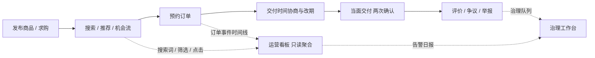

# 拾光校园 · Campus Glimmer

> 让闲置在校园里继续流转，也让每一次相遇都更有回应。

[](https://www.djangoproject.com/)
[](https://www.python.org/)
[](https://github.com/strawberry-little-bear/campus_glimmer/actions/workflows/django.yml)
[](LICENSE)

拾光校园（Campus Glimmer）是一个面向校园生活的二手交易与社区协作项目。它从“发布一件闲置、找到一个买家”的小闭环出发，逐步补齐校园交易中经常被忽略的细节：在哪里交付、如何沟通、预约是否有效、交易进行到哪一步、消息是否被看到、问题由谁处理，以及运营者如何了解站内真实需求。

项目不是一次性推倒重做的演示页面，而是按真实业务链路持续演进的 Django 项目。每次迭代尽量同时考虑数据模型、页面交互、权限边界、数据库迁移、后台运营和自动化测试，让新增能力能够自然地接入原有系统。

## 阅读指南

| 我想做什么 | 建议入口 |
| --- | --- |
| 快速判断这个项目是否相关 | 从[项目定位](#项目定位)和[功能速览](#功能速览)开始 |
| 在本地跑起来 | 直接进入[本地运行](#本地运行)，再按需看[配置说明](#配置说明)和 [Docker 运行](#docker-运行) |
| 了解某条业务链路 | 先看[功能模块](#功能模块)的八模块地图，再进入[功能手册](docs/feature-handbook.md) |
| 找代码和测试 | 查看[项目结构](#项目结构)的概览，或进入[模块与测试地图](docs/module-map.md) |
| 理解指标为什么这样算 | 从[运营数据闭环](#运营数据闭环)进入，再读[功能手册第 7 章](docs/feature-handbook.md#7-运营看板与运营告警) |
| 判断当前能力和规划 | 阅读[当前取舍与边界](#当前取舍与边界)和[后续路线图](#后续路线图)的摘要，需要细节再进深文档 |

## 目录

- [项目定位](#项目定位) · [系统概览](#系统概览) · [功能速览](#功能速览) · [功能模块](#功能模块)
- [典型业务流程](#典型业务流程) · [运营数据闭环](#运营数据闭环) · [项目结构](#项目结构) · [核心数据模型](#核心数据模型)
- [治理工作台](#治理工作台) · [权限与安全边界](#权限与安全边界) · [本地运行](#本地运行) · [配置说明](#配置说明)
- [Docker 运行](#docker-运行) · [后台与定时任务](#后台与定时任务) · [测试与持续集成](#测试与持续集成)
- [当前取舍与边界](#当前取舍与边界) · [后续路线图](#后续路线图) · [参与开发](#参与开发)

## 项目定位

校园二手交易和普通电商并不完全相同。校园用户通常在相对有限的地理范围内活动，交易更依赖当面沟通和时间协调；商品生命周期短，供需变化快；用户既是买家，也是卖家、内容参与者和社区成员。因此，项目将“商品列表”作为入口，但不把系统目标局限在商品 CRUD：

- 对用户，重点是降低从发现商品到完成交易的沟通成本。

- 对交易双方，重点是提供可追踪的预约、状态和交付确认。

- 对社区，重点是保留通知、举报、内容审核和争议处理的入口。

- 对运营者，重点是把搜索、浏览、收藏、预约和完成交易等行为整理成可解释的指标。

- 对项目本身，重点是用小步、可回溯的独立提交持续迭代，而不是一次性堆叠大量改动。

## 系统概览

下面的架构图描述当前项目的主要边界。图中“运营看板”和“站内通知”使用同一套业务数据，但通过权限和通知偏好隔离普通用户与管理员能力。


上面这张图交代的是系统的边界。如果想知道一个学生从打开页面到交易完成中间做了哪些动作、
每个动作在看板上留下什么痕迹，可以接着看下面这张链路图：左边是学生能看见的动作，
右边是这些动作在运营看板上留下的痕迹。箭头全部从左指向右——看板只读不写，
它消费学生产生的行为数据，但不反向改动任何交易状态。


同一条链路上，出售、免费赠送和限期借用会在预约之后各走各的路，求购匹配和失物招领是两条并行的支线，
展开见[典型业务流程](#典型业务流程)。

### 技术栈

| 层次 | 当前方案 | 说明 |
| --- | --- | --- |
| Web 框架 | Django 5.1+ | URL 路由、视图、模板、表单、认证和管理后台 |
| 编程语言 | Python 3.11+ | 业务逻辑、数据统计、管理命令和测试 |
| 数据库 | SQLite（默认） | 适合本地开发、演示和轻量部署；生产环境可替换 |
| 页面层 | Django Templates + 静态资源 | 服务端渲染为主，未读提醒和部分筛选交互使用轻量 JavaScript |
| 文件存储 | 本地 media 目录 | 商品图片和头像；容器运行时使用独立数据卷 |
| 图片处理 | Pillow | 商品图上传限制、EXIF 方向、WebP 重编码、响应式图片候选与展示宽高 |
| Web 服务 | Django 开发服务器 / Gunicorn | Docker 镜像默认使用 Gunicorn |
| 自动化 | GitHub Actions | 语法检查、Django 系统检查、迁移检查和测试 |

## 功能速览

| 面向 | 能做什么 |
| --- | --- |
| 买家 | 搜索、筛选、收藏、心愿单分组、收藏商品降价提醒、详情价格轨迹、发起预约、私信卖家、当面交付两次确认、评价与争议 |
| 卖家 | 发布与编辑商品、多图、校园地点、批量发布与 CSV / XLSX 导入、学期模板、导入预览、批量续期、发布后补图队列与行内补图上传、刷新商品、查看曝光与点击、价格轨迹维护提示、响应求购匹配 |
| 求购者 | 发布求购、接收匹配通知、确认或未采纳卖家响应 |
| 失主 | 发布失物与招领、智能匹配、确认匹配、提交反馈 |
| 借用双方 | 借用下单、催收阶梯、归还两次握手登记、地点每周时段与单日例外提醒 |
| 普通用户 | 站内通知中心、延后通知、通知偏好、关注搜索汇总、延后提醒、我的举报与结果回访、我的内容申诉 |
| 校园认证 | 校园邮箱域名配置、一次性验证链接、认证标识、公开交易档案 |
| 管理员 | 治理工作台、需求雷达与跟进闭环、运营看板（含出售价格轨迹洞察）、告警日报、脱敏 CSV 导出 |

所有运营面板遵循同一条纪律：只报告、不自动改任何业务状态，具体见[功能手册第 7 章](docs/feature-handbook.md#7-运营看板与运营告警)。

## 功能模块

完整功能说明已经按业务链路整理到[功能手册](docs/feature-handbook.md)。这一节保留入口地图，帮助读者先判断兴趣点，再进入对应章节阅读细节。

| 链路 | 关注点 | 详细入口 |
| --- | --- | --- |
| 1. 商品发布与校园地点 | 三种交易方式、多图治理、批量发布与 CSV / XLSX 导入、学期模板、导入预览、错误摘要与批量续期、发布后补图队列与行内补图上传、地点、刷新额度与生命周期 | [阅读](docs/feature-handbook.md#1-商品发布与校园地点) |
| 2. 搜索、保存与推荐 | 搜索、筛选、关注搜索、推荐反馈与供需机会 | [阅读](docs/feature-handbook.md#2-搜索保存与推荐) |
| 3. 失物招领与智能匹配 | 失物/招领线索、匹配确认与结果反馈 | [阅读](docs/feature-handbook.md#3-失物招领与智能匹配) |
| 4. 交易预约与订单状态 | 预约、改期、地点每周时段与单日例外、交付确认、归还、评价、争议与催收 | [阅读](docs/feature-handbook.md#4-交易预约与订单状态) |
| 5. 私信、留言与通知中心 | 会话、未读提醒、通知偏好、延后与汇总降噪 | [阅读](docs/feature-handbook.md#5-私信留言与通知中心) |
| 6. 社区治理与后台处理 | 举报、结果回访、内容分级复核、内容申诉、误判放行、治理队列和处理闭环 | [阅读](docs/feature-handbook.md#6-社区治理与后台处理) |
| 7. 运营看板与运营告警 | 供给侧、需求、搜索、交付、治理、通知、推荐与任务台账 | [阅读](docs/feature-handbook.md#7-运营看板与运营告警) |
| 8. 校园身份与可信交易 | 校园邮箱认证、公开档案、安全确认与信任展示 | [阅读](docs/feature-handbook.md#8-校园身份与可信交易) |

功能手册中的折叠块不是隐藏废弃内容，而是把“常用结论”和“完整口径”分层：页面默认展示结论，需要复核规则时再展开条目。

## 典型业务流程

下面的流程图展示一条从发现商品到完成交易的完整链路。每个阶段都对应页面动作、业务约束和可回看的数据记录。


### 用户视角

1. **发现**：用户从首页、分类、地点或搜索结果进入商品列表；
2. **筛选**：根据价格、成色、地点和状态缩小范围；
3. **了解**：查看图片、描述、卖家信息、地点和其他用户留言；
4. **沟通**：通过留言或私信确认商品细节、交付时间和交易地点；
5. **预约**：发起预约，系统校验商品是否仍可交易；
6. **推进**：双方更新订单状态，系统生成订单事件和必要通知；
7. **交付**：在线下完成交接后，由双方确认交付；
8. **反馈**：交易结束后评价，遇到异常时可以发起争议或举报。

### 系统视角

- 商品是交易入口，订单是状态主线。

- 私信和通知负责把状态变化传递给相关用户。

- 订单事件、浏览历史、搜索记录、评价和举报构成可回看的业务事实。

- 运营看板对这些事实做周期聚合，而不是直接修改交易数据。

- 管理员通知偏好和日报幂等键，保证运营提醒可控、可重复执行而不重复投递。

## 运营数据闭环

运营模块遵循“记录行为 → 聚合指标 → 识别问题 → 发送提醒 → 进入处理页面”的链路：

1. **记录行为**：保存搜索词、筛选条件、结果数量、浏览、收藏、预约、订单事件、私信和举报等结构化数据；
2. **聚合指标**：按统计周期计算供给、需求、活跃度、转化漏斗、回访率和治理队列；求购撮合还会关联匹配通知、卖家响应和求购确认，形成从触达到成交意向的独立漏斗；
   - 地点热力会进一步把供给、有效求购、周期预约和完成交易放到同一口径下，输出地点级供需压力，支持从“看见问题”进入“补充供给”的运营动作；
   - 价格调整后的搜索回响会把一次出售商品改价前后的搜索曝光、点击、收藏和预约放在同表对照，只描述共同变化，不把相关读成因果；
   - 分类调价参考会把同类出售价格聚合成中位数和四分位区间，并只统计当前在售商品的区间外规模；样本不足或区间过宽时降级为观察，不自动改价；

   - 专题分析会把“活动内容 → 商品曝光 → 收藏 → 预约 → 完成交易”串成专题级漏斗，并输出低转化提示，让运营数据能够反向影响下一轮活动策划；
3. **识别问题**：识别无结果搜索、待处理举报堆积、完成交易下降等运营告警；
4. **发送提醒**：管理员可以运行 `send_operations_digest`，将告警摘要写入站内通知中心；
5. **进入处理**：通知携带运营看板地址，管理员可以直接回到对应统计周期继续分析。

### 闭环的最后一环：动作有没有用

前五步只解决"发现问题并派人处理"，回答不了"处理完之后有没有好转"。一个只会报警、无法证明自己有用的雷达，很快会失去运营的信任。因此链路在"进入处理"之后补上第六步：

6. **验证效果**：以跟进任务的创建时间为分界，对比同一主题在前后两个窗口的无结果搜索率。

判定分五档，而不是简单二分：

| 判定 | 含义 | 运营该做什么 |
| --- | --- | --- |
| 缺口收敛 | 无结果率下降 | 若可用供给同时增加，说明补给动作对准了需求，可以复制到同类主题 |
| 基本持平 | 变化落在噪声区间 | 人工判断是否值得继续投入 |
| 缺口扩大 | 无结果率上升 | 核对是否补错了主题，或需求本身在增长 |
| 样本不足 | 两侧搜索量都太少 | 等待数据积累，不下结论 |
| 观察期未结束 | 任务刚建立不久 | 暂不判定，避免冤枉人 |

几条口径上的取舍：

- **分界线用任务创建时间，不用雷达行**。
  - 雷达行是滚动聚合，看板每刷新一次内容就变，不能当稳定边界。

  - 任务是一次有日期的决策。
- **变化和原因分开判**。
  - 无结果率下降但可用供给没涨，只记为"疑似收敛"并提示排除季节性因素。

  - 把两件事混在一起，会让运营误以为随便做点什么都能让数字变好。
- **样本不足不计入命中率**。
  - 用一次偶然的下降宣称成功，比不统计更糟。

  - 命中率只统计有完整证据的任务。
- **两侧窗口等长**。
  - 各取 14 天，避免单一季节波动伪装成收敛。
- **命中率过低会告警**。
  - 这通常意味着机会分口径或补给动作有问题，而不是该继续加供给。

日报是幂等的：同一个管理员、同一个日期、同一个统计周期只会生成一条对应通知。这样可以将命令接入系统计划任务，而不必担心重复执行造成通知刷屏。

## 学期日历与交易高峰

校园交易有明显的学期节律：开学两周集中在教材和宿舍用品，考试周转向复习资料，毕业季则是清仓供给集中释放。只看“最近 30 天平均值”会把这些变化抹平，因此项目引入学期日历，把统计口径切成阶段。

**阶段模型**

- **`AcademicTerm`**：一个学期，包含名称、标识、类型（春 / 秋 / 夏 / 冬）、起止日期和启用状态。
  - 停用后不再参与阶段计算，但历史数据保留。
- **`AcademicPhase`**：学期内的一个阶段，用「开始偏移天数 + 结束偏移天数」定位，偏移以学期开始日为第 0 天计算，超出学期长度时自动截断。

- **`AcademicTermSnapshot`**：阶段级统计快照，由管理命令按周刷新。
  - 已结束的阶段由看板直接读它，进行中的阶段仍然实时算——判据是这一行的计数是否已经封闭，不是 `refreshed_at`（它每次刷新都会被无条件推进，当不了新鲜度信号）。

**默认阶段计划**

| 阶段 | 偏移天数 | 典型特征 |
| --- | --- | --- |
| 开学周 | 0 – 13 | 教材和宿舍用品需求集中 |
| 常规教学周 | 14 – 97 | 以日常兴趣和小件为主 |
| 考试周 | 98 – 111 | 复习资料和陈旧资料需求上升 |
| 毕业季 | 112 – 125 | 清仓供给集中释放 |

偏移天数是可配置的，不是写死在代码里的常量：不同学校的校历长度不同，管理员在后台调整边界即可，代码和迁移都不需要改动。`AcademicPhase` 上还有唯一约束保证同一学期内偏移量不重叠。

**阶段感知的提醒内容**

关注搜索汇总和互助机会摘要会在通知尾部追加一句当前阶段说明，例如“当前处于秋季学期考试周：复习资料和陈旧资料需求上升。”，让用户理解为什么此刻收到这类提醒。没有配置学时会自动退化成原来的文案，不影响任何已有功能。

**阶段切换预热**

运营看板还会在下一阶段开始前 14 天给出供给预热提示：优先对比上一届同学期的同阶段，把历史搜索、无结果搜索、求购与新增商品按分类聚合，再对照当前 7 天的新增供给和可见现货。提示要求历史搜索至少 3 次且无结果至少 2 次；面板只输出分类聚合，不输出搜索词、标题或用户，也不会自动配置专题或发送提醒。

**维护命令**

```bash
python manage.py sync_academic_calendar
python manage.py sync_academic_calendar --ensure-phases
python manage.py sync_academic_calendar --refresh-snapshots
python manage.py sync_academic_calendar --term-slug autumn-2026
```

默认同时补齐阶段并刷新快照；`--term-slug` 可以只处理某个学期。命令会回报处理了多少学期、新增了多少阶段、刷新了多少条快照，适合接入系统计划任务。

**边界说明**

- 阶段对比说明的是供给节律，不代表单个用户的因果结论。

- 阶段统计复用现有的商品、求购、订单和搜索记录，不新增用户行为采集。

- 未配置学时时，看板会保留面板并提示如何录入，其余统计口径完全不变。

## 项目结构

项目保持 Django 应用的自然边界，业务主体集中在 `listings/`，账户与消息分别由 `accounts/`、`chat_messages/` 承担。

```text
campus_glimmer/
├── accounts/                  # 注册、登录、个人资料和账户测试
├── chat_messages/             # 商品留言、私信、内容审核和会话测试
├── campus_glimmer/            # Django 项目配置、根路由和健康检查
├── listings/                  # 商品、订单、搜索、通知、运营和治理业务
│   ├── migrations/            # 数据库迁移
│   └── management/commands/   # 运维、运营和回填管理命令
├── templates/                 # Django 模板和页面布局
├── static/                    # CSS、JavaScript、图标等静态资源
├── media/                     # 本地开发时的上传文件目录
├── docker/                    # 容器相关辅助文件
├── docs/                      # 架构图、业务流程图和项目文档
├── Dockerfile
├── docker-compose.yml
├── init_data.py               # 本地演示数据初始化脚本
├── manage.py
├── requirements.txt
└── README.md
```

`listings/` 内 129 个业务模块、147 个业务链路测试模块、`chat_messages/` 关键测试以及设计文档索引，已整理在[模块与测试地图](docs/module-map.md)。该地图同时标注“读写”和“只报告”模块，用于维护运营面板只读不写的纪律。

## 核心数据模型

项目使用 Django ORM 管理业务数据，当前模型可以按以下几组理解：


<details>
<summary>模型分组（46 行，按业务领域归组）</summary>

| 领域 | 主要模型 | 作用 |
| --- | --- | --- |
| 商品 | `Category`、`CampusLocation`、`CampusLocationServiceWindow`、`CampusLocationServiceException`、`CampusLocationServiceExceptionWindow`、`Item`、`ItemImage`、`ItemPriceChange` | 商品分类、校园地点、每周服务时段与单日例外、商品主体、交易方式、图片、可选展示截止时间和出售价格轨迹 |
| 地点档案质量 | 不新增表，读 `CampusLocation` 与商品、求购、关注搜索、订单、交付安排的外键 | 报告地点档案形状、字段覆盖、当前引用、交付地点可解释性、近似重名和停用引用；只报告，不自动合并或改写任何地点与业务记录 |
| 地点维护队列 | 读 `CampusLocation` 与当前在售商品、活跃求购、启用关注搜索的地点引用 | 把停用引用、公共地点缺安全提示、近似重名和档案字段缺失排成互斥主优先级与可重叠信号清单；只提示人工核对，不自动修复 |
| 地点维护决策 | `CampusLocationMaintenanceDecision` | 保存同一地点同一组信号的人工结论、理由、复核人与时间；决策不隐藏当前信号，也不代替地点或业务记录修改 |
| 商品生命周期 | `Item.last_refreshed_at`、`Item.refresh_count`、`ItemRefreshEvent`、`Item.attention_reminder_sent_at`、`Item.price_drop_reminder_sent_at`、`LifecycleReminderEvent` | 商品最新刷新时间、累计次数与逐次真实刷新事件，两类提醒的冷却时间，以及逐商品、逐类型的真实发送事件台账；刷新和提醒台账都保留历史事实，历史缺口不回填 |
| 生命周期提醒效果 | `LifecycleReminderEvent`、`Item.attention_reminder_sent_at`、`Item.price_drop_reminder_sent_at`、`Item.category`、`Notification.read_at`、`OrderEvent.created_at`、`AcademicTerm`、`AcademicPhase` | 单期效果真实发送事件优先，旧数据回退商品冷却时间戳；通知是否被打开与订单终态时间共同决定「提醒之后有没有动作」。跨学期终态转化只读事件台账与订单终态，不用可覆盖的刷新时间判方向 |
| 分类调价参考 | 不新增表，只读 `Item.category` / `price` / `status` / `expires_at` / `created_at` | 分类级当前供给价格形状：优先近 180 天样本、每分类最多 500 件，当前在售单列低于 / 区间内 / 高于；样本不足、四分位退化与区间过宽都显式标记，只报告不自动改价 |
| 校园活动 | `CampusCampaign` | 有起止时间的专题活动，以及专题与在售商品的可选关联 |
| 学期日历 | `AcademicTerm`、`AcademicPhase`、`AcademicTermSnapshot` | 学期起止日期、按偏移天数划分的阶段规则、阶段级统计快照（已结束阶段由 `build_academic_calendar` 读取，进行中阶段实时算） |
| 互动 | `Favorite`、`ItemAvailabilityWatch`、`Comment`、`PrivateMessage` | 收藏、有货提醒、公开留言和私信 |
| 交易 | `Order`、`OrderEvent`、`MeetingAppointment`、`DeliveryConfirmation`、`Rating` | 交易预约、交付时间协商、状态事件、双方确认和完成后的评价 |
| 交易安全确认 | `OrderSafetyAcknowledgement` | 买卖双方对当前安全卡的版本化确认记录，按订单、角色和安全卡指纹唯一；历史记录保留用于审计 |
| 订单阶段链路 | `OrderEvent`（状态流转事件） | 每次状态变化都会留下带时间戳的事件记录，运营看板据此还原“下单 → 确认 → 交付 → 成交 / 借出 → 归还”的阶段耗时 |
| 搜索 | `SearchQuery`、`SearchClick`、`SearchImpression`、`SavedSearch`、`SearchSynonym` | 搜索需求、点击、曝光、保存搜索和联想词；无结果搜索会进入需求雷达 |
| 需求撮合 | `DemandPost`、`DemandResponse` | 求购发布、商品响应、确认匹配和需求转化 |
| 机会流曝光 | `OpportunityImpression`、`OpportunityDismissal` | 一次机会流渲染落一行的「被看见」，和一次「不再显示」落的「不看了」；两者口径对偶，忽略率的分母来自前者 |
| 通知 | `Notification`、`NotificationPreference` | 站内提醒、未读状态、阅读时间、通知偏好、求购关联、到期提醒和幂等键；通知类型包含商品生命周期提醒，可单独关闭。偏好开关先报形状；关闭后仍出现的历史通知再按发生时间与偏好行最后写入拆开，只给可疑下界，不把整行 `updated_at` 当成逐开关关闭时间 |
| 身份与信任 | `CampusDomain`、`CampusVerification`、`Rating` | 校园邮箱域名配置、身份认证和交易信誉摘要 |
| 治理 | `Report`、`ModerationEvent`、`OrderDispute`、`OrderDisputeEvidence` | 商品举报、交易争议和证据处理；内容审核保存命中规则、风险、复核结论，`receiver` 支持私信恢复，`released_at` 记录内容真正回到原渠道的时间 |
| 运营 | 订单、浏览、搜索、收藏、求购等行为记录的聚合 | 看板、漏斗、用户分层、回访率、需求雷达、跟进任务和运营告警 |
| 看板自身构建耗时 | 不新增表，请求内读共享构建注册表与 `perf_counter` 计时 | 核心统计 + 57 个共享面板；P50/P90 取最近秩，重复 key 单列；页面 Top 12、CSV 全量；不含渲染、序列化、筛选和下载，也不落库或跨请求平均 |
| 需求跟进闭环 | `DemandOpportunityTask.created_at`、`DemandOpportunityTask.radar_key`、`DemandOpportunityTask.available_supply`、`SearchQuery.result_count` | 任务创建时间是唯一稳定的分界线（雷达行是滚动聚合，内容每次刷新都变），创建时的供给数用于判断「动作是否真的发生」，搜索结果数用于判断「需求是否被满足」 |
| 同义词候选 | `SearchQuery.user_id`、`SearchQuery.query`、`SearchQuery.result_count`、`SearchQuery.created_at`、`SearchSynonym.keyword` / `synonym` / `is_active` | 同一次会话内相邻两次搜索的改口证据；已启用同义词的两个方向都参与去重，停用同义词不屏蔽候选 |
| 同义词效果回流 | 不新增表，读 `SearchSynonym.created_at` + `SearchQuery` | 确认时间是唯一稳定的分界线；搜索词记录的是学生原本输入的那一串（扩展只发生在查询内部），按扩展词统计会成为自己和自己比、永远报成功 |
| 搜索曝光与点击配对质量 | 不新增表，只读 `SearchQuery` + `SearchImpression` + `SearchClick` | 周期内点击可在曝光表上线以来寻找同一搜索、同一商品且不晚于点击的曝光；缺搜索记录、零位置、无法配对、点击早于曝光、未来时间各自单列，延迟从最早可配对曝光算起；不比较用户、不判成因、不输出搜索词、用户名或商品标题 |
| 筛选组合对比 | 不新增表，读 `SearchQuery.category_id` + `min_price` / `max_price` | 组合占比的分母是同一个分类内部的搜索次数，因此分类总量上涨不会把每个组合都推成上升；价格带判据与单维表同一套，闭带需要两个界都设、开区间顶带只需下限 |
| 候选门槛建议 | 不新增表，读 `SearchSynonym` + `SearchQuery` | 命中率衡量的是「候选池 + 人工确认」整条链而非候选池本身，因此只作为调整门槛的参考；词对大面积配错时判定为配对问题而非阈值问题，收紧门槛只会把错误藏起来 |
| 候选否决分析 | 新增表 `SearchSynonymRejection` + 读 `SearchQuery` | 否决记录本身落库（否决候选不落库），归一化词对与排查器同一套，因此「充电宝」和「充电宝 」落到同一行；出现次数由同一份改口日志反汇，否决按次数加权而不按否决条数 |
| 定时任务台账 | `TaskRun` | 每个管理命令每次运行的起止时间、耗时、状态、固定指标和失败摘要，用于回答「调度是否健康」 |
| 定时任务失败原因分类 | 不新增表，读 `TaskRun.note` | 把周期内失败的运行按“失败长什么样”归成配置、数据状态、外部依赖、未归类四类，并统计每类的次数、涉及命令与最近一次备注；只描述不下结论 |
| 定时任务健康度的跨周期趋势 | 不新增表，读 `TaskRun.started_at` + `duration_ms` + `status` | 把同一批运行切成本周期与上一个等长周期，比较成功率方向与耗时趋势。一次运行按它开始的时刻归期，否则卡在边界上的那次会算进下一个周期；耗时给中位数、最长一次和异常慢的次数，不给平均值（一次跑了两小时的运行会把平均值抬成一个从未发生过的数字）；只报告，不改 stale 阈值、不自动重试。 |
| 借用逾期催收 | `BorrowReturnEscalation` | 一笔借用订单当前的催收等级、累计升级次数、最近升级时间、说明和归还闭环时间，用于回答「这笔到底催到哪一步了」 |
| 借用逾期风险分层 | 不新增表，读 `Order` + `BorrowReturnEscalation` | 按分类与押金档位聚合的借用量、升级率、第三级率与闭环时长，用来回答「哪些品类天生更容易拖到第三级」；只读聚合，不新增写入路径 |
| 借用节奏与学期阶段交叉 | 不新增表，读 `Order` + `BorrowReturnEscalation` + `AcademicTerm` / `AcademicPhase` | 把风险分层的同一批借用按学期阶段再聚合一遍，给出阶段日均借用、日均第三级与阶段内分类明细，用来区分「考试周集中借出」和「这个品类本身难还」；只读聚合，不新增写入路径 |
| 借用催收跨周期时效对比 | 不新增表，读 `Order` + `BorrowReturnEscalation` | 当前周期与上一等长周期逐项比较；分子分母按同一笔借用归期，逾期天数不参与对比 |
| 机会流上被按「不再显示」的机会 | 新增 `OpportunityImpression`（机会流每次渲染写一行，一次 `bulk_create`），读它 + `OpportunityDismissal` + `Item` + `LostFoundPost` | 按机会类型、分数档和理由拆开忽略的规模与结构，并单独报重复忽略；忽略率的分母来自 `OpportunityImpression`，只数窗口内第一次被看见的（用户, 机会）对，分子要求该机会在窗口内至少被展示过一次，报出来的是下界、只低不高，空分母报 `None` 不报 0，分母不足 24 条只报数字不给方向；按分数档的忽略率带一行「今天已匹配不上」，避免看得见但算不出分数的展示从分母整个消失；重复忽略按 `expires_at` 与 `created_at` 的距离落在 (30, 35] 天判，是间接证据；分数在忽略时刻重算，走 `_match_demand` 与 `score_lost_found_posts` 自己；只报告不改任何一行的 `expires_at`、不改 30 天静默期 |
| 用户建的心愿单分组 | 不新增表，读 `FavoriteCollection` + `Favorite` + `Item` | 分组大小分布（分子分母都是分组）、空分组按 `created_at` 分「刚建」与「早就空着」（占空分组的分母是空分组自己）、收藏的分组渗透（已归组占全部收藏、有收藏且建过分组的人占有收藏用户——建分组不要求有收藏，取交集防占比破百）、分组名收敛（计数天然是用户数，只有 3 个以上用户用过的名字才进榜）；先收藏后归类按当场、事后、从未归类、归过类又取消四类分开报，宽限天数上面板，迁移前归组的老收藏单列不进分母（`Favorite.grouped_at` 由模型在 `collection_id` 变化时写，不用 `auto_now`，时间差在 Python 侧算以兼容 PostgreSQL）；不报分组改名频率（应用内没有改名路由）、不报删分组后收藏去向（只走 admin 且 `SET_NULL` 让删完的收藏和没归过类的一样）；「当前」是快照不是窗口，与窗口内新建规模分开报；只报告不改任何一条 `Favorite.collection` |
| 首页推荐卡挑得准不准 | 新增 `RecommendationImpression`（首页每次渲染写一行，一次 `bulk_create`），读它 + `RecommendationFeedback` + `Favorite` + `Order` | 按理由拆开统计反馈率、正负比例、改口数与反馈后动作；正负比例的分母只收有过反馈的推荐，反馈率的分母是「这张卡被看见过」（只低不高的下界，写入挂了只记日志）；另有两张按推荐当时的 `reason_key` 与 `score` 档拆开的表，这是首页这边独有的——frozen dataclass 在渲染那一刻就带着它们，落库零成本；理由的复算仍然读反馈时刻的输入，两个分母不要混；匿名访客的看见也计入分母（`user` 为 null，`on_delete=SET_NULL`）；只报告不改权重 |
| 推荐曝光日志质量 | 不新增表，只读 `RecommendationImpression` | 已落库行的字段形状、当前理由可解释性、零分、位置 1—8、未来时间、匿名或已注销访客、登录用户重复曝光和自然日覆盖；写失败只进日志所以数不出，没有渲染批次所以不倒推每屏缺几张；只报告，不改推荐和写入路径 |
| 机会流曝光日志质量 | 不新增表，只读 `OpportunityImpression` | 已落库曝光行的类型、目标一致性、合法重复、同刻重复、未来时间与自然日覆盖；页面与 CSV 同步保留最近 30 天逐日明细；只审计忽略率分母的形状，不重算忽略率，也不数不可见的写入失败 |
| 私信响应时效的跨周期对比 | 不新增表，读 `PrivateMessage.created_at` + `is_read` + `read_at` | 本周期与上一个等长周期逐项比较；时长按倍数判方向（中位达到上期 1.5 倍记为变慢），比例按百分点判；任一侧样本不足只报数字不猜方向，`read_at` 上线前就已读的老信计入打开数但不进时长样本 |
| 延后的通知，延了之后回来了吗 | 不新增表，读 `Notification.snoozed_until` + `read_at` + `created_at` | 把用户主动要求的等待从处理时长里拆出来：含延期、扣掉延期、用户主动要求三个数摆在一起不相加也不相减，第三个数是下界（`snoozed_until` 每次延后都被覆盖，前几次延掉的等待不在库里）；五种结局分开数，「还在延后中」不进阅读率分母，「到点之后仍未读」是右删失样本单独数不记 0 天；「此刻」两块不按统计周期过滤，周期开始之前就到期未读的那条恰恰是最不该被藏起来的一件；批量标记已读不清 `snoozed_until`，两个「读过」档位都混着一键清空的人，只报规模不读成「用户会提前回来」；按通知类型聚合，不列通知原文、不按用户排名；只报告，不加迁移、不加字段、不改写入路径、不自动取消延后、不自动标记已读 |
| 需求雷达命中率的跳周期趋势 | 整个 `DemandOpportunityTask` + `SearchQuery` | 同一个周期内的任务改变了多少，与上一周期比对命中率走向。取任务创建时刻作为归期，让刚刚建行的任务不会落入上一周期；只统计有证据的任务，只报告、不把命中率回流到任何字段。 |
| 需求雷达命中率的学期纵向对比 | 整个 `DemandOpportunityTask` 的 `created_at` + `AcademicTerm` / `AcademicPhase` + `SearchQuery` | 把同一个阶段在相邻两个学期里相比，而不是跟前三十天比。学期需求本身顺季节漂移，把上个月当成上个学期比会把季节性读成雷达在漂移；只在一个学期出现过的阶段不给方向，早于第一个学期配置的任务单独计数；只报告、不改加权。 |
| 学期阶段快照读路径 | 不新增表，读 `AcademicTermSnapshot` + `AcademicTerm` / `AcademicPhase` | 已结束阶段读匹配快照（四个 `created_at` 全是 `auto_now_add`，计数已封闭），进行中阶段实时算（快照最多是上周的）；实时行继续拆成“阶段未结束”和“已结束兜底”，后者给出缺行与区间失配告警，不自动补刷；不加缓存层、不改字段与约束、不加迁移 |
| 学期阶段快照质量 | 不新增表，读 `AcademicTermSnapshot` + `AcademicTerm` / `AcademicPhase` + `TaskRun` | 报这张长期只被写的表的规模、应有阶段覆盖率、孤儿行（匹配键失效，与学期停用残留分开）、过期快照（看阶段 `end_date` 不看 `refreshed_at`）和命令是否还在跑；读路径本身的缺行告警在学期日历面板上，质量面板不重算七个计数的偏差；只报告，不刷新、不删行、不改 `starts_on` |
| 跟进任务的接手等待与停留 | 不新增表，读 `DemandOpportunityTask` 的 `created_at` / `updated_at` / `status` / `assigned_to` / `due_at` / `note` | 一条状态机跑了这么久，而「动作是什么时候发生的」从来没被记下来：四个时间列里没有一个记的是「什么时候变成跟进中」。不加迁移、不加字段、不改写入路径，只在既有数据上把能说的和不能说的分开说。接手时长分两支：已接手的只报上界 `updated_at - created_at`，没人接手过的报 `now - created_at`（那一支中间没有任何一次写入，方向性错误就在这里——都用 `updated_at - created_at` 会把两组的可信度同时讲反）。停留时长只报当前快照 `now - updated_at`，这一条上 `updated_at` 恰好是正确的列。待处理清单只按「未闭环」筛，已接手但停住的同样在列；每行带 `has_handover` 把「没人管」和「接手后停住了」分开；最多列 20 条但总数照实报在 `row_total`，截断不等于「一共就这么多」。两个口径不能相加或相减；空平台报「—」不报 0 天；只报告，不自动派单、不改状态、不改截止时间、不按负责人排名。 |
| 需求雷达闭环的分层命中率 | 整个 `DemandOpportunityTask` 的 `category` / `location` + `SearchQuery` | 把同一周期的跟进任务按任务自己带的分类和地点切开，每个分层报自己的命中率。整体一个数字既可能是“每类都在 60% 左右”，也可能是“一类 95%、另一类 25%”，而这两者需要的回应相反。命中率只在层内读，不跟“该层占全部任务的比例”比；每层各自要过与整体相同的任务数门槛，门槛不为了表格好看而放开；任务数少的分层上的差值不算结论，这里不排序、不把命中率回流到机会分。 命中率只在层内读，不跟“该层占全部任务的比例”比；每层各自要过与整体相同的任务数门槛，门槛不为了表格好看而放开；任务数少的分层上的差值不算结论，这里不排序、不把命中率回流到机会分。 |

</details>

<details>
<summary>关键约束（13 条，含缩进子项）</summary>


- 收藏、商品有货提醒等重复关系通过数据库约束或幂等逻辑避免重复。

- 订单创建在事务中校验并锁定商品，降低并发预约冲突。

- 通知读取、订单操作、评价、举报和运营数据访问均在服务端校验身份。

- 争议证据下载只允许订单买卖双方或管理员访问，不直接暴露原始 media 链接。

- 商品是否仍可预约由服务端的 `ItemQuerySet.available()` 和订单创建时的行级锁共同校验，不能只依赖前端按钮或定时任务是否及时运行。

- 搜索和运营数据尽量保存为结构化字段，便于重新计算和解释指标。

- 上传文件保存在 media 目录，数据库不直接保存二进制内容。

- 校园认证令牌只保存 Django 密码哈希，验证成功或重新发送后旧令牌不能继续使用。

- 校园邮箱域名由管理员显式配置，未配置或已停用的域名不能发起认证。

- 商品刷新按 24 小时最小间隔和每月 4 次上限控制，限流状态保存在商品上，刷新只改曝光排序，不改动商品内容和发布状态。

- 生命周期诊断在应用层计算，不回写商品状态，保证“待处理”只是一个可解释的运营口径而不是隐式过滤条件。

- 定时任务台账只保存可横向比较的标量指标，不原样保存命令返回的任意结构。
  - 失败记录写在独立短事务里，业务事务回滚也不会带走失败证据。

</details>

## 治理工作台

三类治理事项原本分散在三个页面，各自使用不同的词汇描述同一件事，而交付预约异常甚至没有前台处理入口，只能在 Django 后台里翻。治理工作台把它们收敛到一处，并补上三者都缺失的一个维度：**处理时长**。现在它同时照顾四类队列：商品举报、交易争议、交付预约异常，以及已经走过三级催收的逾期借用。

### 为什么是"等了多久"而不是"有多少"

积压数量只说明规模。10 件待处理举报可能件件都是当天提交，也可能第一件已经躺了半个月——这两种情况需要的动作完全不同。工作台对每个队列分别统计：

- 周期内处理量、已处理、待处理和超期件数。

- 处理时长中位数、P90 以及最快/最慢，按"处理人写进记录的那一刻"计算，打开队列页不算响应。

- 时限内完成率，衡量的是承诺有没有被守住，而不是事情有没有做完。

### 四类队列为什么时限不同

| 队列 | 处理时限 | 理由 |
| --- | --- | --- |
| 商品举报 | 2 天 | 离线复核，不阻塞交易本身 |
| 交易争议 | 3 天 | 需要双方举证，留给沟通的时间更长 |
| 交付预约异常 | 24 小时 | 阻塞一次已经约好的线下交付，拖延代价最高
| 借用逾期催收 | 7 天 | 已经走过三级催收，再给一周把最坏情况限制在逾期两周内 |

用一个共享时限要么让预约异常被埋进误报，要么让举报烂在队列里。超期判定同时设了一条 75% 的预警线，用来在真正超期前先露出"即将超期"的事项。

### 实现取舍

- **不建镜像表**：三类模型本身都有创建时间和关闭时间戳，聚合在应用层完成。
  - 镜像表只会多出一条写入路径和一次数据漂移的机会。

  - 代价是无法把聚合推给 SQL，而校园规模的治理队列本就只是几百件的量级。
- **待处理清单不受统计周期限制**：周期开始前就已超期的事项，恰恰是最不该被窗口藏起来的那一件。
  - 吞吐量按周期统计，待处理清单按实时状态统计，两者在页面上分开呈现。
- **同一事项只计一次**：一件举报可能同时落在"周期内"和"当前待处理"两个集合里，去重键用 `(队列, 主键)`，不能用 Python 对象的 `id()`——那是临时字典的地址，两次加载会得到两个不同的键，同一件举报就会被算成两件。

- **借用队列没有处理按钮**：平台只记录和通知，不取消订单、不代扣押金，因此这一类卡片只提供“查看订单时间线”，而不是一个假装能处置的实心按钮。

- **前台只下结论**：预约异常处理页只提供"已确认异常 / 已驳回"两种终态，不提供"转处理中"，与另外两个队列的流转规则保持一致。

## 权限与安全边界

### 普通用户

- 只能编辑、删除自己发布的商品。

- 只能查看和操作自己参与的订单、私信、通知和收藏。

- 只能修改自己的资料和通知偏好。

- 可以举报商品或内容，在“我的举报”查看处理状态，并在完结后提交一次三档结果回访；被确认违规的留言或私信作者，也可以在“我的内容申诉”提交一次申诉。
- 结果回访不改变审核结论或举报处理顺序；内容申诉由管理员二次复核，成立时会走误判放行与通知闭环。

- 可以发起校园邮箱认证，但不能自行把认证状态改为已认证。

### 管理员

- 可以访问运营看板、搜索洞察、举报队列、争议队列、内容审核队列和内容申诉。
- 运营看板会分开观察内容申诉的提交、处理与当前积压：申诉率只作无时效窗口下的下界，成立但未恢复单独暴露，不把申诉率或成立率合成审核准确率。

- 可以处理举报、争议和审核事件，并按严重风险、脱离平台联系与低权重线索查看复核目标；分级只影响节奏，不自动判定违规。

- 可以接收运营告警日报，但是否接收由个人通知偏好控制。

- 不能绕过服务端权限检查直接代替普通用户完成交易操作。

### 部署注意事项

- 生产环境必须替换 `DJANGO_SECRET_KEY`。

- 不要提交生产数据库、上传文件、密钥或包含用户隐私的日志。

- 启用 HTTPS 后，应同步配置安全重定向、Session Cookie、CSRF Cookie 和可信来源。

- 面向真实用户时，应进一步配置反向代理、限流、备份、日志和媒体文件访问策略。

- `/healthz/` 是存活检查，只确认 Django 进程能处理请求，不访问数据库。
- `/readyz/` 是就绪检查，会对默认数据库执行一次轻量查询；数据库不可用时返回 503。
- 反向代理和编排系统应以 `/readyz/` 判断实例是否接流量。数据库故障不必等同于进程崩溃，避免把所有 worker 同时重启。

## 本地运行

### 1. 获取代码并创建虚拟环境

```bash
git clone https://github.com/strawberry-little-bear/campus_glimmer.git
cd campus_glimmer
python -m venv .venv
```

Windows PowerShell：

```powershell
.\.venv\Scripts\Activate.ps1
```

macOS / Linux：

```bash
source .venv/bin/activate
```

### 2. 安装依赖并准备数据库

```bash
python -m pip install -r requirements.txt
python manage.py migrate
```

如果需要创建管理员账号：

```bash
python manage.py createsuperuser
```

如果需要快速准备演示数据，可以执行：

```bash
python init_data.py
```

### 3. 启动开发服务器

```bash
python manage.py runserver
```

常用地址：

| 页面 | 地址 |
| --- | --- |
| 首页 | <http://127.0.0.1:8000/> |
| 商品列表 | <http://127.0.0.1:8000/listings/> |
| 批量发布（登录卖家） | <http://127.0.0.1:8000/listings/my_items/bulk-create/> |
| 校园专题 | <http://127.0.0.1:8000/listings/campaigns/> |
| 搜索 | <http://127.0.0.1:8000/listings/search/> |
| 我的订单 | <http://127.0.0.1:8000/listings/orders/> |
| 消息中心 | <http://127.0.0.1:8000/messages/inbox/> |
| 我的内容申诉 | <http://127.0.0.1:8000/messages/moderation/appeals/> |
| 站内通知 | <http://127.0.0.1:8000/listings/notifications/> |
| 运营看板（管理员） | <http://127.0.0.1:8000/listings/operations/> |
| 搜索洞察（管理员） | <http://127.0.0.1:8000/listings/operations/search-insights/> |
| 举报队列（管理员） | <http://127.0.0.1:8000/listings/reports/> |
| 交易争议（管理员） | <http://127.0.0.1:8000/listings/disputes/> |
| 管理后台 | <http://127.0.0.1:8000/admin/> |
| 存活检查 | <http://127.0.0.1:8000/healthz/> |
| 数据库就绪检查 | <http://127.0.0.1:8000/readyz/> |

## 配置说明

本地开发可以直接使用默认配置。需要调整时，复制示例文件：

```bash
cp .env.example .env
```

Windows PowerShell：

```powershell
Copy-Item .env.example .env
```

| 变量 | 作用 | 默认值 |
| --- | --- | --- |
| `DJANGO_SECRET_KEY` | Django 密钥，生产环境必须替换 | 本地开发占位值 |
| `DJANGO_DEBUG` | 是否开启调试模式 | `1` |
| `DJANGO_ALLOWED_HOSTS` | 允许访问的域名，逗号分隔 | `127.0.0.1,localhost,testserver` |
| `DJANGO_CSRF_TRUSTED_ORIGINS` | HTTPS 或反向代理场景下的可信来源 | 空 |
| `DJANGO_DB_PATH` | SQLite 数据库文件路径 | `db.sqlite3` |
| `DJANGO_SECURE_SSL_REDIRECT` | 是否强制跳转 HTTPS | `0` |
| `DJANGO_SESSION_COOKIE_SECURE` | 是否只通过 HTTPS 发送会话 Cookie | `0` |
| `DJANGO_CSRF_COOKIE_SECURE` | 是否只通过 HTTPS 发送 CSRF Cookie | `0` |
| `DJANGO_EMAIL_BACKEND` | Django 邮件后端；本地可使用控制台后端，生产环境建议配置 SMTP | DEBUG 时为 console，生产环境为 SMTP |
| `DJANGO_DEFAULT_FROM_EMAIL` | 校园认证邮件的发件地址 | `no-reply@campus-glimmer.local` |

项目默认使用 SQLite，是为了让新贡献者可以低成本启动和验证完整流程。正式部署时，可以将数据库迁移到 PostgreSQL，并根据规模加入缓存、对象存储、日志和备份服务。

## Docker 运行

项目提供了适合本地演示和轻量部署的容器配置：

```bash
docker compose up --build
```

启动后访问 <http://127.0.0.1:8000/>。Docker 配置默认使用 SQLite，数据库和上传文件分别通过 `campus_data`、`campus_media` 数据卷持久化。停止容器后再次启动时，数据不会因为容器重建而自动消失。

镜像内置 `HEALTHCHECK`，探针访问 `/readyz/`；数据库不可用时容器会转为 `unhealthy`。这只是健康状态上报，是否重启或摘除实例由容器编排配置决定。

如果要停止服务：

```bash
docker compose down
```

如果要连同数据卷一起清理，请确认其中没有需要保留的数据后再执行：

```bash
docker compose down -v
```

## 后台与定时任务

项目将需要周期执行的工作封装成 Django management command，便于接入 Windows 任务计划程序、cron、容器任务或其他调度系统。

### 预约超时处理

发送临近截止的提醒，并释放已经过期的预约：

```bash
python manage.py process_order_timeouts
python manage.py process_order_timeouts --reminder-hours 6
```

该命令同时检查限期借用订单：在预计归还时间临近时提醒借用双方，超过归还时间后发送逾期提醒；每个提醒阶段都带有幂等字段，重复运行不会重复刷屏。

同一次运行还会走一遍借用逾期催收阶梯：逾期满 1 天提醒借用方，满 3 天同时告知双方，满 7 天上报治理工作台。等级按「逾期了多久」推导，漏跑一次下一次会自动追上；同一笔订单两次催收至少隔一天；双方确认归还后记录立即闭环。

### 历史商品图片变体与展示宽高回填

新上传图片会在保存时生成最长边 480px 的列表缩略图；原图最长边超过 960px 时再生成 960px 大图预览，小图不重复落盘。历史图片不必停机一次性处理，可以用幂等命令分批补齐缩略图、预览图和宽高：

```bash
python manage.py backfill_item_thumbnails --dry-run
python manage.py backfill_item_thumbnails --limit 100
```

命令按 `id` 升序处理缺失变体或展示宽高的记录；已有缩略图的记录只补预览图或元数据，不重复生成文件。单张历史图片解码失败时只计入失败数并继续处理后续记录。每次运行都会写入 `TaskRun` 台账，保存检查数、补齐数、失败数和跳过数；剩余待处理量由命令输出，便于决定下一批的 `--limit`。它是上线辅助命令，不是周期任务；全部补齐完成后可以停止调度。

### 商品展示到期处理

将超过展示截止时间的在售商品自动下架，并向商品发布者发送一次到期提醒。该命令设计为幂等操作，可以安全地接入定时任务：

```bash
python manage.py expire_items
```

建议每天运行一次；即使命令没有及时执行，公开列表、推荐和创建订单时也会再次校验截止时间，避免过期商品继续被预约。

### 运营告警日报

按统计周期构建运营告警，并向符合条件的活跃管理员发送站内通知：

```bash
python manage.py send_operations_digest
python manage.py send_operations_digest --days 30
```

可选周期为 `7`、`30`、`90` 或 `365` 天。命令没有发现告警时不会生成空通知；同一天、同一周期重复运行时也不会向同一管理员重复投递。

### 互助机会摘要

向存在有效商品或失物招领记录、且当前确实有可响应机会的用户发送每日摘要：

```bash
python manage.py send_opportunity_digest
```

摘要只在存在匹配机会时生成，用户可以在通知偏好中关闭；同一用户在同一自然日重复运行命令不会收到重复通知。建议将命令接入每天一次的计划任务，并与站内通知未读提醒配合使用。

### 关注搜索汇总提醒

把缓冲区里的关注搜索命中合并成一条通知，按用户和周期去重：

```bash
python manage.py send_saved_search_digest
python manage.py send_saved_search_digest --frequency daily
python manage.py send_saved_search_digest --frequency weekly
```

命令会回归发送、跳过、无命中和静默中的关注数量；处于静默期的关注只统计不发送，命中记录仍然保留。建议每日运行一次（或按需分别运行日订任务与周订任务，两者彻底独立，不会互相干扰）；重复运行安全无偶给性。


### 商品生命周期提醒

把需要卖家处理的商品合并成一条站内通知，按冷却期控制节奏：

```bash
python manage.py send_lifecycle_reminders
python manage.py send_lifecycle_reminders --seller-id 12 --seller-id 34
python manage.py send_lifecycle_reminders --dry-run
```

命令会回报发送条数、两类提醒各覆盖多少卖家、回写了多少件商品的冷却时间、写入多少条事件台账，以及因关闭提醒、处于免打扰时段或缺少价格证据而跳过的卖家数。事件、合并通知与冷却字段在同一事务内写入；`--seller-id` 可重复传入，用于只补发某几个卖家；`--dry-run` 只统计，不写通知、事件或冷却字段，适合上线前确认影响范围。

去重键按“通知类型 + 日期 + 卖家”构成，同一天重复运行不会发出第二条，也不会重复回写冷却时间，因此可以直接接入系统计划任务。建议每日运行一次，与运营告警日报错开时间，避免同一批卖家在同一天收到多条长文通知。

提醒的触达与行动情况由运营看板的「生命周期提醒触达与行动」面板呈现：新发送优先读取事件台账，旧数据回退商品冷却时间戳，并单独标明事件、混合与旧时间戳口径，避免把覆盖差异误读为效果变化。

跨学期视角由「生命周期提醒的跨学期终态转化」面板呈现：它固定回看 420 天，只比较相邻学期的同一阶段；分母只读事件台账，方向只看提醒后 14 天内的订单终态动作，刷新时间因可被后续刷新覆盖而不参与纵向判断。

商品刷新事件台账已同步落地：只有通过限流的真实刷新才逐次落库，事件与累计计数同事务写入；台账上线前的历史缺口照实单列、不回填，完整行动史等覆盖稳定后再评估。

### 学期日历维护

学期日历本身不产生数据，它只是把已有记录按阶段重新聚合。因此只需要一个维护命令：

```bash
python manage.py sync_academic_calendar
```

命令做两件事：为启用中的学期补齐缺失的默认阶段，以及刷新各阶段的统计快照。默认两件事都做，也可以用 `--ensure-phases` 或 `--refresh-snapshots` 单独执行，或用 `--term-slug` 只处理某个学期。没有配置学时时命令会明确提示，不会静默失败。

建议在每学期开始前手工运行一次补齐阶段，之后按周刷新快照即可；阶段边界调整后同样需要重跑，否则看板仍会显示旧边界下的统计。

按周刷新留下的轨迹，现在可以在运营看板的「学期阶段快照质量」面板上读到。刷新出来的快照也不再是没人看的副本：看板对已结束的阶段直接读它，每一行都标着「读快照」或「实时算」。实时行还会继续拆开：阶段未结束是既定策略；已结束阶段缺行或区间不匹配则触发来源告警，说明当前只是实时兜底，并提示核对 `sync_academic_calendar` 与阶段边界，而不是自动补刷。要特别留一句：**改动学期的开始日期会让快照表留下成倍的孤儿行**——`AcademicPhase.start_date` 是算出来的属性，`starts_on` 一改，四个阶段的匹配键整体平移，旧行不会被更新而是被旁置，新键下另插一批新行。命令回报的“刷新阶段快照 N 条”不会有任何变化，只有面板能看出表从这一刻起多了一倍。阶段边界调整后重跑，同样建议顺手看一眼这块面板。

### 定时任务运行台账

七个定时命令过去都是「跑完就走」：各自打印一行摘要然后退出，发送了多少条、跳过了多少个卖家、有没有失败，只存在于进程返回值里。带来的两个后果是，看板回答不了「上周的提醒到底发出去没有」，而命令失败在项目内部也完全没有记录——只有调度器从退出码里知道出过事，排查一次漏跑只能去翻调度器日志。

现在每次运行都会留下一行 `TaskRun` 记录：

```bash
python manage.py send_lifecycle_reminders
python -X utf8 -c "from listings.models import TaskRun; [print(r.name, r.status, r.metrics, r.note) for r in TaskRun.objects.all()]"
```

接入方式对命令本身只增加一行上下文，返回值仍按原有方式打印，不影响任何现有输出：

```python
from listings.task_runs import normalise_metrics, record_task_run

with record_task_run('send_lifecycle_reminders') as run:
    result = send_lifecycle_reminders()
    run.metrics = normalise_metrics(result)
```

台账落库的数据进入运营看板的「定时任务运行台账与健康统计」面板，给出每个命令的运行次数、失败次数、最近状态、静默天数和连续失败次数，并汇总出需要优先处理的命令。看板还会先做一层台账完整性审计，确认时间、状态、备注和指标形状是否可读，再让读者进入健康度结论。

## 测试与持续集成

本地提交前建议执行：

```bash
python -m compileall -q accounts campus_glimmer chat_messages listings
python manage.py check
python manage.py makemigrations --check --dry-run
python manage.py test
git diff --check
```

GitHub Actions 在推送到 `main` 或提交 Pull Request 时执行以下检查：

1. 拉取代码并配置 Python 3.12；
2. 安装 `requirements.txt` 中的依赖；
3. 对主要 Django 应用执行 Python 语法检查；
4. 执行 Django system check；
5. 检查是否存在未生成的数据库迁移；
6. 运行完整测试集。

CI 的目标不是替代本地验证，而是确保每个独立迭代至少满足“能导入、能启动、迁移一致、测试通过”这组基本条件。项目根配置的存活 / 就绪探针和容器健康检查由 `campus_glimmer/tests.py` 覆盖。

## 当前取舍与边界

项目当前更重视交易一致性、隐私边界和可解释运营，而不是把所有能自动化的动作都立即自动化。完整口径见[当前取舍与边界](docs/product-boundaries.md)。

| 主题 | 当前选择 |
| --- | --- |
| 交易一致性 | 订单创建使用事务和锁；状态推进宁可保留人工确认，也不让系统替用户确认交付 |
| 校园地点与隐私 | 地点用于交付和组织信息，不做轨迹还原；导出和看板避免暴露个人位置细节 |
| 指标口径 | 样本、分母、周期和缺失值必须显式说明；不足的样本降可信，不伪装成结论 |
| 供给与提醒 | 提醒做冷却、合并和效果观测，不用无节制发送换短期动作率 |
| 需求跟进闭环 | 缺口被看见后要有任务、接手和复核，而不是只生成一条告警 |
| 调度台账 | 定时任务记录运行事实；失败、缺字段和历史缺口照实报告 |
| 借用催收 | 提醒按截止余量和逾期时长分层，归还仍由双方确认，不自动关闭订单 |

这些边界会随业务证据调整；调整时优先补观测，再讨论自动化，避免把噪声直接变成用户侧动作。

## 后续路线图

后续迭代继续围绕校园场景、交易闭环、社区治理和数据可信展开。这里保留方向概览，具体待办、已落地范围和不做的理由见[后续路线图](docs/roadmap.md)。

| 方向 | 下一步重点 |
| --- | --- |
| 供给侧与提醒 | 刷新事件流水已落地，待台账覆盖稳定后，再评估完整行动史 |
| 搜索、供需与机会流 | 曝光日志质量面板已落地；继续补齐空结果诊断、需求承接和推荐解释 |
| 交易、交付与借用 | 强化交付异常、归还质量、催收效果和安全确认的闭环 |
| 治理与通知 | 继续做治理分组、申诉质量、通知降噪和偏好覆盖观测 |
| 校园场景与信任 | 完善认证体验、可信档案、地点维护和学期节律 |
| 运营与数据质量 | 加强导出一致性、样本审计、指标血缘和数据质量告警 |
| 基础设施与体验 | 优化移动端、无障碍、图片加载、备份恢复和部署可观测性 |

路线图不追求一次性堆功能；每个方向都会拆成可以独立验证、独立回滚的小迭代。

## 参与开发

欢迎提出具体的校园交易场景，也欢迎提交代码、测试、设计和文档改进。适合的贡献方向包括：

- 改进搜索、筛选、推荐和校园地点体验。

- 增加交易安全、交付确认和社区治理能力。

- 优化移动端页面、通知中心和无障碍细节。

- 补充模型、视图、权限和关键流程测试。

- 完善部署、监控、数据维护和运营分析。

- 根据真实校园使用经验调整分类、地点和交易流程。

建议按照以下方式提交改动：

1. 先说明要解决的使用场景和影响的业务链路；
2. 将一个独立功能的模型、页面、权限、测试和文档尽量放在同一组改动中；
3. 提交前运行本地检查和测试；
4. 使用清晰的中文提交信息，保持每个提交可独立理解和回溯；
5. 不提交本地数据库、上传文件、密钥或临时调试产物。

## License

本项目采用 [MIT License](LICENSE)。

## 一张图看完整条链路

上面两张图不打开图片也能看：这一节用文字把同一条链路再画一遍，方便在终端、PR 预览或纯文本环境里读。实线是学生亲自走完的步骤，虚线是这些步骤在看板和治理工作台上留下的痕迹。


