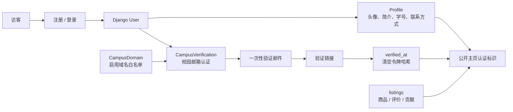
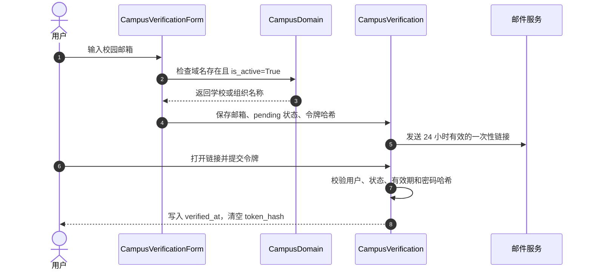

<div align="center">


# accounts · 账户与校园身份

**平台知道“谁在交易”，也负责判断“校园身份是否可信”。**

[项目首页](../README.md) · [完整项目手册](../docs/README.md) · [模块地图](../docs/module-map.md) · [功能手册](../docs/feature-handbook.md)

</div>

> [!NOTE]
> 这个应用只管账户、公开资料和校园邮箱认证。商品、订单、通知和审核分别由 `listings/` 与 `chat_messages/` 负责，不在这里重复实现。

## 📸 账户页面

<table>
<tr>
<td width="50%" valign="top">
<a href="../docs/screenshots/profile.png"></a>
<p align="center"><strong>个人资料</strong><br /><sub>账户信息、校园身份、贡献进度与活动入口</sub></p>
</td>
<td width="50%" valign="top">
<a href="../docs/screenshots/public-profile.png"></a>
<p align="center"><strong>公开交易档案</strong><br /><sub>只展示公开信誉、贡献与在售商品摘要</sub></p>
</td>
</tr>
</table>

<p align="center"><sub>截图来自本地演示账号，不包含真实身份或联系方式。</sub></p>

## 🧭 它在系统中的位置



公开主页会组合账户资料、交易信誉、贡献记录、最多 8 件在售商品和最多 8 条最近评价；它不直接把订单明细或私信内容带出去。

## ✉️ 校园认证怎么走



认证表单还会阻止同一个校园邮箱绑定到多个账号。令牌只保存不可逆哈希，不保存可直接使用的明文链接材料。

## 🗂️ 源码速查

| 文件 | 真实职责 |
| --- | --- |
| [`models.py`](models.py) | `Profile`、`CampusDomain`、`CampusVerification`，以及新用户保存后自动创建资料的信号 |
| [`forms.py`](forms.py) | 注册、资料更新、校园邮箱域名与重复邮箱校验 |
| [`views.py`](views.py) | 注册、公开主页、资料编辑、认证邮件发送和链接验证 |
| [`urls.py`](urls.py) | `/accounts/` 下的页面与认证路由 |
| [`admin.py`](admin.py) | 校园域名与认证记录的运营入口 |
| [`tests.py`](tests.py) | 账户、资料、公开主页和认证流程回归测试 |

## 🚪 页面与入口

| 路径 | 用途 | 登录要求 |
| --- | --- | --- |
| `/accounts/register/` | 创建账户 | 否 |
| `/accounts/login/` | 登录 | 否 |
| `/accounts/profile/` | 自己的资料与贡献摘要 | 是 |
| `/accounts/profile/edit/` | 修改用户名、邮箱、头像和资料 | 是 |
| `/accounts/user/<user_id>/` | 其他用户的公开交易档案 | 否 |
| `/accounts/profile/campus-verification/` | 发起或重新发送校园认证 | 是 |
| `/accounts/campus-verification/<uidb64>/<token>/` | 邮件中的一次性验证链接 | 否 |

## 🧱 关键模型与约束

| 模型 | 关键事实 |
| --- | --- |
| `Profile` | 与 `User` 一对一；保存 `avatar`、`bio`、`student_id`、`wechat`、`phone` |
| `CampusDomain` | 域名唯一；保存前统一转为小写并去掉前导 `@`；只有启用的域名可用于认证 |
| `CampusVerification` | 每个用户一条；校园邮箱唯一；状态为 `unverified / pending / verified / rejected` |
| 验证令牌 | 使用 Django 密码哈希保存；24 小时后失效；认证成功后 `token_hash` 被清空 |
| 公开主页 | 信誉和贡献由 `listings` 聚合；在售商品与评价各限制 8 条，避免公开页无限增长 |

## 🛠️ 修改时先确认

- 认证状态必须由服务端写入，资料表单不能直接修改 `status` 或 `verified_at`；
- 重新发送验证邮件时要覆盖旧令牌，不能让多个链接同时有效；
- 公开主页新增字段前先做隐私检查，不要顺手带出邮箱、订单、私信或完整联系方式；
- 修改自动建资料信号时，要同时考虑已有用户和历史数据；
- 过期链接、错误用户、重复邮箱、已认证用户再次提交都要补测试。

## ✅ 验证

```powershell
python manage.py test accounts
python manage.py check
python manage.py makemigrations --check --dry-run
```

## 📚 继续阅读

- [功能手册：校园身份与可信交易](../docs/feature-handbook.md#8-校园身份与可信交易)
- [校园认证摩擦设计](../docs/campus-verification-friction-design.md)
- [核心数据模型](../docs/data-model.md)
- [当前取舍与边界](../docs/product-boundaries.md)
