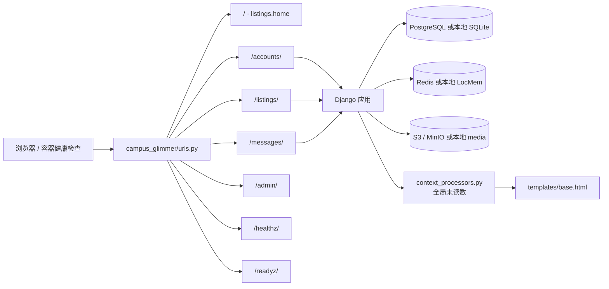
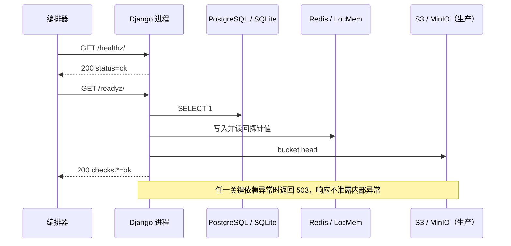

<div align="center">


# campus_glimmer · Django 项目配置

**根路由、运行配置、全局上下文、健康检查和服务入口都在这里汇合。**

[项目首页](../README.md) · [完整项目手册](../docs/README.md) · [生产部署基线](../docs/production-deployment.md)

</div>

<p align="center">
  
</p>

<p align="center"><sub>系统架构图 · 业务应用、页面与部署入口的真实边界</sub></p>

> [!NOTE]
> 这个 Python 包不承载具体业务模型。商品、订单、通知在 `listings/`，账户在 `accounts/`，私信与审核在 `chat_messages/`。这里负责把业务应用、数据依赖和部署入口装配起来。

## 🧭 请求如何进入应用



## 🗂️ 关键文件

| 文件 | 真实职责 |
| --- | --- |
| [`settings.py`](settings.py) | 应用注册、模板、认证、本地 / 生产数据依赖、静态资源、邮件和安全响应头 |
| [`deployment.py`](deployment.py) | 数据库 URL、Redis cache、对象存储配置与生产 fail-closed 校验 |
| [`storage.py`](storage.py) | S3 兼容存储的内部上传端点和浏览器访问端点分离 |
| [`urls.py`](urls.py) | 首页、后台、三个业务应用和两个健康检查的根路由 |
| [`context_processors.py`](context_processors.py) | 向全站模板注入私信与通知未读数 |
| [`health.py`](health.py) | 提供存活探针与数据库、缓存、对象存储就绪探针 |
| [`wsgi.py`](wsgi.py) / [`asgi.py`](asgi.py) | 部署入口 |
| [`tests.py`](tests.py) | 根路由、探针与安全配置基线测试 |
| [`test_deployment.py`](test_deployment.py) | 生产配置解析、fail-closed 校验和存储端点测试 |

## 🚪 根路由

| 路径 | 去向 |
| --- | --- |
| `/` | 首页，由 `listings.views.home` 提供 |
| `/admin/` | Django 管理后台 |
| `/accounts/` | 注册、登录、资料和校园认证 |
| `/listings/` | 商品、搜索、订单、通知、治理与运营 |
| `/messages/` | 留言、私信、内容审核与申诉 |
| `/healthz/` | 只证明 Django 进程还能响应，不访问数据库 |
| `/readyz/` | 检查数据库、缓存和对象存储；关键依赖不可用时返回 `503` |

## ❤️ 两个探针不能混用



本地文件存储模式不会执行对象存储检查。Docker 的 `HEALTHCHECK` 调用 `/readyz/`；修改探针字段、依赖集合或容器入口时，要同步更新部署文档和测试。

## ⚙️ 本地与生产配置

本地默认值保持零额外服务：

```text
SQLite + LocMem + 本地 media/ + 数据库会话
```

生产 Compose 显式启用：

```text
PostgreSQL + Redis + S3 兼容存储 + cached_db 会话 + WhiteNoise 静态文件
```

关键环境变量：

| 变量 | 作用 |
| --- | --- |
| `DJANGO_DATABASE_URL` | PostgreSQL 连接串；为空时使用本地 SQLite |
| `DJANGO_CACHE_URL` | `redis://` 或 `rediss://`；为空时使用 LocMem |
| `DJANGO_STORAGE_BACKEND` | `filesystem`、`s3` 或 `minio` |
| `DJANGO_S3_ENDPOINT_URL` | Web 容器访问对象存储的内部端点 |
| `DJANGO_S3_PUBLIC_ENDPOINT_URL` | 浏览器实际访问对象存储的外部端点 |
| `DJANGO_REQUIRE_PRODUCTION_SERVICES` | 生产 fail-closed 开关；配置缺失时拒绝启动 |

- 本地默认值直接可运行，生产必须显式覆盖 `DJANGO_SECRET_KEY`、域名、HTTPS 和 Cookie 安全开关；
- 完整样例见 [`../.env.production.example`](../.env.production.example)，逐项说明见[生产部署基线](../docs/production-deployment.md)；
- 生产模式启用 `CompressedManifestStaticFilesStorage`；静态文件由 WhiteNoise 分发，用户上传进入对象存储；
- 浏览器安全基线不跟随 `DEBUG`，默认启用 `nosniff`、同源 Referrer、COOP、`X-Frame-Options: DENY` 和 HttpOnly Cookie；
- SQLite / 本地 media 不会因切换环境变量自动迁移到 PostgreSQL / S3；
- 修改根路由、数据依赖、探针或安全头时，应同步补 `tests.py` 与 `test_deployment.py`。

## ✅ 验证

```powershell
python manage.py check
python manage.py test campus_glimmer
python manage.py makemigrations --check --dry-run
```

生产依赖配置还可以在 Compose 启动前验证：

```powershell
docker compose --env-file .env.production -f docker-compose.prod.yml config --quiet
```

## 📚 继续阅读

- [生产部署基线](../docs/production-deployment.md)
- [备份与恢复](../docs/backup-restore.md)
- [部署健康端点设计](../docs/deployment-health-endpoints-design.md)
- [Docker 运行说明](../docker/README.md)
