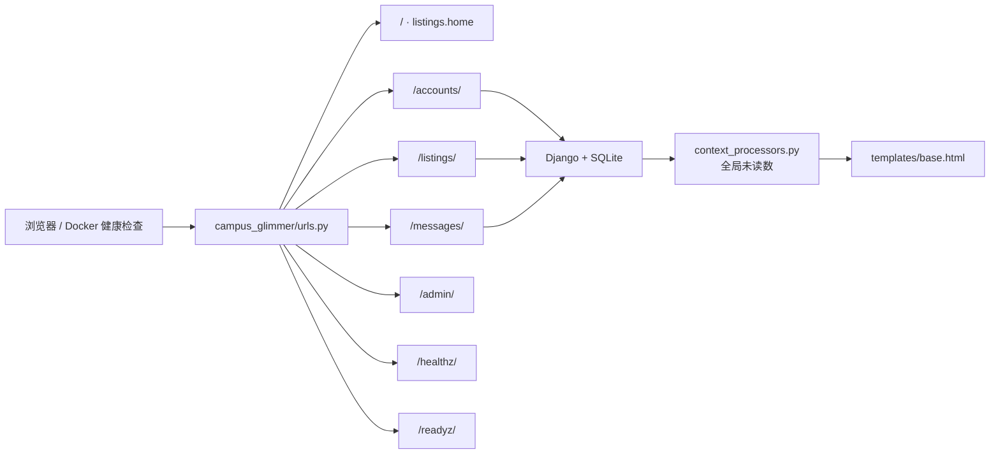
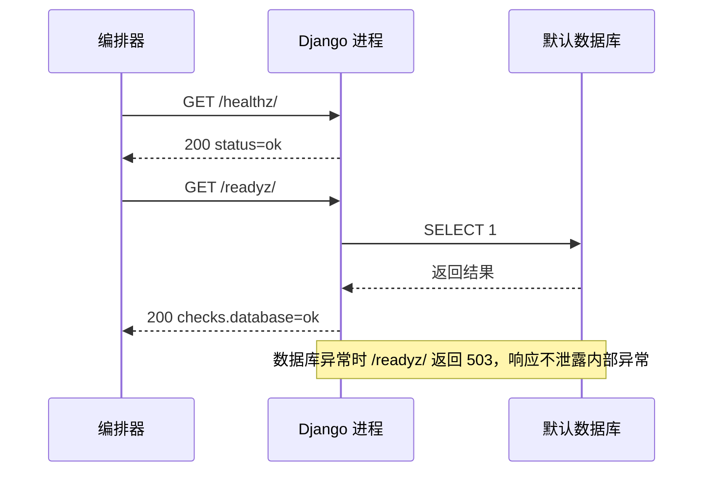

<div align="center">


# campus_glimmer · Django 项目配置

**根路由、运行配置、全局上下文、健康检查和服务入口都在这里汇合。**

[项目首页](../README.md) · [完整项目手册](../docs/README.md) · [模块地图](../docs/module-map.md)

</div>

<p align="center">
  
</p>

<p align="center"><sub>系统架构图 · 业务应用、页面与部署入口的真实边界</sub></p>

> [!NOTE]
> 这个 Python 包不承载具体业务模型。商品、订单、通知在 `listings/`，账户在 `accounts/`，私信与审核在 `chat_messages/`。

## 🧭 请求如何进入应用



## 🗂️ 关键文件

| 文件 | 真实职责 |
| --- | --- |
| [`settings.py`](settings.py) | 应用注册、SQLite、模板、静态/媒体文件、邮件、认证跳转与安全响应头 |
| [`urls.py`](urls.py) | 首页、后台、三个业务应用和健康检查的根路由 |
| [`context_processors.py`](context_processors.py) | 向全站模板注入私信与通知未读数 |
| [`health.py`](health.py) | 提供存活探针和数据库就绪探针 |
| [`wsgi.py`](wsgi.py) / [`asgi.py`](asgi.py) | 部署入口 |
| [`tests.py`](tests.py) | 根路由、探针与配置基线测试 |

## 🚪 根路由

| 路径 | 去向 |
| --- | --- |
| `/` | 首页，由 `listings.views.home` 提供 |
| `/admin/` | Django 管理后台 |
| `/accounts/` | 注册、登录、资料和校园认证 |
| `/listings/` | 商品、搜索、订单、通知、治理与运营 |
| `/messages/` | 留言、私信、内容审核与申诉 |
| `/healthz/` | 只证明 Django 进程还能响应 |
| `/readyz/` | 执行 `SELECT 1`，数据库不可用时返回 `503` |

## ❤️ 两个探针不能混用



Docker 的 `HEALTHCHECK` 调用 `/readyz/`。修改探针语义、响应字段或数据库连接时，要同步更新 Docker 与测试。

## ⚙️ 配置约定

- 本地默认值直接可运行，生产必须显式覆盖 `DJANGO_SECRET_KEY`、域名、HTTPS 和 Cookie 安全开关；
- 环境变量样例见 [`../.env.example`](../.env.example)；
- 默认数据库是 SQLite，路径可用 `DJANGO_DB_PATH` 覆盖；
- `STATICFILES_DIRS` 指向 `static/`，`STATIC_ROOT` 指向 `staticfiles/`；
- 浏览器安全基线不跟随 `DEBUG`，默认启用 `nosniff`、同源 Referrer、COOP、`X-Frame-Options: DENY` 和 HttpOnly Cookie；
- 修改根路由、认证跳转、Cookie 或安全头时，应同步补 `tests.py`。

## ✅ 验证

```powershell
python manage.py check
python manage.py test campus_glimmer
python manage.py makemigrations --check --dry-run
```

## 📚 继续阅读

- [部署健康端点设计](../docs/deployment-health-endpoints-design.md)
- [Docker 运行说明](../docker/README.md)
- [完整项目手册](../docs/README.md)
