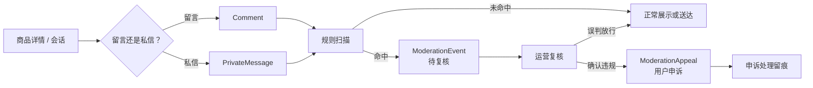

<div align="center">


# chat_messages · 留言、私信与内容治理

**把商品沟通、未读状态、风险拦截、人工复核和用户申诉连成一条可回看的链路。**

[项目首页](../README.md) · [完整项目手册](../docs/README.md) · [模块地图](../docs/module-map.md) · [功能手册](../docs/feature-handbook.md)

</div>

> [!IMPORTANT]
> 站内通知中心位于 `listings/`，这里负责商品留言、用户私信和内容审核。两者会在导航与“站内动态”中汇合，但数据模型和读取状态彼此独立。

## 📸 相关页面

<p align="center">
  <a href="../docs/screenshots/inbox.png"></a>
</p>

<p align="center"><strong>消息中心</strong><br /><sub>按会话整理私信，区分收到与发出的消息，并支持筛选和批量已读 · 本地演示数据</sub></p>

<table>
<tr>
<td width="50%" valign="top">
<a href="../docs/screenshots/item-detail.png"></a>
<p align="center"><strong>商品留言入口</strong><br /><sub>围绕具体商品展开公开讨论</sub></p>
</td>
<td width="50%" valign="top">
<a href="../docs/screenshots/notifications.png"></a>
<p align="center"><strong>站内通知</strong><br /><sub>通知由 listings 提供，与私信未读彼此独立</sub></p>
</td>
</tr>
</table>

> 截图分别来自商品详情、消息中心和通知中心，用来说明三条实际的用户沟通入口。所有账号、消息和商品均为本地演示数据。
## 🧭 一条消息如何被处理



规则扫描只负责生成可解释线索，不自动等同于“违规结论”。真正放行、维持或申诉处理都会保留状态和时间。

## 🚦 内容风险口径

| 命中规则 | 分值 | 复核分级 |
| --- | ---: | --- |
| 微信导流 | 40 | `elevated` |
| 外部链接 | 20 | `caution` |
| 手机号 | 35 | `elevated` |
| 高风险交易（押金、预付款、私下转账等） | 50 | `critical` |

总分最高按 100 计算：`>= 60` 为高风险，`>= 30` 为中风险，其余为低风险。复核目标分别为严重风险 4 小时、脱离平台联系 12 小时、低权重线索 48 小时；这是内部处理节奏，不是对外 SLA。

## 🗂️ 源码速查

| 文件 | 真实职责 |
| --- | --- |
| [`models.py`](models.py) | `Comment`、`PrivateMessage`、`ModerationEvent`、`ModerationAppeal` |
| [`moderation.py`](moderation.py) | 规则、分值、风险等级与拦截事件生成 |
| [`views.py`](views.py) | 收件箱、会话、发送、已读操作、审核队列和申诉 |
| [`forms.py`](forms.py) | 私信与审核表单 |
| [`urls.py`](urls.py) | `/messages/` 下全部路由 |
| [`chat_response.py`](chat_response.py) | 私信响应时效统计 |
| [`chat_response_trend.py`](chat_response_trend.py) | 响应时效跨周期对比 |
| [`chat_trade_correlation.py`](chat_trade_correlation.py) | 沟通与交易结果的只读关联分析 |

## 🚪 主要路由

| 路径 | 用途 |
| --- | --- |
| `/messages/comment/<item_id>/` | 在商品下新增留言 |
| `/messages/inbox/` | 收件箱、会话列表和未读筛选 |
| `/messages/conversation/<user_id>/` | 与指定用户查看会话并继续发送 |
| `/messages/send/<receiver_id>/<item_id>/` | 围绕商品发起私信 |
| `/messages/inbox/read-selected/` | 批量标记当前用户的接收记录 |
| `/messages/moderation/` | 待复核内容与风险队列 |
| `/messages/moderation/appeals/` | 用户申诉和运营处理 |

## 🔐 权限与状态边界

- 只有会话参与者可以查看对应私信；管理员身份不能替代参与关系读取私信；
- 已读操作只更新当前用户收到的记录，不修改发送者的副本或统计口径；
- `read_at` 记录第一次标记已读的时间，用于响应时效统计；
- 审核事件保留来源渠道、作者、关联商品、命中规则、风险分和处理留痕；
- 误判放行要有原渠道恢复材料；历史记录缺少材料时不能被伪造成“恢复成功”；
- 统计模块默认只读，不应把报告结果写回私信或审核表；
- 未读角标通过 `static/js/main.js` 每 30 秒轮询，脚本失败时服务端渲染的初始状态仍然可用。

## ✅ 验证

```powershell
python manage.py test chat_messages
python manage.py test chat_messages.test_moderation_appeal
python manage.py test chat_messages.test_moderation_release
python manage.py check
```

## 📚 继续阅读

- [功能手册：私信、留言与通知中心](../docs/feature-handbook.md#5-私信留言与通知中心)
- [私信响应场景设计](../docs/chat-response-context-design.md)
- [审核风险分层设计](../docs/moderation-risk-tier-design.md)
- [内容申诉设计](../docs/moderation-appeal-design.md)
