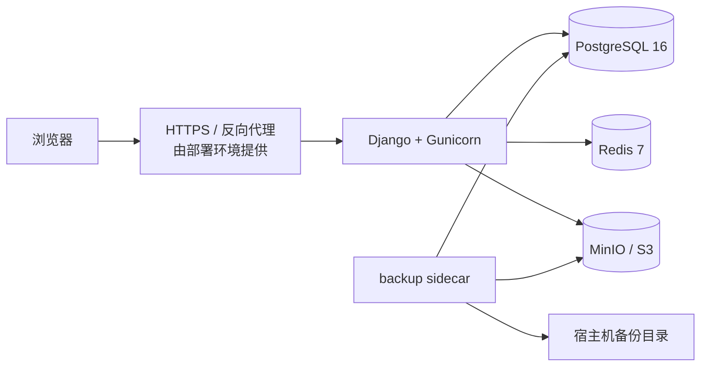

<div align="center">


# docker · 本地与生产容器运行

**一条命令启动本地演示；一份显式配置切换到 PostgreSQL、Redis、对象存储和备份链路。**

[项目首页](../README.md) · [完整项目手册](../docs/README.md) · [生产部署基线](../docs/production-deployment.md)

</div>

<p align="center">
  
</p>

<p align="center"><sub>容器只是承载端到端链路的一层，不改变 Django 应用内部的权限和业务边界</sub></p>

## 🧭 两套容器拓扑

| 场景 | Compose 文件 | 数据库 | 缓存 | 上传文件 | 适用边界 |
| --- | --- | --- | --- | --- | --- |
| 本地演示 | [`docker-compose.yml`](../docker-compose.yml) | 容器内 SQLite | LocMem | 命名卷 `campus_media` | 开发、演示、单实例试运行 |
| 生产基线 | [`docker-compose.prod.yml`](../docker-compose.prod.yml) | PostgreSQL 16 | Redis 7 | MinIO / S3 | 单机小规模上线，不是高可用集群 |

本地模式只启动一个 Web 服务，保持零外部依赖。生产模式不会自动迁移旧 SQLite 或本地媒体文件；切换数据源必须按[生产部署说明](../docs/production-deployment.md)单独执行。

## 🧱 生产拓扑



Web 等待 PostgreSQL、Redis 和 MinIO bucket 初始化完成后启动。入口脚本先执行迁移和静态文件收集，再由 Gunicorn 提供服务；任一步失败都会阻止错误实例启动。

## 🗂️ 文件说明

| 文件 | 真实职责 |
| --- | --- |
| [`entrypoint.sh`](entrypoint.sh) | 执行迁移、收集静态文件，再 `exec gunicorn` |
| [`healthcheck.py`](healthcheck.py) | 请求容器内 `/readyz/`，供 Docker `HEALTHCHECK` 使用 |
| [`backup.py`](backup.py) | PostgreSQL dump、客户端版本核验、对象镜像、SHA-256 校验、保留期清理与对象恢复 |
| [`../Dockerfile`](../Dockerfile) | Python 3.12 镜像、PostgreSQL 客户端、健康检查和 8000 端口 |
| [`../docker-compose.yml`](../docker-compose.yml) | 本地 SQLite、LocMem 与媒体卷 |
| [`../docker-compose.prod.yml`](../docker-compose.prod.yml) | PostgreSQL、Redis、MinIO、Web 与备份 sidecar |
| [`../.env.production.example`](../.env.production.example) | 生产环境变量模板，所有 `CHANGE_ME` 都必须替换 |

## 🚪 本地启动

```powershell
docker compose up --build
docker compose exec web python manage.py check
docker compose exec web python manage.py test
Invoke-RestMethod http://127.0.0.1:8000/healthz/
Invoke-RestMethod http://127.0.0.1:8000/readyz/
docker compose down
```

`docker compose down` 默认保留命名卷；除非明确确认不再需要数据，否则不要附加 `-v`。

## 🏭 生产启动

```powershell
Copy-Item .env.production.example .env.production
# 替换全部 CHANGE_ME，并保证数据库 / Redis 密码与 URL 中的值一致
$env:APP_ENV_FILE = '.env.production'
docker compose --env-file .env.production -f docker-compose.prod.yml config --quiet
docker compose --env-file .env.production -f docker-compose.prod.yml up -d --build
docker compose --env-file .env.production -f docker-compose.prod.yml ps
Invoke-RestMethod http://127.0.0.1:8000/readyz/
```

`.env.production` 只用于本机部署，不能提交，也不应被打进镜像。URL 中的特殊字符必须编码，例如密码里的 `@` 要写成 `%40`。`DJANGO_S3_PUBLIC_ENDPOINT_URL` 必须是浏览器可达的地址，不能填写仅供容器互访的 `http://minio:9000`。

## ❤️ 健康检查语义

| 端点 | 回答的问题 | 失败含义 |
| --- | --- | --- |
| `/healthz/` | Django 进程还能响应吗？ | 进程或路由层异常 |
| `/readyz/` | 数据库、缓存和对象存储能完成最小访问吗？ | 至少一个关键依赖不可用，暂不应接流量 |

生产响应的 `checks` 包含 `database`、`cache`，对象存储启用时还包含 `object_storage`。探针只做最小查询，不执行迁移、不写业务数据，也不返回连接串、异常文本或凭据。`/healthz/` 不访问依赖，避免数据库抖动触发无意义的重启。

## 💾 备份与恢复

备份 sidecar 默认每日运行一次，写入 `${BACKUP_HOST_DIR:-./backups}`：

```powershell
docker compose --env-file .env.production -f docker-compose.prod.yml exec backup python docker/backup.py --once
docker compose --env-file .env.production -f docker-compose.prod.yml exec backup python docker/backup.py --verify /backups/backup-YYYYMMDDTHHMMSSZ
```

备份包含 PostgreSQL custom dump、对象镜像和带大小 / SHA-256 的 manifest。生产镜像安装 PostgreSQL 16 客户端；备份脚本还会在 dump 前核验客户端与服务端主版本，不一致时拒绝生成归档。恢复不是自动动作，完整顺序、对象增量恢复边界和人工验收清单见[备份与恢复](../docs/backup-restore.md)。

## ⚠️ 真实部署边界

- 当前生产拓扑是单机小规模基线，不是高可用、跨可用区或自动故障转移方案。
- Web 启动时执行数据库迁移；多实例发布前应拆成独立的一次性迁移任务。
- Redis 的 AOF 用于进程重启后的缓存连续性，不替代 PostgreSQL 备份。
- 数据库与对象存储不是同一事务快照；默认备份也在宿主机目录，不等同于异地容灾。
- TLS、反向代理、日志采集、指标告警、证书续期和安全补丁由外层部署环境承担。
- 正式上线前仍需做真实上传、签名 URL、恢复演练和端到端人工烟雾测试。

## 📚 继续阅读

- [生产部署基线](../docs/production-deployment.md)
- [备份与恢复](../docs/backup-restore.md)
- [部署健康端点设计](../docs/deployment-health-endpoints-design.md)
- [Django 项目配置](../campus_glimmer/README.md)
