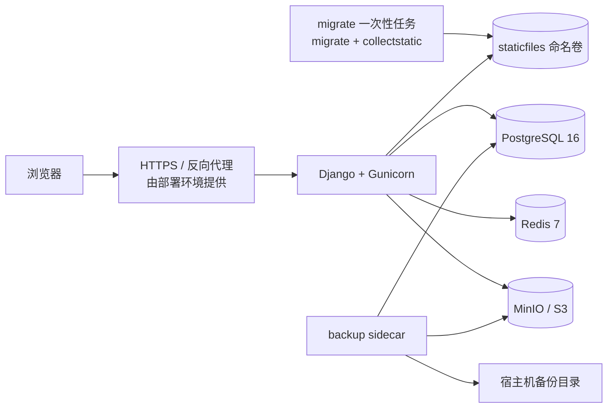

<div align="center">


# docker · 本地与生产容器运行

**一条命令启动本地演示；一份显式配置切换到 PostgreSQL、Redis、对象存储和备份链路。**

[项目首页](../README.md) · [完整项目手册](../docs/README.md) · [生产部署基线](../docs/production-deployment.md)

</div>

<p align="center">
  
</p>

<p align="center"><sub>容器只是承载端到端链路的一层，不改变 Django 应用内部的权限和业务边界</sub></p>

## 🧭 两套容器拓扑

| 场景 | Compose 文件 | 数据库 | 缓存 | 上传文件 | 适用边界 |
| --- | --- | --- | --- | --- | --- |
| 本地演示 | [`docker-compose.yml`](../docker-compose.yml) | 容器内 SQLite | LocMem | 命名卷 `campus_media` | 开发、演示、单实例试运行 |
| 生产基线 | [`docker-compose.prod.yml`](../docker-compose.prod.yml) | PostgreSQL 16 | Redis 7 | MinIO / S3 | 单机小规模上线，不是高可用集群 |

本地模式只启动一个 Web 服务，保持零外部依赖。生产模式不会自动迁移旧 SQLite 或本地媒体文件；切换数据源必须按[生产部署说明](../docs/production-deployment.md)单独执行。

## 🧱 生产拓扑



启动任务由独立的 `migrate` 服务一次性完成，Web 只在它成功退出后才启动。迁移和静态文件收集必须只跑一次：并发 `collectstatic` 会写裂 `staticfiles.json` 哈希清单，让页面安静地丢掉全部样式。直接 `docker run` 镜像时没有这个服务，入口脚本会退回自己执行，保证单容器用法不受影响。

## 🗂️ 文件说明

| 文件 | 真实职责 |
| --- | --- |
| [`entrypoint.sh`](entrypoint.sh) | 默认执行启动任务后 `exec gunicorn`；设 `DJANGO_RUN_STARTUP_TASKS=0` 可跳过 |
| [`startup_tasks.py`](startup_tasks.py) | 启动任务的唯一事实来源：`migrate --noinput` + `collectstatic --noinput` |
| [`healthcheck.py`](healthcheck.py) | `--liveness`（默认，探 `/healthz/`）与 `--readiness`（探 `/readyz/`）两种探针模式；Docker `HEALTHCHECK` 用前者 |
| [`../campus_glimmer/middleware.py`](../campus_glimmer/middleware.py) | 请求关联 ID 中间件与日志过滤器，让多副本日志能对回同一次请求 |
| [`../campus_glimmer/metrics.py`](../campus_glimmer/metrics.py) | 进程级 HTTP 指标与 Prometheus 文本格式的 `/metrics/` 端点，默认关闭 |
| [`backup.py`](backup.py) | PostgreSQL dump、客户端版本核验、对象镜像、SHA-256 校验、保留期清理与对象恢复 |
| [`../Dockerfile`](../Dockerfile) | Python 3.12 镜像、PostgreSQL 客户端、健康检查和 8000 端口 |
| [`../docker-compose.yml`](../docker-compose.yml) | 本地 SQLite、LocMem 与媒体卷 |
| [`../docker-compose.prod.yml`](../docker-compose.prod.yml) | PostgreSQL、Redis、MinIO、一次性迁移任务、Web、备份 sidecar 与统一的日志轮转 |
| [`../.env.production.example`](../.env.production.example) | 生产环境变量模板，所有 `CHANGE_ME` 都必须替换 |

## 🚪 本地启动

```powershell
docker compose up --build
docker compose exec web python manage.py check
docker compose exec web python manage.py test
Invoke-RestMethod http://127.0.0.1:8000/healthz/
Invoke-RestMethod http://127.0.0.1:8000/readyz/
docker compose down
```

`docker compose down` 默认保留命名卷；除非明确确认不再需要数据，否则不要附加 `-v`。

## 🏭 生产启动

```powershell
Copy-Item .env.production.example .env.production
# 替换全部 CHANGE_ME，并保证数据库 / Redis 密码与 URL 中的值一致
$env:APP_ENV_FILE = '.env.production'
docker compose --env-file .env.production -f docker-compose.prod.yml config --quiet
docker compose --env-file .env.production -f docker-compose.prod.yml up -d --build
docker compose --env-file .env.production -f docker-compose.prod.yml ps
Invoke-RestMethod http://127.0.0.1:8000/readyz/
```

`.env.production` 只用于本机部署，不能提交，也不应被打进镜像。URL 中的特殊字符必须编码，例如密码里的 `@` 要写成 `%40`。`DJANGO_S3_PUBLIC_ENDPOINT_URL` 必须是浏览器可达的地址，不能填写仅供容器互访的 `http://minio:9000`。
`migrate` 是一次性任务，成功后会保持退出状态，所以 `docker compose ps` 里它显示为
`exited (0)` 属于正常结果，不代表部署失败；要确认的是 `web` 是否进入 `healthy`，
也就是进程层面的存活。依赖是否可用是另一个问题，单独验 `/readyz/`：

```powershell
Invoke-RestMethod http://127.0.0.1:8000/readyz/
```
Web 没有起来时先看迁移任务的日志，不要去翻 Web：

```powershell
docker compose --env-file .env.production -f docker-compose.prod.yml logs migrate
```

迁移任务失败时 Web 不会启动，这是有意的——带病启动只会让请求打到结构不对的库上。
修好配置后重新执行 `up -d`，迁移任务会再次运行，已应用的迁移不会重复执行。

## ❤️ 健康检查语义

| 端点 | 回答的问题 | 失败含义 |
| --- | --- | --- |
| `/healthz/` | Django 进程还能响应吗？ | 进程或路由层异常 |
| `/readyz/` | 数据库、缓存和对象存储能完成最小访问吗？ | 至少一个关键依赖不可用，暂不应接流量 |

生产响应的 `checks` 包含 `database`、`cache`，对象存储启用时还包含 `object_storage`。探针只做最小查询，不执行迁移、不写业务数据，也不返回连接串、异常文本或凭据。`/healthz/` 不访问依赖，避免数据库抖动触发无意义的重启。

谁来问哪个问题，必须分开：

```powershell
# 容器 HEALTHCHECK（Dockerfile 与 compose 里写死的那条）
python docker/healthcheck.py --liveness

# 发布脚本 / 反向代理 / 人工验收：能不能接流量
python docker/healthcheck.py --readiness
```

`HEALTHCHECK` 只走 `--liveness`。`/readyz/` 连着三个外部依赖，拿它做存活探针的话，数据库抖一次编排系统就会把每个 web 副本判成 unhealthy 并重启，一次存储故障被放大成全站故障。两个模式互斥，默认 `--liveness`，传错参数会非零退出而不是静默探错端点。

由此 `docker compose ps` 里 `web` 的 `healthy` 只代表进程活着；要看能不能接流量，仍然以 `/readyz/` 为准。

## 🧾 日志与请求关联

生产是多副本部署，一条用户投诉落到日志里只是某个副本的某一行，只靠时间戳和 URL 是对不回去的。[`../campus_glimmer/middleware.py`](../campus_glimmer/middleware.py) 给每个请求分配一个关联 ID：客户端带 `X-Request-ID` 就沿用（只接受 `[A-Za-z0-9._-]` 且不超过 64 字符，否则丢弃重新生成，避免日志注入），否则自己生成一个。同一个值同时写进响应头和日志上下文，gunicorn 的 access log 也打同一个字段：

```text
2026-10-31 12:00:00 INFO [3589d67bc0c5492d] django.request ...
```

`DJANGO_LOG_LEVEL` 控制日志级别（默认 `INFO`），日志统一走 stdout，由 json-file 驱动按 `10m` × `5` 个文件轮转，不会无限涨满磁盘。要把一次投诉对回具体请求，先用响应头或用户提供的 ID 在各个副本里 grep。

## 📈 指标与告警

[`../campus_glimmer/metrics.py`](../campus_glimmer/metrics.py) 在进程内累计请求量、耗时直方图、在途请求数和构建信息，以 Prometheus 文本格式暴露在 `/metrics/`，零新增依赖：

```powershell
curl -H "Authorization: Bearer $env:DJANGO_METRICS_TOKEN" http://127.0.0.1:8000/metrics/
```

- 端点默认关闭：未配置 `DJANGO_METRICS_TOKEN` 时返回 404，不对外暴露内部路由拓扑；
- 路由标签只用 URL 模板，`/listings/1/` 与 `/listings/2/` 共用 `listings/<int:pk>/` 一个序列，标签组合封顶 500 组；
- 抓取请求自身不计入指标，健康探针和业务曲线的数字因此保持干净；
- 多 worker 下每个副本各有一份计数：跨副本汇总、按阈值告警、保留与可视化由外层监控系统承担，容器内不假装已经解决。

## 💾 备份与恢复

备份 sidecar 默认每日运行一次，写入 `${BACKUP_HOST_DIR:-./backups}`：

```powershell
docker compose --env-file .env.production -f docker-compose.prod.yml exec backup python docker/backup.py --once
docker compose --env-file .env.production -f docker-compose.prod.yml exec backup python docker/backup.py --verify /backups/backup-YYYYMMDDTHHMMSSZ
```

备份包含 PostgreSQL custom dump、对象镜像和带大小 / SHA-256 的 manifest。生产镜像安装 PostgreSQL 16 客户端；备份脚本还会在 dump 前核验客户端与服务端主版本，不一致时拒绝生成归档。恢复不是自动动作，完整顺序、对象增量恢复边界和人工验收清单见[备份与恢复](../docs/backup-restore.md)。

## ⚠️ 真实部署边界

- 当前生产拓扑是单机小规模基线，不是高可用、跨可用区或自动故障转移方案。
- 启动任务已拆成独立的一次性 `migrate` 服务，Web 不再自行迁移；横向扩容前仍需要无状态化会话与上传文件。
- Redis 的 AOF 用于进程重启后的缓存连续性，不替代 PostgreSQL 备份。
- 数据库与对象存储不是同一事务快照；默认备份也在宿主机目录，不等同于异地容灾。
- TLS、反向代理、集中日志采集、指标告警、证书续期和安全补丁由外层部署环境承担；容器内已保证日志带请求关联 ID、按大小轮转，并提供进程级 `/metrics/` 指标；把各副本的日志与指标汇到一起、按阈值告警仍在外层。
- 正式上线前仍需做真实上传、签名 URL、恢复演练和端到端人工烟雾测试。

## 📚 继续阅读

- [生产部署基线](../docs/production-deployment.md)
- [备份与恢复](../docs/backup-restore.md)
- [部署健康端点设计](../docs/deployment-health-endpoints-design.md)
- [Django 项目配置](../campus_glimmer/README.md)
