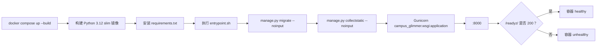

<div align="center">


# docker · 容器运行与健康检查

**一条可复现的启动链路：构建镜像、执行迁移、收集静态文件、由 Gunicorn 启动 Django。**

[项目首页](../README.md) · [完整项目手册](../docs/README.md) · [模块地图](../docs/module-map.md)

</div>

<p align="center">
  
</p>

<p align="center"><sub>容器只是承载端到端链路的一层，不改变 Django 应用内部的权限和业务边界</sub></p>

## 🧭 容器启动链路



入口脚本带 `set -eu`，迁移或静态文件收集失败会直接阻止错误启动。Gunicorn 默认运行 2 个 worker，可用 `WEB_CONCURRENCY` 覆盖。

## 🗂️ 文件说明

| 文件 | 真实职责 |
| --- | --- |
| [`entrypoint.sh`](entrypoint.sh) | 执行迁移、收集静态文件，再 `exec gunicorn` |
| [`healthcheck.py`](healthcheck.py) | 请求容器内 `/readyz/`，供 Docker `HEALTHCHECK` 使用 |
| [`../Dockerfile`](../Dockerfile) | Python 3.12 镜像、依赖安装、健康检查和 8000 端口 |
| [`../docker-compose.yml`](../docker-compose.yml) | 本地端口、环境变量、数据库卷和媒体卷 |
| [`../.env.example`](../.env.example) | 本地与部署环境变量样例 |

## 🚪 常用命令

```powershell
docker compose up --build
docker compose exec web python manage.py check
docker compose exec web python manage.py test
curl http://127.0.0.1:8000/healthz/
curl http://127.0.0.1:8000/readyz/
docker compose down
```

`docker compose down` 默认保留命名卷；除非明确确认不再需要数据，否则不要附加 `-v`。

## ❤️ 健康检查语义

| 端点 | 回答的问题 | 失败含义 |
| --- | --- | --- |
| `/healthz/` | Django 进程还能响应吗？ | 进程或路由层异常 |
| `/readyz/` | 默认数据库能执行最小查询吗？ | 数据库不可用，暂不应接流量 |

健康检查响应 `Cache-Control: no-store`，失败时不返回数据库异常细节。Compose 的 `restart: unless-stopped` 会自动拉起退出进程，但不会修复迁移错误、配置错误或数据库损坏。

## 💾 数据与部署边界

- SQLite 位于 `/app/data/db.sqlite3`，由 `campus_data` 卷持久化；
- 上传文件位于 `/app/media/`，由 `campus_media` 卷持久化；
- Compose 中的 `DJANGO_SECRET_KEY` 只适合本地演示，生产必须替换；
- 当前配置面向开发、演示和轻量部署，不宣称已经具备高可用或水平扩展能力；
- TLS、反向代理、备份、日志采集和进程级监控应由外层部署环境完成；
- 多实例部署前应重新评估 SQLite、共享媒体文件和定时任务的并发模型。

## ✅ 部署前检查

```powershell
docker compose config
docker compose build
docker compose up -d
docker compose ps
curl http://127.0.0.1:8000/readyz/
```

## 📚 继续阅读

- [部署健康端点设计](../docs/deployment-health-endpoints-design.md)
- [后台与定时任务](../docs/scheduled-tasks.md)
- [当前取舍与边界](../docs/product-boundaries.md)
- [Django 项目配置](../campus_glimmer/README.md)
