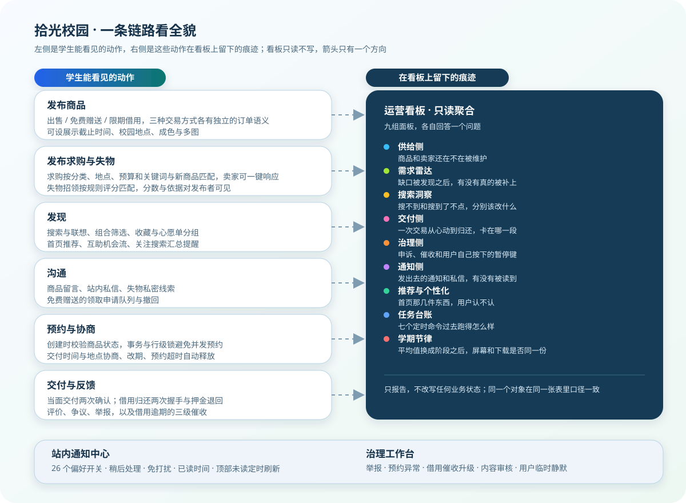

<a id="top"></a>
<p align="right">
  <a href="../README.md">← 返回项目主页</a>
</p>
<div align="center">

# 拾光校园 · Campus Glimmer

> 让闲置在校园里继续流转，也让每一次相遇都更有回应。

[](https://www.djangoproject.com/)
[](https://www.python.org/)
[](https://github.com/strawberry-little-bear/campus_glimmer/actions/workflows/django.yml)
[](../LICENSE)

[项目定位](#项目定位) · [功能地图](#功能地图) · [本地运行](#本地运行) · [文档地图](#文档地图) · [路线图](#后续路线图)

</div>

---

拾光校园（Campus Glimmer）是一个面向校园生活的二手交易与社区协作项目。它从“发布一件闲置、找到一个买家”出发，逐步补齐校园交易中经常被忽略的细节：在哪里交付、如何沟通、预约是否有效、交易进行到哪一步、消息是否被看到、问题由谁处理，以及运营者如何理解站内真实需求。

项目持续按真实业务链路演进。新增能力通常会经过设计说明、数据模型、页面交互、权限边界、数据库迁移、后台运营和自动化测试，再进入主分支。README 负责快速判断与进入；完整功能、模块索引和运营口径分别维护在 `docs/` 下的长期文档中。

## 项目定位

校园二手交易和普通电商并不完全相同：

- 用户活动范围集中，交易更依赖当面沟通和时间协调；
- 商品生命周期短，供需会随开学、考试周、毕业季等阶段快速变化；
- 用户既是买家，也是卖家、内容参与者和社区成员；
- 平台除了撮合交易，还需要处理通知、举报、内容和争议；
- 运营需要看到搜索、浏览、收藏、预约和完成交易之间的真实变化。

因此，项目没有把目标局限在商品 CRUD，而是围绕“发现、协商、预约、交付、反馈、治理、运营”建立一条可追踪的校园交易链路。

## 系统概览

下面两张图分别说明系统边界和端到端链路。运营看板与治理工作台只读消费业务事实，不反向修改交易状态。




### 真实界面

下面四张图来自当前主分支的本地演示环境，分别覆盖发现、运营、消息和账户界面。业务规则仍以文字说明和专项文档为准，截图用于快速确认页面结构与信息层级。

<table>
<tr>
<td width="50%" valign="top">

<p align="center"><strong>发现与筛选</strong><br /><sub>分类、校园地点、价格与分页入口</sub></p>
</td>
<td width="50%" valign="top">

<p align="center"><strong>运营看板</strong><br /><sub>指标卡片、告警状态与构建观测</sub></p>
</td>
</tr>
<tr>
<td width="50%" valign="top">

<p align="center"><strong>消息工作台</strong><br /><sub>会话、未读状态与批量操作</sub></p>
</td>
<td width="50%" valign="top">

<p align="center"><strong>账户中心</strong><br /><sub>校园身份、贡献与活动入口</sub></p>
</td>
</tr>
</table>

### 技术栈

| 层次 | 当前方案 | 说明 |
| --- | --- | --- |
| Web 框架 | Django 5.1+ | 路由、视图、模板、表单、认证与管理后台 |
| 编程语言 | Python 3.11+ | 业务逻辑、统计计算、管理命令和测试 |
| 数据库 | SQLite（本地）/ PostgreSQL 16（生产） | 本地保持零服务启动，生产使用事务数据库和连接健康检查 |
| 缓存 | LocMem（本地）/ Redis 7（生产） | 缓存未读等短生命周期数据，生产会话使用 `cached_db` |
| 页面层 | Django Templates + 轻量 JavaScript | 服务端渲染为主，未读刷新和筛选增强按需使用 JS |
| 文件存储 | 本地 `media/` / S3、MinIO（生产） | 商品图和头像；浏览器签名端点与容器内部上传端点分离 |
| 图片处理 | Pillow | EXIF 方向、WebP 重编码、缩略图和响应式候选 |
| 容器 | Docker + Gunicorn + WhiteNoise | 本地 Compose 与单机生产 Compose 分层 |
| 备份 | PostgreSQL dump + 对象镜像 | manifest、大小与 SHA-256 校验、按保留期清理 |
| 持续集成 | GitHub Actions | SQLite 质量任务 + PostgreSQL/Redis 集成任务 + 对象存储与备份恢复演练 |

## 功能地图

功能说明按九条业务链路组织。这里保留一张总览，完整规则和边界从[功能手册](feature-handbook.md)进入。

| 链路 | 主要能力 | 详细说明 |
| --- | --- | --- |
| 1. 商品发布与校园地点 | 三种交易方式、多图、地点、刷新额度、批量发布、CSV / XLSX 导入、学期模板与续期 | [阅读](feature-handbook.md#1-商品发布与校园地点) |
| 2. 搜索、保存与推荐 | 搜索筛选、关注搜索、价格轨迹、推荐反馈、机会流与供需信号 | [阅读](feature-handbook.md#2-搜索保存与推荐) |
| 3. 失物招领与智能匹配 | 失物/招领线索、匹配确认和结果反馈 | [阅读](feature-handbook.md#3-失物招领与智能匹配) |
| 4. 交易预约与订单状态 | 预约、改期、交付确认、借用归还、评价、争议与逾期催收 | [阅读](feature-handbook.md#4-交易预约与订单状态) |
| 5. 私信、留言与通知中心 | 会话、未读提醒、偏好、汇总降噪、单条与批量延后和恢复 | [阅读](feature-handbook.md#5-私信留言与通知中心) |
| 6. 社区治理与后台处理 | 举报、结果回访、风险分级、内容申诉、误判放行和分页治理队列 | [阅读](feature-handbook.md#6-社区治理与后台处理) |
| 7. 运营看板与运营告警 | 供给、需求、搜索、交付、治理、通知、推荐、任务台账、专题目标和节奏偏差 | [阅读](feature-handbook.md#7-运营看板与运营告警) |
| 8. 校园身份与可信交易 | 校园邮箱认证、公开档案、安全提示与确认记录 | [阅读](feature-handbook.md#8-校园身份与可信交易) |
| 9. 校园专题与个人足迹 | 专题浏览、加入与退出、幂等参与区间、目标进度、严格用户漏斗与运营统计 | [阅读](feature-handbook.md#9-校园专题与个人足迹) |

### 围绕用户能做什么

| 使用者 | 典型能力 |
| --- | --- |
| 买家 | 搜索筛选、收藏与分组、降价提醒、价格轨迹、预约、私信、交付确认、评价与争议 |
| 卖家 | 发布与编辑、多图、校园地点、批量发布、导入预览、批量续期、补图、刷新和响应求购 |
| 求购者 | 发布求购、接收匹配通知、确认或忽略卖家响应 |
| 失主 | 发布失物或招领、智能匹配、确认匹配、提交结果反馈 |
| 借用双方 | 借用下单、归还握手、到期与逾期提醒、催收阶梯 |
| 专题参与者 | 浏览校园专题、加入或退出、回看个人参与区间 |
| 普通用户 | 通知中心、偏好、关注搜索、举报回访、内容申诉和校园认证 |
| 管理员 | 治理工作台、需求雷达、运营看板、告警日报、数据质量审计与脱敏 CSV |

所有运营面板遵循同一条纪律：**只报告，不自动修改业务状态**。具体口径见[功能手册第 7 章](feature-handbook.md#7-运营看板与运营告警)。

## 典型业务流程


1. **发现**：从首页、分类、地点、专题或搜索结果进入商品；
2. **筛选**：按价格、成色、地点、交易方式和状态缩小范围；
3. **了解**：查看图片、描述、卖家信息、交付地点和公开留言；
4. **沟通**：通过留言或私信确认细节、交付地点与时间；
5. **预约**：服务端复核商品可用性后创建预约，状态变化进入订单事件线；
6. **交付**：线下交接，双方按当前安全提示完成确认；
7. **反馈**：交易结束后评价，异常时发起争议或举报；
8. **治理**：举报、争议、预约异常和借用催收进入统一治理队列。

出售、免费赠送和限期借用会在预约之后进入不同状态分支；求购匹配和失物招领是两条并行支线，完整流程图与边缘情况见[功能手册](feature-handbook.md)。

**我的交易**把买家与卖家的记录汇总在同一视图，支持全部、待推进、已完成和已取消筛选；当前结果每页 10 笔，切换页码时保留筛选，顶部分组计数始终按全量订单计算。

**我的心愿单**把收藏按分组分页展示：分组计数与全量收藏计数分开统计，当前结果每页 12 件，切换页码时保留所选分组。

**我的商品**把全部、在售、已预订、已售出和已过期拆成五个服务端页签，每个页签独立分页且每页 12 件；页签计数与生命周期汇总始终按全量商品计算。批量专题、批量续期与刷新只在“全部”页提供，操作完成后安全返回原页签和原页码。

**关注的搜索**按提醒状态与创建时间排序，当前结果每页 8 条；待提醒和当前命中只计算当前页，暂停、保存节奏或删除后安全回到原页码。

## 运营数据闭环

运营模块遵循一条可解释的闭环：

```text
记录行为 → 聚合指标 → 识别问题 → 建立跟进 → 发送提醒 → 验证效果
```

- 行为记录来自搜索、筛选、浏览、收藏、预约、订单事件、私信和举报；
- 看板按统计周期聚合，不直接修改业务数据；
- 需求缺口可以转成有负责人、有截止时间的跟进任务；
- 运营日报、生命周期提醒和关注搜索汇总都带幂等与偏好控制；
- 效果复盘区分“数字变化”和“原因证据”，样本不足时不强行下结论。

地点热力、价格响应、推荐质量、通知触达、任务运行台账和学期阶段复盘都遵守同一套可信度原则。完整指标口径见[功能手册第 7 章](feature-handbook.md#7-运营看板与运营告警)，学期阶段细节见[学期日历与交易高峰](academic-calendar.md)。

## 工程结构

项目保持 Django 应用的自然边界，业务主体集中在 `listings/`，账户与消息分别由 `accounts/`、`chat_messages/` 承担。

```text
campus_glimmer/
├── accounts/                  # 注册、登录、个人资料
├── chat_messages/             # 留言、私信、内容审核与申诉
├── campus_glimmer/            # Django 配置、根路由和健康检查
├── listings/                  # 商品、订单、搜索、通知、运营与治理
│   ├── migrations/            # 数据库迁移
│   └── management/commands/   # 运维、运营和回填命令
├── templates/                 # 页面模板
├── static/                    # CSS、JavaScript 和静态资源
├── media/                     # 本地上传文件
├── docker/                    # 容器辅助文件
└── docs/                      # 功能、设计、架构和运营文档
```

<a id="directory-readmes"></a>
### 目录级 README

每个主要目录都有一份与源码同步的说明，适合在修改具体模块前快速进入：

| 目录 | README 重点 |
| --- | --- |
| [`accounts/`](../accounts/README.md) | 账户、公开资料、校园邮箱域名与一次性认证链路 |
| [`chat_messages/`](../chat_messages/README.md) | 留言、私信、未读状态、审核规则与内容申诉 |
| [`listings/`](../listings/README.md) | 商品、搜索、订单、通知、治理、运营与定时任务 |
| [`campus_glimmer/`](../campus_glimmer/README.md) | 根路由、配置、全局上下文、健康检查与服务入口 |
| [`templates/`](../templates/README.md) | 服务端模板、公共布局和页面组合方式 |
| [`static/`](../static/README.md) | 主题变量、搜索建议、未读轮询和静态资源约定 |
| [`docker/`](../docker/README.md) | 镜像启动、迁移、静态收集与健康检查 |
| [`.github/`](../.github/CI.md) | GitHub Actions 质量检查与本地等价命令 |
| [`docs/screenshots/`](screenshots/README.md) | 真实界面截图、尺寸、隐私和更新流程 |

> GitHub 首页会优先读取 `.github/README.md`。因此 CI 说明固定命名为 [`.github/CI.md`](../.github/CI.md)，避免覆盖根目录的项目主 README。

模块、测试和设计文档索引见[模块与测试地图](module-map.md)。核心模型与关键约束见[核心数据模型](data-model.md)。

## 本地运行

### 1. 获取代码

```bash
git clone https://github.com/strawberry-little-bear/campus_glimmer.git
cd campus_glimmer
python -m venv .venv
```

Windows PowerShell：

```powershell
.\.venv\Scripts\Activate.ps1
```

macOS / Linux：

```bash
source .venv/bin/activate
```

### 2. 安装和初始化

```bash
python -m pip install -r requirements.txt
python manage.py migrate
python manage.py createsuperuser
```

如需快速准备演示数据：

```bash
python init_data.py
```

### 3. 启动

```bash
python manage.py runserver
```

常用页面：

| 页面 | 地址 |
| --- | --- |
| 首页 | <http://127.0.0.1:8000/> |
| 商品列表 | <http://127.0.0.1:8000/listings/> |
| 搜索 | <http://127.0.0.1:8000/listings/search/> |
| 我的交易 | <http://127.0.0.1:8000/listings/orders/> |
| 消息工作台 | <http://127.0.0.1:8000/messages/inbox/> |
| 站内通知 | <http://127.0.0.1:8000/listings/notifications/> |
| 校园专题 | <http://127.0.0.1:8000/listings/campaigns/> |
| 我的专题足迹 | <http://127.0.0.1:8000/listings/campaigns/mine/> |
| 运营看板（管理员） | <http://127.0.0.1:8000/listings/operations/> |
| 管理后台 | <http://127.0.0.1:8000/admin/> |

### 4. 常用检查

```bash
python -m compileall -q accounts campus_glimmer chat_messages listings
python manage.py check
python manage.py makemigrations --check --dry-run
python manage.py test
git diff --check
```

<details>
<summary><strong>环境变量说明</strong></summary>

本地开发可以直接使用默认配置。需要调整时：

```bash
cp .env.example .env
```

Windows PowerShell：

```powershell
Copy-Item .env.example .env
```

| 变量 | 作用 | 默认值 |
| --- | --- | --- |
| `DJANGO_SECRET_KEY` | Django 密钥，生产环境必须替换 | 本地开发占位值 |
| `DJANGO_DEBUG` | 是否开启调试模式 | `1` |
| `DJANGO_ALLOWED_HOSTS` | 允许访问的域名，逗号分隔 | `127.0.0.1,localhost,testserver` |
| `DJANGO_CSRF_TRUSTED_ORIGINS` | HTTPS 或反向代理场景下的可信来源 | 空 |
| `DJANGO_DB_PATH` | 本地 SQLite 数据库文件路径 | `db.sqlite3` |
| `DJANGO_DATABASE_URL` | PostgreSQL 连接串，启用生产依赖时必填 | 空 |
| `DJANGO_CACHE_URL` | Redis 连接串，启用生产依赖时必填 | 空 |
| `DJANGO_STORAGE_BACKEND` | `filesystem`、`s3` 或 `minio` | `filesystem` |
| `DJANGO_S3_BUCKET` | 商品图与头像所在 bucket | 空 |
| `DJANGO_S3_ENDPOINT_URL` | 容器内部 S3/MinIO 地址 | 空 |
| `DJANGO_S3_PUBLIC_ENDPOINT_URL` | 浏览器访问对象时使用的公网或本地端口 | 空 |
| `DJANGO_REQUIRE_PRODUCTION_SERVICES` | 是否强制要求 PostgreSQL、Redis、对象存储 | `0` |
| `DJANGO_SECURE_SSL_REDIRECT` | 是否强制跳转 HTTPS | `0` |
| `DJANGO_SESSION_COOKIE_SECURE` | 是否只通过 HTTPS 发送会话 Cookie | `0` |
| `DJANGO_CSRF_COOKIE_SECURE` | 是否只通过 HTTPS 发送 CSRF Cookie | `0` |
| `DJANGO_SECURE_HSTS_SECONDS` | HTTPS 稳定后开启 HSTS 的 max-age 秒数 | `0` |
| `DJANGO_EMAIL_BACKEND` | Django 邮件后端 | DEBUG 时 console，生产环境 SMTP |
| `DJANGO_DEFAULT_FROM_EMAIL` | 校园认证邮件发件地址 | `no-reply@campus-glimmer.local` |

</details>

## Docker 与部署

```bash
docker compose up --build
```

访问 <http://127.0.0.1:8000/>。容器默认使用 SQLite，数据库和上传文件分别通过 `campus_data`、`campus_media` 数据卷持久化。

```bash
docker compose down
```

仅在确认不需要保留数据后执行：

```bash
docker compose down -v
```

镜像内置 `HEALTHCHECK`：

- `/healthz/` 是存活检查，只确认 Django 进程可以处理请求；
- `/readyz/` 是就绪检查，会验证 PostgreSQL、Redis 和 S3/MinIO，任一失败返回 `503`；
- 编排系统应优先用 `/readyz/` 判断实例是否接流量。

生产拓扑使用 [`docker-compose.prod.yml`](../docker-compose.prod.yml)：PostgreSQL 16、Redis 7、MinIO、Gunicorn Web 和备份 sidecar。所有生产配置集中在 `.env.production`，并通过 `DJANGO_REQUIRE_PRODUCTION_SERVICES=1` 在启动时 fail closed。

<details>
<summary><strong>生产部署检查清单</strong></summary>

- 替换 `DJANGO_SECRET_KEY`，关闭调试模式并配置允许域名；
- 保证数据库/Redis 密码与连接串一致，替换所有 `CHANGE_ME` 占位值；
- 配置浏览器可访问的 `DJANGO_S3_PUBLIC_ENDPOINT_URL`；
- 启用 HTTPS 后配置安全重定向、Session/CSRF Cookie 和可信来源；
- 域名与回滚窗口确认后再设置 `DJANGO_SECURE_HSTS_SECONDS`；
- 将备份复制到独立主机或对象存储，并定期执行恢复演练；
- 不提交生产数据库、上传文件、密钥或包含用户隐私的日志；
- 当前生产编排是单机、小规模基线，不提供自动故障转移或异地容灾。

完整步骤见[生产部署基线](production-deployment.md)和[备份与恢复](backup-restore.md)。

</details>

## 后台与定时任务

周期任务统一封装成 Django management command，可接入系统计划任务、cron、容器任务或其他调度系统。

| 命令 | 主要用途 | 建议 |
| --- | --- | --- |
| `process_order_timeouts` | 预约超时、归还提醒和逾期催收 | 周期性运行 |
| `expire_items` | 下架到期商品并通知发布者 | 每日运行 |
| `send_operations_digest` | 生成管理员运营告警日报 | 按统计周期运行 |
| `send_opportunity_digest` | 发送互助机会摘要 | 每日运行 |
| `send_saved_search_digest` | 发送关注搜索汇总 | 按日/周频率运行 |
| `send_campaign_update_digest` | 发送校园专题上新摘要 | 按日/周频率运行 |
| `send_lifecycle_reminders` | 发送商品生命周期提醒 | 每日运行 |
| `sync_academic_calendar` | 补齐学期阶段并刷新快照 | 开学前及每周运行 |
| `backfill_item_thumbnails` | 回填历史图片变体和宽高 | 上线辅助、分批运行 |

命令的完整参数、幂等边界、运行台账与维护建议见[后台与定时任务](scheduled-tasks.md)。

## 权限与安全

### 普通用户

- 只能编辑、删除自己发布的商品；
- 只能查看和操作自己参与的订单、私信、通知和收藏；
- 只能修改自己的资料和通知偏好；
- 可以举报内容、查看处理状态、提交结果回访和内容申诉；
- 可以发起校园邮箱认证，但不能自行修改认证状态。

### 管理员

- 可以访问运营看板、搜索洞察、举报、争议、内容审核和申诉队列；
- 可以处理治理事项并查看风险分层，但分级只影响处理节奏，不自动判定违规；
- 接收运营告警受个人通知偏好控制；
- 不能绕过服务端权限检查代替普通用户完成交易操作。

### 安全基线

项目默认启用 `nosniff`、`Referrer-Policy`、`Cross-Origin-Opener-Policy`、`X-Frame-Options` 和 HttpOnly Cookie。订单创建使用事务与行级锁，争议证据、通知读取、运营数据和订单操作均在服务端校验身份。详细边界见[当前取舍与边界](product-boundaries.md)。

## 测试与持续集成

GitHub Actions 在推送到 `main` 或提交 Pull Request 时执行：

1. 使用 Python 3.12 安装依赖；
2. 对主要 Django 应用执行语法检查；
3. 执行 `manage.py check`；
4. 检查是否存在未生成的迁移；
5. 运行完整测试集。

CI 的目标是保证每个独立迭代至少满足“能导入、能启动、迁移一致、测试通过”。项目根配置的存活、就绪探针和容器健康检查也有测试覆盖。

## 当前取舍

项目当前更重视交易一致性、隐私边界和可解释运营，而不是把所有能自动化的动作都立即自动化。

| 主题 | 当前选择 |
| --- | --- |
| 交易一致性 | 订单创建使用事务和锁，交付仍保留人工确认 |
| 校园地点与隐私 | 不做轨迹还原，导出和看板避免暴露个人位置细节 |
| 指标口径 | 样本、分母、周期和缺失值必须显式说明 |
| 提醒与供给 | 使用冷却、合并和效果观测，不靠无节制发送换短期动作率 |
| 需求跟进 | 缺口被看见后要有任务、接手、复核和效果验证 |
| 借用催收 | 分层提醒，归还仍由双方确认，不自动关闭订单 |
| 部署形态 | 本地 SQLite 零服务；生产使用 PostgreSQL、Redis、S3/MinIO，但仍是单机小规模基线 |
| 数据迁移 | SQLite、PostgreSQL 和对象存储之间不做隐式迁移，切生产必须单独迁移并核对 |
| 备份一致性 | 数据库和对象分别备份，不是同一事务快照；默认备份不是异地容灾 |

完整取舍见[当前取舍与边界](product-boundaries.md)。

## 后续路线图

后续迭代继续围绕校园场景、交易闭环、社区治理和数据可信展开：

- **供给侧与提醒**：完善刷新台账覆盖和生命周期提醒效果；
- **搜索、供需与机会流**：补齐空结果诊断、需求承接和推荐解释；
- **交易、交付与借用**：强化交付异常、归还质量、催收效果和安全确认；
- **治理与通知**：继续做治理分组、申诉质量和通知降噪；
- **校园场景与信任**：完善认证体验、可信档案和地点维护；
- **运营与数据质量**：加强导出一致性、样本审计、指标血缘和告警；
- **基础设施与体验**：补齐多实例迁移、对象存储 CI、集中日志、监控告警、异机备份与恢复演练；继续优化移动端、无障碍和图片加载。

每个方向都拆成可独立验证、独立回滚的小迭代。详细待办、已落地范围和不做的理由见[后续路线图](roadmap.md)。

## 文档地图

| 文档 | 适合什么时候读 |
| --- | --- |
| [功能手册](feature-handbook.md) | 想了解九条业务链路的完整规则、指标和边缘情况 |
| [校园专题报名设计](campaign-registration-design.md) | 想了解专题参与区间、幂等约束、隐私边界和运营口径 |
| [校园专题上新摘要设计](campaign-update-digest-design.md) | 想了解主动订阅、合并摘要、发送边界和运营口径 |
| [专题目标与转化漏斗](campaign-goals-funnel-design.md) | 想了解六类目标、节奏偏差、严格漏斗和跨专题去重限制 |
| [内容审核队列分页](moderation-queue-pagination-design.md) | 想了解每页条数、筛选保留、越界页码与操作回跳的设计边界 |
| [卖家商品工作台分页](my-items-workspace-pagination-design.md) | 想了解状态页签为什么改为服务端分页、全量统计如何保留，以及批量操作怎样回到原页 |
| [生产部署基线](production-deployment.md) | 想配置 PostgreSQL、Redis、MinIO、Gunicorn 与生产探针 |
| [备份与恢复](backup-restore.md) | 想创建、校验、保留或恢复数据库与对象存储 |
| [备份脚本边界设计](backup-script-boundary-design.md) | 想了解备份脚本的失败分支为什么值得离线测试，以及哪些部分仍然只能人工演练 |
| [对象存储 CI 集成设计](object-storage-ci-integration-design.md) | 想了解 MinIO 集成任务覆盖了什么，以及为什么宁可失败也不静默跳过 |
| [搜索洞察懒加载与导出同构](search-insights-lazy-loading-design.md) | 想了解搜索洞察分区为什么比运营看板多一列裁剪，以及 CSV 导出与页面同构是怎么守住的 |
| [核心数据模型](data-model.md) | 想理解模型分组、关键字段和约束 |
| [模块与测试地图](module-map.md) | 想找代码模块、测试以及设计文档索引 |
| [后台与定时任务](scheduled-tasks.md) | 想接入周期任务、回填数据或排查运行台账 |
| [学期日历与交易高峰](academic-calendar.md) | 想理解学期阶段模型、快照和阶段提醒 |
| [当前取舍与边界](product-boundaries.md) | 想确认项目为什么暂时不做某些自动化 |
| [后续路线图](roadmap.md) | 想了解下一步方向和不做某项功能的理由 |
| [`docs/` 设计说明](./) | 想追溯具体功能在设计阶段的口径和取舍 |

README 只保留项目级入口，详细口径继续在深文档中维护。这样新增能力时不必反复拉长首页，也不会把长期积累的设计理由混进快速说明。

## 参与开发

欢迎提出具体的校园交易场景，也欢迎提交代码、测试、设计和文档改进。适合的贡献方向包括搜索与推荐、交易安全、治理、通知、移动端、无障碍、部署、监控和运营分析。

建议的提交方式：

1. 先说明要解决的使用场景和受影响的业务链路；
2. 将一个独立功能的模型、页面、权限、测试和文档放在同一组改动中；
3. 提交前运行本地检查和测试；
4. 使用清晰的中文提交信息，保持每个提交可独立理解和回溯；
5. 不提交本地数据库、上传文件、密钥或临时调试产物。

## License

本项目采用 [MIT License](../LICENSE)。
