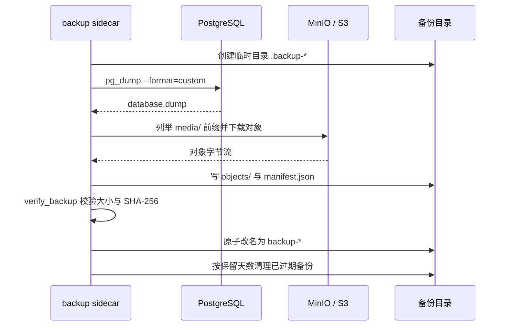

# 备份与恢复

<p align="right"><a href="../README.md">返回项目主页</a> · <a href="README.md">完整手册</a></p>

生产备份覆盖 PostgreSQL 业务数据和对象存储中的用户上传文件。Redis 只作为缓存和 `cached_db` 会话缓存，不是唯一业务事实源，因此不进入备份清单；Redis 自身开启 AOF，用于进程重启后的缓存连续性，但不能替代数据库备份。

> 默认备份写入宿主机目录 `./backups/`。它适合单机基线，不等于异地容灾。正式部署应把备份复制到独立主机或对象存储，并定期做恢复演练。

## 备份内容

```text
backup-YYYYMMDDTHHMMSSZ/
├── database.dump       # pg_dump custom format
├── objects/            # 对象镜像
└── manifest.json       # 时间、bucket、prefix、大小和 SHA-256
```

`database.dump` 使用 PostgreSQL custom format，恢复时由 `pg_restore` 同时处理表、索引、约束和序列。对象镜像不是把 S3 文件平铺成没有来源的随机文件；`manifest.json` 保存原始 key 与镜像文件的对应关系，也保存每个文件的 SHA-256 和大小。

备份镜像中的 `pg_dump` / `pg_restore` 固定为 PostgreSQL 16，并与 `docker-compose.prod.yml` 的数据库主版本一致。脚本在 dump 前会读取服务端 `server_version_num`，发现客户端与服务端主版本不一致时直接终止，避免生成“看似成功、目标数据库却无法恢复”的归档。

## 备份流程



关键行为：

- 先写临时目录，校验通过后才原子改名，失败不会留下“看起来可用”的半成品；
- `--verify` 会逐文件检查数据库 dump 和对象镜像的大小、SHA-256；
- 对象前缀按目录边界匹配，`media` 不会误匹配 `media-other`；
- 保留期只删除名称以 `backup-` 开头且 manifest 可解析的目录；
- 对象恢复是增量上传，不删除备份外的新对象，避免旧备份覆盖更新内容；
- 数据库与对象不是同一事务快照，极端情况下可能出现引用存在但对象缺失，或对象存在但数据库引用已删除；
- PostgreSQL 客户端主版本必须与服务端一致，升级 PostgreSQL 主版本时要同步更新镜像的 `POSTGRES_MAJOR` 并重新做恢复演练。

## 边界由测试钉住

备份脚本最容易出问题的分支不需要真实 PostgreSQL 或 MinIO 就能验证，因此它们由 campus_glimmer/test_backup_script.py 固定下来：

- URL 解析：非 PostgreSQL scheme、缺主机或缺库名必须显式失败；pg_dump 参数里不出现密码，密码只通过 PGPASSWORD 传给子进程；
- 版本护栏：客户端主版本读不出来、服务端主版本读不出来、两者不一致，都以 RuntimeError 结束，不生成目标库无法恢复的 dump；
- 校验：大小不符、SHA-256 不符、清单版本不受支持、清单不可读、清单路径越权都要报错，并一次汇总所有问题；
- 清理：只删除过期的 ackup- 目录；manifest 不可解析的目录跳过，不会中断其余清理；
- 失败路径：dump 或对象下载失败时 staging 目录必须被清空，不留下"看起来可用"的半成品。

这些用例是纯本地的：_dump_database、_download_objects 和 S3 客户端都被替换，因此不引入对数据库或对象存储的依赖。把 dump 灌回 PostgreSQL 的那一段由下面的 CI 恢复演练覆盖，正式环境的恢复演练仍要按「恢复步骤」人工执行。
## CI 恢复演练

`backup-restore` 任务把人工路径里能自动化的部分搬进了 CI：`migrate` 之后真实生成一份备份，灌进一个全新的隔离数据库，再逐项比对。它不写 fixture——库里已有的 `django_migrations`、`django_content_type` 与 `auth_permission` 就足够回答「dump 能不能原样恢复」，也不需要一份会随模型演进而过时的数据文件。

比对的是三类东西，而不是只看 `pg_restore` 有没有返回 0：

- `public` schema 下每一张表的行数，源库与恢复库逐张对齐；
- `pg_indexes` 的索引总数与 `pg_constraint` 的约束总数；
- 上传到 MinIO 的一个对象，恢复到第二个桶后按原 key 与原字节比对。

同一个任务还包含一条负向用例：往 `PATH` 最前面放一个只对 `--version` 报告 17 的假 `pg_dump`，备份必须失败。这一条复现的是本地真实踩过的事故——17 客户端生成的 dump 能通过清单校验，直到灌回 16 的服务端才被拒绝。

## 手动创建与校验

在 Compose 环境中执行：

```powershell
docker compose --env-file .env.production -f docker-compose.prod.yml exec backup python docker/backup.py --once
docker compose --env-file .env.production -f docker-compose.prod.yml exec backup python docker/backup.py --verify /backups/backup-YYYYMMDDTHHMMSSZ
```

本地运行脚本时，需要安装 PostgreSQL 客户端并配置 `DJANGO_DATABASE_URL`、`DJANGO_S3_*` 和 `BACKUP_DIR`：

```powershell
python docker/backup.py --once
python docker/backup.py --verify backups/backup-YYYYMMDDTHHMMSSZ
```

## 恢复步骤

恢复应作为一次受控发布执行，不要在 Web 容器仍然处理写入时直接覆盖数据库。

1. 停止 Web 写入并记录当前版本、备份目录、数据库和 bucket；
2. 用 `pg_restore --clean --if-exists --no-owner --no-acl` 恢复到目标 PostgreSQL；先确认目标库和备份来源一致；
3. 执行对象增量恢复：

   ```powershell
   docker compose --env-file .env.production -f docker-compose.prod.yml exec backup `
     python docker/backup.py --restore-objects /backups/backup-YYYYMMDDTHHMMSSZ `
     --restore-bucket campus-glimmer
   ```

4. 运行 `python manage.py check` 与 `python manage.py migrate --check`；
5. 启动 Web，确认 `/healthz/` 返回 200，`/readyz/` 的 database、cache、object_storage 均为 ok；
6. 人工验证登录、商品图、收藏、预约、订单、通知和运营看板；
7. 记录恢复耗时、缺失对象、人工修复和后续改进。

对象恢复不会删除目标 bucket 中不属于备份的文件。若目标环境有残留对象，应先明确清理范围，不要用“恢复”命令顺便做删除。

## 保留与异地策略

Compose 示例默认 `BACKUP_RETENTION_DAYS=14`、`BACKUP_INTERVAL_SECONDS=86400`。生产至少应确认：

- 每日备份是否完整通过 `--verify`；
- 是否有独立于主机的副本；
- 数据库和对象备份是否覆盖同一发布版本；
- 是否有月度恢复演练；
- 备份目录权限是否限制到运维账号；
- 备份、校验和恢复结果是否进入告警。

## 当前边界

- 备份不是 PostgreSQL PITR；归档日志和持续恢复需要数据库层方案；
- 不自动执行 `pg_restore`，恢复必须人工确认目标库；CI 里的隔离恢复只针对一次性数据库，不碰任何真实环境；
- 不提供跨区域复制、加密托管或密钥轮换；
- 默认目录位于宿主机，主机损坏会同时丢失业务卷和备份；
- Redis 不备份，因为业务事实应能从 PostgreSQL 和对象存储重建。
