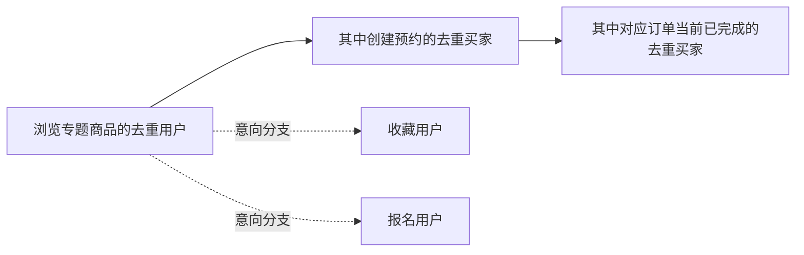

# 专题目标与转化漏斗设计

<p align="right"><a href="../README.md">返回项目主页</a> · <a href="README.md">完整手册</a></p>

校园专题不能只停留在“有浏览、有报名”的计数上。运营真正需要回答的是：这次专题有没有带来足够的新供给，用户有没有从看到内容走到预约和完成交易，当前进度相对时间窗口是领先还是落后。本迭代因此把专题目标、用户漏斗和 CSV 导出接入现有运营看板，而不是再建一套脱离业务表的统计系统。

<p align="center">
  
</p>

<p align="center"><sub>运营看板中的专题区沿用真实业务表聚合；截图来自本地演示数据</sub></p>

## 设计目标

- 运营人员能为同一个专题配置多个指标目标，并给目标独立的起止时间；
- 目标进度从商品、浏览、收藏、报名和订单事实实时重算，不保存容易失真的进度快照；
- 漏斗只描述严格的用户路径，不把收藏或报名强行拼进预约、成交的分母；
- 看板同时给出“完成了多少”和“按当前时间应该完成多少”，避免只看完成率；
- 指标、公式、限制和缺失值在页面与 CSV 中保持同一口径；
- 用户级明细不进入看板或导出，运营只消费聚合结果。

## 数据模型

`CampaignGoal` 表示一个专题下的一项运营目标。同一个专题和指标只能有一条目标记录，目标值必须大于 0，时间窗口不能早于专题开始或晚于专题结束。

| 字段 | 含义 |
| --- | --- |
| `campaign` | 目标所属的校园专题 |
| `metric` | 六类指标之一 |
| `target_value` | 正整数目标值 |
| `starts_at` | 可覆盖专题起点的目标开始时间 |
| `ends_at` | 可覆盖专题终点的目标结束时间 |
| `note` | 最多 200 字的运营说明 |
| `is_active` | 是否在运营看板中启用 |

目标不保存 `current_value`、完成率或状态。每次打开看板和导出 CSV 时，系统都从当前业务事实重新计算，因此目标不会因为后台任务漏跑、重复跑或人工改库而与业务记录脱节。

## 六类目标口径

| 指标 | 当前值的计算方式 |
| --- | --- |
| 周期新增商品 | 目标窗口内创建、且属于该专题的商品数 |
| 浏览用户 | 目标窗口内最近一次浏览落在窗口内、且浏览商品属于该专题的去重用户数 |
| 收藏用户 | 目标窗口内收藏了该专题商品的去重用户数 |
| 报名用户 | 目标窗口内加入专题的去重用户数 |
| 预约用户 | 目标窗口内创建了该专题商品订单的去重买家数 |
| 完成交易用户 | 目标窗口内创建、对应订单当前状态为 `completed` 的去重买家数 |

### 时间与节奏

目标窗口优先使用自身 `starts_at` / `ends_at`，留空时继承专题窗口。目标窗口独立于看板的 7 天或 30 天统计周期，切换看板周期不会悄悄改写目标是否达成。

- 完成率 = 当前值 ÷ 目标值；
- 已流逝时间比例 = 已测量时长 ÷ 目标总时长；
- 节奏偏差 = 完成率 − 已流逝时间比例；
- 偏差低于 −10 个百分点时标记为“需要推进”；
- 目标开始前显示“待开始”；到达截止时间仍未达标显示“已到期未达成”；
- 没有截止时间时不做节奏判断，只显示“开放目标”或“已达成”。

## 严格用户漏斗



连续漏斗只有三层：

1. **浏览用户**：报告窗口内最近一次浏览落在窗口内；
2. **预约用户**：浏览用户中，在报告窗口为专题商品创建预约的去重买家；
3. **完成交易用户**：上一步预约用户中，对应订单当前状态为 `completed` 的去重买家。

收藏和报名展示为意向分支，不进入连续漏斗分母。这个选择是有意为之：收藏不一定产生订单，报名也不代表已经预约；把它们塞进一条“浏览 → 收藏 → 预约 → 成交”的链条，会让转化率看起来完整，却无法解释每一步是否真的是上一步的子集。

### 为什么顶部漏斗不能当全站去重用户数

看板顶部会把各专题的用户数相加。同一用户可以浏览、预约或完成多个专题，因此顶部数字只代表“专题用户参与量”，不能当作全站去重用户数。单专题行才适合做纵向转化判断；跨专题比较应看各行的比率和绝对量，而不是把总和解释成去重用户。

### 完成交易时间的限制

订单模型目前没有独立的“完成时间”字段。当前完成交易目标使用订单 `created_at` 落在目标窗口、且订单当前状态为 `completed` 的组合口径。它不会伪装成“按完成时刻统计”，也不会把后来才完成的订单回溯成在窗口内完成。若未来补充 `completed_at`，需要同时迁移历史数据、调整目标窗口与测试，再改变对外口径。

## 页面与导出

运营看板新增：

- 启用目标数、已达成目标数、需要推进目标数；
- 每个目标的当前值、完成率、剩余量、时间进度和节奏偏差；
- 各专题严格漏斗、意向分支和比率；
- 顶部漏斗汇总及明确的口径说明；
- CSV 中的目标明细、漏斗明细、公式和限制说明。

目标最多展示 12 行，避免页面无限增长；完整目标仍可在 Django 后台查看。看板和导出都只包含聚合值，不包含用户姓名、邮箱或浏览明细。

## 测试覆盖

`listings/test_campaign_goals.py` 覆盖：

- 六类目标的实时统计与目标窗口过滤；
- 待开始、已达成、到期未达成和需要推进状态；
- 时间进度、节奏偏差和开放目标；
- 非法目标值、越界时间和重复指标；
- 看板目标、漏斗、公式说明和 CSV 导出。

验证命令：

```powershell
python manage.py test listings.test_campaign_goals
python manage.py test listings.test_campaign_analytics
```

## 当前边界

- 目标按请求实时计算，专题行为量很大时需要再评估缓存或预聚合；
- 跨专题顶部汇总不去重；
- 完成交易暂时按订单创建时间筛选、当前状态判断；
- 目标只读展示，不自动通知负责人，也不自动暂停专题；
- 不追踪用户跨会话身份，也不把浏览行为还原为个人轨迹。
