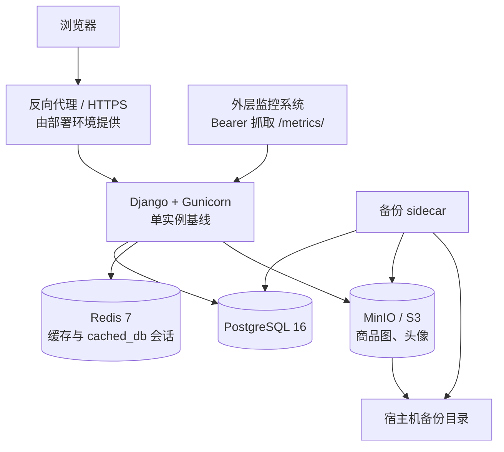

# 生产部署基线

<p align="right"><a href="../README.md">返回项目主页</a> · <a href="README.md">完整手册</a></p>

这份说明描述项目当前的单机、小规模生产基线。它解决的是“默认本地 SQLite + 本地媒体文件无法支撑正式站点”的问题，不把项目包装成高可用平台。生产环境可以替换为托管 PostgreSQL、Redis 和 S3，也可以直接使用仓库内的 Compose 拓扑。

<p align="center">
  
</p>

## 拓扑



本地开发仍然零额外服务：SQLite、LocMem 缓存和本地 `media/`。只有显式启用生产依赖时才要求 PostgreSQL、Redis 和对象存储，避免开发者为了跑一个页面先安装整套基础设施。

## 组件职责

| 组件 | 生产用途 | 不应承担的事实 |
| --- | --- | --- |
| PostgreSQL | 业务数据、订单、通知、运营事实 | 不是缓存，也不由 Redis 替代事务数据 |
| Redis | Django cache、`cached_db` 会话缓存 | 不保存唯一业务事实；AOF 不是数据库备份 |
| MinIO / S3 | 商品图、头像等对象文件 | 不保存业务记录之间的引用关系 |
| WhiteNoise | 收集并分发静态文件 | 不处理用户上传文件 |
| 备份 sidecar | PostgreSQL custom dump + 对象镜像 | 不提供异地容灾或高可用 |

数据库和对象存储不是同一事务快照。备份先完成 PostgreSQL dump，再镜像对象前缀；两者可以用于恢复站点，但无法保证某一毫秒级别的严格一致性。生产镜像固定 PostgreSQL 16 客户端，备份脚本还会拒绝客户端与服务端主版本不一致的配置。备份口径见[备份与恢复](backup-restore.md)。

## 1. 准备生产环境文件

复制模板：

```powershell
Copy-Item .env.production.example .env.production
```

至少替换以下内容：

- `DJANGO_SECRET_KEY`：至少 32 位随机值；
- `POSTGRES_PASSWORD` 与 `DJANGO_DATABASE_URL` 中的密码：必须一致，URL 特殊字符需要编码；
- `REDIS_PASSWORD` 与 `DJANGO_CACHE_URL` 中的密码：必须一致；
- `MINIO_ROOT_USER` / `MINIO_ROOT_PASSWORD`；
- `DJANGO_S3_ACCESS_KEY_ID` / `DJANGO_S3_SECRET_ACCESS_KEY`；
- `DJANGO_ALLOWED_HOSTS`、`DJANGO_CSRF_TRUSTED_ORIGINS`；
- `DJANGO_S3_PUBLIC_ENDPOINT_URL`：必须是浏览器实际可访问的对象存储域名或端口，不能想当然填写容器内部地址 `minio:9000`。

生产服务的启动会在配置缺失、仍包含 `CHANGE_ME` 占位值或依赖类型不正确时失败。`DJANGO_REQUIRE_PRODUCTION_SERVICES=1` 是 Compose 的显式开关。

## 2. 校验 Compose

```powershell
$env:APP_ENV_FILE = '.env.production'
docker compose --env-file .env.production -f docker-compose.prod.yml config --quiet
```

`--env-file` 负责 Compose 变量替换，`APP_ENV_FILE` 负责容器 `env_file`。两者都指向同一份生产配置，避免“宿主机解析了变量，但容器没有拿到”的隐性差异。

## 3. 启动

```powershell
docker compose --env-file .env.production -f docker-compose.prod.yml up -d --build
docker compose --env-file .env.production -f docker-compose.prod.yml ps
```

服务依赖顺序：

1. PostgreSQL 健康；
2. Redis 健康；
3. MinIO 启动并完成 bucket 初始化；
4. `migrate` 一次性任务执行迁移与静态文件收集，成功后退出；
5. Web 确认 `migrate` 成功后启动 Gunicorn；
5. 备份 sidecar 连接数据库和对象存储，按周期运行。

启动任务由 `docker/startup_tasks.py` 统一实现，`migrate` 服务与入口脚本调用同一份代码，避免两处实现漂移。生产拓扑下 Web 设 `DJANGO_RUN_STARTUP_TASKS=0`，不再自行迁移；直接 `docker run` 镜像时该变量默认为 `1`，单容器用法保持不变。

拆成独立任务不只是为了少一次等待：`collectstatic` 在 `CompressedManifestStaticFilesStorage` 下会重写 `staticfiles.json`，多个 worker 并发执行会写裂哈希清单，页面随后安静地丢掉全部样式。因此 `migrate` 与 Web 通过 `staticfiles` 命名卷共享产物，Web 以只读挂载。

## 4. 验证

```powershell
Invoke-RestMethod http://127.0.0.1:8000/healthz/
Invoke-RestMethod http://127.0.0.1:8000/readyz/
```

`/healthz/` 只证明进程能响应；`/readyz/` 会检查：

- PostgreSQL `SELECT 1`；
- Redis 写入/读取探针；
- MinIO/S3 bucket `head_bucket`。

任一关键依赖失败时返回 `503`，响应不包含异常文本、连接串或凭据。浏览器访问首页、后台登录、商品图片上传和专题运营看板还需要人工烟雾测试。

`docker compose ps` 里 `web` 显示 `healthy` 只代表进程存活，不代表上面三项依赖可用——容器的 `HEALTHCHECK` 只请求 `/healthz/`。判定能否接流量以 `/readyz/` 为准；依赖没就绪时容器仍是 `healthy`，这是有意为之，避免数据库一次抖动把每个副本都重启一遍。

## 5. 首次迁移数据

从旧部署迁移时，SQLite 和 PostgreSQL 不会自动切换数据源，本地 `media/` 也不会自动上传到 S3。至少需要单独完成：

1. 停写并备份旧 SQLite 与媒体目录；
2. 在 PostgreSQL 建库并执行迁移；
3. 使用受控的数据迁移脚本导入业务表，校验主键、序列、外键和行数；
4. 将 `media/` 对象上传到目标 bucket/location；
5. 抽查商品图、头像、订单引用和运营聚合；
6. 验证 `/readyz/` 与关键页面后再切流量。

迁移脚本和对象上传策略属于部署环境职责，不包含在常规 CI 中。不要用 `flush`、覆盖生产库或直接复制 SQLite 文件来模拟迁移。

## 6. HTTPS 与反向代理

生产安全基线默认具备 `nosniff`、同源 Referrer、COOP、`X-Frame-Options: DENY` 和 HttpOnly Cookie。HTTPS 稳定后，再逐步设置：

```text
DJANGO_SECURE_SSL_REDIRECT=1
DJANGO_SESSION_COOKIE_SECURE=1
DJANGO_CSRF_COOKIE_SECURE=1
DJANGO_SECURE_HSTS_SECONDS=31536000
```

`DJANGO_SECURE_HSTS_SECONDS` 一旦开启就会附带 `includeSubDomains` 和 `preload`，应在域名和回滚策略确认后再使用。反向代理需要正确传递 `X-Forwarded-Proto`，并把静态文件、上传大小、请求超时和限流策略纳入部署配置。

## 7. 可观测性与单机边界

当前 Compose 是单机基线：

- PostgreSQL、Redis 不向宿主机暴露端口；
- MinIO API/Console 默认只绑定 `127.0.0.1`；
- Web 默认绑定 `127.0.0.1:8000`，由外层反向代理接入；
- 镜像健康检查只调用 `/healthz/`（存活），`/readyz/`（就绪）由发布脚本、反向代理和人工验收调用；
- Redis 开启 AOF，但 Redis 不是业务事实源；
- 备份默认写入宿主机目录，不自动复制到异地；
- 没有自动故障转移、读写分离、对象跨区域复制，也没有把各副本的日志与指标汇到一起的聚合和告警；进程内已有请求级指标，但还没有人负责盯着它们。

迁移已经是独立的一次性任务。扩大到多实例前，仍需要把会话与上传文件改成无状态依赖，并为数据库、对象存储、备份和告警建立独立监控。

### 请求关联 ID 与日志轮转

多副本下日志分散在各个容器里，没有关联 ID 时只能靠时间戳和 URL 猜。`campus_glimmer.middleware.RequestIdMiddleware` 给每个请求分配一个 ID：客户端带 `X-Request-ID` 就沿用（只接受 `[A-Za-z0-9._-]` 且不超过 64 字符，否则重新生成），否则自己生成；同一个值同时写进响应头和日志上下文，gunicorn 的 access log 也打同一个字段。

`DJANGO_LOG_LEVEL` 控制级别（默认 `INFO`），健康探针日志单独压到 `WARNING`——它每 30 秒一条，比业务请求还吵。日志统一走 stdout，Compose 对全部服务按 `10m` × `5` 个文件轮转。关联关系、字符集校验与轮转参数由 `campus_glimmer/test_request_logging.py` 钉住。

### 进程级指标与 `/metrics/`

`campus_glimmer/metrics.py` 在进程内累计请求量、耗时直方图、在途请求数和构建信息，以 Prometheus 文本格式暴露在 `/metrics/`。它不写库、不引第三方依赖，序列化在锁外进行，抓取本身不跟业务请求抢同一把锁。

- **路由标签只取 URL 模板**（`/listings/<int:pk>/`），不取 `request.path`：后者会让每条商品各成一个序列，一天就能把 Prometheus 的内存和每次抓取的体积一起打爆；
- 标签组合封顶 500 组，超出折叠进 `overflow` 路由，同时把 `campus_glimmer_metrics_label_overflow` 置 1——封顶本身是一次故障，必须可见；
- 状态码压成 `2xx/3xx/4xx/5xx`，按精确码分组等于把基数再乘一个量级；
- 抓取请求自身不计入指标，否则每次 scrape 都会把业务曲线抬高一点；
- 端点默认关闭：未配置 `DJANGO_METRICS_TOKEN` 时返回 404，配置后抓取需带 `Authorization: Bearer <token>`，令牌比对走 `hmac.compare_digest`。

多 worker 下计数器按进程分离：gunicorn 起几个 worker 就有几份计数，抓任一副本都只是总量的一部分。所以这份指标回答的是「这个副本忙不忙、慢不慢、错误率有没有抬头」；把各副本汇到一起、按阈值告警、保留与可视化仍在外层监控系统。

```powershell
curl -H "Authorization: Bearer $env:DJANGO_METRICS_TOKEN" http://127.0.0.1:8000/metrics/
```

## 8. CI 覆盖

GitHub Actions 的 `quality` 任务在 SQLite 下执行语法、`check`、迁移一致性和完整测试；`production-deps` 任务使用 PostgreSQL 16 与 Redis 7 service，执行 `collectstatic` 并再次跑完整测试。`object-storage` 任务在 runner 上直接启动 MinIO，对默认存储执行真实上传、回源、签名 URL 与对象镜像恢复，覆盖范围与取舍见[对象存储 CI 集成设计](object-storage-ci-integration-design.md)。`backup-restore` 任务额外安装 PostgreSQL 16 客户端，把 `migrate` 之后的库真实 dump 到一个全新隔离库并逐表比对行数、索引与约束，对象部分恢复到第二个桶后按原 key 逐字节比对，并用一个主版本不一致的假客户端验证版本护栏会拒绝生成 dump，口径见[备份与恢复](backup-restore.md)。`quality` 的完整测试同时覆盖指标端点契约：标签基数、暴露格式、序列封顶与 Bearer 鉴权。

## 相关文档

- [备份与恢复](backup-restore.md)
- [健康端点演进](deployment-health-endpoints-design.md)
- [对象存储 CI 集成设计](object-storage-ci-integration-design.md)
- [后台与定时任务](scheduled-tasks.md)
- [当前取舍与边界](product-boundaries.md)
- [项目首页](../README.md)
