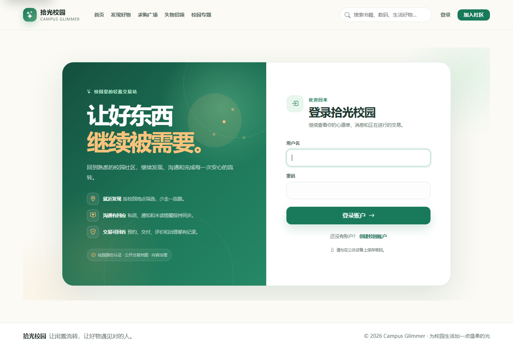
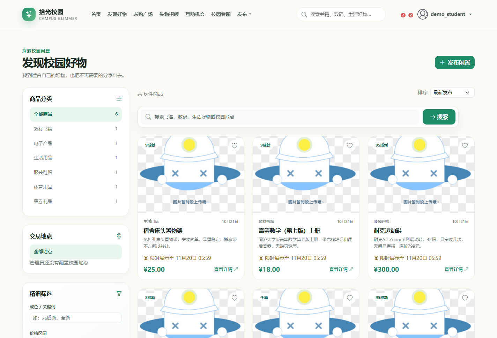
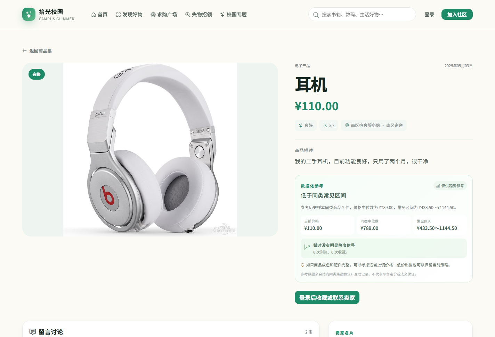
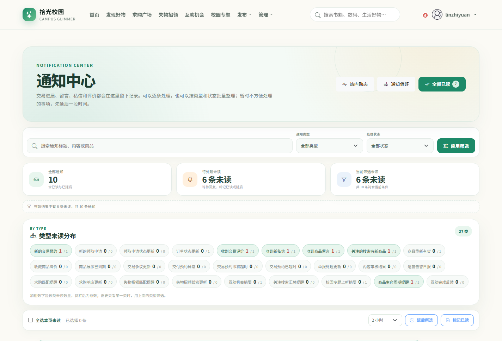
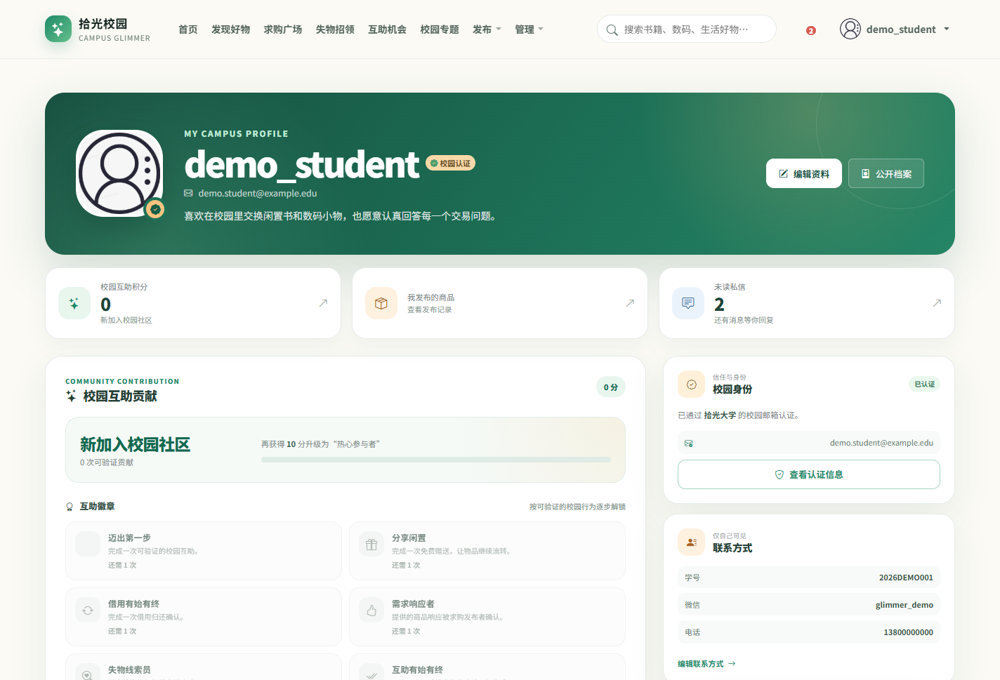
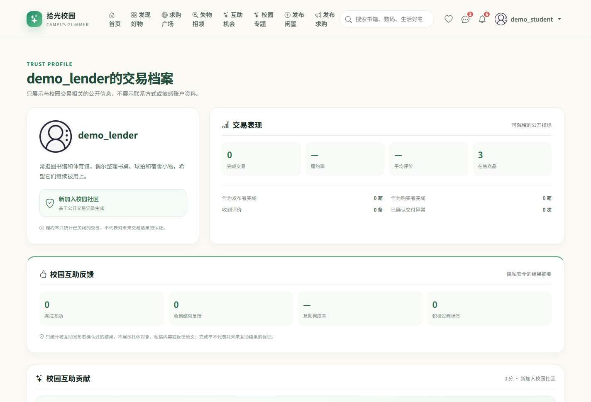
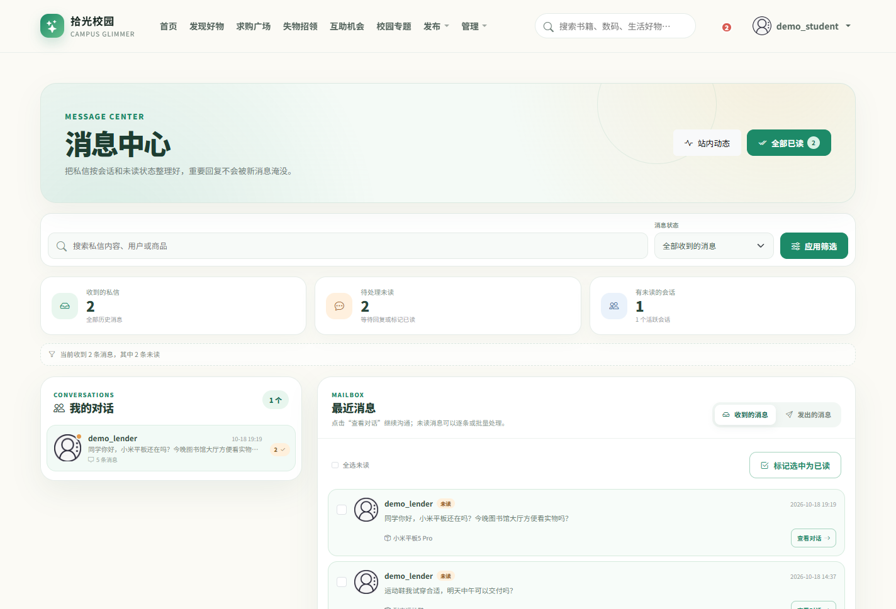
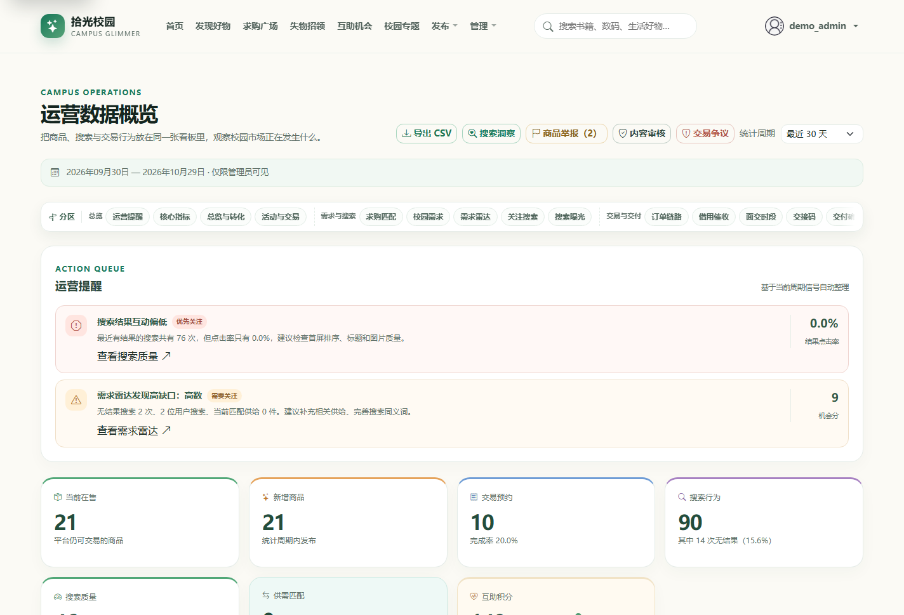

# screenshots · 系统界面预览

**九张当前主分支的真实页面截图，覆盖浏览、交易、账户、消息和运营五类入口。**

[项目首页](../../README.md) · [完整项目手册](../README.md) · [模块地图](../module-map.md)

> [!IMPORTANT]
> 所有截图均来自本地独立演示数据库。账号、商品、消息、通知和指标均为演示内容，不代表真实用户、真实成交或线上生产数据。登录页为未登录状态，登录后的页面统一使用 `demo_*` 演示身份，并已清理旧测试用户名和联系方式。

## 📸 截图画廊

  

<strong>登录与账户入口</strong> 品牌说明、账户动作与全局导航保持同一套视觉语言 · 本地演示数据

<table>
<tr>
<td width="50%" valign="top">

<strong>首页</strong> 品牌主视觉、全局导航与在售商品概览

</td>
<td width="50%" valign="top">

<strong>发现好物</strong> 关键词、分类、校园地点、成色、价格和排序

</td>
</tr>
<tr>
<td width="50%" valign="top">

<strong>商品详情</strong> 图片、交易信息、价格参考和操作入口

</td>
<td width="50%" valign="top">

<strong>通知中心</strong> 未读统计、类型分布、延后和批量已读

</td>
</tr>
<tr>
<td width="50%" valign="top">

<strong>账户中心</strong> 校园认证、可信资料、贡献进度与活动入口

</td>
<td width="50%" valign="top">

<strong>公开交易档案</strong> 公开信誉、贡献、在售商品和评价摘要

</td>
</tr>
<tr>
<td width="50%" valign="top">

<strong>消息工作台</strong> 会话整理、未读聚焦、收到与发出视图

</td>
<td width="50%" valign="top">

<strong>运营看板</strong> 管理员视角下的指标、告警和构建观测

</td>
</tr>
</table>

点击图片可查看原始尺寸。

## 📏 当前文件

| 文件 | 尺寸 | 页面与观察重点 |
| --- | --- | --- |
| [`home.png`](home.png) | `1424 × 969` | 首页；品牌主视觉、导航和商品概览 |
| [`discover.png`](discover.png) | `1424 × 969` | 发现页；关键词搜索、分类、校园地点、商品卡片和排序 |
| [`login.png`](login.png) | `1424 × 969` | 登录页；品牌信息、认证表单与全局导航 |
| [`item-detail.png`](item-detail.png) | `1424 × 969` | 详情页；图片、状态、价格、地点和价格参考 |
| [`notifications.png`](notifications.png) | `1424 × 969` | 通知中心；未读统计、类型分布和批量操作 |
| [`profile.png`](profile.png) | `1424 × 969` | 账户中心；校园认证、贡献、联系方式与活动入口 |
| [`public-profile.png`](public-profile.png) | `1424 × 969` | 公开档案；公开信誉、互助反馈和在售摘要 |
| [`inbox.png`](inbox.png) | `1424 × 969` | 消息工作台；未读统计、搜索筛选、会话与批量已读 |
| [`operations.png`](operations.png) | `1424 × 969` | 运营看板；管理员指标、告警和构建耗时 |

## 🔄 更新截图时

仓库当前不提交自动截图脚本，截图需要人工准备和复核。建议流程：

1. 使用独立演示数据库，或在确认不会污染真实数据的环境中启动项目；
2. 运行 `python manage.py migrate`，按需执行 `python init_data.py` 准备演示数据；
3. 为账户、商品、地点和通知准备同一套演示身份，避免截图之间出现互相矛盾的账号；
4. 使用无痕窗口登录演示账号，隐藏密码、令牌、浏览器书签和开发者工具；
5. 保持相同浏览器缩放与窗口宽度，当前基准视口为 `1424 × 969`；
6. 保存后逐张检查用户名、商品、通知、价格和日期是否仍为演示数据；
7. 更新本文件、根 README 以及引用截图的目录 README 描述。

## 🔐 隐私检查

- 不出现真实姓名、邮箱、手机号、学号、微信或私信内容；
- 不出现真实订单号、交付码、争议证据或运营告警；
- 不出现浏览器标签页中的个人信息、系统通知或本地路径；
- 商品图片如果来自网络，应确认可用于仓库展示；
- 截图中的功能必须与当前主分支一致，不能用设计稿或 AI 生成图冒充系统页面。

## 🗺️ 使用位置

- [根 README](../../README.md)
- [完整项目手册](../README.md)
- [accounts 说明](../../accounts/README.md)
- [chat_messages 说明](../../chat_messages/README.md)
- [listings 说明](../../listings/README.md)
- [static 说明](../../static/README.md)
- [templates 说明](../../templates/README.md)

品牌图标位于 [`../assets/brand-mark.svg`](../assets/brand-mark.svg)。
