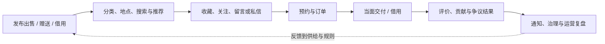

<div align="center">


# listings · 校园交易与运营核心

**从一件闲置被发布，到被发现、预约、交付、评价和被运营复盘。**

[项目首页](../README.md) · [完整项目手册](../docs/README.md) · [模块地图](../docs/module-map.md) · [功能手册](../docs/feature-handbook.md)

</div>

<p align="center">
  
</p>

<p align="center"><sub>发现页：分类、校园地点、商品状态与价格在同一入口完成筛选 · 本地演示数据</sub></p>

> [!NOTE]
> `listings/` 是仓库里最大的业务应用。模型和测试文件很多，但入口始终围绕一条主线：供给如何被发现、如何形成交易、如何被安全完成，以及运营如何理解真实需求。

## 🧭 交易主线



商品状态使用 `available / reserved / sold / expired`；订单覆盖 `pending / confirmed / meeting / completed / cancelled / borrowed / returned`。状态变化由服务端校验，不由按钮文案直接决定。

## 📸 核心页面

<table>
<tr>
<td width="50%" valign="top">
<a href="../docs/screenshots/item-detail.png"></a>
<p align="center"><strong>商品详情</strong><br /><sub>图片、校园地点、价格参考与交易操作</sub></p>
</td>
<td width="50%" valign="top">
<a href="../docs/screenshots/notifications.png"></a>
<p align="center"><strong>通知中心</strong><br /><sub>未读统计、类型分布、筛选与批量处理</sub></p>
</td>
</tr>
</table>

<p align="center">
  <a href="../docs/screenshots/operations.png"></a>
</p>

<p align="center"><strong>运营数据概览</strong><br /><sub>把供给、搜索、预约、互助和看板构建观测放在同一页，仅管理员可见 · 本地演示数据</sub></p>

> 截图均来自当前主分支的本地演示环境，不代表真实用户、真实成交或生产运营数据。
## 🗂️ 能力分组

| 方向 | 代表实现 | 用户能感知到什么 |
| --- | --- | --- |
| 商品与供给 | [`item_lifecycle.py`](item_lifecycle.py)、[`availability.py`](availability.py)、[`image_processing.py`](image_processing.py) | 出售、赠送、借用、多图、有效期、刷新额度与批量发布 |
| 搜索与发现 | [`recommendations.py`](recommendations.py)、[`saved_searches.py`](saved_searches.py)、[`price_insights.py`](price_insights.py) | 组合筛选、搜索建议、收藏搜索、价格轨迹和推荐反馈 |
| 校园专题与参与 | [`campaign_registration.py`](campaign_registration.py)、[`campaign_updates.py`](campaign_updates.py)、[`campaign_analytics.py`](campaign_analytics.py) | 专题浏览、加入与退出、参与区间、可选的新上架摘要、聚合报名人数和运营导出 |
| 求购与失物 | [`demand_matching.py`](demand_matching.py)、[`demand_radar.py`](demand_radar.py)、[`lost_found_matching.py`](lost_found_matching.py) | 求购响应、需求机会和失物招领线索匹配 |
| 订单与交付 | [`order_workflow.py`](order_workflow.py)、[`meeting_scheduling.py`](meeting_scheduling.py)、[`delivery_handshake.py`](delivery_handshake.py)、[`return_handshake.py`](return_handshake.py) | 预约、改期、签到、交付确认、借用归还与争议 |
| 通知与摘要 | [`notifications.py`](notifications.py)、[`notification_kind_coverage.py`](notification_kind_coverage.py)、[`*_digest.py`](.) | 通知中心、偏好、免打扰、延后和周期摘要 |
| 治理与安全 | [`report_priority.py`](report_priority.py)、[`governance_sla.py`](governance_sla.py)、[`dispute_resolution_quality.py`](dispute_resolution_quality.py) | 举报分级、处理时限、交付异常和争议结果 |
| 运营与数据质量 | [`analytics.py`](analytics.py)、[`dashboard_build_performance.py`](dashboard_build_performance.py)、[`task_runs.py`](task_runs.py) | 看板、导出、任务台账、趋势与样本质量 |

完整模块与测试索引见[模块地图](../docs/module-map.md)。功能口径、指标分母和边缘情况以[功能手册](../docs/feature-handbook.md)为准。

## 🚪 常用页面入口

| 路径 | 用途 |
| --- | --- |
| `/listings/` | 发现好物 |
| `/listings/search/` | 搜索结果与组合筛选 |
| `/listings/campaigns/` | 校园专题列表与聚合报名人数 |
| `/listings/campaigns/mine/` | 当前用户的专题参与记录与历史 |
| `/listings/demands/` | 求购广场 |
| `/listings/lost-found/` | 失物招领 |
| `/listings/item/<item_id>/` | 商品详情与交易入口 |
| `/listings/orders/` | 我的订单 |
| `/listings/notifications/` | 通知中心 |
| `/listings/notifications/activity/` | 通知与私信汇合的站内动态 |
| `/listings/operations/` | 运营看板，仅管理员可用 |
| `/listings/governance/` | 治理工作台，仅管理员可用 |

> 私信、留言和内容审核不在这个应用里，入口是 [`../chat_messages/README.md`](../chat_messages/README.md)。

## 🗂️ 源码速查

| 文件或目录 | 真实职责 |
| --- | --- |
| [`models.py`](models.py) | 商品、地点、订单、通知、举报、争议、搜索、求购、失物和运营模型 |
| [`views.py`](views.py) | 用户页面、交易动作、运营看板、治理和通知操作 |
| [`urls.py`](urls.py) | `/listings/` 下的全部路由 |
| [`forms.py`](forms.py) | 商品、搜索、订单、通知偏好等表单 |
| [`admin.py`](admin.py) | Django 后台维护入口 |
| [`management/commands/`](management/commands/) | 定时任务与数据回填命令 |
| [`test_*.py`](.) | 按能力拆分的回归测试，不是一个大而全的测试文件 |

## ⏱️ 定时任务

| 命令 | 用途 |
| --- | --- |
| `process_order_timeouts` | 预约超时、借用到期与逾期提醒 |
| `expire_items` | 下架到期商品并通知发布者 |
| `send_operations_digest` | 发送管理员运营告警摘要 |
| `send_opportunity_digest` | 发送互助机会摘要 |
| `send_saved_search_digest` | 发送关注搜索汇总 |
| `send_campaign_update_digest` | 发送用户主动订阅的校园专题上新摘要 |
| `send_lifecycle_reminders` | 发送商品生命周期提醒 |
| `sync_academic_calendar` | 同步学期阶段和统计快照 |
| `backfill_item_thumbnails` | 回填历史图片缩略图和响应式变体 |

参数、幂等边界和运行台账见[后台与定时任务](../docs/scheduled-tasks.md)。

## 🛡️ 实现纪律

- 订单、交付、归还和争议动作必须在服务端校验当前用户身份与当前状态；
- 交易写入优先使用事务和必要的行级锁，避免并发下重复确认；
- 看板与统计模块默认只读，不自动改写被观察的业务数据；
- 指标要明确分母、时间窗口、样本门槛和缺失值语义，样本不足时不强行下结论；
- 新能力优先拆成独立领域模块与对应 `test_*.py`，不要继续把职责堆进单一视图；
- 图片处理统一复用 `image_processing.py`，避免每个页面各写一套压缩和方向修正。

## ✅ 验证

```powershell
python manage.py test listings
python manage.py test listings.test_order_stage_flow
python manage.py test listings.test_campaign_registration listings.test_campaign_updates listings.test_campaign_analytics listings.test_campaigns
python manage.py makemigrations --check --dry-run
python manage.py check
```

测试量较大时，先运行受影响能力的单个测试文件，提交前再跑全量测试。

## 📚 继续阅读

- [功能手册](../docs/feature-handbook.md)
- [核心数据模型](../docs/data-model.md)
- [后台与定时任务](../docs/scheduled-tasks.md)
- [学期日历与交易高峰](../docs/academic-calendar.md)
- [当前取舍与边界](../docs/product-boundaries.md)
- [后续路线图](../docs/roadmap.md)
