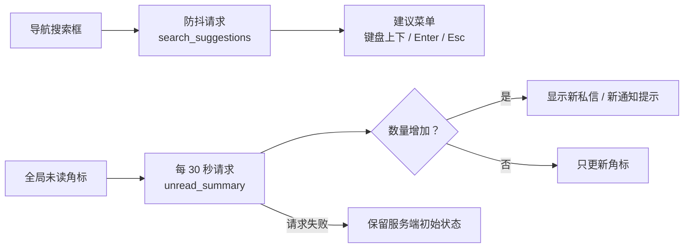

<div align="center">


# static · 样式、脚本与基础图片

**没有 Node.js 构建链，CSS、JavaScript 和基础图片由 Django 静态文件系统直接提供。**

[项目首页](../README.md) · [完整项目手册](../docs/README.md) · [模块地图](../docs/module-map.md)

</div>

<p align="center">
  
</p>

<p align="center"><sub>当前主题在主内容、筛选侧栏和商品卡片上的实际呈现 · 本地演示数据</sub></p>

## 🎨 主题语言

| Token | 色值 | 使用场景 |
| --- | --- | --- |
| `--primary` | `#1d8a68` | 主按钮、品牌图标、关键数字 |
| `--primary-dark` | `#146a50` | 主按钮悬停与深色强调 |
| `--mint` | `#e8f6ee` | 轻提示、选中态与柔和背景 |
| `--warm` | `#f6aa61` | 首页主视觉与暖色强调 |
| `--cream` | `#fbfaf5` | 页面底色 |
| `--ink` | `#15251f` | 正文与标题 |

样式入口是 [`css/style.css`](css/style.css)。新组件优先复用 `:root` 变量和现有 Bootstrap 组件，不要另起一套主题。

## 🧭 页面增强如何工作



`js/main.js` 当前承担两类增强：

1. 搜索建议的防抖、请求取消、键盘导航和失焦关闭；
2. 每 30 秒刷新私信与通知未读数，并在数量增加时显示提示。

脚本失败时，页面仍应保留服务端渲染的初始状态。新增逻辑优先限定在对应 `data-*` 容器中，不要在全局选择器上执行破坏性操作。

## 📁 目录内容

| 路径 | 作用 |
| --- | --- |
| [`css/style.css`](css/style.css) | 全站主题、布局、组件、运营页和响应式样式 |
| [`js/main.js`](js/main.js) | 搜索建议、未读角标轮询和轻量页面增强 |
| [`img/default-avatar.png`](img/default-avatar.png) | 默认头像 |
| [`img/no-image.png`](img/no-image.png) | 商品缺图占位 |

模板引用统一写 ``。生产环境由 `collectstatic` 收集到 `STATIC_ROOT`，不要手工修改收集后的文件。

## 🛠️ 修改检查

- 颜色、阴影和圆角优先复用现有主题值；
- 桌面和移动端断点都要检查，不能只在一个宽度下截图；
- 运营页面和用户页面保持可区分的视觉层级，但不要分裂成两套设计语言；
- 图片资源优先 WebP / 压缩后的 PNG，商品上传图由 `listings/image_processing.py` 处理；
- 大段样式要带用途说明，避免无法判断归属的规则继续堆积；
- 修改未读数轮询时，确认隐藏标签页不会持续请求，且 99+ 显示仍然正确。

## ✅ 验证

```powershell
python manage.py collectstatic --noinput
python manage.py check
python manage.py runserver
```

手动检查搜索建议、未读刷新、移动端导航、商品卡片和运营表格横向滚动。

## 📚 继续阅读

- [模板说明](../templates/README.md)
- [截图维护说明](../docs/screenshots/README.md)
- [完整项目手册](../docs/README.md)
