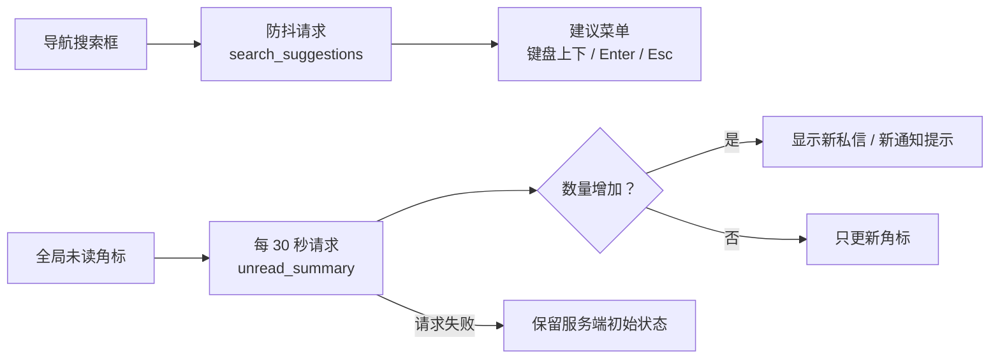

<div align="center">


# static · 样式、脚本与基础图片

**没有 Node.js 构建链，CSS、JavaScript 和基础图片由 Django 静态文件系统直接提供。**

[项目首页](../README.md) · [完整项目手册](../docs/README.md) · [模块地图](../docs/module-map.md)

</div>

<p align="center">
  
</p>

<p align="center"><sub>当前主题在主内容、筛选侧栏和商品卡片上的实际呈现 · 本地演示数据</sub></p>

## 🎨 主题语言

| Token | 色值 | 使用场景 |
| --- | --- | --- |
| `--primary` | `#187a5b` | 主按钮、品牌图标、关键数字 |
| `--primary-dark` | `#146a50` | 主按钮悬停与深色强调 |
| `--ink-soft` | `#42574d` | 次级正文、表单标签 |
| `--muted` | `#61726a` | 说明文字、脚注、时间戳 |
| `--mint` | `#e8f6ee` | 轻提示、选中态与柔和背景 |
| `--warm` | `#f6aa61` | 首页主视觉与暖色强调 |
| `--cream` | `#fbfaf5` | 页面底色 |
| `--surface` | `#ffffff` | 卡片与内容底色 |
| `--surface-soft` | `#f7faf8` | 表格悬停、输入组附件底色 |
| `--line` | `#e5ece8` | 分隔线与边框 |
| `--ink` | `#15251f` | 正文与标题 |

样式入口是 [`css/style.css`](css/style.css)。新组件优先复用 `:root` 变量和现有 Bootstrap 组件，不要另起一套主题。

## 🧩 Bootstrap 兼容层

站内仍有一批历史模板直接使用 Bootstrap 的组件类（次级按钮、徽章、表单标签、提示条、分页等）。
列表组已全部迁走，`.list-group` 规则作为兜底保留：万一将来又有模板用回这个类，不会掉回 Bootstrap 默认观感。为了让这些页面不掉回 Bootstrap 默认观感，[`css/style.css`](css/style.css) 在主题变量之后提供了一层兼容规则，把常用组件类统一映射到上面的品牌色板：

| Bootstrap 类 | 兼容后的表现 |
| --- | --- |
| `.btn-light` / `.btn-outline-secondary` / `.btn-link` | 次级操作：`--ink-soft` 文字、`--line` 边框、11px 圆角 |
| `.btn-outline-danger` / `.btn-danger` | 危险操作：`#b25548` 药丸按钮 |
| `.btn-outline-warning` / `.btn-warning` / `.btn-dark` / `.btn-outline-dark` | 与语义色板一致的强调按钮 |
| `.btn-success` / `.btn-outline-success` | 成功操作：`#1f7653` 实底或描边，与徽章成功色同源 |
| `.badge` 配 `.text-bg-*` 或 `.bg-*` | 淡底深字药丸，与 `.order-status-*` 同一套语义色 |
| `.form-label` / `.form-text` | `--ink-soft` / `--muted`，小号加粗 |
| `.form-control` / `.form-select` | 低优先级基线：`--line` 边框 + 11px 圆角，各作用域仍可继续覆写 |
| `.alert` 配 `.alert-*` | 品牌色描边与浅底，替代 Bootstrap 原色 |
| `.card` / `.card-header` / `.card-body` / `.card-footer` | 20px 圆角、`--line` 描边、柔和投影 |
| `.list-group` / `.list-group-item` | 透明底 + `--line` 分隔线 |
| `.input-group-text` / `.dropdown-divider` / `.table-hover` | 中性色板：`--surface-soft` 附加件、`--line` 分隔线与表格悬停底色 |
| `.pagination` / `.page-link` | 10px 圆角、`--primary` 选中态；`.pagination` 允许换行，长分页条不会横向溢出整页，省略号走 `.page-link-gap` |
| `.text-primary` / `.text-success` / `.text-danger` / `.text-warning` / `.text-info` / `.text-muted` | 品牌语义色 |

兼容层之前还有一处补不到的根因：Bootstrap 的 `:root` 把 `--bs-body-color`、`--bs-emphasis-color`、`--bs-border-color` 等定义成自定义属性，`body { color: var(--ink) }` 只改 body 自身的计算色，改不了这些变量本身。而 `.card`、`.dropdown-menu`、`.list-group-item`、`.accordion-button` 都直接或间接引用它们，这些位置此前一直是 Bootstrap 的中性近黑 `#212529`，表格单元格更是纯黑。所以在兼容层最前面加了一段 `:root` 覆写，把这些根变量整体对齐到品牌色板（`--ink` / `--line` / `--primary`），比一类一类补规则更稳，新增页面也自动受益。

两点实现约束：

1. Bootstrap 5.3 的 `.text-bg-*` 与 `.text-*` 自带 `!important`，覆写必须同步带上，否则不生效；
2. `.bg-*` 只收敛到 `.badge.bg-*`，不要写成 `.bg-success` 这样的全局规则，否则会误伤进度条等确实需要实色背景的元素；
3. `--bs-body-bg` 不要动。`.form-control` / `.form-select` 的背景取自它，改成米白会让输入框在白卡片上发灰，这两处只覆写边框、圆角和文字色；
4. 模板里不要再写 `bg-light` / `bg-success` 这类会被 `!important` 盖住兼容层的类，`.card-header` 和 `.progress-bar` 已有品牌规则，直接删掉多余类名即可。

### 单选 / 多选卡片组

Django 的 `RadioSelect` 与 `CheckboxSelectMultiple` 继承 `ChoiceWidget`，
`option_inherits_attrs` 为 `True`，因此 widget `attrs` 里的 `class`
会同时出现在外层容器和每一个 `<input>` 上。往这两类控件上套 Bootstrap 类不会得到预期效果：
`.form-check-input` 带 `width: 1em`，套到容器上会把整个选项组压成一颗 14px 的圆点，选项文字被挤出可视区；
`.form-control` 套上去则会把每个选项变成一个完整输入框。这两类故障页面都不报错，只有截图才看得出来。

`StyledModelFormMixin._style_fields` 因此跳过这两类控件；样式改由
`ChoiceGroupMixin` 在渲染上下文里单独注到容器上，选项本身由
`.choice-card-group` 的后代选择器绘制（和 `.status-choice-*` 同一套单选卡片语言，只是入口不同）。
新增选项组时用 `RadioCardGroup` / `CheckboxCardGroup`，不要直接往 widget attrs 上写 class。

全部模板已经不再使用 `list-group`，相应规则保留在兼容层里上下文防身；申诉列表用 `.mod-event-*`，心愿单侧栏用 `.filter-stack` + `.filter-link`，争议证据用 `.dispute-evidence-row`。

新增页面时优先使用设计系统自有类，只有复用历史结构时才依赖这层兼容。动手前先在 `style.css` 里搜一遍目标类名，确认是否已有更贴合的规则。

## ♿ 对比度基线

全站文字与图标按 WCAG AA 取值：正文 ≥ 4.5:1，图标等非文本元素 ≥ 3:1，
大字号（≥ 24px，或 ≥ 18.66px 且字重 ≥ 700）按 3:1。以下是已经收口的几条约定，改色值时不要单独突破某一项：

- **灰绿文字统一走 `var(--muted)`**。早期散落的 `#70817a` 一类灰绿在白底上只有 4.11:1，已全部收敛到 `--muted: #61726a`（白底 5.09:1）。
- **实底白字按元素类型取阈值**。白字正文的底色本身要过 4.5:1：`.conversion-stage-index` 那个 24px 小方块里放的是阶段序号（正文），四个变体 `#4c815f` / `#5d75aa` / `#9f6a31` / `#786ba7` 分别落在 4.55 / 4.57 / 4.59 / 4.71:1。而 `.opportunity-icon`（39px）、`.report-target-icon`（42px）这类容器只放 Bootstrap Icons，按非文本 3:1 判就够（3.29:1、3.14:1）。两种阈值混为一谈，要么把图标底压得发闷，要么放过了真正的正文白字。
- **`.eyebrow` 有两种形态**。基色是 `var(--primary)`，供 `page-intro` 一类浅色页面使用；深色 hero 里的反色标签由 `.hero-panel .eyebrow` 单独给 `#bdebd2`。早前基色直接写成 `#bdebd2`，而 `.eyebrow` 在 88 个模板里共出现 228 次，其中 28 次在 `page-intro` 这类浅色区块里，白底上只有 1.31:1，基本等于看不见。
- **面板脚注走 `--panel-footnote`**。`[class*="-panel"] .rewrite-candidate-footnote` 取 `var(--panel-footnote, #61726a)`；各面板在自己的规则里覆写这个变量以匹配自身渐变底。回落值故意写成字面色而不是 `var(--muted)`：那样测试才能断言“面板外也有确切默认值”，而不是一个可能被继承色覆盖的引用。它与 `--muted` 同值，改 `--muted` 时要同步（`PanelFootnoteColourTests` 会盯这件事）。
- **徽章内的图标继承徽章色**。`.campus-verified-badge i { color: inherit }`：金色变体的底色是 `#f9d8a8`，原先写死的绿色图标只有 2.42:1，继承后跟随徽章自身的 `#684a20`（5.95:1）。
- **模板的 `style` 属性里不写颜色**。行内色值是唯一同时躲过 token 扫描和静态对比度扫描的位置：`test_deployment.py` 的 `InlineStyleColourTests` 会把 `color` / `background` / `border-color` / `box-shadow` 这类属性里的字面值直接判失败，只放行 `var(...)`。几何属性（`width` / `height` / `min-width`）不在此列，按比例增长的条形图必须由视图算好后注入。真实踩过的坑：运营看板一条建议文案在模板里写了 `color:#6a7d73`，盖掉了已有的 token 规则，落在 `#fbfdfb` 上只有 4.29:1。
- **校验要用浏览器里的真实背景**。同一个色值落在不同面板的渐变底上结果并不相同，指“最深浅底”一刀切的静态扫描会同时漏报和误报：白字落在深色 hero 上会被判失失败，装饰性圆点的 `color` 也会被算进去。可靠的判法是渲染后逐元素取计算色与合成后的祖先背景，并跳过 `background-image` 为渐变的元素。

## 📦 第三方依赖本地化

Bootstrap 与 Bootstrap Icons 不再走 CDN，而是以原样文件放在 [`vendor/`](vendor/) 下，由 `templates/base.html` 通过 `` 引用。

此前 `base.html` 直接连 `unpkg.com` 和 `fonts.googleapis.com`。实测这三个请求是页面上仅有的跨域请求，且**全部阻塞渲染**：

```
fonts.googleapis.com/css2?family=Noto+Sans+SC     224ms  render-blocking
unpkg.com/bootstrap@5.3.3/dist/css/...            169ms  render-blocking
unpkg.com/bootstrap-icons@1.11.3/font/...         176ms  render-blocking
```

更实际的隐患是可用性：这两个域名在国内网络下经常不可达，一旦失败页面会退化成无样式 HTML。本地化之后首屏零跨域请求，冷缓存首屏内容绘制从 372ms 降到约 112ms。

`campus_glimmer/test_deployment.py` 里的 `VendoredStaticAssetTests` 盯着这件事，其中两类是只在生产环境才暴露的故障：

- 有人把外链加回了 `base.html`；
- vendor 文件里的 `sourceMappingURL` 或失效 `url()` 让 `collectstatic` 在 Manifest 存储下整条失败。这不是假想：Bootstrap 自带的 `.map` 注释就让生产构建直接崩掉，而本地开发用 `StaticFilesStorage` 完全看不出问题。

正文字体没有跟着本地化。Noto Sans SC 经 Google Fonts 分发时被拆成 101 个 unicode-range 分片，全量下载约 1.6 MB，对当前仓库体积不划算；改为中文优先的系统栈（苹方 / 微软雅黑 / Noto Sans CJK），零请求、零 FOUT，各平台也都有完整的中文字形覆盖，不会出现缺字方框。

## 🧭 页面增强如何工作



`js/main.js` 当前承担两类增强：

1. 搜索建议的防抖、请求取消、键盘导航和失焦关闭；
2. 每 30 秒刷新私信与通知未读数，并在数量增加时显示提示。

脚本失败时，页面仍应保留服务端渲染的初始状态。新增逻辑优先限定在对应 `data-*` 容器中，不要在全局选择器上执行破坏性操作。

## 📁 目录内容

| 路径 | 作用 |
| --- | --- |
| [`css/style.css`](css/style.css) | 全站主题、布局、账户中心、消息工作台、运营页和响应式样式 |
| [`js/main.js`](js/main.js) | 搜索建议、未读角标轮询和轻量页面增强 |

| [`img/no-image.png`](img/no-image.png) | 商品缺图占位 |
| [`vendor/`](vendor/) | Bootstrap 5.3.3 与 Bootstrap Icons 1.11.3 的本地副本，版本与升级方式见 [`vendor/README.md`](vendor/README.md) |

模板引用统一写 ``。生产环境由 `collectstatic` 收集到 `STATIC_ROOT`，不要手工修改收集后的文件。

## 🔊 语义与可访问性

样式层只解决「看得见」。读屏软件和键盘用户还要靠标签语义，而这类问题不会让页面变形，
只会让一部分人用不了——所以它们需要常驻守卫，而不是上线前人工抽查一遍。

守卫是 [`campus_glimmer/test_page_semantics.py`](../campus_glimmer/test_page_semantics.py)：
22 个测试，约 20 秒跑完，只依赖标准库（`html.parser` + 正则），不引入新依赖。它走两条路线——
静态扫全部模板，再用 Django test client 真实渲染 53 个页面（普通用户视角 + 运营视角）后复核。

| 维度 | 规则 | 为什么容易坏 |
| --- | --- | --- |
| 标题层级 | 每页只有一个 `h1`，不跳级（`h2` 后直接 `h4` 算缺陷），且开闭标签配得上 | 模板 include 片段时最常失控；改标签层级时容易只换开标签 |
| 表单标签 | 每个 `input` / `select` / `textarea` 都要有关联的 `<label for>` 或 `aria-label` | 拆模板时标签和控件被分到不同文件 |
| 可访问名称 | 每个 `a` / `button` 都要有文字或 `aria-label` | 纯图标按钮（`<i class="bi ...">`）是重灾区 |
| 图片替代文本 | 信息性图片必须写 `alt`，装饰性图片写 `alt=""` | 占位图常被顺手填成「暂无图片」 |
| 重复 id | 同一页里同一个 `id` 只能出现一次 | `label for` / `aria-labelledby` / `getElementById` 都只命中第一个，页面毫无异常 |
| id 引用完整 | `for` 和 `aria-*` 指向的 id 必须真实存在，且不能是空值 | Django 会自动拼 `aria-describedby`，模板不同步补 id 就整片悬空 |
| 触控目标 | 导航链接至少 24×24（WCAG 2.2 的 2.5.8，AA） | 压内边距时顺手把命中区域压没了 |
| 表格可访问名称 | 每张 `<table>` 都要有 `<caption class="visually-hidden">` 或 `aria-label` / `aria-labelledby` | 运营看板一屏三十张表，肉眼分不出谁是谁，读屏软件更是只能念列头 |

几条踩过的坑，写在这里省得重复：

1. **「看起来像小标题」的文字不要用 `h3`–`h6` 图省事。** 空状态、区块标签跟在列表后面，层级上属于页面主标题的下一级；只有样式需求时用 `<div class="section-label">`，不要占用标题标签。确需小字号标题时用 `h2` 配 Bootstrap 的 `.h3` / `.h5` 工具类把字号压回去——视觉不变，层级不乱。
2. **改了标题标签，必须同步 `style.css` 里的字号规则。** `.seller-profile` 里的标题从 `h5` 改成 `h2` 后，样式表显式压回了 `1.25rem`：`h2` 的浏览器默认值是 `2rem`，不写就会突然变大。
3. **条件渲染的表单最容易漏。** 求购详情页有两套表单，只有「手里有匹配商品、且还没响应过这条求购」的卖家才看得到「用这件商品响应」那一套。测试类统一以求购发布者身份登录时它根本不渲染，标签坏了也测不出来——所以用例里单独用卖家会话登录取证（`SELLER_PAGES`）。新增只在特定身份或状态下出现的表单时，请照样补一条对应视角的渲染。
4. **`alt=""` 是给装饰性图片用的**，不是「懒得写」。缺图占位图外面套了链接，所以链接本身要补 `aria-label="查看 {{ item.title }} 的详情"`；否则读屏软件会把「暂无图片」四个字当成链接名称读出来，用户听到的不是商品名。
5. **触控目标看的是命中区域，不是字号。** `.site-nav .navbar-nav .nav-link` 现在带 `min-height` / `min-width: 24px`，压 `padding-inline` 时不要把它删掉。
6. **表单的帮助文字和错误提示必须自己补 id，Django 不会替你补。** `BoundField.aria_describedby` 会按 `field.auto_id` 拼出 `id_<字段名>_helptext` 和 `id_<字段名>_error`，但渲染帮助文字的是模板——写成 `<div class="form-text">{{ field.help_text }}</div>` 而不带 `id`，引用就悬空，读屏软件一个字都读不到。正确写法是 `id="{{ field.auto_id }}_helptext"`，两边用同一套拼法。全站 19 个模板、43 处踩过这个坑。
7. **`field.id_for_label` 不保证有值，不能拿来无条件拼属性。** Django 的 `RadioSelect.id_for_label` 刻意返回空串（注释写得很清楚：不给 `<label>` 配 `for`，免得读屏软件把选项组里第一个选项当成唯一标签）。所以 `for="{{ field.id_for_label }}"` 在单选 / 多选组上会渲染出 `for=""`，`id="{{ field.id_for_label }}_helptext"` 会退化成 `id="_helptext"`——多个字段还会撞成重复 id。约定：`id_for_label` 为空即「这是个选项组」，此时用 `role="group"` + `aria-labelledby` 关联标签，拼 id 一律改用 `field.auto_id`。参考 `templates/listings/_mutual_aid_feedback_fields.html`。
8. **`<caption>` 要写成 `<table>` 的第一个子元素，前面不能混文本。** 浏览器会把 caption 之前的所有节点连同 caption 一起从表格里丢掉——所以 `<div>` 里换行再开 `<table>` 没问题，`<table>` 标签后面紧跟的只能是一个 caption 和空白。
9. **caption 上的 `.visually-hidden` 不会把表格布局带崩。** Bootstrap 专门给 caption 开了口子：只有 `.visually-hidden:not(caption)` 才绝对定位。所以可以放心用视觉隐藏把 caption 藏起来；换成 `display:none` 反而连读屏软件一起屏蔽，等于没写。项目里 `.visually-hidden` 由 `static/vendor/bootstrap.min.css` 提供，`style.css` 里没有定义。
10. **caption 文本要带面板前缀。** 运营看板 37 个分区挤一页，只写子标题（比如「字段与结构」）读屏软件念出来不知道属于哪一块。约定是「面板 · 子标题」，同一面板下无子标题时只写面板名。标题本身是模板表达式（`{{ group.kind_label }}`）的循环表格，改用 `aria-labelledby` 直接引用可见标题，文案只有一份、不会漂。
11. **页面清单漏掉表单页，等于那一页的语义检查从来没跑过。** 新增守卫维度后第一次反向验证就发现：`lost_found_form.html` 的缺陷在 264 个页面的开发期审计里能抓到，在守卫测试里抓不到——因为 `PAGES` 里根本没有「发布失物招领」。现在补齐了发布商品、发布/编辑失物招领、发布/编辑求购、批量创建、举报、发起交易。新增表单页时请顺手加进 `PAGES`。

## 🛠️ 修改检查

- 颜色、阴影和圆角优先复用现有主题值；
- 需要 Bootstrap 组件类时，先确认兼容层已覆盖；新增语义色只能扩在 `:root` 或兼容层里，不要散落到页面模板；
- 桌面、平板和移动端断点都要检查；关键页面至少覆盖 `1424px`、`1024px` 和 `390px`；
- 运营页面和用户页面保持可区分的视觉层级，但不要分裂成两套设计语言；
- 图片资源优先 WebP / 压缩后的 PNG，商品上传图由 `listings/image_processing.py` 处理；
- 新增或修改颜色后，按「对比度基线」一节复核文字 4.5:1 / 图标 3:1，并用渲染后的真实背景而不是样式表文本判断；
- 图片按**实际显示尺寸**给源，不要按原图直出。默认头像 `media/avatars/default.png` 最大只在
  `clamp(90px, 10vw, 124px)` 的账户头像位出现，导航栏里更是只有 30px，因此固定输出 256×256（覆盖 2x 视网膜）；
  它挂在每个登录页的导航栏上，之前用 749×750 的 200KB 原图，压到 256×256 后是 37KB。
  `static/img/no-image.png` 是简单占位图形，转 64 色自适应调色板后从 34KB 降到 11KB，观感无损；
- 标题层级、表单标签、可访问名称、表格名称、`alt` 和触控目标按上面「语义与可访问性」一节的规则先自查，再跑 `python manage.py test campus_glimmer.test_page_semantics`；
- 大段样式要带用途说明，避免无法判断归属的规则继续堆积；
- 修改未读数轮询时，确认隐藏标签页不会持续请求，且 99+ 显示仍然正确；
- 交互元素要保留清晰的 `:focus-visible` 状态，并检查键盘操作顺序。
- 新增单选 / 多选组用 `RadioCardGroup` / `CheckboxCardGroup`，不要往 widget attrs 写 class（类名会漏到每个选项上，见上文）；

## ✅ 验证

```powershell
python manage.py collectstatic --noinput
python manage.py check
python manage.py runserver
```

手动检查搜索建议、未读刷新、移动端导航、商品卡片和运营表格横向滚动。

## 📚 继续阅读

- [模板说明](../templates/README.md)
- [截图维护说明](../docs/screenshots/README.md)
- [完整项目手册](../docs/README.md)
