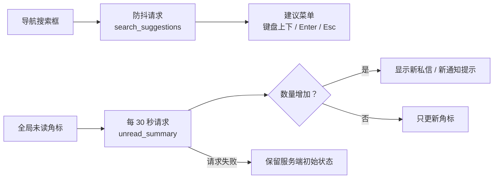

<div align="center">


# static · 样式、脚本与基础图片

**没有 Node.js 构建链，CSS、JavaScript 和基础图片由 Django 静态文件系统直接提供。**

[项目首页](../README.md) · [完整项目手册](../docs/README.md) · [模块地图](../docs/module-map.md)

</div>

<p align="center">
  
</p>

<p align="center"><sub>当前主题在主内容、筛选侧栏和商品卡片上的实际呈现 · 本地演示数据</sub></p>

## 🎨 主题语言

| Token | 色值 | 使用场景 |
| --- | --- | --- |
| `--primary` | `#1d8a68` | 主按钮、品牌图标、关键数字 |
| `--primary-dark` | `#146a50` | 主按钮悬停与深色强调 |
| `--mint` | `#e8f6ee` | 轻提示、选中态与柔和背景 |
| `--warm` | `#f6aa61` | 首页主视觉与暖色强调 |
| `--cream` | `#fbfaf5` | 页面底色 |
| `--ink` | `#15251f` | 正文与标题 |

样式入口是 [`css/style.css`](css/style.css)。新组件优先复用 `:root` 变量和现有 Bootstrap 组件，不要另起一套主题。

## 🧩 Bootstrap 兼容层

站内仍有一批历史模板直接使用 Bootstrap 的组件类（次级按钮、徽章、表单标签、提示条、列表组、分页等）。为了让这些页面不掉回 Bootstrap 默认观感，[`css/style.css`](css/style.css) 在主题变量之后提供了一层兼容规则，把常用组件类统一映射到上面的品牌色板：

| Bootstrap 类 | 兼容后的表现 |
| --- | --- |
| `.btn-light` / `.btn-outline-secondary` / `.btn-link` | 次级操作：`--ink-soft` 文字、`--line` 边框、11px 圆角 |
| `.btn-outline-danger` / `.btn-danger` | 危险操作：`#b25548` 药丸按钮 |
| `.btn-outline-warning` / `.btn-warning` / `.btn-dark` / `.btn-outline-dark` | 与语义色板一致的强调按钮 |
| `.btn-success` / `.btn-outline-success` | 成功操作：`#1f7653` 实底或描边，与徽章成功色同源 |
| `.badge` 配 `.text-bg-*` 或 `.bg-*` | 淡底深字药丸，与 `.order-status-*` 同一套语义色 |
| `.form-label` / `.form-text` | `--ink-soft` / `--muted`，小号加粗 |
| `.form-control` / `.form-select` | 低优先级基线：`--line` 边框 + 11px 圆角，各作用域仍可继续覆写 |
| `.alert` 配 `.alert-*` | 品牌色描边与浅底，替代 Bootstrap 原色 |
| `.card` / `.card-header` / `.card-body` / `.card-footer` | 20px 圆角、`--line` 描边、柔和投影 |
| `.list-group` / `.list-group-item` | 透明底 + `--line` 分隔线 |
| `.input-group-text` / `.dropdown-divider` / `.table-hover` | 中性色板：`--surface-soft` 附加件、`--line` 分隔线与表格悬停底色 |
| `.pagination` / `.page-link` | 10px 圆角、`--primary` 选中态；`.pagination` 允许换行，长分页条不会横向溢出整页，省略号走 `.page-link-gap` |
| `.text-primary` / `.text-success` / `.text-danger` / `.text-warning` / `.text-info` / `.text-muted` | 品牌语义色 |

兼容层之前还有一处补不到的根因：Bootstrap 的 `:root` 把 `--bs-body-color`、`--bs-emphasis-color`、`--bs-border-color` 等定义成自定义属性，`body { color: var(--ink) }` 只改 body 自身的计算色，改不了这些变量本身。而 `.card`、`.dropdown-menu`、`.list-group-item`、`.accordion-button` 都直接或间接引用它们，这些位置此前一直是 Bootstrap 的中性近黑 `#212529`，表格单元格更是纯黑。所以在兼容层最前面加了一段 `:root` 覆写，把这些根变量整体对齐到品牌色板（`--ink` / `--line` / `--primary`），比一类一类补规则更稳，新增页面也自动受益。

两点实现约束：

1. Bootstrap 5.3 的 `.text-bg-*` 与 `.text-*` 自带 `!important`，覆写必须同步带上，否则不生效；
2. `.bg-*` 只收敛到 `.badge.bg-*`，不要写成 `.bg-success` 这样的全局规则，否则会误伤进度条等确实需要实色背景的元素；
3. `--bs-body-bg` 不要动。`.form-control` / `.form-select` 的背景取自它，改成米白会让输入框在白卡片上发灰，这两处只覆写边框、圆角和文字色；
4. 模板里不要再写 `bg-light` / `bg-success` 这类会被 `!important` 盖住兼容层的类，`.card-header` 和 `.progress-bar` 已有品牌规则，直接删掉多余类名即可。

全部模板已经不再使用 `list-group`，相应规则保留在兼容层里上下文防身；申诉列表用 `.mod-event-*`，心愿单侧栏用 `.filter-stack` + `.filter-link`，争议证据用 `.dispute-evidence-row`。

新增页面时优先使用设计系统自有类，只有复用历史结构时才依赖这层兼容。动手前先在 `style.css` 里搜一遍目标类名，确认是否已有更贴合的规则。

## 📦 第三方依赖本地化

Bootstrap 与 Bootstrap Icons 不再走 CDN，而是以原样文件放在 [`vendor/`](vendor/) 下，由 `templates/base.html` 通过 `` 引用。

此前 `base.html` 直接连 `unpkg.com` 和 `fonts.googleapis.com`。实测这三个请求是页面上仅有的跨域请求，且**全部阻塞渲染**：

```
fonts.googleapis.com/css2?family=Noto+Sans+SC     224ms  render-blocking
unpkg.com/bootstrap@5.3.3/dist/css/...            169ms  render-blocking
unpkg.com/bootstrap-icons@1.11.3/font/...         176ms  render-blocking
```

更实际的隐患是可用性：这两个域名在国内网络下经常不可达，一旦失败页面会退化成无样式 HTML。本地化之后首屏零跨域请求，冷缓存首屏内容绘制从 372ms 降到约 112ms。

`campus_glimmer/test_deployment.py` 里的 `VendoredStaticAssetTests` 盯着这件事，其中两类是只在生产环境才暴露的故障：

- 有人把外链加回了 `base.html`；
- vendor 文件里的 `sourceMappingURL` 或失效 `url()` 让 `collectstatic` 在 Manifest 存储下整条失败。这不是假想：Bootstrap 自带的 `.map` 注释就让生产构建直接崩掉，而本地开发用 `StaticFilesStorage` 完全看不出问题。

正文字体没有跟着本地化。Noto Sans SC 经 Google Fonts 分发时被拆成 101 个 unicode-range 分片，全量下载约 1.6 MB，对当前仓库体积不划算；改为中文优先的系统栈（苹方 / 微软雅黑 / Noto Sans CJK），零请求、零 FOUT，各平台也都有完整的中文字形覆盖，不会出现缺字方框。

## 🧭 页面增强如何工作



`js/main.js` 当前承担两类增强：

1. 搜索建议的防抖、请求取消、键盘导航和失焦关闭；
2. 每 30 秒刷新私信与通知未读数，并在数量增加时显示提示。

脚本失败时，页面仍应保留服务端渲染的初始状态。新增逻辑优先限定在对应 `data-*` 容器中，不要在全局选择器上执行破坏性操作。

## 📁 目录内容

| 路径 | 作用 |
| --- | --- |
| [`css/style.css`](css/style.css) | 全站主题、布局、账户中心、消息工作台、运营页和响应式样式 |
| [`js/main.js`](js/main.js) | 搜索建议、未读角标轮询和轻量页面增强 |

| [`img/no-image.png`](img/no-image.png) | 商品缺图占位 |
| [`vendor/`](vendor/) | Bootstrap 5.3.3 与 Bootstrap Icons 1.11.3 的本地副本，版本与升级方式见 [`vendor/README.md`](vendor/README.md) |

模板引用统一写 ``。生产环境由 `collectstatic` 收集到 `STATIC_ROOT`，不要手工修改收集后的文件。

## 🛠️ 修改检查

- 颜色、阴影和圆角优先复用现有主题值；
- 需要 Bootstrap 组件类时，先确认兼容层已覆盖；新增语义色只能扩在 `:root` 或兼容层里，不要散落到页面模板；
- 桌面、平板和移动端断点都要检查；关键页面至少覆盖 `1424px`、`1024px` 和 `390px`；
- 运营页面和用户页面保持可区分的视觉层级，但不要分裂成两套设计语言；
- 图片资源优先 WebP / 压缩后的 PNG，商品上传图由 `listings/image_processing.py` 处理；
- 大段样式要带用途说明，避免无法判断归属的规则继续堆积；
- 修改未读数轮询时，确认隐藏标签页不会持续请求，且 99+ 显示仍然正确；
- 交互元素要保留清晰的 `:focus-visible` 状态，并检查键盘操作顺序。

## ✅ 验证

```powershell
python manage.py collectstatic --noinput
python manage.py check
python manage.py runserver
```

手动检查搜索建议、未读刷新、移动端导航、商品卡片和运营表格横向滚动。

## 📚 继续阅读

- [模板说明](../templates/README.md)
- [截图维护说明](../docs/screenshots/README.md)
- [完整项目手册](../docs/README.md)
