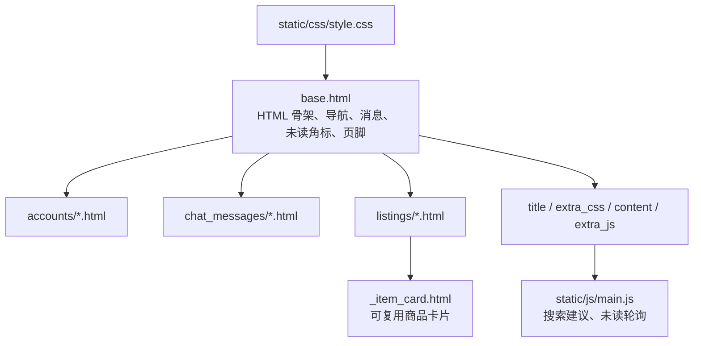

<div align="center">


# templates · 服务端渲染页面

**Django Templates 负责结构与展示，JavaScript 只做渐进增强。**

[项目首页](../README.md) · [完整项目手册](../docs/README.md) · [模块地图](../docs/module-map.md)

</div>

<p align="center">
  
</p>

<p align="center"><sub>首页由 `base.html`、`listings/home.html` 和共享商品卡片组合渲染 · 本地演示数据</sub></p>

## 🧭 模板如何组合



页面的权限、状态流转和指标口径必须在 Python 服务端完成。模板里的条件判断只优化展示，不能作为唯一安全边界。

## 📁 页面目录

| 目录或文件 | 内容 |
| --- | --- |
| [`base.html`](base.html) | 全站导航、品牌、消息提示、未读角标、页脚和公共脚本 |
| [`accounts/`](accounts/) | 账户中心、登录、资料编辑、公开主页和校园认证 |
| [`chat_messages/`](chat_messages/) | 消息工作台、会话、审核队列和申诉页面 |
| [`chat_messages/moderation_appeals.html`](chat_messages/moderation_appeals.html) | 用户侧的内容申诉，与审核队列共用 `.mod-event-*` 组件 |
| [`listings/`](listings/) | 首页、商品、搜索、订单、通知、运营看板和治理页面 |
| [`listings/_item_card.html`](listings/_item_card.html) | 商品卡片复用片段 |
| [`listings/_mutual_aid_feedback_fields.html`](listings/_mutual_aid_feedback_fields.html) | 互助结果反馈表单的字段循环，处理选项组的标签关联与帮助文字 id |

## 🧩 常用 block

| Block | 用途 | 放置建议 |
| --- | --- | --- |
| `title` | 浏览器标题 | 页面名称 + 拾光校园 |
| `extra_css` | 页面专属样式 | 只放当前页确实需要的覆盖 |
| `content` | 主内容区 | 页面主体结构 |
| `extra_js` | 页面专属脚本 | 依赖当前页面 DOM 的逻辑 |

全局导航、未读角标或页脚发生变化时，要同时检查 [`base.html`](base.html) 与 [`../static/js/main.js`](../static/js/main.js)。新增页面优先使用 ``、`` 和 ``，避免硬编码路径与资源地址。

## 🛠️ 修改检查

- 复用结构优先抽成下划线前缀片段，例如 `_item_card.html`；
- 审核队列和用户申诉是同一类内容的两端，改一边时同时看 `moderation_queue.html` 和 `moderation_appeals.html`，保持 `.mod-event-*` 结构一致；
- 运营看板已按分区拆到 `listings/operations/` 下，新增分区用 `` 挂到主模板，不要再往单文件里继续堆。一个分区要改三处才算是真的加上了：`listings/operations/_xxx.html` 写内容、`operations_dashboard.html` 里用 `<section class="ops-section" id="ops-xxx">` 包住 include、`listings/operations_nav.py` 的 `OPERATIONS_DASHBOARD_SECTIONS` 登记锚点和 chip 文案。三处少任何一处， `listings/test_operations_nav.py` 与 `listings/test_operations_deferred_sections.py` 会当场报错；
- 运营看板里单个分区**混了多个主题**才按主题再拆一层：原文件退化成只写 `` 的 umbrella，内容搬到 `_<主题>_<子主题>.html`。这样分区数、跳转条和两个守卫测试的常量都不用动；拆完拿 `git show HEAD:<文件>` 和子 partial 拼回来逐字节比对，确认一个字节都没动。判据是主题聚合度、不是体积——单一主题的分区（贡献体系、借用催收、地点档案）哪怕 28KB 也保持整块，`_demand.html` 这种一块讲供需、三块讲跟进闭环的才拆。当前最大 `_contribution.html`（约 28KB，三块同属贡献体系故未拆）；
- **新增表格必须带 `<caption class="visually-hidden">面板 · 子标题</caption>`，循环表格里标题本身是模板表达式的用 `aria-labelledby` 引用可见标题。** caption 只能是 `<table>` 的第一个子元素，前面混文本会被浏览器连同 caption 一起丢掉；`campus_glimmer/test_page_semantics.py` 的 `TableAccessibleNameTests` 常驻看守；
- 标题层级、表单标签、可访问名称、`alt`、重复 id、id 引用完整性和表格名称由 `campus_glimmer/test_page_semantics.py` 常驻看守：每页只有一个 `h1` 且不跳级，每个控件都有关联标签，图标按钮都有 `aria-label`，`for` / `aria-*` 指向的 id 都真实存在。想要小字号标题时用 `h2` 配 `.h3` / `.h5` 工具类把字号压回去，不要图省事写 `h3`–`h6`——空状态和区块标签跟在列表后面，层级上属于页面主标题的下一级；
- **表单字段循环不要直接写 `for="{{ field.id_for_label }}"`。** `RadioSelect.id_for_label` 对选项组刻意返回空串，那样写会渲染出 `for=""`；帮助文字和错误提示的 id 也要用 `field.auto_id` 拼（`<auto_id>_helptext` / `<auto_id>_error`），因为 Django 的 `aria_describedby` 就是按这个约定拼的，两边不一致引用就悬空。直接复用 `listings/_mutual_aid_feedback_fields.html`，或照它的写法写；
- 新增页面时同步把它加进 `test_page_semantics.py` 的 `PAGES`。清单漏一页，那一页的语义检查就静默失效——测试照样绿，只是从此没人管；
- 图片补齐 `alt`，装饰元素使用空 `alt` 或 `aria-hidden`；
- 表单必须保留 ``；
- 不要只靠模板隐藏按钮来保护操作，服务端仍需校验；
- 视觉改动同时查看桌面和窄屏，并确认[系统截图](../docs/screenshots/)仍能代表当前界面；
- Bootstrap、Bootstrap Icons 已本地化到 `static/vendor/`，正文字体走系统栈，新增模板不要再引入任何 CDN 资源；`campus_glimmer/test_deployment.py` 会拦住外链回归。

## ✅ 验证

```powershell
python manage.py check
python manage.py test
python manage.py runserver
```

## 📚 继续阅读

- [静态资源说明](../static/README.md)
- [截图维护说明](../docs/screenshots/README.md)
- [功能手册](../docs/feature-handbook.md)
