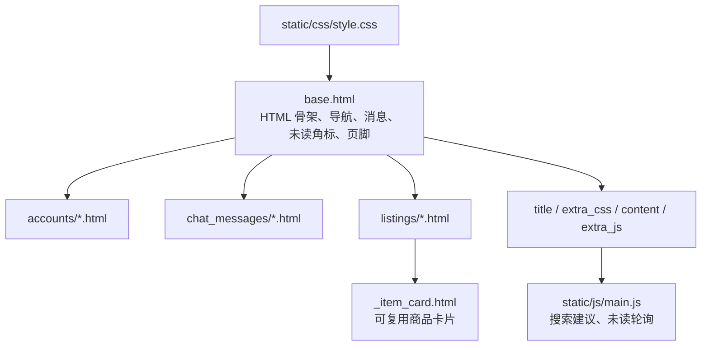

<div align="center">


# templates · 服务端渲染页面

**Django Templates 负责结构与展示，JavaScript 只做渐进增强。**

[项目首页](../README.md) · [完整项目手册](../docs/README.md) · [模块地图](../docs/module-map.md)

</div>

<p align="center">
  
</p>

<p align="center"><sub>首页由 `base.html`、`listings/home.html` 和共享商品卡片组合渲染 · 本地演示数据</sub></p>

## 🧭 模板如何组合



页面的权限、状态流转和指标口径必须在 Python 服务端完成。模板里的条件判断只优化展示，不能作为唯一安全边界。

## 📁 页面目录

| 目录或文件 | 内容 |
| --- | --- |
| [`base.html`](base.html) | 全站导航、品牌、消息提示、未读角标、页脚和公共脚本 |
| [`accounts/`](accounts/) | 注册、登录、资料、公开主页和校园认证 |
| [`chat_messages/`](chat_messages/) | 收件箱、会话、审核队列和申诉页面 |
| [`listings/`](listings/) | 首页、商品、搜索、订单、通知、运营看板和治理页面 |
| [`listings/_item_card.html`](listings/_item_card.html) | 商品卡片复用片段 |

## 🧩 常用 block

| Block | 用途 | 放置建议 |
| --- | --- | --- |
| `title` | 浏览器标题 | 页面名称 + 拾光校园 |
| `extra_css` | 页面专属样式 | 只放当前页确实需要的覆盖 |
| `content` | 主内容区 | 页面主体结构 |
| `extra_js` | 页面专属脚本 | 依赖当前页面 DOM 的逻辑 |

全局导航、未读角标或页脚发生变化时，要同时检查 [`base.html`](base.html) 与 [`../static/js/main.js`](../static/js/main.js)。新增页面优先使用 ``、`` 和 ``，避免硬编码路径与资源地址。

## 🛠️ 修改检查

- 复用结构优先抽成下划线前缀片段，例如 `_item_card.html`；
- 图片补齐 `alt`，装饰元素使用空 `alt` 或 `aria-hidden`；
- 表单必须保留 ``；
- 不要只靠模板隐藏按钮来保护操作，服务端仍需校验；
- 视觉改动同时查看桌面和窄屏，并确认[系统截图](../docs/screenshots/)仍能代表当前界面；
- 外部字体、Bootstrap 和图标来自 CDN，离线环境下应确认降级体验。

## ✅ 验证

```powershell
python manage.py check
python manage.py test
python manage.py runserver
```

## 📚 继续阅读

- [静态资源说明](../static/README.md)
- [截图维护说明](../docs/screenshots/README.md)
- [功能手册](../docs/feature-handbook.md)
